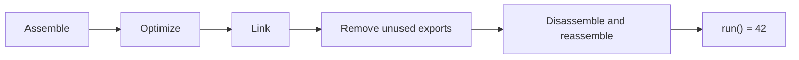

# Silmaril

Silmaril uses Lean 4 to model programs and prove properties about them. It includes
a WebAssembly toolkit with Binaryen-style commands and a library of logics,
models, lambda calculi and verified translations.

## Try the Binaryen demo

Install [elan](https://github.com/leanprover/elan), Git, GNU Make, a native C
toolchain, Python 3.11+ and Node.js 24+, or use the
[development environments](docs/development.md).

```sh
git clone https://github.com/hiloopai/silmaril-lean.git
cd silmaril-lean
make cache
make demo
```

The demo exercises all seven tools: it assembles two modules, removes dead code,
links them, keeps the selected exports, converts the result to text and back,
and checks that `run()` returns **42** in both the Lean WebAssembly interpreter
and Node.
A second example precomputes a constructor and checks that its getter returns
**9**.



The binaries are in `build/bin/`. Use their standalone names or the `sil`
dispatcher:

```sh
export PATH="$PWD/build/bin:$PATH"
sil --help
sil wasm opt --print-presets
sil wasm opt input.wasm --dce -o output.wasm
```

| Command | Operation |
| --- | --- |
| `sil wasm as` / `wasm-as` | Assemble module text |
| `sil wasm dis` / `wasm-dis` | Disassemble a binary module |
| `sil wasm opt` / `wasm-opt` | Apply selected optimization passes |
| `sil wasm merge` / `wasm-merge` | Link named modules |
| `sil wasm shell` / `wasm-shell` | Invoke an export with a step budget |
| `sil wasm ctor-eval` / `wasm-ctor-eval` | Precompute a supported constructor |
| `sil wasm metadce` / `wasm-metadce` | Remove unused exports and unreachable functions using a graph |

The tools use Binaryen-style names and flags. The [Wasm guide](docs/projects/wasm.md)
lists supported inputs, passes and proof contracts. The
[benchmark guide](docs/projects/wasm-benchmarks.md) gives reproducible comparisons
with Binaryen 133, including acceptance counts, timings and output sizes.

## Check and explore

`make check` compiles every included Lean library module, builds the tools and
correctness theorem modules, and runs the native regression suites. The semantic
proofs cover pure toolkit functions; the [Wasm guide](docs/projects/wasm.md#what-the-proofs-mean)
explains their execution models and assumptions.

The library and tools share one Lake project. Compiler contracts and verified
translations provide the common API for composing transformations across
representations. Selected APIs separate definitions and theorem statements from
longer proofs under `Silmaril/Proofs/`.

- [Wasm tools and demo walkthrough](docs/projects/wasm.md)
- [WAT quotations in Lean](docs/projects/wasm-wat.md): `wat1!`, `watLime!`, `wat3!` and expression forms
- [Versioned Wasm execution models](docs/projects/wasm-semantics.md)
- [Compiler and pass APIs](docs/projects/compilers.md)
- [Institutions and logics](docs/projects/logic.md): HOL, Metamath, ZF/ZFC,
  arithmetic and Hets-style development graphs
- [Lambda cube and parametricity](docs/projects/lambda-cube.md): all eight pure type systems,
  System F/Fω models, free theorems and institution graphs
- [Linux process promotion](docs/projects/process.md): LPS syscall semantics,
  ELF/musl launch models, x86/RV64 slices and probe provenance
- [SHA-256 process demos](docs/projects/sha256sum.md): the freestanding
  `sha256-cli` filter and `sha256sum-min`, a libc-free reimplementation of GNU
  coreutils 9.4 `sha256sum`, each proved end to end from its executable bytes
- [Library design](docs/design.md) and [contributing rules](AGENTS.md)
- [Bibliography and artifact hashes](references.bib)

## Coming next

Wasm led the first release. Further releases will add game semantics, broader
x86 and RISC-V coverage, C semantics and compilers, and more. These will
arrive in follow-up releases with their own guides, examples and proof contracts.
The [project index](docs/projects/README.md) tracks the public developments;
the [x86 roadmap](docs/projects/x86.md) describes the path from assembly proofs
to whole-program input/output specifications.

Original contributions use [MIT](LICENSE). Upstream-derived material retains
its applicable terms and [notices](NOTICES). Dependencies are pinned public
repositories.
