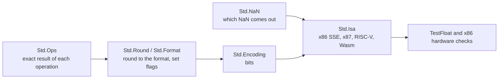
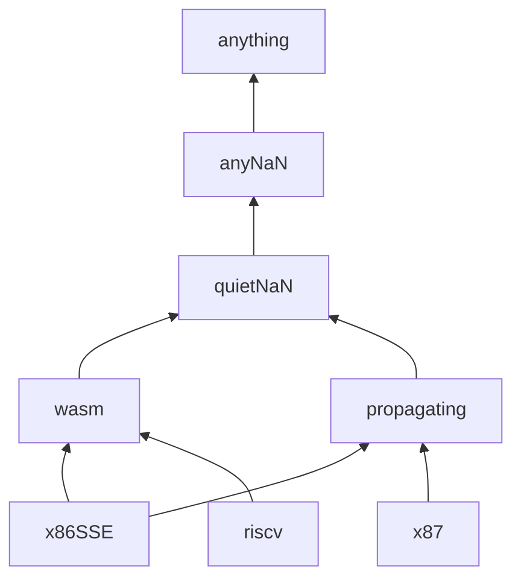
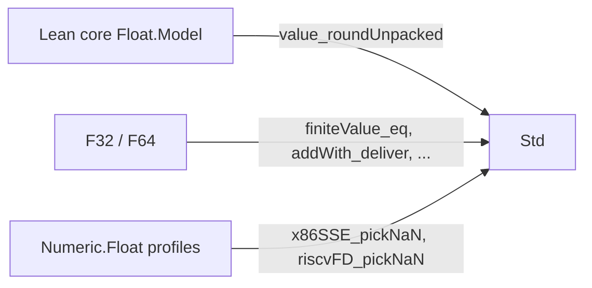

# The `Std` IEEE 754-2019 core

Status: this page describes the `Std` modules. They are not yet in this
repository; today `Silmaril.Numeric.Ieee754.Std` re-exports
`Silmaril.Numeric.Ieee754.Exact`.

`Silmaril.Numeric.Ieee754.Std` is one IEEE 754-2019 binary floating-point core
with four parts:

- a **specification**: what each operation must return, and which flags it
  raises;
- an **implementation** that runs, proved to return exactly the specified
  result;
- **variants** for the choices the standard leaves to the hardware, with proofs
  of which variant contains which;
- **tests** against Berkeley TestFloat 3e and real x86 instructions.

The older models (`Numeric.Ieee754` `F32`/`F64`, and `Numeric.Float` profiles)
stay as they are; the bridges below connect them to `Std`.



## Modules

| Module | Contents |
| --- | --- |
| `Std.Round` | Rounding to a grid of representable numbers (`Grid.RoundMag`), its uniqueness, and the executable `Grid.roundMagQ` (`roundMagQ_spec`). |
| `Std.Format` | Formats: binary16/32/64/128, bfloat16, x87 80-bit extended and the x87 precision-control formats. Rounding with flags (`Deliver`); `deliver_iff` says the executable `deliverQ` gives the only allowed answer. |
| `Std.Ops` | Exact results of add, sub, mul, div, fma, remainder, round-to-integer, format and integer conversions, and comparisons, including NaN, infinity and signed-zero rules (IEEE §§5–7). |
| `Std.IntegerRound`, `Std.Sqrt` | Rounding to integers (`roundIntMag`), and square root (`sqrtQ_spec`). |
| `Std.Encoding`, `Std.EncodingCorrect` | Bit encodings for every format, including the x87 extended classes (pseudo-denormal, unnormal, pseudo-infinity, pseudo-NaN). Non-NaN results are encoded faithfully (`decode_encode_fin`). |
| `Std.NaN` | NaN rules as a lattice (`NaNSpec`); `runOp_spec_iff`: an ISA's operation is the only output its NaN rule allows. |
| `Std.Isa`, `Std.Chaos` | ISA profiles; "chaos" variants that allow any value where hardware state is unknown (MXCSR flush bits, x87 encodings). |
| `Std.CoreBridge`, `Std.WasmBridge` | Proved links to `Float.Model`, `F32`/`F64` and WebAssembly. |
| `Std.TestFloat`, `Std.Vectors`, `Std.KernelExamples`, `Std.Bridge`, `Std.BridgeTests` | TestFloat checker, sample vectors, kernel-checked examples and executable cross-checks. |

## How an operation is specified

1. `Std.Ops` gives the exact result: a NaN, an infinity, or an exact number.
2. `Deliver` rounds it in one of the five directions, including
   `roundTiesToAway`. Subnormals are part of the grid, so gradual underflow
   needs no special case. Results above the largest finite number overflow.
3. The flags `inexact`, `overflow` and `underflow` are set. Tininess (for
   underflow) is a parameter: before or after rounding.
4. `RoundSpec.unique` shows the answer is unique; `deliver_iff` shows the
   executable `deliverQ` computes it.

At the bit level, `OpSpec` fixes the output and flags, and leaves a NaN result
to the NaN rule.

## Variants

Where IEEE 754 leaves a choice open, each choice is a parameter. A "chaos"
variant allows every choice, and each exact variant is proved to be inside it.
A theorem that assumes only the chaos variant holds on every ISA.

The NaN rules form this lattice (an arrow means "is contained in"):



Proved non-inclusions: `riscv` is not in `propagating`, `quietNaN` is not in
`wasm`, `x86SSE` is not in `riscv`. `OpSpec.mono` moves an operation's
specification up the lattice. For `fma`, SoftFloat's x86 rule and x87 replace an invalid
`∞ × 0` by the default NaN first (`Isa.fma_x87_not_propagating`).

| Choice | Variants | Containing variant |
| --- | --- | --- |
| Tininess | before or after rounding | parameter; x86 and RISC-V use after |
| `fma(∞, 0, qNaN)` | x86 hardware: quiet addend; SoftFloat x86 and RISC-V: invalid | `FmaChaos` (`Isa.fma_fmaChaos`) |
| Invalid float→integer | x86 indefinite, RISC-V saturate, Arm/Wasm saturate with NaN→0 | `ToIntChaos` |
| min/max | x86 `MINSS/MAXSS`, IEEE 2008 and 2019 rules | `MinMaxChaos` (`minMax_chaos`) |
| x87 odd encodings | hardware or SoftFloat reading | `ReadingAny` (`readingChaos_le_readingAny`) |
| MXCSR DAZ/FTZ | exact for `DAZ = FTZ = 0`, otherwise may flush to zero | `Mxcsr.Unknown` (`Mxcsr.spec_le_unknown`) |

## What is proved and tested

| Operation | Proved | TestFloat (level 1) | x86 hardware |
| --- | --- | --- | --- |
| add, sub, mul, div | `runOp_spec_iff` | f16/f32/f64/f128, extF80 | f32/f64 SSE, extF80 x87 |
| fma | as above, both `fma(∞,0,qNaN)` variants | every 32nd vector, plus every NaN vector | f32/f64 FMA3 |
| sqrt | `sqrtQ_spec` | all formats | f32/f64, extF80 |
| remainder | `runOp_spec_iff` | all formats | extF80 (`FPREM1`) |
| round to integer | `roundIntMag_spec`, `roundIntMag_unique` | all formats and directions | f32/f64, extF80 |
| format conversion | `convert_spec` | all pairs | f32↔f64, f32↔f16 |
| integer → float | `ofInt_spec` | i32/ui32/i64/ui64 | i32/i64 → f32/f64 |
| float → integer | `roundIntMag_spec`, `ToIntChaos` | all formats | f32/f64 → i32/i64 |
| compare | definition | all predicates | f32/f64, extF80 |
| min/max | `MinMaxChaos` | (none in TestFloat) | f32/f64 |

## Bridges to the older models



- `Std.CoreBridge.value_roundUnpacked`: the rounding step of `Float.Model` is
  `Std` rounding.
- `Std.CoreBridge.finiteValue_eq`: the `F32`/`F64` decoder agrees with `Std`'s.
- `F32.addWith_deliver` (and sub, mul, fma, and `F64`): for finite inputs
  without overflow, in every direction, the result has the value `Std` allows.
- `Std.ProfileBridge`: the x86 SSE and RISC-V profiles pick the same NaN as
  `Isa.x86SSE` and `Isa.riscv`; without flushing, their arithmetic has the
  same value as every `Isa`.

`Bridge.agreeProfile` and `Bridge.agreeCore` check the same agreement bit for
bit on test vectors, in `Std.BridgeTests` at build time and in
`scripts/ieee754/BridgeCheck.lean` on full vector sets.

## Running the tests

SoftFloat 3e and TestFloat 3e are built outside the repository from these
pinned GitHub archives:

| Source | Commit | Archive SHA-256 |
| --- | --- | --- |
| `ucb-bar/berkeley-softfloat-3` | `b64af41c3276f97f0e181920400ee056b9c88037` | `faae889814ea6a292f7ca03d9b36e6c7e95bab2a64777804883cc822b8d48757` |
| `ucb-bar/berkeley-testfloat-3` | `06b20075dd3c1a5d0dd007a93643282832221612` | `38ea6ca7727ba5f22f53cf35128bb74cc5fde9ffbb02d87b01a7499e9e25f122` |

Build each three times, with `SPECIALIZE_TYPE=8086-SSE` (x86 SSE), `RISCV` and
`8086` (x87), then run:

```
scripts/ieee754/testfloat-check.sh sf8086SSE <tf-8086-SSE>/testfloat_gen OUT [JOBS] [MULADD_STRIDE]
scripts/ieee754/testfloat-check.sh riscv     <tf-RISCV>/testfloat_gen    OUT
scripts/ieee754/testfloat-check.sh x87       <tf-8086>/testfloat_gen     OUT
scripts/ieee754/x86-hw-check.sh <tf-8086-SSE>/testfloat_gen OUT
scripts/ieee754/fma-nan-check.sh x87 <tf-8086>/testfloat_gen OUT "f32 f64"
scripts/ieee754/fma-nan-check.sh x86hw <tf-8086-SSE>/testfloat_gen OUT "f32 f64"
lake env lean --run scripts/ieee754/BridgeCheck.lean OUT/manifest.txt
```

- `testfloat-check.sh` checks result and flags for every operation, direction
  and format, plus tininess-before-rounding mul and div.
- `fma-nan-check.sh` checks every `fma` vector with a NaN input.
- `x86-hw-check.sh` reruns the inputs on this machine's SSE, AVX, FMA3, F16C and
  x87 instructions (four directions; x86 has no ties-to-away) and compares
  with `Isa.x86SSE` and `Isa.x87`.

## Scope

- `Isa.x86SSE` assumes `DAZ = FTZ = 0`; use `Mxcsr.Spec` or `Mxcsr.Unknown`
  otherwise.
- `Isa.x87` matches the x87 FPU on the 80-bit format and the precision-control
  formats. On binary32/64 it is SoftFloat's `8086` functions.
- x87 precision control is available as formats, not as a mode.
- `rem` is `FPREM1` on x87; SSE/AVX and RISC-V have no such instruction.
