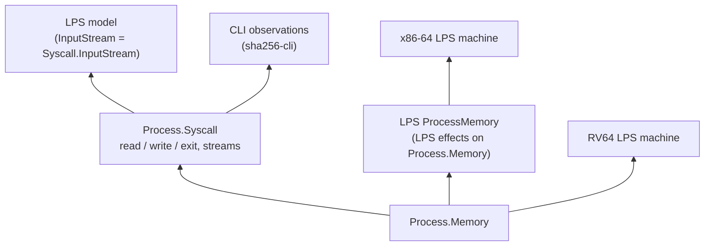

# Process memory, I/O contracts, and observable traces

`Silmaril.Process` is the shared layer under every process model in this
repository. It gives:

- **Memory** (`Process.Memory`): byte-addressed regions with read, write and
  execute permissions.
- **I/O contracts** (`Process.Syscall.Step`): what a completed `read`, `write`
  or `exit` may do to memory and to byte streams.
- **Traces** (`Machine.Trace`): finite observed runs, and refinement between
  machines that emit the same events.

The layer does not depend on an instruction set, so each machine plugs into it:



- The x86-64 and RV64 LPS machines keep user memory as a `Process.Memory`
  (`Process.LPS.Machines.ProcessMemory`, `RiscV.LPS.Machine`).
- LPS input streams are `Process.Syscall.InputStream` (`Process.LPS.Stream`).
- The `sha256-cli` statements observe a run through `Process.Syscall.Event`s
  (`Process.CLI.Observation`).

The full Linux model, with 90 system calls, is described in
[`LPSProcess.md`](LPSProcess.md).

## Memory

- An access is checked over its whole span, which must not wrap around.
- A successful write keeps the mapping table and every byte outside the
  written interval.
- `Memory.WellFormed`: regions are aligned and disjoint, and every mapped byte
  has a value. Installing the initial bytes and checked writes both keep it
  (`writeBytes_wellFormed`).

## Read, write and exit

`Syscall.Step` allows every outcome Linux can produce for these three calls:

- `read`: a short positive count, end of file, a zero-length request, or an
  error. An error may change bytes inside the requested buffer and consume part
  of the input, so proofs handle errors without assuming the buffer is intact.
- `write`: the accepted bytes are recorded in order, as output events.
- `exit`: ends the process and records the low eight bits of the status.

An input stream is fixed in advance, read through a cursor, and may be finite
or infinite. Descriptor modes, other descriptors and memory outside the allowed
write span stay unchanged.

## Linux environment

The contracts match a Linux process that:

- has one thread, and private mappings and file descriptors;
- has no other process writing its memory;
- receives no asynchronous signals, and ignores or blocks `SIGPIPE` (so a
  write to a closed pipe returns an error).

Calls may block; a trace records only the calls that completed.

## Traces

`Machine.Trace` records finite runs that emit lists of events. `Refines`
quantifies over every implementation step, so it cannot pick a favourable
environment response; `Refines.trans` composes refinements.

```sh
lake build Silmaril.Process.Memory Silmaril.Process.Syscall Silmaril.Machine.Trace --wfail
```
