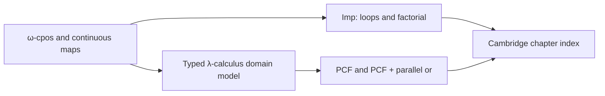

## Denotational semantics

The Part II course follows Meven Lennon-Bertrand's *Lecture Notes on
Denotational Semantics*, version of December 5, 2024, building on notes by
Pitts, Winskel and Fiore. The chapter modules preserve item numbers and
printed-page references, so readers can work from a theorem or exercise in
the notes to its Lean statement.

```sh
lake build Silmaril.Courses.Cambridge.DenotationalSemantics
```

The course index is a leaf over reusable libraries. Its imports are restricted
to the developments used by the wrappers; the course does not pull in separate
game-semantics or categorical-model developments through broad umbrellas.



| Chapter | Checked material |
| --- | --- |
| `Introduction` | Partial-function denotations for Imp, loop unfolding, the factorial loop's finite approximants and final result, agreement with big-step execution |
| `LeastFixedPoints` | Partial orders, chains and least upper bounds; finite/discrete/flat examples and counterexamples; ω-continuity; Kleene's least fixed-point theorem |
| `Constructions` | Flat lifting, products, function spaces, evaluation, currying, composition, continuity of the fixed-point operator and threshold predicates |
| `ScottInduction` | Admissible predicates and closure rules; fixed-point induction; the factorial nonnegativity invariant; counterexamples for images and separately chain-closed slices |
| `PCF` | Intrinsic/extrinsic typing correspondence, typed substitution, call-by-name evaluation, determinism, big-step/small-step correspondence, call-by-value comparison and defined-result simulation for partial recursive functions |
| `Denotation` | Continuous interpretation of terms, substitution and context compositionality, operational soundness and semantic equality implying contextual equivalence |
| `Adequacy` | The formal approximation relation, its fundamental lemma and Scott-induction fix case; ground-type adequacy; contextual tests and extensionality |
| `FullAbstraction` | Parallel-or undefinability in PCF; a concrete failure of full abstraction; full abstraction for PCF + parallel or, including open terms and the contextual preorder; first-order stability, finite Boolean fragments and closed-term applicative bisimilarity |

**PCF** is a simply typed functional language with natural numbers, booleans,
conditionals and general recursion. **Parallel or**, written `por`, can return
true when either argument is true even if the other diverges. The library
uses a Boolean flag: `Term false` is PCF and `Term true` additionally has
`por`. Application is call by name; big-step evaluation relates closed terms
to values. The `Part` domains used for numbers and booleans include an
undefined element, written `⊥`.

The theorem statements distinguish three useful contracts:

- **Soundness:** evaluation to a value preserves the denotation.
- **Ground adequacy:** at natural-number and Boolean types, a term denoting a
  value evaluates to that value.
- **Full abstraction:** semantic equality agrees with contextual equivalence,
  where every closing program context observes ground results. The corresponding
  preorder agrees with the semantic order.

`example19` simulates every defined result of a partial recursive function.
For total recursive functions this gives computation at every input; the
current `Realizes` predicate imposes no condition at undefined inputs.

Soundness and ground adequacy cover both PCF variants. For sequential PCF,
`theorem41` gives two contextually equivalent closed terms with different
function-space denotations, and `theorem41_not_fullyAbstract` records the
consequence. A `por` context distinguishes their embeddings. For PCF + `por`,
`theorem42`, `theorem42_fullyAbstract`, `theorem42_le_closed` and `theorem42_le`
prove equality and order correspondences for closed and open terms.

The full-abstraction proof constructs an increasing sequence of finite
idempotent deflations on each semantic type. Each element is the supremum of
its projected approximations, and each approximation is definable by a PCF +
`por` term. `TypedLambda.Observation.denote_le_of_ctxLe` then derives the generic
order-reflection argument from density and ground reflection. The proof uses
ω-chains; it does not require an identification of these finite projections
with compact elements.

Reusable entry points are:

- `Silmaril.Semantics.Domain`: ω-cpos, least fixed points, continuity,
  flat/product/function domains, Scott induction, bounded completeness,
  finite projections, Sieber's ternary relation and order-theoretic stability.
- Modules under `Silmaril.Calculi.TypedLambda`, including `.Denotation`,
  `.LogicalRelation`, `.FullAbstraction`, `.Finite`, `.Stability` and
  `.Applicative`, extend the signature-parametric syntax with continuous
  domain models, logical relations and observation results. Import the
  individual extension modules to use these APIs.
- `Silmaril.Calculi.Imp`: the integer-state while language and the factorial
  example, whose denotation agrees with big-step execution.
- `Silmaril.Calculi.PCF`: syntax and operational semantics for both flags,
  morphisms, domain semantics, soundness, adequacy and the concrete
  full-abstraction results.

An **ω-cpo** supplies least upper bounds for increasing countable chains; a
**domain** here additionally has a least element. A **continuous** map is
monotone and preserves those suprema. **Admissible** predicates contain the
least element and are closed under chain suprema. These are the exact domain
notions used by the library.

The closing background topics are deliberately distinguished from the results
above. `por_not_stable` and `pcf_bool₂_stable` concern uncurried first-order
Boolean maps. They do not construct a cartesian closed category of stable
functions or a dI-domain model. Finiteness of the Boolean-fragment domains and
contextual-equivalence quotients is proved; Loader's undecidability theorem is
background. The applicative-similarity/bisimilarity correspondence covers
closed terms. The second example of the notes' Remark 14 remains unindexed.

The chapter statements identify several corrections or explicit restrictions
relative to the cited edition:

| Printed location | Checked statement |
| --- | --- |
| p. 10, factorial approximation table | The displayed formula is stated for `n ≥ 1`; the zeroth approximation is undefined everywhere |
| p. 28, Proposition 15 | For `f : E → F` and `g : D → E`, composition applies `f` after `g` |
| p. 30, Exercise 5 | The constant alternative includes the undefined input; constancy only on defined inputs is insufficient |
| pp. 34–35, Example 16 | The positive-guard case applies the recursive approximation `w` to the updated state before using its invariant |
| p. 46, Remark 8 | Joint divergence is stated for closed terms of ground type, where the empty context is an observation |
| p. 22, Exercise 3 | The Imp guard is total because expressions terminate; the wrapper states that specialization explicitly |

The cited composition, constancy, factorial-approximation and invariant
formulas were checked against rendered pages of the source PDF. Its
bibliography record carries SHA-256
`fd34a46f6cc1039f10668bb5e8a1ff509fba28cd172162cdbe8408ff4553517f`.
The numbered index documents its own scope instead of claiming every
background discussion in the notes as a theorem of this development.
