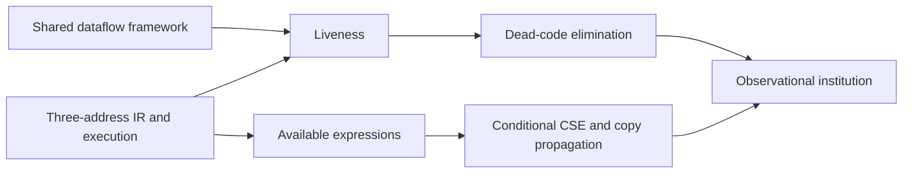

# Optimising Compilers coursework

The Cambridge Part II *Optimising Compilers* development follows the Lent 2025 course by Tobias Grosser and Timothy M. Jones. It includes a three-address intermediate representation (IR), dataflow analyses, verified transformations, higher-level analysis models and worked exercises. The code keeps the course's examples close to their proofs; shared dataflow and compiler APIs remain outside the course tree.

```sh
lake build Silmaril.Courses.Cambridge.OptimisingCompilers.Course
```

Import the course umbrella, or select a module beneath `Silmaril.Courses.Cambridge.OptimisingCompilers`.



Arrows in this diagram show dependencies. Institution comorphisms are described separately below.

## A useful first example

`Exercises.S1Q1` computes the live-variable sets of a ten-node program, proves exactly which instruction each of two DCE iterations removes, and proves that the original program has the same outputs, returned values and final memory as `return x + 2`, for every initial state. The final simplification is a proved equality of behaviors; it is not claimed to be the automatic output of DCE alone.

`Flowgraph.dceWith_obsEquiv` proves DCE correct for any safe supplied liveness assignment. `Flowgraph.dce_obsEquiv` instantiates it with the verified liveness algorithm, and `dce_iterate_obsEquiv` permits any finite number of repetitions. A counterexample shows why repeating DCE can remove further instructions.

## Results and scope

| Area | Proved result and boundary |
| --- | --- |
| Flowgraphs and blocks | Deterministic small-step execution; unreachable-node elimination preserves observations; cyclic basic blocks are unique only up to rotation. |
| Dataflow and liveness | Shared lattice-based equations, least solutions and iteration; syntactic liveness contains semantic liveness; computed liveness is safe. |
| DCE | Removes dead ALU, move and load results by replacing instructions with NOP. Preserves output-prefix sets and halting outcomes from every configuration. |
| CSE | Behavior preservation with a fresh temporary, selected sites where the expression is available and computed, and an entry without predecessors. |
| Copy propagation | Behavior preservation at selected sites certified by the copy analysis, with an entry without predecessors. |
| Register allocation | A coloring of the interference graph preserves observations when initial live values agree. The Chaitin-style algorithm's successful results are valid colorings; no optimality, completeness or spilling theorem is claimed. |
| Code motion | Partial-availability and anticipation analyses, plus a verified loop-hoisting example. This is not a generic PRE implementation. |
| SSA | Straight-line assignment conversion produces fresh versions and preserves current variable values. Phi graphs and worked examples are separate; general CFG-to-SSA conversion is not supplied. |
| Strength reduction | Algebraic simplification over integers and a counted-iteration loop theorem with distinct induction/result variables and a body-preservation hypothesis. |
| Abstract interpretation | Sound sign and interval operations and examples, using shared fixed-point transfer machinery. |
| Higher-order analyses | Strictness transfer from monotone safe primitive analyses; least solutions of 0CFA constraints; derivation-directed inference-model soundness; effect containment for evaluated closed terms. The 0CFA module does not prove operational soundness against a lambda-calculus evaluator. |
| Points-to | Andersen constraint solutions are safe in the supplied pointer language; Steensgaard-style models refine those constraints. Null loads/stores are no-ops in this model, not C undefined behavior. |
| Scheduling | Valid permutations preserve register values, memory and output under `runBlock`; greedy list scheduling respects dependencies. The block semantics ignores control-flow successors and skips exit instructions. No speedup or optimal-stall theorem is claimed. |
| Farboo | Supported programs compile to terminating three-address code with correct non-temporary variables. Canonical supported programs round-trip through the decompiler. Support excludes division, source names beginning `%`, and loop bodies assigning their counter; canonical sequences associate to the right. |

**Execution model.** Values and addresses are mathematical integers. Memory is a total map from addresses to integers; loads do not fault. Variables and memory are separate. Calls, indirect branches, finite-width overflow, concurrency and an executable machine-code backend are outside this IR. Observations contain finite output prefixes and, for halting runs, returned values and final memory. There is no separate divergence token or timing observation.

## Institution interfaces

An institution packages signatures, sentences, models and satisfaction. Here signatures are register files with injective register renamings; all model categories are discrete. Four views reuse the existing semantics:

| View | Sentences | Models |
| --- | --- | --- |
| State assertions | Register/memory comparisons and Boolean combinations | Initial states |
| Transitions | Instructions, source assertions and Hoare-style conditions | Individual transitions |
| Relational | Assertions about either side and lockstep agreement | Pairs of transitions |
| Observational | Program behavior equations and inclusions | Initial states |

There are actual comorphisms from assertions to transitions (read an assertion at the source) and transitions to the relational view (read a sentence on the left). A flowgraph's transition theory has exactly its execution steps as models. Safe liveness yields relational lockstep consequences, and the DCE proof yields the corresponding consequences for the original/transformed pair.

A sound transformation gives a corridor of the observational room. A sound family natural under injective register renamings gives an institution endocomorphism; DCE is a constructed instance. Register allocation may merge registers and therefore is not generally a signature morphism: its correctness remains conditional on a valid coloring for the particular program. No equivalence or invertibility of optimization passes is claimed.

`Passes` also packages a proved sound transformation as the shared `PassAPI.Pass`.
Its `observationalContract` requires equality of behavior for every initial state,
and `dcePass` is constructed from the existing DCE proof. Shared pass pipelines and
finite repetition therefore preserve the same course behavior. This is an
endomorphism API; optimization passes need not be invertible.

## Exercises and coverage

There are 29 exercise modules. Twenty-two contain Lean definitions or theorems; four are discussion-only (`S4Q2`, `S4Q3`, `S4Q15`, `S4Q16`), and three point to past-paper questions whose answers are not formalized (`S4Q6`, `S4Q7`, `S4Q20`). `S4Q1` formalizes a phase-order example by reusing the DCE non-idempotence theorem. The class-hierarchy-analysis section is a literature pointer and has no dedicated formalization.

The development covers representative results from every substantive course section, not every possible compiler optimization or every exercise solution.

## Sources

The handout combines notes on PDF pages 1–41 and slides on pages 42–131. Page references in the Lean modules identify locations in that artifact. The exercise sheets, three-address summary and supplementary constraint-analysis notes are cited separately. Their exact SHA-256 hashes and public retrieval URLs are recorded in the bibliography; source PDFs are not distributed here.

Primary artifact: *Optimising Compilers (Computer Science Tripos Part II, Lent 2025): handout and slides*, Grosser and Jones, 2025, SHA-256 `851cd8493a1f35eb0814f263b23d5067b24abdb01a0c97f41ec7a05bedf56daf`.
