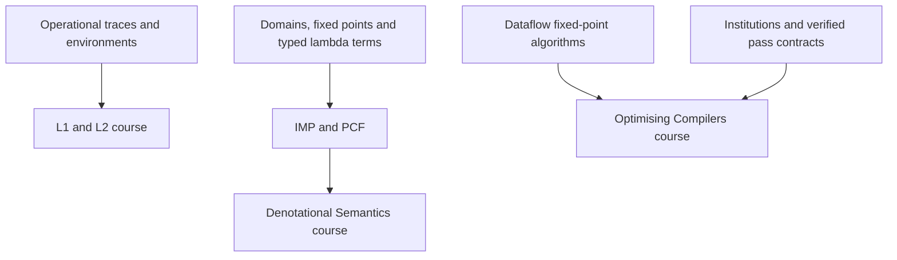

# Cambridge courses

These developments follow three Cambridge courses, with source references,
numbered results and exercises. Course proofs stay near their definitions when
that makes the argument easier to follow. Each course is a library leaf:
reusable foundations sit beneath it, and other library regions do not import it.

| Course | Included development | Guide |
| --- | --- | --- |
| Semantics of Programming Languages, Part IB | L1 imperative language; L2 functions and recursion; type inference, progress and preservation; evaluation strategies and interpreters | [Operational semantics](cambridge-operational.md) |
| Denotational Semantics, Part II | Domains and fixed points; IMP; PCF semantics and adequacy; failure of full abstraction for PCF and full abstraction with parallel-or | [Denotational semantics](cambridge-denotational.md) |
| Optimising Compilers, Part II | Three-address flowgraphs; dataflow analysis and scoped optimization proofs; institution models and verified-pass adapters; exercise sheets 1–4 | [Optimising compilers](cambridge-optimising.md) |

The guides distinguish proved results, executable examples, conditional
interfaces and discussion exercises. This collection follows selected course
materials; it does not cover the whole Cambridge curriculum.

## Check the courses

Use the repository's [development environment](../development.md), or install
the tools listed in the [README](../../README.md).

```sh
make cache
lake build Silmaril.Courses.Cambridge
```

For a smaller starting point:

```sh
lake build Silmaril.Courses.Cambridge.L1.Course
lake build Silmaril.Courses.Cambridge.L2.Course
lake build Silmaril.Courses.Cambridge.DenotationalSemantics
lake build Silmaril.Courses.Cambridge.OptimisingCompilers.Course
```

Import one of these modules in Lean to explore a course. The smaller `L1` and
`L2` roots expose syntax, typing and execution interfaces; their `.Course`
imports add metatheory and exercises. Every course module is also checked by
`make library`.

## How it fits together



Shared entry points are `Silmaril.Semantics.Domain`,
`Silmaril.Semantics.Dataflow`, `Silmaril.Semantics.Operational`,
`Silmaril.Calculi.Imp` and `Silmaril.Calculi.PCF`. The compiler course uses the
existing [institution](../projects/logic.md) and
[pass](../projects/compilers.md) APIs: its DCE transformation has both an
institution comorphism and a composable verified-pass contract.

The [bibliography](../../references.bib) records course editions, public URLs
and hashes of the referenced artifacts. Each guide states the covered fragment
and the assumptions attached to its principal results.
