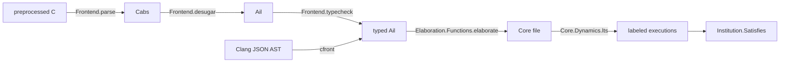

# Cerberus C semantics in Lean

This area is a Lean port of the [Cerberus](https://github.com/rems-project/cerberus)
C semantics. Cerberus handles C in stages. It parses preprocessed C into **Cabs**,
its abstract syntax tree. It desugars Cabs into **Ail**, which is C with names
resolved to symbols. It types Ail into **typed Ail**. Last, it elaborates typed
Ail into **Core**, a small intermediate language with explicit memory actions,
sequencing and nondeterminism. The port follows the same stages:



- **Core syntax and dynamics.** Core's syntax is transcribed from upstream
  `core.lem`. `Core.Dynamics.lts` is a labeled transition system over Core
  states. Evaluation contexts are explicit frames, and a call unfolds one body
  per step. Unsequenced expressions (`unseq`) run as arenas of tasks, and `nd`
  choices are kept as relational branches. Undefined behaviour, errors and
  unsupported paths are explicit `Outcome`s. The port never guesses a result.
- **Memory models.** Core is parametric in a `MemoryModel`. There are two
  instances. `Codec.wireModel` is the provenance-free value model used by
  exported documents. `Mem.Concrete.model` is the concrete byte memory, with
  PNVI-ae-udi pointer provenance, typed access and the default LP64 layouts.
  Floating values are binary64 under the shared IEEE model.
- **The institution over Core executions.** A model is a Core program, its
  saved-label environment and an initial state. A behavior is either a finite
  labeled trace with its final state or an infinite labeled execution. A
  sentence is a predicate on behaviors, and a model satisfies it when every
  behavior does. Sentences are semantic predicates. They are not a parsed C
  assertion language.
- **Target types.** `Target.Config` passes the integer, layout and alias choices
  of a target in as explicit data. In upstream they are a global switch. Missing
  layouts, unsupported aliases and unregistered enums return errors.
- **The Clang frontend `cfront`.** This is a second route to typed Ail. It
  reads Clang's JSON AST dump (`-Xclang -ast-dump=json`) and keeps the implicit
  conversions Clang already inserted. It never calls the Cerberus frontend. Any
  construct it does not handle becomes a named error (fail-closed).

## Module map

Links point at public headers. The Raw and Proofs files behind each header hold
the bodies.

| Public module prefix | What it holds |
| --- | --- |
| [`Silmaril.Cerberus.Core`](../../Silmaril/Cerberus/Core/Defs.lean) | Core syntax, the LTS, startup, bounded runs, exploration, step and reachability lemmas, printers |
| [`Silmaril.Cerberus.Memory`](../../Silmaril/Cerberus/Memory/Defs.lean), `Silmaril.Cerberus.Mem.*` | Abstract memory interface, concrete provenance memory, typed access, layouts, memory laws |
| [`Silmaril.Cerberus.Frontend`](../../Silmaril/Cerberus/Frontend/Defs.lean) | C lexer and parser, Cabs-to-Ail desugaring, Ail typing, each with its reject diagnostics |
| `Silmaril.Cerberus.{Cabs,Ail}` | Cabs, Ail and typed-Ail syntax, name maps, wire codecs, canonical renumbering, the `cerb-lean`/`ail-lean` drivers |
| `Silmaril.Cerberus.{Ctype,Symbol,Map,Undefined,Implementation,Floating}` | C types and annotations, symbols and locations, Lem finite maps, the UB catalogue, implementation constants, the floating environment |
| `Silmaril.Cerberus.{Codec,Encoding}` | Tagged S-expression codecs for Core documents, the checked `parseDocument`, layered-encoding laws |
| `Silmaril.Cerberus.{Names,Schema,Consilience}` | The Cerberus-to-Lean name map and structural agreement with the pinned Lem schema |
| [`Silmaril.Cerberus.Target`](../../Silmaril/Cerberus/Target/Defs.lean), [`GeneralizedTypes`](../../Silmaril/Cerberus/GeneralizedTypes/Defs.lean) | Explicit target configuration, enum environment, generalized-type interpretation |
| [`Silmaril.Cerberus.NativeTypes`](../../Silmaril/Cerberus/NativeTypes/Defs.lean), [`NativeValues`](../../Silmaril/Cerberus/NativeValues/Defs.lean) | Native LP64 type vocabulary and typed concrete C values |
| `Silmaril.Cerberus.Elaboration.*` | Selected cases of typed-Ail-to-Core elaboration (`translation.lem`): constants, arithmetic, comparisons, casts, objects, statements, calls, globals |
| [`Silmaril.Cerberus.Elab.Translate`](../../Silmaril/Cerberus/Elab/Translate/Defs.lean) | Whole-file elaboration entry point used by `core-elab` (currently rejects every input) |
| [`Silmaril.Cerberus.Institution`](../../Silmaril/Cerberus/Institution/Defs.lean) | The institution over Core executions |
| `Silmaril.Cerberus.Spec` | `Spec.allowed`, the loose specification of observed behaviour, and the bounded checker `Spec.check` |
| `Silmaril.Cerberus.Assertion` | Small semantic assertion fragments: pure integer (ACSL/CN), whole-cell resources, RefinedC-style integer refinements |
| `Silmaril.Compiler.Core.{ElaborationSemantics,ElaborationCorrectness,ElaborationProcess,ElaborationTotal,CallReturn,CalleeReturn,ParameterCallReturn,ElaborationCallProcess}` | Correctness results for actual elaborator output on restricted sources |
| `Silmaril.Compiler.Category.{Cerberus,Institution,Pass}` | Core as a language in the compiler category, process observations, a Hets logic graph |
| `Silmaril.Compiler.Clang.*` | Clang JSON AST model, decoder and typed-Ail translation (`cfront`) |
| `Silmaril.Compiler.{Core,Mir,Target,Forks}.*` | Core reader, recognizers and backend pieces that the closure pulls in |
| `Silmaril.Semantics.CPort.*` | Shared prerequisites: S-expressions, tagged codecs, operational execution, MD5, an ELF writer |
| `Silmaril.Machine.{CBackend,X86.Lir}.*` | Low-level IR and x86 modules that the closure pulls in; they are not described here |

## Main definitions and theorems

Names are relative to `Silmaril.Cerberus` unless they are written in full.

- **Dynamics.** `Core.Dynamics.lts`, `Core.Dynamics.initial` (C startup with
  `argv`), `Core.Dynamics.run` and `runWith`, and `run_sound`: the trace from a
  bounded run is a real `MTr` trace. `Core.Dynamics.successors_correct` proves
  the successor enumeration sound and complete for the relation. `exploreOutcomes`
  is a finite outcome-set explorer.
- **Institution.** `Institution.Model`, `Behavior`, `Model.realises`,
  `Satisfies`, `Model.Refines`, `room` and `inst`. The theorems are
  `satisfaction` (the satisfaction condition for vocabulary inclusions),
  `run_realises`, `run_satisfies`, `satisfies_of_refines`, `Model.Refines.trans`,
  `run_noUndefinedBehaviour` and `no_infinite_execution`. The sentences are
  `noUndefinedBehaviour`, `terminalOutput` and `terminates`.
- **Specification.** `Spec.allowed` holds when some execution of the
  nondeterministic Core semantics admits an observed termination and stdout.
  `Spec.check_sound` proves the bounded depth-first `Spec.check` sound for it.
- **Documents.** `Codec.WellFormed.parseDocument`, with `Encoding.parseDocument_iff`.
  `Silmaril.Compile.Core.Reader.read_eq` proves the fast reader equal to
  `parseDocument`. `Cabs.Codec.print_parseCabsDocument` is the byte-exact
  print-after-parse law. In `Schema`, the `schema_agreement` command generates
  agreement theorems for constructor order and arity against the pinned Lem
  schema, and `covers_generated` proves coverage of all 81 generated Lem entries.
- **Memory.** Laws in `Mem.ConcreteLaws`, `Mem.TypedLaws` and
  `Mem.TypedAggregateLaws`, for example `read_write_same` and
  `representation_roundtrip`.
- **Target.** `Target.pinnedApple`, `registerEnum`,
  `registerEnum_rejects_existing`, `pinned_signed_int_range`,
  `GeneralizedTypes.interpretInteger` and `firstRepresentable_sound`.
- **Elaboration equations.** `Elaboration.Functions.elaborate`, and theorems
  such as `Arithmetic.signed_overflow`, `Arithmetic.unsigned_wrap`,
  `NullPointers.integer_pointer_cast_is_not_null` and
  `Scheduling.execute_run`.
- **Elaboration correctness** (namespace `Silmaril.Compiler.Core`):
  - `ElaborationCorrectness.returnLiteral_run`: Core run of an elaborated `return` of a literal.
  - `ElaborationProcess.literal_process`: an existential process behavior for a literal-returning `main`.
  - `ElaborationTotal.literal_total`: universal satisfaction for the same program.
  - `ParameterCallReturn.source_call_returns`: an existential Core schedule for a one-parameter identity call.
  - `ElaborationCallProcess.whole_source_f_main_total`: a two-function source elaborates, starts, satisfies `returnsInteger 42`, and its only process observation is `exit 42` with empty output.
  - `whole_source_f_main_category`: the same result in the compiler category.
- **Process observations.** `Silmaril.Compiler.Category.Cerberus.Process.coreBeh_iff_realises_observes`
  links the compiler specification's `CoreBeh` to institution behaviors.

## Status

| Category | What it covers |
| --- | --- |
| **Proved** (kernel-checked) | The institution laws and runner soundness above. Successor completeness and `Spec.check_sound`. Codec round-trip and reader-equality laws. Schema agreement. Concrete and typed memory laws. Target and generalized-type lemmas. The elaboration equations in `Silmaril.Proofs.Cerberus.*`. The restricted end-to-end elaboration results in `Silmaril.Compiler.Core.*`. The tree contains no `sorry`, `axiom` or `native_decide`; the test audits print the axioms of the main theorems. |
| **Tested** (compile-time) | `tests/cerberus/*.lean` other than the four runtime replays (see "Oracle fixtures and replays"). They are `rfl`, `decide` and `cbv` checks on actual elaborator output (constants, arithmetic, comparisons, control flow, objects, parameters, calls, scheduling, helpers, global objects), target types and the institution, plus `#check`/`#print axioms` audits of the public theorems. |
| **Assumed / trusted** | The port is a hand transcription of upstream Cerberus. Only the syntax schema is checked against upstream mechanically, so faithfulness of the semantics rests on review and the cited source lines. The target configuration (`Target.pinnedApple` keeps upstream's Apple default, including its eight-byte floating-layout shortcuts; it is not a System V model). Runtime (`std.core`) bindings and freshness contexts are explicit inputs to the elaborator. The Clang JSON model and the command-line drivers, which are trusted glue. |
| **Open / not ported** | `Elab.Translate.elaborate` rejects every program, so `core-elab` exits 1 on every decoded input. Upstream's whole `translation.lem` is not yet ported; only the selected cases in `Elaboration.*` exist, and they reject explicitly outside their domain (CHERI, pointer arithmetic, floating constants, compound literals, nonempty global dependencies, indirect calls, among others). Unsupported Core operations and `printf` flags and widths halt with `unsupported`. Ambiguous provenance (iota) states are unsupported. No ISO C refinement theorem, Ail semantics or native compiler certificate is claimed. See each module docstring for its exact domain. |

## Build

Build the headers with `--wfail`:

```sh
lake build --wfail Silmaril.Cerberus.All.Defs           # syntax, frontend, codecs, Core, memory, Spec
lake build --wfail Silmaril.Cerberus.Core.Thms Silmaril.Cerberus.Memory.Thms
lake build --wfail Silmaril.Cerberus.Frontend.Thms Silmaril.Cerberus.Ail.Thms
lake build --wfail Silmaril.Cerberus.Institution.Thms Silmaril.Cerberus.Target.Thms \
  Silmaril.Cerberus.GeneralizedTypes.Thms Silmaril.Cerberus.NativeValues.Thms
lake build --wfail Silmaril.Cerberus.Elaboration.Functions.Defs
lake build --wfail Silmaril.Compiler.Core.ElaborationCallProcess.Thms \
  Silmaril.Compiler.Core.ElaborationTotal.Thms Silmaril.Compiler.Category.Cerberus.Thms
```

`Silmaril.Cerberus.All.Defs` does not include the `Elaboration`, `Target`,
`GeneralizedTypes`, `Native*` or `Institution` headers. Build those directly.
Elaboration has no aggregate: `Elaboration.Functions.Defs` imports the
statement and global stages, which import the expression stages, and each topic's `Thms` brings in its
proofs.

The tests form the `CerberusTests` library (globs `tests.cerberus.+`):

```sh
lake build --wfail tests.cerberus.TargetTypes
lake build --wfail tests.cerberus.ElaborationTotal
```

### Executables

```sh
lake build cerb-lean ail-lean core-lean core-elab cfront
```

- `cerb-lean parse [--level cabs|ail|tail] [--time] FILE.i` parses preprocessed C.
  It prints the Cabs, Ail or typed-Ail document, or a `$reject`.
  `cerb-lean read` decodes a document and prints it again, `typecheck` types an
  Ail document, and `digest` prints the MD5 digest carried by a file's symbols.
  `--batch LIST` processes many paths with framed output.
- `ail-lean read [--time] FILE.sexp` decodes a typed-Ail document and reprints it
  (also `--batch LIST`).
- `core-lean read|compare FILE...` decodes Core documents.
  `core-lean run FILE [FUEL] [CHOICE] [ARG...]` runs the bounded dynamics and prints
  one JSON observation. `loop-shape` and `cfg-shape` inspect the proved recognizers.
- `core-elab [-o OUT] FILE.tail.sexp` elaborates typed Ail to a Core document.
  It currently rejects every program (see Status).
- `cfront decode FILE.json` reprints a Clang JSON AST. `cfront ail [--partial] FILE.json`
  translates it to a `$document_tail` typed-Ail document. The module docstring of
  `Silmaril.Compiler.Clang.AST` gives the expected `clang` invocation.

`cerb-lean`, `ail-lean`, `core-elab` and `cfront` exit with 0 on success, 1 on a
reject or unsupported program, 2 on a usage or I/O error and 3 when an input does
not decode. The docstrings of `Silmaril.Cerberus.Cabs.Main`, `Silmaril.Cerberus.Ail.Main`,
`Silmaril.Compiler.Clang.Main` and the `core-lean`/`core-elab` tool roots document
the exact formats and exit codes.

## Wire documents

Documents use a tagged S-expression dialect: for example
`($document_tail 1 ($str "<commit>") ($str "<impl>") <program>)` or
`($reject 1 … ($str "<stage>") <loc> ($str "<message>"))`, each followed by one
newline. Tags are upstream Lem names, mapped through `Names`. Lem tuples print
flat as `($tuple …)`, and maps print as `($map …)` in key order. Digests are empty
or 16-byte MD5. Ail documents renumber fresh symbols by rank
(`Ail.Canonical.renumber`), as upstream's exporter does. The codec modules
(`Cabs.Codec`, `Ail.Codec`, `Codec.*`) are the definitive specification.

## Layout exception

The Cerberus closure is one of the retained implementation modules allowed by the
repository rules. Public headers under `Silmaril/Cerberus/**`,
`Silmaril/Compiler/**`, `Silmaril/Semantics/CPort/**` and `Silmaril/Machine/**`
are thin: most contain only `public import Silmaril.Raw.…` or
`Silmaril.Proofs.…` and a one-line docstring. Raw declarations keep their
`Silmaril.*` namespaces, which sometimes differ from the file path. For
example, `Silmaril/Compiler/Clang/*` declares `Silmaril.Clang.*`,
`Silmaril/Compiler/Core/*` declares `Silmaril.Compile.Core.*`, and
`Silmaril/Semantics/CPort/Encoding/TaggedCodec` declares `Silmaril.TaggedCodec`.
Each header's docstring names the namespace it re-exports. Headers will be
refined incrementally, keeping theorem statements and assumptions.

## Provenance and licence

The Lean port is derived from the upstream Cerberus sources at
[rems-project/cerberus@b3e11ea334e95359907d4abf9194f0e7fedc6c6a](https://github.com/rems-project/cerberus/tree/b3e11ea334e95359907d4abf9194f0e7fedc6c6a).
Cerberus is distributed under the BSD 2-Clause licence with exceptions; the notice
is in [`NOTICES/Cerberus/`](../../NOTICES/Cerberus/). Raw files cite the upstream
`.lem` and `.ml` files and line ranges they transcribe (for example
`translation.lem:61-74` or `memory/concrete/impl_mem.ml`).

Upstream Cerberus is described in:

- Kayvan Memarian, Victor B. F. Gomes, Brooks Davis, Stephen Kell, Alexander
  Richardson, Robert N. M. Watson and Peter Sewell. "Exploring C semantics and
  pointer provenance". POPL 2019.
- Kayvan Memarian, Justus Matthiesen, James Lingard, Kyndylan Nienhuis, David
  Chisnall, Robert N. M. Watson and Peter Sewell. "Into the depths of C:
  elaborating the de facto standards". PLDI 2016.

## Oracle fixtures and replays

[`benchmarks/cerberus-elaboration/oracle`](../../benchmarks/cerberus-elaboration/oracle/README.md)
holds genuine Cerberus output on 18 small C programs. Four replay tests run against it (`make
cerberus-oracle`, part of `make check`): every Core document runs through the Core LTS to the
observation of the `cerberus` CLI (`ci_cerberus_genuine_oracle`); the Lean elaborator on each
typed Ail gives the genuine Core file byte for byte (`ci_cerberus_elaboration_oracle`); the
captured loaded-integer conversions (`ci_cerberus_integer_cast`); a parameter call
(`ci_cerberus_parameter_call`). These are **tested against an oracle**, not proved.

## Not in this release

- The kernel tests `IntegerCastKernel` and `PointerGlobalKernel`. They need a
  vendored RISC-V package that is not in this release.
- The System V / x86 translation-validation machinery and the native C compiler.
  These are planned for later releases.
