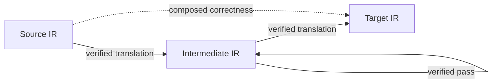

# Compiler and pass APIs

A **pass** transforms programs while preserving a stated contract. A
**translation** connects two intermediate representations (IRs). Its correctness
proof relates their meanings.

The included APIs serve different purposes:

| API | Programs and meaning | Correctness |
| --- | --- | --- |
| [Pass contracts](../../Silmaril/Compile/PassAPI/Contract.lean) | An invariant and a relation of acceptable replacements | Every admitted input remains admitted and is related to the result |
| [IR translations](../../Silmaril/Compile/PassAPI/Category.lean) | Several program representations denoting one shared semantic domain | Relate source and target denotations using that domain's relation |
| [Compiler category](../../Silmaril/Compile/Category/Compiler/Defs.lean) | Languages with interfaces and sets of observable behaviors | Successful partial compilations produce translated interfaces and transport specifications through an observation convention |

A **contract** supplies both the input invariant and the permitted replacement
relation. A **convention** describes how interfaces and observations translate
between languages. Behavior sets may be empty; termination and outcome existence
require additional theorems.

## Translations compose; passes are endomorphisms

- `Translation A B` changes representation while preserving the chosen contract.
- `Pass C` transforms programs within one contract. For an IR `A`,
  `Pass A.contract` corresponds to `Translation A A`: an **endomorphism**,
  or arrow from `A` back to itself. Such a translation may be irreversible.
- `p * q` runs pass `p` first, then `q`. `f ≫ g` uses the same order.
- `CheckedPass` combines a proposed transformation with a sound checker. On
  rejection, its checked pass returns the original input. Acceptance is sound;
  completeness is optional.
- The compiler category uses partial translations: failure returns `none`;
  successful results carry correctness through composition.

## Concrete Wasm instance

[ModeCategory](../../Silmaril/Wasm/Binaryen/PassAPI/ModeCategory.lean) puts Core
modules and Binaryen IR over the actual selected Wasm correctness relation.
Lowering and structured lifting are verified translations; existing optimization
passes become endomorphisms. Equivalence, refinement and trap-insertion policies
have separate contracts. The [Wasm guide](wasm.md) defines their observations.

An additional IR supplies its syntax, invariant, denotation and translation
proof. A game model can instantiate the shared semantic carrier; connecting it
to Wasm execution requires an adequacy or simulation theorem. Game semantics
and LambdaSSA integration are planned extensions.

The behavioral compiler framework includes satisfaction and read-back laws.
The [institution API](logic.md) provides general signature-indexed theories,
models and translations. Connecting these two presentations is a further
adapter theorem. See [references](../../references.bib) for the cited sources.

## Read definitions and statements first

- [Compiler definitions](../../Silmaril/Compile/Category/Compiler/Defs.lean)
  describe languages, partial translations and compilation graphs.
- [Compiler laws](../../Silmaril/Compile/Category/Compiler/Thms.lean) state
  composition, specification transport and graph properties.
- [Compiler proofs](../../Silmaril/Proofs/Compile/Category/Compiler.lean) contain
  the corresponding proof bodies.
- Checked transformations likewise have [definitions](../../Silmaril/Compile/PassAPI/Checked/Defs.lean),
  [theorem statements](../../Silmaril/Compile/PassAPI/Checked/Thms.lean) and
  separate construction and correctness proofs.

Compatibility entry points preserve existing import paths. This separation is
being applied incrementally; many other implementation modules still contain
their proofs inline. `make library` checks every included library module;
`make check` also builds the native tools and runs the release regressions.
