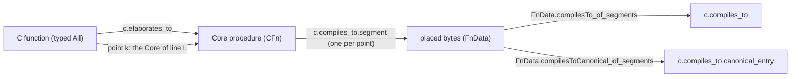

# C to x86, segment by segment

What a compiler explorer shows for a C function, as Lean goals: the C function, its Cerberus Core
and the machine code a real compiler emitted for it share numbered **program points**, and each
segment between two points is a goal. Proved segments close the function-level row of the
[System V shapes](sysv-tv.md) (`c.compiles_to`). `tools/c-tv` generates everything from a C
file: the build, the correspondences, the Lean header with every goal, the mechanical proofs
and the rows.



| | |
| --- | --- |
| Vocabulary | `Silmaril/Project/CompilesTo/Defs.lean` (`FnData`, points, slots, the relations) |
| Segment theorems | `Silmaril/Project/CompilesTo/Thms.lean` and `Silmaril/Proofs/Project/CompilesTo/` |
| Shapes and the bridge | `Silmaril/Project/Shapes/CompilesTo/{Defs,Thms}.lean` |
| Generator | [`tools/c-tv`](../../tools/c-tv/README.md), with the decoder [`tools/x86-lift`](../../tools/x86-lift/README.md) |
| Examples | `examples/compiles-to/` (library `CompilesToExamples`) |

## The statements

### Program points and segments

A `FnData` is one function of one build:

```lean
structure FnData where
  sig : Signature                 -- System V INTEGER scalars (Silmaril.X86.SystemV.CApi)
  cfn : C.CFn sig                 -- its Core: file, parameters, body (the C side of sysv-tv)
  addr : Nat                      -- where its bytes are placed
  code : List Byte                -- the bytes, tied to the object by `elf.object_fn`
  frame : Nat                     -- the stack bytes below the entry rsp it may write
  points : List Point             -- ⟨frag : EE, off : Nat, kind : PointKind⟩

inductive PointKind
  | entry                                                  -- the System V call
  | slots (cont : Option (Pattern Sym × EE × Bool)) (objs : List Slot)   -- a statement (-O0)
  | ret (sym : Sym)                                        -- the return label
```

`FnData.corr F I k0` instantiates the generic cut-point simulation
(`Silmaril.Compiler.CompilesTo.Sim`): the source is the Core run of the procedure in the caller's
continuation `k0`, the target the model `I` running the bytes. At point `k` the Core control is
`points[k].frag` and `rip` is `addr + points[k].off`. The relation depends on the kind:

* **entry**: a System V entry (`MachineEntry`: the code loaded, `rip` at it, `AbiEntry`, the
  arguments in their registers, the frame readable, writable and apart from the code) and a
  Core entry with the same arguments (`CFn.CoreEntry`: the parameters are the verified Core
  library's `int` objects under its invariant, with room for the body's own objects);
* **slots** (gcc `-O0` statement boundaries): the frame after `push %rbp; mov %rsp,%rbp`
  (`Frame0`), and every C object in scope in its DWARF frame slot (`DW_OP_fbreg off`, frame
  base the CFA) holding its Core value (`ObjectsAgree`; an object marked `defined` must have a
  value). The Core stack is the statement's sequencing frame (in an environment `env₀` that
  binds the objects as the current one does), then frames without a procedure boundary, then the
  procedure frame;
* **ret**: `Frame0`, and the return label's parameter holds a specified integer that `rax`
  encodes.

The machine's result at the return (`FnData.Result`): callee-saved registers restored, memory
written only in the frame, and for a scalar result a specified integer in `rax`.

A **segment goal** is `F.Segment I k`: from related states at point `k`, if the Core cannot go
wrong from there and terminates (`Source.Safe`), both sides reach their next cut point (the
machine its *first* one) along some Core run, and are related there (or both have returned
with related results). Source undefined behaviour therefore permits any machine behaviour, and
nondeterministic Core (unsequenced operands) is handled by the existential over Core runs.

### C to Core

`c.elaborates_to` (`C.ElaboratesTo ail name F.cfn`) is the function-level link. A point adds
which statement it is: `PointOf F k line` says that point `k`'s fragment is the only Core
statement located at `line` (by its `Aloc`/`Astmt` annotations), with the matching sequencing
continuation, or the procedure body (entry), or the return label's body (the closing brace).
The generated headers prove these by `rfl`.

### The shapes

| id | Lean | statement |
| --- | --- | --- |
| `silmaril.shapes.c.compiles_to.point` | `PointOf F k line` | C ↔ Core, one segment |
| `silmaril.shapes.c.compiles_to.segment` (`.open`) | `SegmentSim I F k` | Core ↔ x86, one segment |
| `silmaril.shapes.c.compiles_to.segment_from_c` | `SegmentFromC I ail name F k line` | C ↔ x86, one segment: the three above |
| `silmaril.shapes.c.compiles_to.canonical_entry` (`.open`) | `CompilesToCanonical M p frame F` | `c.compiles_to` with the C function read from one canonical entry (below) |

The function-level row is the System V shape `c.compiles_to` (`C.CompilesTo M p frame F`), and
`c.compiles_to.builds` gathers the builds of one source.

### From segments to `c.compiles_to`

```lean
theorem FnData.compilesTo_of_segments (F : FnData) (haddr : F.addr < 2 ^ 64)
    (hp0 : F.points[0]? = some ⟨F.body, 0, .entry⟩) (hseg : ∀ k, F.Segment Open.isa k)
    (henter : SysV.Enterable Open.isa F.placement F.sig F.frame)
    (hint : ∀ k ∈ F.sig.arguments, k = .int32) (hlen : F.params.length = F.sig.arguments.length)
    (hsix : F.sig.arguments.length ≤ 6) (hnd : (F.params.map (·.1.key)).Nodup)
    (hsafe : F.cfn.meaning.Inhabited) :
    C.CompilesTo Open.isa F.placement F.frame F.cfn
```

How the two function statements differ, and how the proof bridges them:

* **First return.** `c.compiles_to` reads the result at the function's first return
  (`ContractStrict`); the composition of `Sim` (`Corr.whole_of_segments`) only gives *a*
  return. Each segment run stops at its first cut point and no related state at a point is a
  return (`FnData.notFinal`: the stack pointer is the entry's, or eight bytes below it), so
  the composed run passes no return before its end (`wholeFirst_of_segments`).
* **Every argument tuple.** The System V contract quantifies over the arguments in the entry
  registers; a Core entry with those arguments exists for every tuple of at most six `int`
  arguments (`CFn.canonicalEntry_entry`), and the arguments are determined by the entry state.
* **Placement and frame.** `F.placement` is the bytes at `addr`, entered at their first byte;
  the frame is the same bytes below the entry `rsp` in both statements.
* **Results.** A scalar function's Core value must be a specified integer (`FnData.Result`, as
  the C shapes' `ValueIs`).
* **Non-vacuity.** `c.compiles_to` asks for `F.cfn.meaning.Inhabited`: the C function is safe
  on some argument tuple from **every** Core entry (every memory and environment that satisfies
  the verified library's invariant). The segment proofs assume safety and do not give it. This
  is `Task.<f>_safe` in the generated headers, and it is open for every example.

### Two readings of the C function

`CFn.meaningFrom F E` reads `F` from the entry states `E a` (each with the empty caller
continuation). The standard meaning is `F.meaning = F.meaningFrom F.Entry` (every Core entry,
`CFn.meaning_eq`). The **canonical** meaning fixes one entry per argument tuple
(`CFn.canonicalEntry`: the arguments allocated in order from an empty memory whose allocator
starts at `65536`, the environment binding the parameters and nothing else), and the shape
`c.compiles_to.canonical_entry` uses it. Its non-vacuity is the safety of one state, which a
forced Core run evaluated by `cbv` proves (`forcedRun`, `safe_of_forced`), so today's proofs
close it (`FnData.compilesToCanonical_of_segments`).

The canonical row does **not** cover a call from any other program state: another memory
(other objects, another allocator frontier, other ids or addresses), another environment or a
caller continuation. `C.CompilesTo.of_canonical` states exactly what it lacks: a canonical row
and `F.meaning.Inhabited` give the standard row. Either of these would turn the canonical rows
into standard ones:

* a **memory-independence lemma** for the profile (`int` parameters, no memory beyond them, no
  calls, no pointer comparison): every Core entry of a function runs like its canonical entry;
* a **universal safety proof per function**: `Task.<f>_safe` directly, for every entry memory.

## The segment theorems

Each generic theorem has only decidable hypotheses about the `FnData` (offsets, slots, decoded
instructions, the verified Core library's recognisers on the fragments), which the generated or
hand-written proof discharges by `decide +kernel` and `rfl`:

| theorem | C | code | Core side |
| --- | --- | --- | --- |
| `FnData.segment_entry` | the call, to the first statement | `push %rbp; mov %rsp,%rbp`, the argument spills | enter the body, create the block's `int` locals |
| `FnData.segment_init_add` | `int x = y + z;` | `mov y,%edx; mov z,%eax; add %edx,%eax; mov %eax,x` | `StateExitMem.init_runs` |
| `FnData.segment_if_gt` | `if (y > z) A else B` | `mov y,%eax; cmp z,%eax; jle B` | `StateExitMem.if_runs` |
| `FnData.segment_return` | `return v;` | `mov v,%eax` (then `jmp` to the epilogue) | `StateProc.ret_returns`, stopped at the return label |
| `FnData.segment_ret` | the closing brace | `pop %rbp; ret` | the label's `pure(r)` and the procedure return |
| `FnData.segment_call` | the whole function (`-O2`, one point) | three steps of straight-line code | `FnData.core_straight`: `int x = y + z; …; return v;` |

The machine side goes one instruction at a time on `Open.isa` (`step_store32`, `step_load32`,
`step_add32`, `step_cmp32_mem`, `step_jcc8`, `step_jmp8`, `step_lea32`). `Params.inv_params`
builds the parameters' objects under the library's invariant.

## The trust boundary of the generator

`tools/c-tv` proposes; Lean checks.

| step | status | relied on |
| --- | --- | --- |
| the compiler run (a pinned gcc image, the flags, `RECEIPT.json` with the hashes of `cc1` and `as`) | recorded | reproducibility, not correctness: the statements are about the bytes it produced |
| the object's bytes ↔ the header's `objBlob` | kernel (`elf.object_fn` rows: `ObjectFn.of_blob`, `blob_of_decode`) | the artifact registry's digests of the committed objects (`sil project lint`) |
| the function's bytes, symbol and relocations in the object | kernel (`SysV.objectCodeN`, `decide +kernel`) | the public ELF reader |
| the bytes → instructions | kernel (`decodesAs`, `decide +kernel`, `Ext.decode`) | the x86 model's decoder |
| the line table, the DWARF slots, the granularity | untrusted (`gimli`) | a wrong slot or range makes a goal unprovable, not provable-but-false |
| C text → typed Ail | compiled evaluation (`#guard`) | the Lean frontend (its typing pass is `partial`) and Lean's compiler |
| typed Ail → Core | kernel (`elab_eq` by `cbv`, then `Task.elaborates_<f>`) | the elaborator's fidelity to Cerberus (a port) |
| point fragments | kernel (`PointOf … := ⟨_, rfl, rfl⟩`) | — |
| the Core and x86 semantics, `Encodes`, the System V obligations | trusted definitions | the ports' fidelity |
| segment and function goals | `Task.…` goals, proved by the segment theorems above | — |
| the canonical entry's safety | kernel, through `cbv` (a forced Core run) | `import all` of `Init.Data.String.{Legacy,Defs,Basic,Bootstrap}`: the dynamics reads source locations through `libraryLocation`, which calls `String.splitOn`, whose body the module system does not export |

Builds are path-neutral: gcc runs in `/src` inside the container with
`-fdebug-prefix-map=/src=.`, so the objects' DWARF records `.` and the file name, and the
receipts record the container's paths only.

## Running it on a new C file

```sh
cargo build --release --locked --manifest-path tools/c-tv/Cargo.toml
lake build Silmaril.Project.CompilesTo.Probe.Defs
tools/c-tv/target/release/c-tv gen --src path/to/file.c --name file \
  --core-probe "lake env lean {file}"
scripts/sil project artifacts add examples/compiles-to/file/file.c --name silmaril.compiles_to.file.source
scripts/sil project artifacts add examples/compiles-to/file/O0/file.o --name silmaril.compiles_to.file.o0.object
scripts/sil project artifacts add examples/compiles-to/file/O2/file.o --name silmaril.compiles_to.file.o2.object
lake build --wfail CompilesToExamples
```

`gen` needs Docker with the pinned image. Proof modules written by hand or by a prover go next
to the generated ones (`examples/compiles-to/CompilesToExamples/File/Proofs/`); a regeneration
keeps them and marks the rows whose `Task` they prove. `tools/c-tv/regen.sh` regenerates the
examples here.

## Results

gcc 13.3.0 (pinned by digest), `-g -c` and the default flags of `tools/c-tv`:

| file | build | function | points | proved | open |
| --- | --- | --- | --- | --- | --- |
| `straight.c` | `-O0` | `add3` | 5 (statement) | C ↔ Core; every segment and its C ↔ x86 form; the object tie; `c.compiles_to.canonical_entry` | `c.compiles_to` (needs `Task.add3_safe`) |
| `straight.c` | `-O2` | `add3` | 1 (function) | the segment; the object tie; `c.compiles_to.canonical_entry` | `c.compiles_to` (needs `Task.add3_safe`) |
| `branch.c` | `-O0` | `max2` | 5 (statement) | as for `add3` at `-O0` | `c.compiles_to` (needs `Task.max2_safe`) |
| `branch.c` | `-O2` | `max2` | 1 (function) | the object tie | the segment (`cmp; mov; cmovge; ret`), `c.compiles_to`, the canonical row |
| `loop.c` | both | `sum_to` | — | the bytes and the listing | no goals: the Lean elaborator has no `while` (nor assignment, `<`) |

Per function, `canonical_safe` (the canonical entry of `add3(1, 2, 3)`, `max2(1, 2)` is safe)
is proved; `c.compiles_to.builds` is proved for `add3` from `Task.add3_safe`, and for `max2`
from `Task.max2_safe` and the open `-O2` row. In the
[System V example](sysv-tv.md), the `c.elaborates_to` row of `max2` is proved with the same
quoted-Core method.

## What is not covered

* **Universal safety** (`Task.<f>_safe`): no proof here shows a C function safe from every entry
  memory; the `c.compiles_to` rows stay open on it, and the canonical rows say less.
* **The System V example's `-O0` row**: its object (gcc 14.2.0) has no debug information, so
  `c-tv` cannot read its points and slots. A twin build with `-g` would give them; its
  `if (a > b) return a;` without `else` also needs a segment theorem for the empty `else`.
* **Loops**: the elaborator has no `while`, `for`, `do` or assignment.
* **Calls, globals, memory through pointers, floating point, structs, `void` results**: the tool
  refuses them (relocations, calls, non-integer signatures), and the C meaning's profile excludes
  them.
* **Divergence**: `Safe` includes termination.
* **Other compilers and models**: one placement address per function; rows use `Open.isa`
  (`C.CompilesTo.open9_of_open` transfers to `Open9.isa`); only gcc 13.3.0 is pinned here.
* **The C ↔ Core link** stops at typed Ail; the frontend is checked by evaluation only. Core is
  the Lean port's, with the constructed conversion runtime, not Cerberus's `std.core`.

## Build

```sh
lake build --wfail Silmaril.Project.CompilesTo.Thms Silmaril.Project.Shapes.CompilesTo.Thms \
  CompilesToExamples SysVTvExample
cd tools/c-tv && cargo test --locked && cd ../x86-lift && cargo test --locked
```
