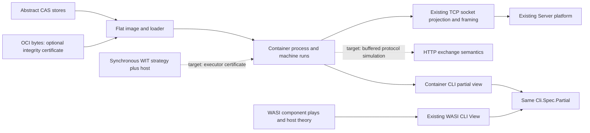

# Experimental container adapters: first Stage2 slice

Start with the runnable examples:

```sh
lake build --wfail Silmaril.Containers.Adapter.Examples.Thms \
  Silmaril.Containers.Cli.Thms Silmaril.Containers.Sha256sum.Thms \
  Silmaril.Containers.Cas.Bridge.Thms
lake env lean --run examples/containers/Stage2.lean
```

The default workflow loads a tiny program from **abstract stores**, narrows stdout events,
rejects an unsupported clock event as UB, and runs a SIGINT cleanup script and a buggy handler.
It computes no OCI layout digests. `Adapter.Examples.Thms` proves shared descriptor offsets,
partial-write effects, cancellation cleanup/noUB, the buggy counterexample, and a certificate
for a two-program Boolean executor. That executor is a finite **model**, not Wasm or x86.
Existing APIs and the real OCI/ELF examples remain available.

## What is checked, and what is still a target

| Request | Checked in this slice | Remaining implementation/law |
| --- | --- | --- |
| Loader/runtime categories | `Category`: actual category instances, success-preserving loader maps, runtime observation/simulation maps, forgetful functor; `Hom.sat` and separate `Hom.noUB` | Concrete cross-machine simulation instances; richer permanent-refusal variants |
| Events and UB | `Events`: fixed-profile subtypes, independent stdio alphabet, checked finite projection with prefix-preserving unsupported UB; full-run confinement/range law. `Outcome`: reason maps, noUB elimination to Empty, top preorder, quotient law, defined traps and optional more-UB policy, UB-to-crash counterexample | Prove capability confinement equivalent to codec range for all infinite behaviours; executable/coinductive projection and independent small-machine simulations; full-behaviour outcome-variant bridge |
| HTTP / CLI / WASI | Existing HTTP platform/framing retained. `Cli.of_wasi` transports the same `Cli.Spec` through actual admitted WASI plays and equal partial observations | Concrete container-to-WASI realization instances; TCP chunk/connection decoder simulation to the HTTP exchange model |
| Synchronous components / executor | `Posix.signature` uses existing dependent game signatures. `Executor.Certificate` universally quantifies supported guests and admitted hosts/contexts; validation, loading, source noHostUB, simulation and nonvacuity; finite model instance | Instantiate with synchronous WIT component semantics and linked game hosts; prove a real x86-hosted Wasm executor |
| CAS performance | `Oci.loadFrom` factors the existing reader; byte-store variant, checked/byte equality under integrity, decoded-byte/abstract-runtime equality via a common flat image; cheap abstract-store example | Optional separately verified layout certificates or verified checker; avoid calling an external verifier report a Lean proof |
| POSIX/files | Dependent read/write responses, bounded reads, EOF/errno, accepted write prefixes; descriptor/open-description/file identities and shared offsets; stateful response-to-effect adapter | ABI decoder and WIT resource adapters; split-call log interpreter connected to file effects and interruption; filesystem permissions/identity lifetime laws |
| SHA reuse | Finite report adapter includes faults and unmodeled results. Reuses both total release theorems for noUB, GNU exact stdout/exit and complete report | Full `Mach` runtime bridge: Ext/Ext8 versus native ISA, syscall/refusal tables, supported event mapping, clone freedom, divergence/progress correspondence |
| Signals now | Arrival/pending/mask/registration, delivery, handler entry/return, default termination, split typed calls/returns, EINTR/restart actions; cleanup and buggy scripts; residual-state composition | General handler invariants over all admitted schedules, partial-syscall/resource interpreter, fairness/progress; later Ctrl-C environment, SIGKILL/STOP constraints and ELF handlers |

## One common direction for adapters

An implementation's behaviour is mapped into the abstraction's behaviour. A runtime arrow
`f : A ⟶ B` contains a loader arrow and `observe : Adapter A.Event B.Event`, together with
`A.runtime.beh i b → B.runtime.beh (f.loading.image i) (f.observe.run b)`.
Identity and composition are checked category laws. Forgetting events, observations and
simulation is a genuine functor to the loader category. A loader arrow only preserves
successful loads, so its target may accept more inputs. A runtime arrow must additionally
account for source refusals: success preservation alone cannot establish runtime simulation.

Specifications pull back through the observation map. `Adapter.sat_image_iff` is its
satisfaction condition. An adapter acts on a whole behaviour, so the API allows stateful
transducers and rechunking; merely supplying a function is not a correctness proof. Each
instance must establish its simulation and account for infinite internal activity.

`Adapter.ReflectsNoUB` is a **separate** certificate condition. Turning source UB into a crash
can refine a semantic UB-top approximation, while the result has no UB and the source does.
`Outcome.masked_noUB` proves this counterexample. On the existing full behaviour type,
`Adapter.maskUB_refines` proves permissive UB refinement and `maskUB_not_reflects` disproves
noUB reflection. Executor certificates instead require
source `noHostUB` outright, before any observation map can hide it.

Refusal is not UB and not invariably an invalid image. `Refusal` already includes missing
blobs and resources. `LoaderCat.Contract` classifies permanent refusals relative to an explicit
wellformedness contract. `wellformed_resource_refusal` demonstrates a wellformed input whose
loader refuses resources. A restricted model's unsupported instruction is distinct from a
loader's refusal and becomes UB where that model cannot interpret execution.

## Event profiles and outcomes

`StdioEvent` has only input/output/error chunks. `stdioCodec` embeds it into `Ev`, checks the
reverse direction and proves both round-trip laws. `finite` stops at the first unsupported
letter, preserves the already accepted prefix, and reports `UB.unmodeled`. It retains a source
UB stop. `finite_embed` is the executable round trip.

`VsockEvent`, `TcpEvent`, `UdpEvent` and `NetworkEvent` are checked subtypes of the existing
capability contract, not a new network semantics. In particular `Ev.cap` checks the primary
socket; the subtype does not establish every address-family/accepted-socket consistency law.
`EventCodec.expand_restrict` applies to full behaviours when each source run has a small
representation, including its stop or blocking/divergence/reactive kind. `sat_restrict`
explicitly needs a run simulation for an independently implemented small machine. No
confinement assumption alone proves that two machines execute the same program.

`Outcome U` is an additive finite-outcome variant. `Outcome UB` keeps reasons, `Outcome Unit`
forgets them, and `Outcome Empty` cannot contain UB. Eliminating UB to Empty needs a noUB proof.
`Outcome.ofStop` connects the old tagged stops to this representation. Defined guest traps have
an independent constructor. `trapAsUB` is explicitly a **more UB** map: a certificate under it
implies the default noUB property; a default defined-trap certificate need not survive it.
The examples prove both directions' intended distinction.

The approximation preorder makes every `undefined u` top by explicit policy. Mutual
approximation is exactly equality after reason erasure; `quotient_eq_of_mutual` gives the
quotient antisymmetry law. Multiple reason tags do not inherently require a preorder: they
are deliberately identified here. Model inclusion and trace inclusion remain different
orders in `Behaviour`, with different preservation laws. Distinct implementations with equal
behaviours likewise remain distinct until an implementation quotient is chosen.

## HTTP and one CLI specification



Solid links are implemented constructions; dashed links still require concrete simulations.
The existing `Http.platform` obtains socket traces, connection logs and an HTTP framing. Its
`platform_view_iff_linux` reuses the process platform. This is not a proof that arbitrary TCP
chunks equal HTTP request/response events. The concrete decoder must track connections,
receive/send buffers, partial heads/bodies, pipelining and close/error state. The target law is
that every admitted TCP run decodes to an allowed exchange run; framing/parser soundness and
unsupported-message outcomes must be explicit. Reuse `Servers.WasiHttp`'s
`wasiServerB_refines`, `linkServer_refines`, `link_sat_of`, `runs_refines`, `runs_link` and
`mem_linkServer` when relating component strategies and hosts to the server side.

`Cli.stdioView` accumulates input/output/error chunks and observes terminal exit status,
without claiming unchanged files. `stdioView_exit_matches` prevents a wrong final exit from
satisfying an exit specification. Views use `Check.ObsPrefix`, including terminal stops.
`Cli.Realizes` supplies admitted component plays for **every finite source observation**, with
at most one CLI invocation and the same existing `Seen`. It contains no desired CLI spec.
`Cli.of_wasi` then applies the existing `Wasi.Cli.CliSat` guarantee. Existing
`CliSat.every_host`, `mono`, `of_theory` and `of_agP` remain the host/link/theory tools.
`Cli.Certified` separately requires source noUB. A partial CLI view alone cannot certify
noUB, nonvacuity or progress, and a view of only successful observations is insufficient.

## Synchronous WIT and the executor northstar

A syscall subset can be presented by `Games.Sig`: program requests are operations and host
responses have the request-dependent arity. A component strategy implements exports by asking
imports; a host has the dual role and is composed using existing `Wasi.link`/game composition.
A fixed WIT event-strategy standard fixes names, types, protocol and allowed moves. An arbitrary
component strategy is an implementation to check against that standard. WASI is an instance,
not the definition of every component/container interaction. Begin with synchronous calls and
returns; futures/streams and core-module interfaces are separate later extensions.

Host nondeterminism is universal in the proof: every admitted host answer/strategy is covered.
Seeded replay, fuzz and chaos hosts are useful tests of chosen executions; they cannot replace
that quantification. Guest trap is a defined guest outcome by default. An explicit optional UB
import or trap-as-UB policy enlarges the UB boundary and must use the certificate direction
proved above. Existing finite-play strategies expose safety, not termination or absence of
infinite hidden chatter (`Games.Strategy` documents that boundary).

`Executor.Certificate` states the desired higher-order obligation now: for all supported valid
guests and admitted hosts/contexts, loading succeeds, execution exists, the source has no
host UB, and **every** source execution maps to the linked guest semantics. `covered` and
`supported_exists` prevent empty domains from certifying an executor. `Progress` is separate
and conditional on stated assumptions. Defined guest traps must remain allowed outcomes of
the linked semantics. A real x86 container hosting a Wasm runtime will need guest validation,
resource/import/export identity, call/return/outcome simulation, and these noHostUB/nonvacuity
laws uniformly over that declared supported fragment. The Boolean instance checks the
certificate's mechanics only; it establishes none of those binary/WIT facts.

## Cheap CAS, then optional bytes and integrity

Use `D → Option Layer/Config/Content` via existing `Stores` for routine examples and semantic
proofs. The new abstract example proves its load and noUB/exit property without hashing.
For OCI bytes, `Oci.loadBytes` still runs the **same** JSON/tar/descriptor/size parser as the
checked reader but leaves digest integrity as an obligation. `load_checked_eq_bytes` connects
it to `Oci.load` when `Cas.Store.Sound Crypto.sha256 L.raw` is separately proved.
`runtimeBytes_eq_layered` connects byte and abstract stores through a common decoded flat
image. Integrity is distinct from collision binding, as in `Cas` already.

An external `sha256sum` or verifier can test a layout and record hashes. Its output is not a
Lean theorem. Options are a once-proved certificate, a verified checker and soundness theorem,
or a plainly documented external trust assumption. Do not routinely replay SHA-256 over
large tar/ELF blobs in the kernel. Existing real-layout parser/digest proofs are retained.

## POSIX effects and signals

`Ev.read(path, bytes)` / `write(path, bytes)` are coarse application effects. They lack fd,
offset/count, attempted versus accepted bytes, return values and errno, and do not by
themselves settle chunk-versus-whole-file semantics. Keep that useful abstraction, but do not
rename an fd into a path and claim a POSIX adapter.

`Posix.Req` / `Response req` model bounded read data, EOF/error, and accepted write prefixes.
`State` uses descriptor → open-description → file identity plus a shared offset. `respond`
checks successful reads against the actual bytes and maps completed calls to offset-aware
`Effect`s. `lookup_advance` proves aliases observe one offset; the examples read through fd 3
then inspect fd 4, and accept only one byte of a two-byte write. The target pipeline is
ABI syscall → typed request/response → file/stream/socket effects → application view. ABI
register/memory decoding, WIT resource mapping and the split-call interpreter remain laws to
prove. Permissions, append mode and identity lifetimes are beyond this subset.

`Signals` separates arrival/pending, masks/registration, delivery, handler entry/return and
default termination. `Posix.Event` separates calls from returns, so a request may be in flight
when a signal is delivered. EINTR is an explicit error response; partial success uses a typed
response; restart keeps a pending request under an explicit policy. The signal log layer does
not yet run the descriptor interpreter automatically: that composition must validate effects
and responses against resource state. Invalid transitions produce UB rather than success.

The cleanup example receives SIGINT during a read, enters the registered handler, returns
EINTR, closes the socket, returns from the handler and exits 130 with noUB. The buggy variant
faults in the handler. `execute_append` evaluates residual behaviour after a signal from the
resulting pending-call/handler/effect state. Restricting to no delivery differs from erasing
signal letters: handler effects remain, and an entry with no prior delivery is unsupported.
Ordinary default signal termination is defined, not UB. These are finite script theorems;
all-schedule handler correctness and eventual delivery/cleanup need invariants and honest
scheduling/environment progress assumptions. Ctrl-C → foreground-group SIGINT, SIGKILL/STOP
noncatchability, nested handlers and verified ELF handlers are later work.

## SHA reuse boundary

`Sha256sum.Report` adapts ended reports **and** the original LPS fault/unmodeled reports into
container outcome variants. `gnu_noUB` and `filter_noUB` use the stronger public
`Process.gnuSha256sum_lpsTotal` and `sha256Cli_total`, rather than relying on the CLI projection
which hides faults/blocking/divergence. `gnu_output` reuses `Elf.LpsCli.out1Of_of_prefix` to prove
exact expected stdout and exit 0; `gnu_complete` reuses the actual complete trace, including
its original unchanged filesystem. These quantify every finite stdin, flag oracle, refusal
configuration, budget and admissible launch. There is no hashing reproof or layout evaluation.

The 35,512-byte static `sha256sum-min` and 2,368-byte filter are distinct programs. Dynamic
full GNU/glibc has a different model and import contracts. File-operand binary correctness is
not established. A full container-runtime transfer additionally needs Ext/Ext8/native ISA and
syscall/refusal correspondence, clone freedom, supported event mapping and maximal-run/progress
simulation; this finite-report bridge does not claim those laws. See
[the SHA development](sha256sum.md) and [the existing CLI header](../../Silmaril/Elf/LpsCli/Sha256sum/Thms.lean).

All APIs on this page are experimental. No new axiom, proof-policy exception, digest assumption,
check bypass or claimed Wasmtime theorem is introduced.
