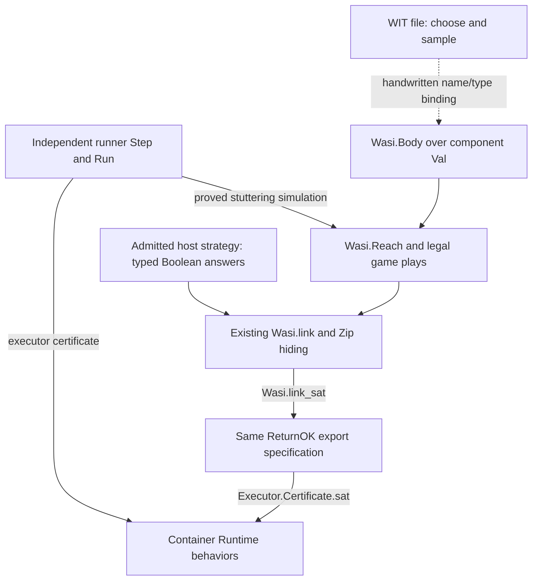

# A synchronous WIT component as a container model

```sh
lake build --wfail Silmaril.Containers.SyncComponent.Thms
lake env lean -DwarningAsError=true --run examples/containers/SyncComponent.lean
```

The model runner enumerates these complete source traces:

| Invocation | Host answer | Component result | Runner status |
| --- | --- | --- | --- |
| `sample(false)` | `choose() = false` | `true` | 0 |
| `sample(false)` | `choose() = true` | `false` | 0 |
| `sample(true)` | no import | defined guest trap | 70 |
| `sample(false)` | answer not delivered | waiting | no exit |

The [WIT file](../../examples/containers/sync-component/world.wit) declares a synchronous
`choose: func() -> bool` import and `sample: func(trap: bool) -> bool` export. Its names and
function types are represented by the existing `Wasm.Component.Iface`, `Val`, and `Wasi.World`
types. This binding is handwritten, not a proved WIT parser/importer. `choose_result_typed`
and the executor's validation field use the existing component value checker.

This is an **abstract component instance**, interpreted by the existing `Wasi.Body` language
and operational semantics. It is not a Boolean toy certificate standing in for that language,
and it is not a component binary, native Wasm engine or x86 executor. The runner prints
model traces; `complete_run`, `runtime_choice` and `runtime_trap` prove they are executions.
No OCI layout hashing is performed. The example is included in `make check`.

## The concrete semantic path



The source runner has separate phases for export entry, import request, waiting, internal
negation, result and export return. `Step.negate` and `Step.trap` are silent steps. The existing
component computes the continuation directly, so the simulation matches those steps by
stuttering; source semantics were not defined equal to linked plays.

`run_reaches` embeds every source run in `Wasi.Reach body`; `run_legal` consequently proves
alternation and matching pending questions. `zip_trace` synchronizes each import request and
reply with an actual host play and hides it using the existing game composition. Exports
remain observable. `source_simulates` then maps complete source executions to the existing
linked component's plays and their container reports.

The independent component proof uses an invariant over **all** `Wasi.Reach` states and every
typed import answer, including repeated export invocations. `component_sat` establishes
`ReturnOK`; `linked_good` applies the existing `Wasi.link_sat` law to every typed host strategy.
`runtime_returns` transports that same specification through the executor certificate and
adds source noHostUB. The container runner itself models one invocation, not a persistent
component service. The stronger `runtime_complements` law relates its result to a Boolean
choice actually available in the selected host.

## Nondeterminism, nonvacuity and traps

`looseHost` is the existing `Wasi.ofPred` construction over legal plays with typed answers.
It permits both Boolean answers on the same import. `two_results` proves both resulting
container behaviors; neither branch is erased by the adapter. The tests of these two paths
are illustrations. The proofs quantify over **every admitted host strategy and every source
execution**, rather than only these seeds.

| Boundary | Explicit contract / checked fact |
| --- | --- |
| WIT types | Supported export argument is one Boolean. Import answer is exactly one Boolean; traps and malformed values are excluded by `TypedAnswers`. `untyped_reply_rejected` checks a wrong integer answer. |
| Turns | Existing host strategies are legal/receptive. Source simulation establishes component legality; `reply_requires_wait` rejects a reply before its request. |
| Host progress | `Admitted` separately requires at least one available answer to the first `choose()` call, to witness a complete execution. A safety strategy does not guarantee eventual delivery. |
| Nonvacuity | The loose host is admitted. For every admitted host and either invocation mode, `runtime_nonempty` supplies an execution. |
| Source progress | Waiting remains possible even when an answer is available: finite-play strategies express safety, not eventual delivery. `runtime_waits` checks this boundary; `Reports` retains a partial observation. No engine fairness or arbitrary-program termination is asserted. |
| Validation/loading | The guest is the fixed named component body with checked Boolean arguments. Loading selects that model; no bytes, binary validation or arbitrary guest acceptance are claimed. |
| Observation | Container events retain the export call/return; imports are hidden by linking. `returned none` records a guest trap, and wrapper exit 70 reports it. That status is not a normal guest exit. |

Guest trap is defined by default: `guestOutcome none = Outcome.trapped 0`, while the default
container report has no host UB. `trapPolicy` is an explicit **more UB** alternative on actual
container behaviors. `trap_policy_contrast` exhibits a default noUB run that becomes UB under
that policy. `trapPolicy_reflects` proves the correct certificate direction: noUB after opting
into the stricter policy implies default noUB; default noUB does not imply stricter noUB.
Existing host UB is never hidden by that policy.

## Exact remaining executor obligation

The certificate is for this synchronous abstract runner and this component language fragment.
To reach the northstar—an x86 container hosting a valid component runtime—a lower-level
executor must validate/load supported guest binaries and relate **every** admitted native
execution to these component moves: export entry, each import request and typed host response,
internal computation, export result and defined trap. It must account for native faults,
unsupported instructions, ABI/memory/resource identity, scheduling, divergence and host-context
composition. Source noHostUB, loading success, supported-domain coverage and execution
nonvacuity must hold uniformly; progress needs separate honest assumptions. A test of Wasmtime
or a successful CLI projection alone would not discharge that simulation.

Streams, futures, core-module execution and real engine binaries are outside this example.
The broader [Stage2 scope table](containers-stage2.md) continues to track those obligations.
