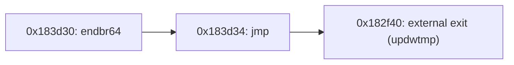

# Complete symbol-extent CFGs from ELF bytes

`Elf.Region.CFG.FunctionRow` adds a complete **declared symbol extent** to the
[byte CFG API](elf-region-cfg.md). Regions remain independent of function
extraction. A nonzero-size `STT_FUNC` record supplies an address and length;
`FunctionRow.Valid` requires the checked layout and symbol reader, an executable
section containing the entire extent, the exact extent's `CodeAt` bytes, full
canonical decoding and the intrinsic CFG relation. The entry is the symbol's
value. IFUNC, undefined and zero-size symbols are excluded from this layer.
No next-symbol heuristic supplies a missing size.

`Valid.encoded_bytes` proves the listed canonical encodings concatenate to the
entire byte extent. `Valid.encoded_size` identifies their total length with
`st_size`. These certificates establish no incoming-edge restriction, ABI
contract, unique partition, source-language identity or reachability of every
syntactically listed edge. Symbol metadata is an explicit boundary convention,
not a semantic theorem about which executions belong to a function.

## One complete actual corpus function

The source is the checked-in Ubuntu glibc 2.39 `libc.so.6`, with provenance and
licence in [the pinned ELF inventory](../../examples/elf/README.md). Its SHA-256 is
`3a15d66867d83762c7f2f1e37359cb8f6c5743edb369c65285cb0b1c4f7498bf`.
The existing checked `.dynsym` record 103 names `updwtmpx`, section 17, value
`0x183d30`, size **9**. `GlibcLibc.Regions.updwtmpx_complete` reuses that symbol
reader theorem and the checked ELF parse, and reads all nine executable bytes:

| ELF VA | Source bytes | Instruction | Successor |
| --- | --- | --- | --- |
| `0x183d30` | `f3 0f 1e fa` | `endbr64` | `0x183d34` |
| `0x183d34` | `e9 07 f2 ff ff` | direct `jmp` | `0x182f40` |



The instruction-start support is `{0x183d30, 0x183d34}`. The ordered byte extent
is `[0x183d30, 0x183d39)` (also these file offsets for this segment), and the
exact declared outward-label set is `{0x182f40}`. There is no terminal RET
omitted from the extent. The tail target lies outside it; the CFG does not
inline `updwtmp`, assume its behavior or add a return/fallthrough edge.
The final instruction at `0x183d34` ends exactly at the symbol's declared end.

`prefix_cfg_valid` and `prefix_not_complete` distinguish a certified partial
window from a complete extent: ENDBR64 alone gives a valid four-byte CFG, but
cannot cover this nine-byte function symbol.

## Execution, RET and concurrency policy

The intrinsic relation still rejects any decoded CALL or RET. In particular,
a RET with no named direct edges does **not** prove a closed region. Neither
function entry nor return is identified with the end address of its bytes.
Supporting returning functions needs a separate return-outcome/state-dependent
boundary policy; an empty successor list is insufficient. Calls also need
callee-summary, first-return and resumption evidence. The inventory below does
not silently broaden that subset.

`FunctionRow.Valid.first_exit` and the specialized `updwtmpx_first_exit` reuse
`CFG.ExecutionContract`: exact executable loading in the invariant, actual
`X86.Ext` retirement for modeled thread steps, invariant preservation by thread
and environment steps, and environment preservation of the focused PC. Every
normal first exit then has the external target `0x182f40`. Faults, traps and all
nonretirement outcomes remain distinguished halts; this is a partial normal-exit
soundness result, not termination or callee adequacy. It makes no hardware
multithread claim. Nonempty admitted entry states are additionally required for
the existing semantic region-validity theorem.

The symbol and bytes use base-relative ELF VAs. This ET_DYN file still needs
actual loader/staged-reader identification, runtime bias, admitted states and
an immutable-code/interference invariant before obtaining a concrete execution
instance. Those premises are explicit, not consequences of the byte certificate.

## Measured native discovery coverage

The executable `elf-region-inventory` reuses the existing staged layout/symbol
readers and canonical `X86.Ext` decoder. `scripts/elf-region/inventory.sh` first
checks the seven pinned hashes, then measures exactly those files. This is a
native candidate inventory, independent of the kernel certificates.

The denominator is distinct `(section index, st_value, st_size)` extents of
defined **STT_FUNC**, with positive size, entirely inside executable
`SHT_PROGBITS`. Aliases across `.symtab`/`.dynsym` count once. Zero-size entries
are counted separately, with no inferred extent. IFUNC and undefined symbols
are excluded. A candidate requires complete canonical decoding, no CALL/RET,
a read-only executable `PT_LOAD`, an instruction-start entry, a bounded address
range and the actual direct-edge/outward-label relation. No reachability or
function-call semantics are inferred.

| File | Distinct extents | Full decode | Calls/RET after full decode | Decode rejection | Accepted direct CFG candidates |
| --- | ---: | ---: | ---: | ---: | ---: |
| hello-gcc | 2 | 1 | 1 | 1 | 0 |
| hello-clang | 2 | 1 | 1 | 1 | 0 |
| gnu-sha256sum | 0 | 0 | 0 | 0 | 0 |
| zlib-checksums | 15 | 10 | 8 | 5 | 2 |
| zlib-libz | 88 | 57 | 45 | 31 | 12 |
| glibc-libm | 615 | 20 | 11 | 595 | 9 |
| glibc-libc | 2247 | 847 | 659 | 1400 | 188 |
| **Total** | **2969** | **936** | **725** | **2033** | **211** |

There were 4,083 defined function-symbol entries, including 12 zero-size
entries (six per hello file); alias deduplication accounts for the remaining
entry/extent difference. No positive-size entry was outside its executable
section in this measured corpus. No additional rejection occurred after the
decode/direct-subset checks. The stripped sha256sum file supplies no defined
STT_FUNC entries; zero in that row is an empty metadata denominator, not proof
that it contains no functions. The other corpus directories were not measured.
Only **one of the 211 candidates** receives a complete-function kernel
certificate here. The selected coverage is **1 function, 2 instructions, 9
bytes**; the remaining candidates and their individual exits are emitted in the
JSON report and are not advertised as certified.

## Reproduce and extend

```sh
lake build --wfail Silmaril.Elf.Staged.Pinned.GlibcLibc.Regions.Thms elf-region-inventory
make check CHECK_TARGETS='Silmaril.Elf.Staged.Pinned.GlibcLibc.Regions.Thms elf-region-inventory'
scripts/elf-region/inventory.sh > build/elf-function-inventory.json
```

The native executable is in the default check target set. Kernel proofs remain
outside its runtime import closure. The graph above is grounded in the certified
row; the ELF viewer's existing certificates remain separate. A viewer extension
should attach both the complete-symbol and byte/CFG evidence, preserving the
existing distinction between certified and stated rows. This slice adds neither
a viewer badge for whole functions nor a new return/call recognizer.
