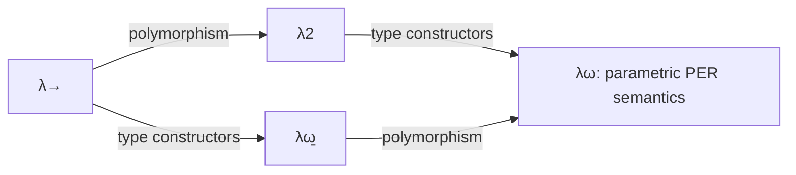

# Lambda cube and parametricity

The lambda cube organizes eight typed lambda calculi by three features:
polymorphism, type constructors and types depending on terms. Silmaril defines
all eight as pure type systems over shared syntax, proves their rule inclusions,
and constructs parametric PER semantics for System F and Fω. Proved institution
translations organize restrictions of those semantics.

**Parametricity** expresses uniform behavior across choices of types and
relations. The abstraction theorems here derive that uniformity from typing;
free theorems then constrain what polymorphic programs can do.

## Build and explore

```sh
make cache
lake build Silmaril.Calculi.LambdaCube.Thms \
  Silmaril.Calculi.LambdaCube.PER.Examples \
  Silmaril.Calculi.LambdaCube.Hets.Examples
```

Import `Silmaril.Calculi.LambdaCube.Defs` for the central definitions and `.Thms`
for the results. `Silmaril.Calculi.TypedLambda` collects the reusable simply
typed syntax and categorical interpretation. These modules use the root
project's pinned Lean, Mathlib and CSLib versions.

| Entry point | Content |
| --- | --- |
| `LambdaCube.PTS` | Pure type system specifications, syntax, typing, eight corners and rule inclusions |
| `LambdaCube.PTSMetatheory` | β-conversion, Church–Rosser and substitution/conversion laws |
| `TypedLambda` | Intrinsically typed terms, raw-term inference, contexts, substitutions and signature translations |
| `LambdaCube.STLC.Thms` | Simply typed set-model institution and βη soundness in sets and cartesian closed categories |
| `LambdaCube.PER.SystemF`, `.SystemFOmega` | Separate System F/Fω syntax, typing and partial-equivalence-relation models |
| `LambdaCube.PER.Parametricity.Thms` | System F abstraction and free theorems |
| `LambdaCube.PER.ParametricityOmega.Thms` | Higher-kind relational interpretation and Fω abstraction |
| `LambdaCube.PER.CubeMorphisms` | PTS/institution translations and parametric semantic restrictions |
| `LambdaCube.Hets.Thms` | Logic graphs, path translations and consequence borrowing |
| `LambdaCube.PER.Reynolds` | Reynolds' set-model impossibility argument with explicit semantic hypotheses |

Module names in the table start with `Silmaril.Calculi.`.

## Eight calculi, one syntax

A **pure type system** (PTS) specifies sorts, sort axioms and product-formation
rules. `Specification` supplies these data; `HasType` implements the seven
rules for sorts, variables, weakening, products, abstraction, application and
conversion. `Pseudo` represents terms and types using de Bruijn indices: a
variable counts outward from its nearest binder.

| Corner | Polymorphism | Type constructors | Types depending on terms |
| --- | --- | --- | --- |
| `stlc` (λ→) | | | |
| `systemF` (λ2) | ✓ | | |
| `omega` (λω̲) | | ✓ | |
| `systemFOmega` (λω) | ✓ | ✓ | |
| `lambdaP` | | | ✓ |
| `lambdaP2` | ✓ | | ✓ |
| `lambdaPOmega` | | ✓ | ✓ |
| `cc` (calculus of constructions) | ✓ | ✓ | ✓ |

`Corner.typing_inclusion` transports every derivation along rule inclusion.
`Corner.inferenceFunctor` packages this as a functor into the category of
inference systems. `Corner.systemF_identity` supplies a closed derivation of
`λ A : *. λ x : A. x` at `Π A : *. A → A`.

`Pseudo.Conv` is untyped β-conversion, including congruence under annotations.
Parallel reduction proves confluence and a common-reduct characterization of
conversion. Renaming and simultaneous substitution preserve conversion;
distinct normal forms, including distinct sorts, stay distinct. The generic
PTS layer provides these conversion results and typing inclusions. Generic
PTS subject reduction and normalization are future work.

`PTSJudgment.systemF_equation_iff` compares equations on the **already STLC-typed
fragment**. The equivalence follows from shared β-conversion and typing
inclusion; it does not reflect arbitrary System F typing. The intrinsic STLC
library below has its own syntax and βη equational theory; a correspondence
with the PTS-STLC corner is not established here.

## Simply typed semantics

`Term S Γ τ` records its type in Lean. The annotated raw syntax has sound and
complete type inference when base-type equality is decidable. Renaming,
substitution, one-hole contexts and operator translations are reusable APIs.

The STLC institution varies over signatures of base types and typed operators.
A signature map uses an injective base-type renaming and a typed operator map.
Its sentence translation and model reduct satisfy the institution's iff law.
Models have arbitrary small base carriers, full function spaces and a discrete
model category.

`STLC.soundness` proves βη soundness in these set models.
`STLC.categorical_soundness` interprets the same equations in any supplied
**cartesian closed category**: a category with finite products and function objects.
Interpretation commutes with substitution, context filling and derived-operator
translations. This interface is a place to attach future game models.
A Boolean model distinguishes two variables, while a one-point model equates them.

## PER models and free theorems

A **partial equivalence relation** (PER) is symmetric and transitive; its
self-related elements are its supported values. The models interpret function
types by application and universal quantification by intersection on a fixed
untyped carrier. A constructed lambda-term model supplies a nondegenerate
instance in which the Church booleans are distinct.

| Result | Exact scope |
| --- | --- |
| System F abstraction | Related environments yield related denotations, using relations saturated under the endpoint PERs |
| `free_id` | Every closed inhabitant of `∀X. X → X` acts as identity |
| `free_K` | Every closed inhabitant of `∀X. ∀Y. X → Y → X` returns its first argument |
| `free_bool_uniform` | A closed Church boolean always selects the first argument, or always selects the second |
| Fω abstraction | Well-typed terms respect the higher-kind relational interpretation, ranging over all relation transformers |
| PTS bridges | System F typing and Fω β-only `TypedB` typing embed into cube typing; conversion reflection uses typed endpoints and the encoded-context hypotheses stated by each theorem |

The System F result uses saturated PER relations; identity extension is an
additional, unproved property. The Fω relational interpretation supplies an
abstraction theorem over relation transformers. A full reflexive-graph model
also supplies object actions and coherence with the relations; combining that
structure with saturated PER semantics is a further construction.

Cube satisfaction quantifies over bounded separated-syntax decodings of a PTS judgment.
Its PER guarantees apply to those decodings; a judgment with no decoding
satisfies this predicate vacuously. Read this predicate as a semantic contract
for the decoded fragment, rather than a characterization of PTS typability.

## Institutions and Hets graphs

An [institution](logic.md) packages signatures, sentences, models and satisfaction.
A PTS morphism maps sorts while preserving axioms and product rules. It preserves
typing, and pulling a target semantics back along it yields an institution
**comorphism**: sentences translate forward and models restrict backward.
Identity and composition laws are proved.

`RestrictionGraph` builds a Hets-style graph from a supplied semantics for a
top corner. Nodes are smaller corners; edges carry proved comorphisms and
reverse institution morphisms. `PERGraph` supplies a concrete instance:



All four nodes retain the same raw judgments, models and satisfaction from Fω;
their typing rules differ. Thus their semantic institution maps are identities
on sentences and models. Paths support model expansion and consequence
borrowing. `PERGraph.diamond` proves the two routes from STLC to Fω equal
as institution comorphisms. `Hets.Examples` checks a polymorphic identity judgment
in the nondegenerate lambda-term model and exposes both composite routes.
This graph records restrictions of one constructed semantics.
The independent STLC set institution and native System F PER semantics remain
separate APIs. Restricted Fω satisfaction implies native System F satisfaction;
the current bridge proves that one direction.

`Semantics c` also provides a conditional interface for the dependent corners:
a client supplies models, satisfaction and soundness. Concrete dependent-corner
models can join the same machinery as they are added. This interface permits
empty model categories; model existence requires a separate construction.

## Proofs and sources

Longer STLC soundness and System F/Fω abstraction proofs live under
[`Silmaril/Proofs/Calculi/LambdaCube`](../../Silmaril/Proofs/Calculi/LambdaCube).
Their public `Defs` and `Thms` files keep definitions and theorem statements
separate from these proofs. Supporting implementation modules retain additional
proofs for incremental refinement.

The bibliography records Reynolds (1983, 1984), Wadler (1989), Atkey (2012),
Selinger (2008), the Cambridge denotational-semantics notes, and the
institution/Hets sources, with artifact hashes in
[`references.bib`](../../references.bib).

`Reynolds.SetModel.false` derives a contradiction from twelve explicit
fixed-universe semantic laws, including full function spaces; the denotation
of `∀` is left arbitrary. A separate `UniverseModel.subsingleton` theorem
assumes products over the whole universe. Its empty/unit `boolUniverse`
witness makes that statement's consistency and scope concrete.
