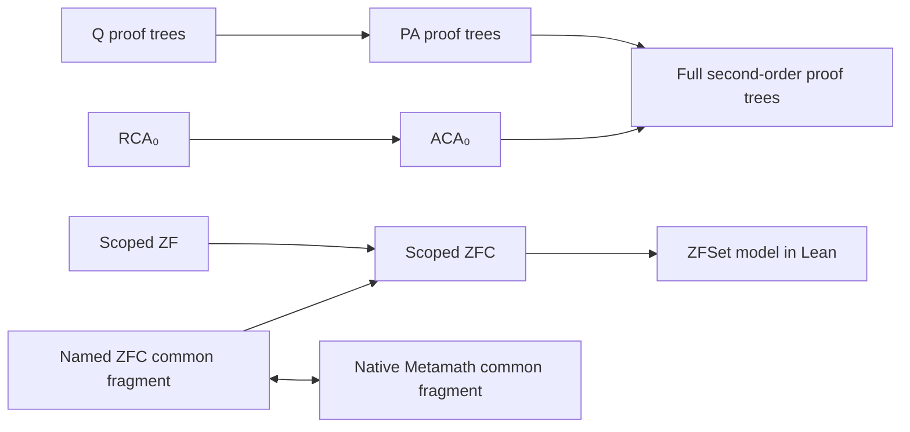

# Arithmetic and set theory

| Entry point | Definitions and results |
| --- | --- |
| `Silmaril.Logic.Arithmetic.Defs` / `.Thms` | Scoped first-order arithmetic, classical natural-deduction proof trees, Q and PA, standard-model soundness and proof reconstruction for closed quantifier-free formulas and their existential closures. |
| `Silmaril.Logic.SecondOrderArithmetic.Defs` / `.Thms` | Two-sorted finite syntax, independent subsystem proof trees, general Henkin structures and standard ω-structures, subsystem inclusions, soundness under explicit axiom assumptions, and native transport for the common Hilbert fragment. |
| `Silmaril.Logic.ArithmeticToSecondOrder.Examples` | A proof-producing compiler from closed PA derivations to full second-order arithmetic (`Z2Full`), with an injective sentence translation and a commuting Q interpretation. |
| `Silmaril.Logic.SetTheory.Defs` / `.Thms` | Independent scoped ZF/ZFC calculi, model soundness, Lean-relative consistency, and exact provability correspondence with the named common Metamath fragment. |

Here **Q** is Robinson arithmetic, **PA** is Peano arithmetic, **ZF** is
Zermelo–Fraenkel set theory, and **ZFC** adds choice. **Second-order arithmetic**
has number variables and set-of-number variables. A **Henkin structure** supplies
separate number and set carriers; an **ω-structure** fixes the numbers to ℕ.

The arithmetic compiler translates actual finite derivations. It handles
classical logic, equality, quantifiers and arbitrary PA induction. Its target is
full second-order arithmetic, not RCA₀. `sentence_injective` proves that distinct
source sentences remain distinct, and `sentence_eval` proves agreement with
standard arithmetic truth. `peanoToSecondOrder` packages the compiler as an
arrow in the arithmetic-capable inference-system category; its Q interpretation
commutes on syntax and proof data.

For a compact arithmetic example, `Arithmetic.paLeftZeroAdd` (in `Arithmetic.Examples`) stores an
induction proof of `∀ x, 0 + x = x`. The examples in
`Arithmetic.Completeness.Examples` reconstruct Q proofs of `3² + 4² = 25`,
`7 · 8 ≠ 55`, and an existential square-root statement. These use arithmetic
axiom constructors and inference rules. They are useful checks that the proof
families have concrete inhabitants.

The ZF presentation uses finite variable indices and capture-avoiding
substitution. Its nine primitive set-theoretic schemas match the selected
set.mm ZF0 assertion shapes, including the replacement schema's shadowing
binder. ZFC extends the same calculus with choice. `ZF.sound` works in any
nonempty membership structure satisfying the stated schemas;
`ZFC.zfSet_sound` uses Mathlib's `ZFSet` universe. The consistency statements are
external results in Lean using that model. They are relative to Lean and its
standard axioms, rather than self-consistency theorems inside ZF or ZFC.

The Metamath bridge proves bidirectional provability for the common named
language with the nine ZF schemas, choice and four propositional assertions.
It constructs finite, well-formed native frames with checked sorting and
disjoint-variable conditions. The independent and native proof objects retain
their own syntax and derivation constructors. `ZF.emptySetProof`,
`ZFC.choiceAndEmptyProof` and the reflected extensionality application in
`Inductive.Tests` exercise both the object logic and the bridge.

## Further translations

| Current result | Concrete next step |
| --- | --- |
| `WKL0Sep` implements Σ⁰₁ separation. | Define the binary-tree form of weak König's lemma and prove equivalence over RCA₀ before exposing the name WKL₀ without qualification. |
| The two full second-order presentations have equal provability. | Preserve the theorem as an equivalence of inhabited proof types; a category isomorphism would also need inverse maps on individual proof fibers. |
| Independent/native SOA correspondence covers the Hilbert fragment, with exact syntax identities for the remaining schemas. | Build sorting and disjoint-variable certificates for induction/comprehension instances, translate number/set generalization, and prove reverse classification of all native schema applications. |
| The independent SOA proof interpreter is sound under the explicit `ValidAxioms` condition; the propositional Hilbert fragment is valid in every Henkin structure. | Prove each subsystem's axiom schemas valid under explicit model closure conditions, then instantiate the all-rule soundness theorem. The concrete standard environment and identity proof exercise the unconditional fragment. |
| ZF/ZFC correspondence covers the named common schema/propositional fragment. | Translate native predicate/equality rules; for larger class terms, prove definition elimination, sort preservation, binder freshness, translated defining axioms and derivation reflection. |
| Q and PA soundness use the standard ℕ model. | Generalize evaluation to arbitrary arithmetic structures and parameterize axiom soundness by the structure's Q/PA axioms. |

The selected set.mm assertions and their exact source hashes are recorded in
[data/metamath](../../data/metamath/README.md). Mathlib is pinned by the root Lake
manifest. Simpson's *Subsystems of Second Order Arithmetic* is a background
reference for the conventional subsystem names; see
[references.bib](../../references.bib).
