# Type theories: MLTT, LF and CIC

Extensional and intensional Martin-Löf type theory (rule budgets, function η, primitive theories, finite tags, W-types with their set model and countability, indexed and mutual inductive systems, context substitution, the HOL bridge), λΠ-modulo (LF) presentations and their native encodings, and the calculus of inductive constructions with defined cases, as institutions and logical systems registered with their comorphisms in the [logic graph](logic-graph.md). The sections below are the guides of each development.

## Extensional MLTT

Martin-Löf type theory (**MLTT**) is a language for types, programs and proofs.
For example, `Π n : Nat, Nat` is a function type; `Σ n : Nat, Id Nat n n`
is a pair containing a number and a proof that it equals itself. The second
component's type depends on the first component.

This development implements **extensional cumulative Russell MLTT**: Π, Σ,
naturals, Empty, Unit and identity types, with equality reflection, UIP,
function extensionality and a hierarchy `U₀ : U₁ : …`. A Russell universe is
used directly as a type of types; a Tarski presentation instead has codes and
an explicit decoding operation `El`. Equality reflection turns an identity
proof into judgmental equality, so the type checker may interchange its
endpoints. UIP says any two proofs of the same identity are equal. Function
extensionality identifies functions that agree at every argument. Cumulativity
allows a type in one universe to be used in a larger universe.

- **Equality reflection** turns a proof of `Id A a b` into equality usable by
  the type conversion rules. The intensional calculus does not have this rule.
- **UIP**, uniqueness of identity proofs, equates any two proofs of the same
  identity type.
- **Function extensionality** equates functions whose outputs are equal for
  every input.
- A **universe** is a type of types. **Cumulative** means that a type admitted
  at one universe level is also admitted at higher levels.
- A **context** lists the variables and their types. A **judgment** states a
  typing or typed equality under that context. A **derivation** is a tree of
  inference rules proving the judgment.
- A **cofinite premise** requires a binder rule to work for every variable name
  outside a finite set of names to avoid. This makes freshness explicit.
- A **Grothendieck universe** is a set closed under the set constructions used
  for the model, including pairs, power sets and suitably indexed unions.
  A **tower** lists such universes in increasing levels.
- **Semantic consequence** means that every model satisfying the assumptions
  also satisfies the conclusion. A soundness theorem connects derivations to
  this model-based meaning.

The source is the standalone MLTT calculus in
[Silmaril #2791](https://github.com/hiloopai/silmaril/pull/2791), head
`9203df8258f40b4997232b481520a2b15eab8e0b`. The GT3 port and bounded-universe
Intensional MLTT, starting from `mr-ohman/logrel-mltt`,
has its own namespace, source rules, soundness and normalization proofs.
The names distinguish the equality rules, without assigning historical priority.

| Development | Namespace | Equality rules |
|---|---|---|
| Intensional MLTT | `Silmaril.Logic.TypeTheory.IntensionalMLTT` | Identity types and J; no equality reflection or UIP rule |
| Extensional MLTT | `Silmaril.Logic.TypeTheory.ExtensionalMLTT` | Equality reflection, UIP and extensionality rules |

The extensional namespace replaces `Silmaril.Logic.TypeTheory.MLTT`; current
imports, proof namespaces and the Raw source use the explicit name throughout.

## Code map

| Entry point | Contents |
|---|---|
| `Silmaril.Logic.TypeTheory.ExtensionalMLTT.Defs` | Source syntax and closed-theory judgment rules |
| `Silmaril.Logic.TypeTheory.ExtensionalMLTT.Derivation` | All rules with hypothesis leaves; theory monotonicity and substitution of derivations |
| `Silmaril.Logic.TypeTheory.ExtensionalMLTT.DerivationStructure` | All-rule closed derivational context recovery and weakening along actual lookup embeddings |
| `Silmaril.Logic.TypeTheory.ExtensionalMLTT.IdentityElimination` | Derived based path induction for actual function-valued motives, computation and empty-theory examples |
| `Silmaril.Logic.TypeTheory.ExtensionalMLTT.SetOps` | Set-valued functions, dependent products/sums, identity types and natural-number recursion |
| `Silmaril.Logic.TypeTheory.ExtensionalMLTT.SetSemantics` | Term interpretation, context satisfaction and judgment validity |
| `Silmaril.Logic.TypeTheory.ExtensionalMLTT.Structural` | Opening, substitution, weakening and fresh-environment laws |
| `Silmaril.Logic.TypeTheory.ExtensionalMLTT.Soundness` | Soundness of every rule and Empty consistency relative to a supplied hierarchy |
| `Silmaril.Logic.TypeTheory.ExtensionalMLTT.Institution.Defs` | Institutions, proof-theoretic entailment and set-model interpretation |
| `Silmaril.Logic.TypeTheory.ExtensionalMLTT.Hets` | A logic graph, interpretation path and borrowing of semantic consequence |
| `Silmaril.Logic.TypeTheory.ExtensionalMLTT.Finite.Derivation` | All rules with a uniform universe bound; finite-tower soundness and Empty consistency |
| `Silmaril.Logic.TypeTheory.ExtensionalMLTT.Finite.Logic` | Sound logical systems and proof-preserving universe inclusions |
| `Silmaril.Logic.TypeTheory.ExtensionalMLTT.Finite` | The family `MLTT(n)`, finite-tower models and universe-inclusion comorphisms |
| `Silmaril.Logic.SetTheory.Universes.Finite` | Finite universe supplies, including concrete instances for 1, 2 and 3 universes |

Longer proofs live under `Silmaril/Proofs/Logic/`. The source calculus remains
under `Silmaril/Raw/Logic/TypeTheory/ExtensionalMLTT/` behind its public header.

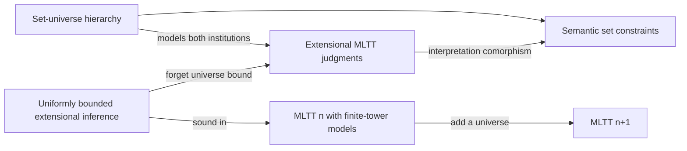

Both institutions currently have one fixed-language signature. A comorphism
translates sentences forward and models backward, with a proved equivalence
of satisfaction. The Hets graph uses Silmaril's institution machinery and
requires no external Hets executable.

The target consists of general set constraints: an environmental premise,
two set-valued expressions and a carrier set. Its interpretation expands an
MLTT judgment into equality and membership in `ZFSet`. A translation into
first-order ZF/ZFC formulas for arbitrary MLTT judgments remains a task in #122.
The existing `SetTheoryTranslation` API already gives first-order membership
formulas for Grothendieck-universe closure and finite/infinite universe supplies;
`eval_grothendieck` and `eval_tower` prove their intended `ZFSet` meanings.
Those universe formulas do not yet translate arbitrary typing derivations.

## Finite-universe institutions

`Finite.bundled n` is the institution `MLTT(n)`. Its sentences are judgments
whose universe indices are all below `n`, including indices in contexts and
annotations. Its models are `FiniteTower n`; interpreting a sentence requires
no infinite hierarchy. The tail-irrelevance theorem shows that out-of-range
entries in a tower's total lookup function cannot affect a bounded sentence.

`Finite.successor n` includes `MLTT(n)` into `MLTT(n+1)`. More generally,
`Finite.inclusion h` works for `h : n ≤ m`. The sentence map preserves the
judgment; the model map forgets the additional universe laws. The maps preserve
satisfaction and semantic consequence, satisfy identity and composition laws,
and form `Finite.family : ℕ ⥤ CoIns`.
`Finite.hetsGraph` registers the family and these inclusions in a Hets logic
graph using the shared indexed-institution construction.

Reflecting semantic consequence needs an extra model-extension assumption.
Inclusions do not automatically extend every smaller tower inside the same
ambient set carrier. `Finite.ModelsExtend h` asks for an expansion agreeing at
indices below the smaller bound; unused lookup entries can change.
`inclusion_entails_iff` uses the resulting agreement on satisfaction to obtain
consequence in both directions. Every zero-level model has such an expansion
when a larger tower is supplied. For positive bounds, existence of one larger
tower alone does not show that every smaller tower can be expanded.

The parameter counts available universe levels: `n` means levels `0` through
`n−1`. It differs from the span or offset bandwidth of a universe-polymorphic
proof. `ECtx.JEqB n H` now bounds every inference-rule universe uniformly;
polymorphic span bandwidth remains follow-up work in #122.

## Structural derivation weakening

`ECtx.Embeds Γ Δ` preserves each exact typed lookup. The all-rule closed
`ECtx.JEqH.weaken` theorem transports a complete equality derivation into an
actually well-formed target context. Cofinite premises add the target's
declared names to their exclusion set and lift the embedding through the
same binder. Every existing rule is handled, including reflection, UIP,
function/sum extensionality and every Nat beta rule. The original `ECtx.JEq`
calculus inherits the theorem through its proved empty-theory correspondence.

`ECtx.JEqH.context` recovers actual context well-formedness, and
`weaken_last` adds a fresh well-formed declaration. Concrete examples preserve
an old named variable and the two-abstraction unit motive through all its
cofinite binders. The small cofinite-family helper follows the established
W-calculus weakening pattern; W uses a separate syntax, so its bounded
theorem cannot apply directly to `ETm`/`ECtx`. The closed specializations have empty judgment hypotheses and permit context
variables. `weaken_of_hypotheses` also handles arbitrary source and target
theories with an explicit `HypothesisTransport H K` contract for original
hypothesis leaves; it does not assume that arbitrary theories are closed under
context change.

## Derived based identity elimination

`IdentityElimination` derives based path induction for an actual term
`M : Π b : A. Π p : Id A a b. Uₙ`. Equality reflection identifies `a` and
`b`; UIP then identifies the supplied path with reflexivity at `a`. Two
dependent application congruences identify `M a (refl a)` and `M b p`, and
conversion transports the supplied base equality. The implementation
`basedJ d b p = d` computes at reflexivity.

The theorem requires actual context, carrier and cofinite motive-fiber
formation derivations, motive typing, endpoint/path typings and base typing.
No formation certificate is inferred from an arbitrary hypothesis leaf.
The concrete unit motive is derived using both abstraction rules; two checked
beta steps supply its base typing. Empty-theory examples cover a declared
path variable and closed computation.

`IdentityElimination.Motive` now packages an arbitrary `C : ETm 2` as
`packageMotive A a C = λ b:A. λ p:Id A a b. C`. Carrier/base typings and
actual cofinite formation of `C` in both binder contexts derive the function
typing. Target derivational weakening supplies the path-domain formation
under the endpoint binder; `max k (n+1)` accounts for the universe-valued
codomain. A concrete endpoint-dependent identity family has a fully checked
packaging derivation. `packagedBasedJ_congr` then applies the derived
eliminator to this actually typed function.

`packageMotive_value` now identifies the packaged application with direct
double instantiation `(C.lst b).lst p`, using actual typed free-name
substitution under the retained path declaration and two checked beta steps.
`directBasedJ_congr` consequently derives elimination at that direct motive
instance, from actual empty-theory carrier/base/endpoint/path typings and
cofinite motive formation. The endpoint-dependent example exercises both
application equality and direct elimination.

Every-rule closed intensional checked preservation is also implemented
separately: `IntensionalMLTT.Extensional.judgment_checked` maps `CheckedEq`
into actual `ECtx.JEqH ∅`; `judgment_checked_successor` lands in
`ECtx.JEqB (levels + 1) ∅`. Closed here means empty judgment hypotheses,
while source contexts may contain variables. These theorems do not translate
arbitrary raw conversion trees or provide a same-budget finite map. Their
syntactic proofs are separate from the semantic corridor.

## Proof boundary

The source PR's new semantic proofs were unfinished. This port proves the
set operations, structural laws and all 34 non-hypothesis inference rules independently,
with a separate rule for judgment hypotheses. `ECtx.JEqH.sound` gives
rule-by-rule soundness; `ECtx.JEq.consistent` excludes closed Empty inhabitants
when a hierarchy is supplied.

`SetHierarchy` supplies an infinite sequence of Grothendieck universes inside
one ambient set carrier. Its existence is an explicit assumption. Separately,
`HasFiniteTower` provides a checked finite supply: the instances for 1, 2 and
3 universes use carriers at Lean levels `u+1`, `u+2` and `u+3`.

`ECtx.JEqB n H` keeps all 34 non-hypothesis extensional rules and the hypothesis rule and imposes the same finite
universe bound on every premise, including the cofinite premise families.
`ECtx.JEqB.sound` validates every rule in an actual `FiniteTower n`, assuming
validity of the theory hypotheses. It does not extend a finite model to an
infinite hierarchy. Hypotheses in `JEqB` itself are arbitrary judgments; the
institution's logical system restricts its theory to bounded sentences.

`ECtx.JEqB.consistent_of_tower` excludes closed Empty inhabitants when the
`HasFiniteTower` typeclass supplies the model. `consistent_one`,
`consistent_two` and `consistent_three` instantiate the concrete supplies.
The examples `zero_one` and `univ_zero_two` check that the bounded systems
admit ordinary data and universe typing.

`Finite.logic n` equips `MLTT(n)` with this proof-theoretic consequence
relation; `logic_sound` proves soundness. `inclusionLogical` and
`successorLogical` preserve bounded derivability and have exactly the same
sentence maps and model reducts as the existing institution inclusions.

`JEqB.forget` embeds a bounded derivation into the original calculus.
A bounded conclusion need not certify the bound of an existing derivation.
We do not claim that an arbitrary cofinite derivation has a uniform finite
bound, or that these results establish bounded GT3 consistency. GT3 still
needs its own rules and interpretation.

## HOL and classical choice

The HOL bridge guide records the syntax compiler,
the extensional-choice proof of excluded middle and the remaining institution-map
obligations. The existing source calculus has no choice rule. The new semantic
selector API keeps its assumptions explicit and restricts selection to inhabited
carriers.

`Finite.Zero.Thms` proves why the current zero rule budget cannot serve as a
full universe-free MLTT: it cannot extend a context or form a type in a Russell
universe. A separate universe-free sentence endpoint uses rule budget one for
auxiliary formation, without changing the finite tower's counting convention.

## Sources and correspondence

| Source | Use and artifact identity |
|---|---|
| `Silmaril/Logic/TypeTheory/Gt3/MLTT/Syntax.lean` at `9203df8258f40b4997232b481520a2b15eab8e0b` | Adapted source syntax/rules; namespace/import changes and free-name support |
| `Silmaril/Logic/SetTheory/Universe.lean` at `288ee492ad09224b78ac44f8456e2ffcd6482384` | Grothendieck closure, set lifting and the universe of lower-level sets; the Tarski-class/cardinality results remain outside this slice |
| Abel–Öhman–Vezzosi, *Decidability of Conversion for Type Theory in Type Theory*, POPL 2018 | Reference for the type formers; the extensional equality rules are additional. PDF SHA-256: `9b1e10047c66efa194ff0d5dac406c8ec712b46ba9c0bfc32180eb9f81c88cb0` |
| GT3 `gt3-rules.tex` in #2791 | Context for the later GT3 translation. SHA-256: `856c19b5a7d609167b32c9c0d293b25f69bec656fc8161c016b15854f865f8b5` |

The MLTT set model uses ordinary function graphs and ordered pairs. GT3's
proof-squashing representation and classical choice require a separate model
and interpretation proof.

To check this slice:

```sh
LEAN_NUM_THREADS=2 bin/mor build --no-pool --mem-cap 16 \
  Silmaril.Logic.TypeTheory.ExtensionalMLTT.Thms
```

## Source review map

Paths below are relative to `Silmaril/Logic/TypeTheory/ExtensionalMLTT/` unless
another root is shown. The code map above names public entry points; these
locate the exact definitions and theorem premises behind the main claims.

| Claims | Source |
| --- | --- |
| Syntax and source rules | `Defs.lean` imports `Silmaril/Raw/Logic/TypeTheory/ExtensionalMLTT/Syntax.lean`; `Derivation/Defs.lean` adds `ECtx.JEqH`; `Finite/Derivation/Defs.lean` defines `ECtx.JEqB` |
| Semantic operations and supplied models | `SetOps/Defs.lean`, `SetSemantics.lean`: `SetSem.pi`, `sigma`, `natrec`, `SetHierarchy`, `ETm.denoteIn`, `EJdg.ValidIn`; `Silmaril/Logic/SetTheory/Universes/Finite/Defs.lean`: `FiniteTower`, `HasFiniteTower` |
| Soundness/Empty consistency | `Soundness.lean` exports `ECtx.JEqH.sound` and `ECtx.JEq.consistent`; `Finite/Soundness/Thms.lean`: `ECtx.JEqB.sound`, `consistent_of_tower`, concrete consistency results |
| Finite sentences, tail irrelevance, inclusions and model-extension condition | `Finite/{Defs,Thms}.lean`, `Finite/Inclusion{,/Defs}.lean`: `Sentence`, `EJdg.validIn_congr`, `inclusion`, `ModelsExtend`, `inclusion_entails_iff` |
| Actual bounded logic, inclusions and zero-budget boundary | `Finite/Logic/{Defs,Thms,Examples}.lean`, `Finite/Zero/Thms.lean`; `Finite/Derivation/Examples.lean`: `zero_one`, `univ_zero_two` |
| Set constraints, semantic corridor and Hets borrowing | `Institution/Defs.lean`: `SetSequent`, `interpret`, `toSetTheory`; `Hets/{Defs,Thms}.lean`: `graph`, `path_borrows` |
| Structural weakening and original-leaf transport | `DerivationStructure/{Defs,Thms,Examples}.lean`, `TheoryStructure/Defs.lean`: `Embeds`, `weaken`, `weaken_of_hypotheses`, `HypothesisTransport` |
| Path induction and direct motive instantiation | `IdentityElimination/{Defs,Thms,Examples}.lean`, `IdentityElimination/Motive/{Defs,Thms,Examples}.lean`: `basedJ_congr`, `packageMotive_value`, `directBasedJ_congr`; `DerivationSubstitution/Thms.lean`: `substitute`, `instantiate` |
| Closed intensional-to-extensional proof maps | `Silmaril/Logic/TypeTheory/IntensionalMLTT/ExtensionalSyntax/Thms.lean`: `judgment_checked`; `ExtensionalHeight/Thms.lean`: `judgment_checked_successor`; `ExtensionalInference/Thms.lean`: inference-map compatibility |
| First-order universe formulas, distinct from general judgment translation | `SetTheoryTranslation/Thms.lean`, `SetTheoryTranslation/Theory.lean`: `eval_grothendieck`, `eval_tower` |

The whole page was compared with source definitions, exact public theorem
premises and named examples, with selected motive-substitution and soundness
proofs inspected. The source identities above record adaptation/reference
provenance, not new correspondence proofs with the external papers. No fresh
Lean build, runtime execution or transitive proof/axiom audit is claimed here;
the displayed build command is a suggested targeted check.


## Intensional MLTT

MLTT means Martin-Löf type theory: a language of terms, types and proofs.
A type can depend on a value. For example, a dependent pair can contain a
natural number `n` together with a proof of `n = n`; its second component's
type mentions its first component. `Π` describes dependent functions and `Σ`
dependent pairs. A universe `U_i` is a type of types, with `U_i : U_(i+1)`.
Identity types express equality as a type with proof terms. “Intensional” here
means those proofs do not automatically make their endpoints interchangeable
by the judgmental type-conversion rules; the separate extensional calculus
has that additional rule.

`Silmaril.Logic.TypeTheory.IntensionalMLTT.Thms` provides scoped cumulative MLTT
with Π, Σ, Nat, Empty, Unit and intensional identity types with based path
induction J. Its rules include no eta, equality reflection or UIP.
The extensional development has a separate namespace,
`Silmaril.Logic.TypeTheory.ExtensionalMLTT`.

For a runnable introduction, see named terms and checked examples:

```lean
import Silmaril.Logic.TypeTheory.IntensionalMLTT.Notation.Thms
open Silmaril.Logic.TypeTheory.IntensionalMLTT

#check mltt% (fun x : Nat => x)
#check Notation.identity_typed
#check Notation.dependentPair_typed
```

The macro constructs an MLTT term. The named theorems establish its MLTT type
by checking a supplied certificate and applying the checker's soundness theorem.
Lean's `#check` on the macro alone only reports the syntax object's Lean type.

The `Conversion`/`Derivation` presentation retains the source calculus.
It has admissible renaming, weakening, substitution, regularity and subject
reduction at every compatible term position. Its concrete quotient realizability
model validates all original typing rules, including arbitrary raw conversion,
and proves closed Empty consistency. A separate open Kripke logical relation
now validates every original typing rule and gives each originally typed term
a unique full annotated normal representative in its original conversion class.
`Normalizer` computes that form for typed open terms and decides their original
conversion, retaining the exact requested source type.
OriginalNormalization proves that its result
is reached by unchanged original reduction, with confluence from every typed
source and original directed joinability for originally convertible typed terms.
CompletionSimulation schedules every conservative
completion path as original computation from any strongly normalizing source;
the two reachability relations therefore agree on typed sources.
`Typing.strongly_normalizing` separately proves accessibility for every original
reduction path from an originally typed term, including annotations and motives.

The separately formalized `CheckedEq` presentation uses typed judgmental
equality. It has soundness in actual finite Grothendieck towers and concrete
Empty consistency at heights one, two and three.
`CheckedEqH.toRaw` preserves both raw
endpoint typings and beta conversion, assuming raw typed equalities for
hypothesis leaves. Raw-to-checked completeness remains open.

Module names beginning with `Original`, such as `OriginalInstitution`, refer
to preservation of that source calculus. They describe implementation
provenance; the mathematical system is called intensional MLTT.

| Entry point | Contents |
|---|---|
| `IntensionalMLTT.Syntax` | Scoped terms, telescopes, lookup and universe occurrence bounds |
| `IntensionalMLTT.Structural` | Renaming/substitution identities, composition and compatibility; binder instantiation |
| `IntensionalMLTT.Rules` | Beta conversion, context/typing derivation trees, cumulative universes and checked Nat/J examples |
| `IntensionalMLTT.Budget` | Whole-proof universe budgets, larger-budget inclusions and finite-proof capture |
| `IntensionalMLTT.Substitution` | Conversion transport, admissible typing renaming/weakening and simultaneous/single-variable substitution |
| `IntensionalMLTT.Regularity` | Context recovery, declaration formation, syntactic Π/Σ/Id formation inversion and universe typing of every derived type |
| `IntensionalMLTT.Computation` | Conversion under pointwise substitution, and typed forms of all six primitive beta computation schemes |
| `IntensionalMLTT.Reduction` | Full-grammar directed compatible computation, renaming/substitution, exact finite-zigzag conversion factorization and based-J synchronization |
| `IntensionalMLTT.SubjectReduction` | Exact requested-carrier preservation for every compatible step, including annotations and all J positions; finite computations give typed equalities |
| `IntensionalMLTT.TypedCompletion` | Original typing throughout conservative parallel computation; typed common reducts characterize original typed equality |
| `IntensionalMLTT.TypedNormalCompletion` | Unique full annotated normal forms reached by conservative computation, retaining original typing at the exact requested carrier |
| `IntensionalMLTT.Normalizer` | Total executable full normalization of typed open terms and exact original-conversion decisions, without a fuel parameter |
| `IntensionalMLTT.OpenCanonicalForms` | Actual source and executable normal-form constructor/neutral alternatives at Nat, Unit, Empty, Sigma and Id, including arbitrary conversion nodes |
| `IntensionalMLTT.StrongCandidates` | Original-step accessibility, annotated constructor and all-six-field J closure, stable accessible neutrals and raw syntax candidates; groundwork for source strong normalization |
| `IntensionalMLTT.StrongBeta` | Original pointwise substitution paths, annotated beta accessibility, dependent raw function candidates and lambda introduction with explicit beta-closed fibres |
| `IntensionalMLTT.SaturatedCandidates` | Elimination-reduct saturation, derived beta closure and saturated dependent Pi candidates with explicit reduction-coherent fibres |
| `IntensionalMLTT.SaturatedSigma` | Saturated dependent pair candidates, projection expansion, pair introduction and exact dependent projection membership |
| `IntensionalMLTT.SaturatedNat` | Least elimination-saturated natural candidate, original reduction closure and successor inversion; excludes function and type-code heads |
| `IntensionalMLTT.OriginalNormalForms` | Original no-step normality, conservative-completion fixedness, raw normal-form uniqueness and normal elimination/type-head separation |
| `IntensionalMLTT.SaturatedUniverses` | Positive raw code hierarchy and actual saturated universe candidates at every finite cap, with strict universe membership and a substantive accessibility gate |
| `IntensionalMLTT.SaturatedUniverses.Functionality` | Cross-cap raw code functionality and inversions, cumulative code membership, and reduction-coherent fibres constructed from actual instance codes |
| `IntensionalMLTT.SaturatedNatrec` | Dependent elimination from the least natural candidate into actual reduction-coherent saturated fibres |
| `IntensionalMLTT.SaturatedJ` | Exact original based-J membership in reduction-coherent endpoint/path fibres, using maximal-accessibility path membership |
| `IntensionalMLTT.StrongNormalization.Support` | Accessibility reflection from simultaneous substitution and saturated Empty elimination with both actual fields reduced |
| `IntensionalMLTT.StrongNormalization` | Full original all-path strong normalization from every source Derivation or Typing, using actual raw instance codes and constructed dependent families |
| `IntensionalMLTT.OriginalInstitution` | Sound full original-rule typing consequence, actual finite/full code-capacity models, source-exact empty hypotheses, all-stage consistency and coherent WithTop CoIns/Hets/apex family |
| `IntensionalMLTT.OriginalHypotheses` | Every original typing rule with actual scoped typing-hypothesis leaves, proof substitution beneath all binders, same-cap whole-tree substitution, exact empty-hypothesis source recovery and concrete realizability soundness |
| `IntensionalMLTT.RawRealizability` | Concrete quotient realizability, actual functional cumulative universe codes and all-rule original soundness/closed Empty consistency, including arbitrary conversion and exact Id/J |
| `IntensionalMLTT.OriginalRealizability` | Exact original-conversion quotient, all-rule soundness, unique canonical closed naturals, Unit computation and closed identity conversion |
| `IntensionalMLTT.NaturalEvaluator` | Total executable evaluation of originally typed closed natural terms, exact returned-numeral correctness and conversion invariance |
| `IntensionalMLTT.TypeHeadEvaluator` | Total executable outer-constructor evaluation of originally typed closed types at every universe; exact typed results and strict universe-head bounds |
| `IntensionalMLTT.NormalForms` | Full annotated normal/neutral syntax, executable recognition, renaming and uniqueness under original conversion |
| `IntensionalMLTT.KripkeCandidates` | Scoped normalization candidates with future renaming, actual neutral reflection, normal-witness reification and dependent Π/Σ/Id operations |
| `IntensionalMLTT.KripkeCodes` | Actual finite open code stages with strictly lower universes, normal representatives, cross-cap candidate functionality, renaming, cumulative lifting and realized telescope environments |
| `IntensionalMLTT.KripkeFundamental` | All-original-rule source fundamental, realization of every source context by its free variables and unique full annotated normal representatives in the original conversion class |
| `IntensionalMLTT.NatEvaluation` | Derivation-based total closed-Nat evaluation and exact Boolean original-conversion comparison |
| `IntensionalMLTT.RawNonconfluence` | Actual raw self-application fork with no common reduct, proved by a full compatible-reduction invariant |
| `IntensionalMLTT.Checked` | Typed finite judgmental equality, all-rule occurrence bounds and checked Nat/lambda/J examples |
| `IntensionalMLTT.CheckedStructure` | All-rule closed checked renaming, weakening, simultaneous substitution and binder instantiation |
| `IntensionalMLTT.CheckedContext` | All-rule closed checked context recovery, declaration formation and reversible newest-declaration conversion |
| `IntensionalMLTT.CheckedInversion` | Same-height checked Π/Σ formation inversion across every equality rule and beta contractum |
| `IntensionalMLTT.AnnotationInversion` | Same-height Π/Σ/Id formation inversion in the typed J-annotation completion, including discharged inference leaves and beta-exposed heads |
| `IntensionalMLTT.AnnotationRegularity` | Actual carrier formation for every completed equality after one additional universe level, including the J-annotation constructor |
| `IntensionalMLTT.CheckedSubstitutionFunctionality` | Full dependent substitution functionality with uniform +1 universe cost given carrier formation, or +2 using regularity, independently of telescope length |
| `IntensionalMLTT.CheckedRegularity` | All-rule closed checked carrier regularity with one additional universe level and actual two-binder instantiation |
| `IntensionalMLTT.CheckedUniverseHeight` | Exact universe-typing thresholds and a concrete counterexample to same-height checked regularity |
| `IntensionalMLTT.ConversionFreeBridge` | Existing original proof trees with no `.conv` nodes compile to checked typing at every positive whole-proof cap; restricted finite soundness |
| `IntensionalMLTT.Bridge` | All-rule checked-to-raw preservation and context transport across a convertible newest declaration |
| `IntensionalMLTT.SetModel` | Scoped graph denotation, substitution semantics, all-rule finite soundness and concrete Empty consistency at heights 1/2/3 |
| `IntensionalMLTT.Finite` | Full-rule logical systems with hypotheses, finite set models, consistency, level comorphisms and `ℕ → CoIns`/Hets |
| `IntensionalMLTT.Extensional` | Constructor translation, finite/apex satisfaction corridors, semantic entailment morphisms and cross-family Hets edges |
| `IntensionalMLTT.Apex` | Full-hierarchy semantic apex, finite-family cocone and `WithTop ℕ → CoIns`/Hets |

All module names in the table start with `Silmaril.Logic.TypeTheory.`. Longer
structural proofs are in `Silmaril/Proofs/Logic/TypeTheory/IntensionalMLTT/`.

## Reading the results

The implementation has three interfaces with different inputs:

| Interface | Input | Established result |
|---|---|---|
| Original typing (`Typing`, `Derivation`) | A derivation using the source rules | Full normalization, original-step strong normalization and exact conversion decisions for typed terms |
| Checked judgmental equality (`CheckedEq`) | An equality derivation whose premises are themselves typed | Finite set-model soundness and checked structural operations; unrestricted translation from original typing remains open |
| Executable certificate checking (`Certificates.verify`) | A supplied indexed rule-tree certificate with finite conversion bounds | Acceptance yields original typing; every original derivation has an accepted certificate |

A normal form has no remaining computations, including in written type
annotations. Strong normalization means **every** sequence of original
computation steps terminates. Confluence from a typed source means any two
finite computations from that source can continue to a common result.
Conversion allows computation in either direction and inside subterms.
The “requested carrier” is simply the type `A` in the judgment `Γ ⊢ t : A`;
retaining it means the theorem returns the same `A`, rather than just an
equivalent type. A telescope is an ordered context of variable declarations,
where later types can mention earlier variables.

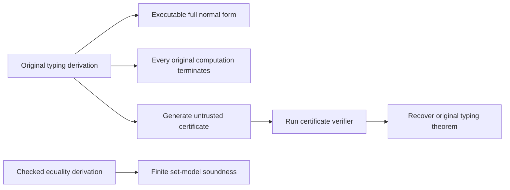

## Binding and equality

`Term n` has `n` available de Bruijn variables; zero is innermost. A lambda
carries its domain annotation. A motive specifies a result type that can vary
with the eliminated input. J is equality elimination: prove a statement about
an endpoint and an equality proof by giving its reflexive case. The motive of
`j A a C d b p` is scoped over
an endpoint `b : A` and then a path `p : Id A a b`. Inside the motive, index
zero denotes the path and index one denotes the endpoint.
`instantiate₂ C b p` respects that order. The ordinary step term of
`natrec C z s t` has two dependent function arguments: a predecessor and its
recursive result.

Conversion is the equivalence and congruence closure of lambda beta,
projection beta, natural recursion and J computation. In particular,
`j A a C d a (refl a)` converts to `d`. Conversion itself is untyped;
`TypedEq Γ t u A` additionally requires both endpoint typing derivations.
Typing conversion also requires formation of the replacement type. Endpoint
typing does not imply that all intermediates of an untyped conversion chain
are typed. Original directed computations do retain typing at every step by
`Derivation.subjectReduction`. Soundness for arbitrary original conversion
uses the concrete quotient realizability model; it does not require every
conversion intermediate to have a typing derivation.

The conversion-conservative completion supplies another path between equal
typed terms: `typedEq_iff_completion_join` gives a common reduct, and
`Typing.completion_reduces` retains the exact requested type along both paths.
Its parallel steps include reductions under dependent annotations and in every
J argument. The reflexive-J completion guard follows from the source typing
tree. This gives typed common reducts while preserving the original conversion
relation and its existing typing rules. This complete-development construction
uses a classical conversion guard. The separate `Normalizer` gives executable
conversion decisions, and `OriginalNormalization` proves original directed
normalization, as described above.

`CheckedEq levels Γ t u A` instead gives every judgmental-equality rule typed
premises directly. Its conversion rule requires a typed equality of the two
types, and it never takes an arbitrary raw `Conversion` proof. Universe
formation and closure rules carry explicit in-range bounds. `CheckedContext`
supplies its well-formed telescopes; reflexive checked equality is
`CheckedTyping`. These are inductive propositions, distinct from the raw
proof-relevant tree data described below.

`CheckedEqH levels H` and `CheckedContextH levels H` permit arbitrary scoped
judgment hypotheses at the leaves of every rule, including beneath binders.
The closed names `CheckedEq` and `CheckedContext` are their empty-theory
aliases. `CheckedEqH.bind` replaces hypotheses by derivations throughout the
rules; `weakenLevels` preserves the full derivation in any larger supply.
Soundness with hypotheses requires those hypotheses to be valid in the chosen
actual tower.

`CheckedEqH.universeBound` proves that bounded hypothesis leaves keep the whole
resulting judgment within the finite level supply: context, carrier and both
endpoints. `CheckedEq.universeBound` needs no hypothesis premise, and
`CheckedEq.levelBound` recovers `i < levels` for a judgment with carrier `U_i`.
The same scoped occurrence-bound definitions are shared with finite sentences.
Unrestricted hypothetical leaves need not be bounded, so their bound is an
explicit premise. The checked universe-zero judgment exists at height two
and is excluded at height one.

`CheckedSubstitutionEq levels Γ Δ σ τ` gives pointwise checked equality at the
left instantiated declaration types. `CheckedEq.subst_congr_uniform` takes these
equal assignments, an actual right checked substitution, a checked target context
and carrier formation. It derives `t[σ] ≡ u[τ] : B[σ]` at `levels + 1`,
independently of the source telescope length. The left substitution is recovered
from the equalities. `subst_congr_regular_uniform` obtains carrier formation
from regularity and uses `levels + 2`. These theorems are in
`CheckedSubstitutionFunctionality.Thms` and cover all Id/J parameters.

The older `subst_congr` and `subst_congr_regular` APIs remain available with
telescope-length bounds `levels + |Γ|` and `levels + 1 + |Γ|`, respectively.
Their proofs use checked abstraction, application and beta equality. Examples
use a nonconstant endpoint/path family and change the fixed left endpoint of an
actual J term. These results do not prove arbitrary raw conversion admissible
in the checked calculus.

`LinearJ.Parallel` is a separately named raw extension on the same full
syntax. Its J root rule contracts `j A a C d b (refl c)` to a parallel reduct
of `d` while ignoring the redundant endpoint annotations. It does not replace
`RootReduction`, `ReductionStep`, raw `Conversion`, or `CheckedEq`.
`LinearJ.develop` and `Parallel.triangle` give an actual complete-development
proof of the parallel diamond. `LinearJ.confluent` proves confluence for its
finite directed closure, and `convertible_iff_join` identifies its own
conversion with extended common reducts. Pointwise parallel substitution,
renaming and both motive binders are included.

`LinearJ.ofRootReduction`, `ofReductionStep`, `ofReduces` and `ofConvertible`
embed the original relations. `strict_directed_extension` gives a closed raw
mismatched-J term that is normal for original reduction and contracts to
`star` in the extension. This example proves directed strictness. A separate closed raw
counterexample, `ConversionCompletion.Preservation.Examples.unrestricted_reflection_false`,
proves that unrestricted conversion reflection from `LinearJ` is false.
For two actually originally typed endpoints, `LinearJ.convertible_iff_original_of_typing`
does prove reflection; `Derivation.linear_subjectReduction` preserves original
typing along its parallel steps. Arbitrary extended-step checked subject
reduction remains separate. The original raw nonconfluence fork joins in the
extension; a separate example pairs one extended J step with an actual
original checked computation from explicit endpoint/path equalities.

`Convertible.rigidHead_eq` proves a consequence for the **original** raw
conversion: when both endpoints have persistent outer constructors, their
head tags agree. `Term.rigidHead` records variable indices, universe indices
and every constructor that no root law removes; eliminators have no rigid
head. The proof embeds the original conversion into `LinearJ`, obtains an
extended common reduct and preserves both heads along the two paths. It needs
no conversion-conservativity assumption. The separate guarded completion
now recovers original component conversion as described below.

In particular, `convertible_univ_iff` gives original raw universe-index
rigidity. Direct corollaries separate universes from products, sums and
identity types, products from sums, and Nat/Empty/Unit from one another.
An all-rule original universe-generation induction yields
`typing_univ_iff`: `Typing Γ (univ i) (univ j)` holds exactly when `Γ` is
well formed and `i < j`. Original raw universes therefore cannot inhabit
themselves, even with arbitrary raw conversion intermediates. These are
syntactic separation and generation results. All-rule semantic soundness and
component compatibility are proved separately.

Original `Derivation.lam_generation`, `pair_generation`, `zero_generation`,
`succ_generation`, `star_generation` and `refl_generation` recover actual
introduction premises and conversion from the requested carrier to the
constructor's native carrier. Lambda annotations and dependent pair component
types are retained. The proof covers every original typing rule, transports
the carrier through conversion and rules out a universe carrier in the
cumulativity case using persistent-head separation. A converted lambda-carrier
example and specific impossible lambda/zero typings exercise this result.
These generation results supply the introduction premises used in root
subject reduction; they do not assert normalization.

`Derivation.nat_zero_subjectReduction`, `nat_succ_subjectReduction` and
`j_refl_subjectReduction` now preserve the exact requested carrier from an
arbitrary original typing tree of the corresponding root redex. They retain
all conversion and cumulativity endings. The successor case obtains actual
predecessor typing by value generation, then types the genuine recursive
call. The `TypedEq.*_of_typing` corollaries package both endpoint typings and
the original raw computation law. Constructed examples cover type-valued
recursion lifted by cumulativity and Nat/J computations at beta-redex carriers.
`Derivation.root_subjectReduction` also covers beta and both projections.
`Derivation.subjectReduction` extends preservation to every compatible position
of the original grammar, including domain annotations and both J motive
binders. The proof converts dependent contexts when annotations change and
restores the exact requested carrier after dependent arguments change.
`Typing.reduces` iterates this result along any finite original computation;
`TypedEq.of_reduces` packages the source typing, target typing and original
conversion. Regressions include the annotation-changing lambda fork, a
nonconstant endpoint/path-dependent J motive with a neutral path, and a
cumulative requested upper universe. Original raw nonconfluence remains
proved. `StrongNormalization` establishes strong normalization for the original
directed relation from every original source typing. Raw-to-checked completeness
remains open.

`CheckedEqH.toRaw` interprets each hypothesis as a raw `TypedEq` and preserves
that judgment throughout every checked rule. Thus it proves raw typing of both
endpoints at the stated carrier, as well as raw beta conversion. Closed
`CheckedEq.toRaw` needs no hypothesis interpretation. Checked contexts also
preserve raw well-formedness. The Π/Σ cases use `Derivation.changeLast`, proved
from a typed identity substitution between telescopes whose newest types are
convertible. Dependent result types in application, projections, Nat and J
are converted using actual formation derivations. This theorem is one-way:
it does not turn arbitrary raw equality into checked equality. Original raw
semantic soundness is supplied separately by `RawRealizability`.

`CheckedEq.rename` and `CheckedEq.weaken` transport all closed checked rules
through lookup-preserving variable maps and checked scope extensions.
`CheckedSubstitution` supplies an actual closed checked typing for every
assigned source variable. Its identity, lifting, extension and composition
operations support `CheckedEq.subst` and `CheckedEq.instantiate`; the full
proof checks both J binders and every primitive computation rule. Target
contexts must be checked, and source occurrence bounds recover the finite
universe levels needed beneath binders. Here closed means no arbitrary judgment hypotheses; the variable telescope
may be nonempty. An arbitrary set of judgment hypotheses need not be preserved by
renaming or substitution, so no unrestricted hypothetical structural theorem
is asserted. Concrete successor substitution and weakened beta examples
exercise the new admissibility API at height one.

`CheckedEq.instantiate_type_congr` proves that equal checked arguments give
equal instances of an actual checked type family at `levels + 1`.
`CheckedEq.instantiate_congr` extends this to checked term equalities with
explicit carrier formation; `instantiate_congr_regular` obtains that formation
from regularity and uses `levels + 2`. These are derived from the existing
lambda, application and beta rules. `instantiate₂_type_congr` handles a real
dependent two-binder telescope at `levels + 1`, transporting the second
argument's carrier when the first argument changes. No raw conversion or
normalization hypothesis enters these proofs.

`CheckedEq.j_of_endpoint_path_eq` derives original checked J computation at
`levels + 1` when the endpoint is explicitly checked equal to the fixed base
endpoint and the path is explicitly checked equal to its reflexivity witness.
It uses the two-binder functionality theorem to transport the actual dependent
motive carrier. A closed example uses a motive depending on both the endpoint
and path, with a beta-redex right endpoint that does not match the syntactic
root-J contraction. Recovery of the endpoint/path equalities from arbitrary
typing and raw-to-checked completeness remain open. Original-step strong
normalization is proved separately by `Typing.strongly_normalizing`.

`CheckedEq.context` recovers a checked telescope from every closed checked
equality rule. `Lookup.checkedFormation` gives an actual checked universe
typing for each retrieved declaration, including all intervening weakenings.
`CheckedSubstitution.changeLast` constructs a typed identity assignment from
`Γ.snoc A` to `Γ.snoc B` when `A` and `B` have a checked universe equality.
Its newest entry converts the target variable's type back to the source
declaration; older entries are ordinary lookup typings. Applying all-rule
checked substitution gives `CheckedEq.changeLast` and its reversible form.
No level enlargement is needed for these context theorems. A concrete beta
example replaces the type `(λ _:Unit. Nat) star` by `Nat` in a checked
context. These are structural theorems about the current calculus, separate
from the general checked type-regularity theorem below.

`CheckedEq.sound` proves equality and actual set membership for every checked
rule in any `FiniteTower levels`. Lambda beta uses membership of its argument
in the graph domain. Nat recursion uses a typed predecessor and
recursive result. The Id interpretation is a singleton exactly when the
endpoint values agree; typed J uses that agreement and the unique path value
to transport its base-case membership into the target motive. None of these
semantic facts adds reflection or UIP to the syntax.

The finite supplies are constructed in successively larger Lean set carriers.
`empty_consistency_one`, `empty_consistency_two` and `empty_consistency_three`
therefore rule out closed checked inhabitants of Empty without assuming an
infinite hierarchy. Checked zero, natural identity/beta and J-refl examples
already live in height one. `U₀ : U₁` requires at least height two.

`CheckedUniverseHeight` checks the finite-height boundary for regularity.
Given an actual `FiniteTower (k+1)`, `checked_universe_typing_iff` proves
that `Uₖ` has some checked universe type at height `levels` exactly when
`k+2 ≤ levels`. The negative direction uses every-rule checked soundness:
any proposed type level `i` at height `k+1` satisfies `i ≤ k`, so its model
would give `Uₖ ∈ Uᵢ ⊆ Uₖ`, contradicting membership irreflexivity. The
positive direction is an actual universe-rule derivation. The constructed
two-level model makes the `U₁` threshold unconditionally concrete: it is
untypable at height two and has type `U₂` at height three.

Consequently `not_same_height_checked_regularity` refutes the unchanged-height
claim for the existing checked calculus, using the actual `U₀ : U₁` derivation
at height two. The separate syntactic theorem `CheckedEq.type_formation`
now proves the corrected general contract: from `CheckedEq levels Γ t v A`,
it derives some `CheckedTyping (levels+1) Γ A (univ i)`. This covers every
existing closed checked equality rule and every variable telescope; no set
model is required for the positive theorem. One extra level suffices uniformly
and is necessary in general, as the concrete universe example shows.

`CheckedEq.pi_formation` and `CheckedEq.sigma_formation` now recover actual
checked domain and codomain universe typings, in `Γ` and `Γ.snoc A`, from
any equality with a syntactic product/sum endpoint. They preserve the original
height and cover every existing checked equality rule. The strengthened
internal induction treats both endpoints after arbitrary checked substitution.
Each image with a syntactic Π/Σ head must have component formation; images
with other heads impose no condition. Identity images satisfy this directly.
For a beta contractum, extending the assignment uses the argument induction
hypothesis, so no general regularity theorem is assumed. The right fibers of
Π/Σ congruence use actual newest-declaration conversion. Concrete type-valued
identity beta examples expose a product and a sum by substituting an argument
for a variable, exercising the strengthened step. No replacement typing
calculus or conversion-injectivity assumption is used.

Carrier regularity uses that checked inversion for the function/pair types
in application and projections, followed by actual checked instantiation.
`CheckedEq.instantiate₂` constructs the composed endpoint/path assignment
for a J motive, with the path innermost, and checks the result-carrier
formation for the full J rule. Contexts also embed into larger level supplies
via `CheckedContext.weakenLevels`. Concrete application, second-projection,
full-J and sharp universe examples exercise these branches. This is
regularity for the existing `CheckedEq` calculus; it does not assert raw
subject reduction, conversion injectivity or syntactic extensional preservation.

`Renaming Γ Δ ρ` preserves declaration lookup. `Substitution Γ Δ σ`
provides a derivation for every assigned source variable at its instantiated
type. Given a well-formed target, `Derivation.rename` and `Derivation.subst`
transport actual derivation trees through every typing rule, including
cumulativity and J's endpoint/path binders. `Derivation.instantiate` gives
dependent substitution for the newest declaration. `TypedEq.beta` uses that
theorem to derive the beta contractum's typing, and `TypedEq.subst` transports
both endpoint typings and their conversion. These are syntactic admissibility
theorems and do not establish subject reduction for arbitrary raw conversions.

`Derivation.context` recovers an actual well-formedness tree from every typing
tree. `Lookup.formation` checks retrieved declarations in their full context.
`Derivation.type_formation` proves that every derived type belongs to some
universe, using substitution for dependent application, projections, Nat and J.
Syntactic Π/Σ formation inversion also handles final conversion and cumulative
rules. `ConversionCompletion` supplies original component conversion, used
with this formation and constructor generation to prove root subject reduction.

All six root computation schemes now have typed equalities from their ordinary
formation premises. In particular, the second projection's contractum is
converted into the projection's dependent source type, and Nat successor
applies the step term to the predecessor and the typed recursive result.
`SubjectReduction` extends these contracts to arbitrary typing trees, including
final conversion and cumulativity rules, and every compatible term position.

`RootReduction` orients the six existing raw beta laws. `ReductionStep` places
one such contraction in one subterm, including annotations, all ordinary
binders and both binders of the J motive. `Reduces` is its finite directed
closure. These relations preserve renaming and simultaneous substitution;
directed paths are compatible with every term constructor. Raw `Convertible`
is exactly a finite path of forward or backward `ReductionStep` contractions.
This is an exact factorization of the existing conversion relation, without
changing its rules or assuming a common reduct.

`Reduces.j_synchronize` gives an actual directed J computation when its three
endpoint copies reduce independently to a common term. A closed typed J
example checks the local fork: reducing only the right endpoint prevents an
immediate root contraction, but further directed steps synchronize the other
copies and reach the original base case. This local synchronization does not
imply unrestricted raw confluence.

`RawNonconfluence.raw_not_confluent` proves that unrestricted raw confluence is
false for the existing exact based-J rule. Its closed self-application terms
adapt Barendregt and Klop's finite fixed-point counterexample: a term `C A`
reduces both to `star` and to `C star`. Every reduct of `C star` retains an
unbalanced recursive J guard. The invariant includes pending lambdas and is
stable under substitution and every compatible reduction position, so the
nonjoining proof includes reductions under binders. Since `star` is normal,
these two reducts have no common reduct. The public API also gives an actual
raw `Convertible` pair with no common directed reduct.

These witnesses are raw self-applications; no typing derivation or typed
inconsistency is asserted. The result leaves all checked finite soundness,
Empty consistency and checked-source-to-extensional preservation theorems
intact. Original compatible subject reduction coexists with this raw
nonconfluence. A checked normalization/conversion bridge and raw-to-checked
completeness remain open; unrestricted raw Church–Rosser cannot supply them.

`CompletedConversionBridge` reifies one compatible raw contraction into
`AnnotationCheckedEq` when the original source typing tree is conversion-free.
Unlike `StableJStep`, its `ReductionWitness` covers every existing raw position,
including J's carrier, fixed endpoint and motive. Witnesses are equivalent to
`ReductionStep`; they contain raw computation rather than assumed typing
certificates. The result retains the exact source carrier.

The finite reserve starts at one level, adds three for each enclosing lambda
domain change, and adds one for each enclosing J carrier or fixed-endpoint
change. The other positions retain the inner reserve. Any raw `ReductionStep`
therefore yields a completed equality at some finite enlarged level supply.
This reserve describes the proof construction, not an optimal universe bound.

`AnnotationCheckedEq.conv_of_original_step` and its reverse form use these
equalities for carrier conversion of arbitrary completed judgments. The value
proof need not be conversion-free; the supplied original carrier-formation
tree still must be. Examples change a lambda annotation, convert a carrier
below a Pi, and compute inside J's fixed endpoint and motive while retaining
the original result carrier. This does not yet reflect arbitrary raw
conversion trees or remove the conversion-free source restriction.

`Derivation.evaluateNat` computes the canonical natural value with no caller
fuel. The actual complete-development function is cofinal at reachable
stationary targets, so closed canonicity proves termination of the search for
a literal numeral. `evaluateNat_spec` supplies original typed equality and a
directed guarded path to the answer. `Derivation.compareNat` returns true
exactly when its two actually typed closed Nat subjects are originally
convertible; false rules out that conversion. Both operations are computable
Lean definitions. Their termination depends on actual original typings,
and they make no claim about conversion at other carriers or in open contexts.

## Finite institutions and the semantic apex

`Finite.Sentence n` bounds the whole scoped judgment: context, carrier and
both terms. `Finite.logic n` uses all checked inference rules with arbitrary
bounded hypotheses, and `Finite.logic_sound` proves its soundness in actual
finite towers. Its entailment relation is concretely nontrivial at heights
one, two and three. Larger stages have a nonempty model class whenever the
corresponding `HasFiniteTower` is supplied in the chosen Lean carrier.

For `n ≤ m`, `Finite.inclusionLogic` preserves derivations and its underlying
institution comorphism is `Finite.inclusion`. Sentences move forward without
changing their judgments; models move backward by restricting tower closure
laws. Satisfaction is preserved exactly. These maps obey identity/composition
and give `Finite.family : ℕ ⥤ CoIns` and the corresponding Hets graph.

`Apex.bundled` interprets all scoped judgments in explicitly supplied full
set hierarchies. Restricting a full hierarchy gives a model of every finite
stage. The maps `Apex.fromFinite` form a proved cocone, and `Apex.family`
extends the finite family to `WithTop ℕ`, with a Hets node for the apex.
Every apex sentence occurs at its computed finite occurrence bound. The
construction does not assert a colimit universal property or construct a
nonempty class of full hierarchies; finite consistency above uses the
independently constructed finite supplies.

`Extensional.term` translates scoped variables into locally nameless
extensional terms, retaining Π/Σ binders, Id and universe constructors. It
partially applies the ordinary two-argument Nat step beneath the target's
predecessor binder. J translates to its base term, matching the existing
specified set interpretation. The denotation theorem compares these two
interpretations; it does not assert raw beta-conversion soundness. Checked J
soundness supplies the result-carrier membership when the endpoint and path
are typed.

Named telescope translation uses injective canonical names and a proved
extension of every source environment to a named environment. This gives
actual satisfaction equivalence in the same finite tower, with no increase
in whole-judgment universe occurrences. `Extensional.finite` is consequently
an institution comorphism, `finiteEntailment` maps every checked inference
into the target **semantic** entailment relation, and `finiteNatural` commutes
with all finite level inclusions. An unlifted view of the existing full
extensional hierarchy semantics receives `atApex`; the finite-to-apex squares
also commute. `targetFamily` is a proved `WithTop ℕ` institution functor, its
apex is a cocone over the finite extensional family, and `natural` translates
the full source finite/apex functor to it. The Hets graph contains both
finite/apex families and their
translation edges. Concrete beta validity and a false Empty judgment show
that this interpretation is nonvacuous.

Separate syntactic preservation is implemented for every closed checked rule.
`Extensional.judgment_checked` translates `CheckedEq levels` into actual
extensional `ECtx.JEqH ∅`, and `judgment_checked_successor` lands in
`ECtx.JEqB (levels + 1) ∅`, with actual carrier formation at that same bound.
Closed means empty judgment hypotheses; the variable telescope may be nonempty.
Injective naming supplies the target context and lookup typings. The proof
handles the target's cofinite contexts and derives J elimination using its
extensional identity rules.

`ExtensionalInference.successorInference_naturality` makes this fixed-stage
proof map commute with level inclusions. The proof map and semantic corridor
share the canonical sentence translation, but the fixed-stage theorem does not
itself assert an institution morphism or transport arbitrary judgment hypotheses.
Translation of arbitrary raw `Conversion`/`Derivation` trees, same-budget checked
preservation and raw-to-checked completeness remain separate boundaries.

The current policy is beta-only. Upstream's Π/Σ eta and Unit equality are
not silently included. They require separately named variants and checked
relationships. Intensional identity types also have no rule that turns an
identity proof directly into judgmental equality of its endpoints.

## A realizability model for the original raw calculus

`RawRealizability.Value n` is the actual full scoped syntax modulo the separately
named `LinearJ` conversion. Confluence proves injectivity of the target's Π/Σ/Id
constructors and separation of their heads. Original conversion embeds one way;
no original component injectivity or conversion conservativity follows.

`RawRealizability.Code i q X` constructs an actual set of realizers `X` for a
quotient type `q`. Nat denotes numeral classes, Empty denotes the empty set,
Unit denotes the star class, and dependent Π/Σ use actual application and pair
classes. Identity uses a proof-irrelevant target set of reflexivity classes.
This target interpretation does not add equality reflection or UIP to the source.

`CodeLayer` is strictly positive because realizer sets and families are explicit
external data. `Code` supplies lower universe stages by well-founded natural
recursion: U_j is available only when `j < i`, and its realizers are actual
level-j codes. Interpretation functionality is proved across all code levels;
cumulative lifting keeps the same realizer set. Original raw conversion
preserves code interpretation by the proved quotient embedding. Constructed
examples include Nat and reflexivity realizers, U0 in U1, cumulative Nat,
an original beta-redex type, and a coded Empty set with no realizers.

The environment interpretation respects capture-avoiding substitution, binding,
original conversion and actual quotient computation. `Derivation.realizes` proves
that every original derivation maps every realizing assignment into an actual
carrier code and member. Its induction handles all original rules, including
arbitrary `.conv`, `.cumulative`, dependent Pi/Sigma, Nat recursion by actual
numeral induction, and the exact original based-J rule. Target identity membership
supplies equal endpoint values and an actual reflexivity class for J computation;
no equality reflection rule is added to the source.

`closed_realizes` gives actual code/member data for closed source derivations.
The empty context has an actual realizing assignment, and `empty_consistency`
therefore excludes any original closed Empty inhabitant without a conversion-free
restriction. Examples include a converted Nat recursor, a cumulative type-valued
recursor, converted J and a motive depending on both endpoint and path.
Original compatible subject reduction and strong normalization are proved
independently in `SubjectReduction` and `StrongNormalization`. Checked reification
and full raw-to-checked completeness remain separate.

## Canonical closed natural values

`OriginalRealizability` supplies a second realizability model whose quotient
equality is exactly original conversion. It adapts the existing model's code,
environment and fundamental proofs to the conservative completion. Its J
computation requires equal endpoint values and a reflexivity value; actual
identity-code membership supplies both. The existing `RawRealizability` model
keeps its independently useful unconditional untyped J computation law.

`Derivation.originalRealizes` validates every original typing constructor in this
exact quotient, including arbitrary raw conversion and cumulativity. The empty
context has a realizing assignment. A closed natural therefore denotes a numeral
class in the original conversion relation. Numerals have no nontrivial parallel
reduct, so the common-reduct theorem gives `closed_nat_computation`: every
originally typed closed natural reaches exactly one numeral in a finite
conservative-completion computation. `closed_nat_typed_computation` retains its
original natural type. The same argument computes closed Unit terms to star;
closed identity proofs identify their endpoints by original conversion and are
convertible to reflexivity.

These are computations in `ConversionCompletion`, whose guarded J rule differs
from the original directed relation. Full normal forms at arbitrary dependent
types are reached in this completion by `TypedNormalCompletion`. `Normalizer.reduces` certifies its executable strategy in the completion. Source strong
normalization is proved separately, and `OriginalNormalization` now derives
normalization in the unchanged original directed relation.
Examples include a source recursor with
actual nontrivial conversion nodes, an endpoint/path-dependent J proof,
an actual Unit inhabitant, and exclusion of a closed identity proof of zero = one.

## Executable natural evaluation

`Typing.linearJ_develop_eq_completion` shows that the executable structural
`LinearJ.develop` agrees with the guarded development on every actual original
typing derivation. Original typing supplies each J guard. Every iteration keeps
the exact requested type and is a finite conservative-completion computation.
A cofinality proof shows that complete development eventually finds any reachable
parallel-normal form; the closed-natural canonicity theorem supplies such a form.

`NaturalEvaluator.value t h` evaluates any closed `t : Nat` with original typing
proof `h`. It searches for the first development iteration that is a literal
numeral. The termination and `Option.get` safety proofs are erased at runtime;
the executable uses structural development and numeral recognition. `correct`
proves original typed equality between the input and its returned numeral.
Originally convertible inputs return the same value. `steps_minimal` concerns
development iterations, rather than the shortest possible reduction sequence.

For example:

```lean
module
public import Silmaril.Logic.TypeTheory.IntensionalMLTT.NaturalEvaluator
public meta import Silmaril.Logic.TypeTheory.IntensionalMLTT.NaturalEvaluator.Defs
public meta import Silmaril.Logic.TypeTheory.IntensionalMLTT.Rules.Thms

open Silmaril.Logic.TypeTheory.IntensionalMLTT

#eval NaturalEvaluator.value natRecOne ⟨natRecOne_derivation⟩ -- 1
#eval NaturalEvaluator.value jZero ⟨jZero_derivation⟩         -- 0
```

These two executions also run during the examples build. The API takes an original
typing proof; it does not infer types for unchecked inputs. Search currently
recomputes each development prefix. The general `Normalizer` below extends this
strategy to full annotated normal forms at every type and in open contexts.

`TypeHeadEvaluator.head A h` extends executable evaluation to closed types
`A : U_i`, for any universe index `i`. It iterates the same structural complete
development until an outer Nat, Empty, Unit, universe, Π, Σ or Id constructor
appears. Original type formation proves that the search terminates. `correct`
gives original typed equality at the exact requested `U_i`, and a returned
universe `U_j` satisfies `j < i`. Originally convertible inputs have the same
constructor tag, including the exact index for a universe.

This stops at the outer constructor: a product already containing a reducible
domain is returned unchanged. Its components need not be normal forms, and
the API does not decide conversion between arbitrary dependent types. The
termination proof uses actual code membership for every original typing rule,
including arbitrary conversion and cumulativity. Runtime examples exercise a
type-valued beta redex, universe two at universe three, and type-valued J.

`NormalForms.Normal` checks all annotated syntax, including lambda domains,
Nat-recursion motives and both binders of a J motive. Its executable recognizer
`isNormal` is proved sound and complete for that grammar. Normal forms remain
normal under renaming, and originally convertible normal forms have identical
scoped syntax. `Neutral` describes variable-headed eliminations with normal
arguments and annotations; every neutral is normal.

The grammar also covers untyped stuck syntax. J is normal only when its path
is not a reflexivity constructor, so it is normal for the separately named
`LinearJ` relation and for the conservative completion. A fixed point of
complete development is a weaker condition: the raw self-application Ω is a
proved fixed point that the normal recognizer rejects. Examples also reject
redexes hidden inside domain annotations and motives.

`OriginalRealizability.QNormal q` asks for an actual normal representative of
the exact-original-conversion class `q`. Its normal representative is unique,
and renaming preserves the property. `KripkeFundamental.Source` establishes this
property for every originally typed term, including open terms and annotations.
It gives an original-convertible normal representative, without a directed
reduction path to it or a proof that every reduction sequence terminates.
The latter property is established independently by `StrongNormalization` for
the original reduction relation.

`KripkeCandidates` supplies the open-scope candidate operations for that logical
relation. A candidate tests quotient values along every future renaming. Each
member carries an actual `QNormal` witness, and every actual neutral form is
reflected into every candidate. Thus a domain used for Empty still admits a
fresh variable when the scope is extended: function membership cannot rely on
an empty closed domain.

Dependent function membership tests every future argument. Dependent sums
admit either a neutral form or a pair with actual component membership; fibre
coherence transports those components along renaming. Identity membership
admits a neutral proof independently of endpoint equality, or a reflexivity
proof with equal endpoints. Concrete candidates also cover Nat and Unit.
The examples include an originally typed Empty identity with actual function
membership, an actual pair, and an originally typed hypothetical neutral path
whose zero and successor-zero endpoints remain distinct.

The candidate universe constructor takes explicit lower-code transport and
neutral-code reflection contracts. `KripkeCodes` now constructs actual stages
by recursion on the finite cap: `U_j` uses strictly lower stage `j`, while Nat,
Empty, Unit, neutral types, dependent Π/Σ and Id have concrete codes. Every
code has an actual normal representative. For dependent bodies, that witness
comes from instantiation at the reflected fresh variable. Renaming preserves
code interpretation, and lifting to a larger cap preserves the exact candidate.
Realized telescope environments retain actual code/member witnesses for each
declaration and transport along renaming.

Examples include closed Nat in universe zero, universe codes at stages one,
two and three, and the dependent type `Σ x : Nat, Id Nat x x` with an actual
source formation and argument-dependent identity fibres. Thus these stages
include closed and dependent types as well as neutral universe codes.

Cross-cap code functionality proves that independent interpretations of the
same original conversion class have equivalent candidate membership. This
coherence aligns dependent fibres and carrier conversions throughout the
source fundamental theorem.

`KripkeFundamental` defines validity against the original source telescope and
proves preservation for every original typing rule, including arbitrary
original conversion and cumulativity.
Its lambda lemma constructs a normal witness from domain-code validity and
body validity: it extends the actual realized environment with a fresh neutral
member, reifies the open body there, and reconstructs the annotated lambda by
original conversion congruence. This also works when the closed domain is
Empty. Examples exercise an actually source-typed beta program and both closed
and open identity abstractions. The source induction combines these rule
lemmas without assuming source normalization. A second induction realizes every
well-formed original context by its free variables; applying validity to this
environment yields the normal-representative theorem.

`TypedNormalCompletion` turns this originally convertible representative into
a directed conservative-completion normal form. The common-reduct theorem gives
a join of the source term and its full normal representative; the normal side
cannot change, so the source reaches that representative. Every intermediate
term, including the normal form, retains original typing at the exact requested
carrier, which need not itself be normalized. The normal form is unique as scoped
syntax. Examples include a dependent pair projection, an open neutral
J, an open successor recursor and a J with an endpoint/path-dependent motive.

Neutral eliminators have reconstruction lemmas for projections, Empty
elimination, Nat recursion and J. These use actual normal representatives of
every annotation and motive and actual neutral representatives of the
scrutinee/path. The J lemma keeps both motive binders and makes no endpoint
equality assumption. The examples include original source typings for a
neutral natural recursor with a real step function and for J in a dependent
context containing a hypothetical path between distinct open endpoint values.

The general Natrec and J validity rules now construct members of actual motive
interpretations from the validity of the original rule premises. Natrec follows
an actual natural normal representative through zero, successor and neutral
cases; the successor case applies the actual step twice and uses cross-cap code
functionality to align its result with the motive. J uses the identity candidate's
neutral-or-reflexivity split. Its two-binder motive annotation is normalized in
actual future environments with two fresh reflected variables, and the neutral
case does not identify endpoints. Examples supply an actual realizing assignment
for the dependent neutral-path context and an original successor-recursion
derivation. The full source fundamental theorem uses both rule-preservation
lemmas directly.

## Executable full normalization and conversion

`Normalizer.result t h` computes the unique full annotated normal form of an
originally typed term `h : Typing Γ t A`. It handles open terms, dependent
functions and pairs, Nat recursion, Empty, Unit, Id/J and every universe. The
returned term retains original typing at the exact requested `A`, even when
`A` itself has redexes. `normal`, `typed`, `correct` and `reduces` expose its
normality, source typing, original conversion and conservative-completion path.

The runtime searches structural complete-development iterations and stops when
`NormalForms.isNormal` accepts the entire syntax. Source normal-form existence
and the existing development-cofinality theorem prove termination. Typing
supplies the conservative J guards at every iteration; no conversion oracle is
executed. The typing and termination proofs are erased. This API takes a typing
certificate rather than inferring one, and currently recomputes each development
prefix. Its own termination argument concerns this strategy; the separate
`StrongNormalization` theorem proves termination of every original reduction
sequence from a typed source. `Normalizer.original_reduces` identifies an
original reduction path to the same output.

`Normalizer.compare t u ht hu` returns true exactly when the two typed inputs are
convertible in the original relation. Contexts and requested carriers may differ;
the raw terms must have the same variable scope. `decideConversion` returns the
corresponding positive or negative proof. There is no fuel parameter.

```lean
module
public import Silmaril.Logic.TypeTheory.IntensionalMLTT.Normalizer
public meta import Silmaril.Logic.TypeTheory.IntensionalMLTT.Normalizer.Defs
public meta import Silmaril.Logic.TypeTheory.IntensionalMLTT.Rules.Thms

open Silmaril.Logic.TypeTheory.IntensionalMLTT

#eval Normalizer.compare natRecOne (.succ .zero)
  ⟨natRecOne_derivation⟩ ⟨.succ (.zero .nil)⟩ -- true
#eval Normalizer.compare natRecOne jZero
  ⟨natRecOne_derivation⟩ ⟨jZero_derivation⟩    -- false
```

Seven guarded evaluations also check reduction inside a lambda annotation, a
dependent pair projection, an open neutral J, an open successor recursor and a
comparison whose inputs have different universe carriers.

## Accessibility for every original reduction path

`StrongCandidates.SN t` is accessibility for the original compatible
`ReductionStep`, which includes reductions in annotations and motives. This
property controls every original reduction path. Full syntactic normality
implies it: an actual contraction forces `isNormal` to return false, so a normal
term has no outgoing original step. Equality of a term with a parallel reduct
alone would not exclude a genuine self-step.

Accessibility is closed under the noncomputing constructors when every field
is accessible, including lambda domains and bodies and dependent Π/Σ bodies.
Pair accessibility reflects to each field by compatible context embeddings;
both projections preserve it. A J is accessible whenever all six actual fields
are accessible, including its two-binder motive. The proof follows every field
reduction, and an original root contraction returns the accessible base field.

`StrongNeutral` describes variable-headed eliminations whose arguments,
annotations and motives are accessible but may still contain redexes. It is
stable under actual original reduction and implies accessibility, including for
neutral Natrec and J. The raw `Candidate` interface records accessibility,
reduction closure and expansion at these genuine neutrals. The accessibility
predicate itself gives an actual maximal candidate, and every candidate admits
the strong neutrals. No beta-expansion law is assumed by this interface.

`StrongBeta` proves the underlying accessibility expansion law: accessibility of
the lambda annotation, the argument and the actual instantiated body implies
accessibility of the entire beta redex. Accessibility of the instantiated body
also reflects to the open body, since original steps survive substitution.
Reducing a substituted argument can duplicate its contraction; the proof lifts
pointwise finite original computations through every syntax constructor,
including both binders of J motives. It uses finite paths where one compatible
step would be insufficient.

`Candidate.pi X Y` constructs a raw function candidate whose result candidate
`Y a ha` may depend on the actual argument and its domain-membership witness.
Lambda introduction requires proved beta closure of each selected result fibre;
the accessibility candidate supplies an actual beta-closed instance. The narrow
neutral interface does not imply beta closure for every candidate. Function and
body accessibility remain explicit, including when the closed domain is empty.
The source example has genuine beta redexes in its annotation, body and argument;
its candidate example uses a constant-fibre instance of the general constructor.

`SaturatedCandidates` strengthens the raw interface with expansion from all
immediate reducts of elimination syntax. Its `EliminationForm` includes computing
applications, projections, Natrec and J; it is distinct from the stable,
variable-headed `StrongNeutral`. Beta closure is proved from this expansion rule
and the original compatible substitution paths, rather than assumed as another
candidate field. The accessibility predicate supplies an actual saturated
candidate.

A saturated dependent Pi uses actual argument-indexed saturated fibres and
explicit membership coherence when the argument takes an original reduction
step. Accessible-argument induction transports the result between these fibres
and proves the Pi expansion rule. Its beta closure and lambda introduction then
follow without a separate beta-closure hypothesis. This remains a raw candidate
construction at a fixed scope; source typing does not automatically supply the
required fibre coherence or universe interpretation.

Every raw saturated candidate admits the stuck normal elimination `app nat zero`.
Testing the body at that actual candidate member reflects accessibility from an
instance to the open body, removing a separate body-accessibility premise in
`pi_lam_of_instances`. No source typing or empty-type inhabitation is asserted
for this stuck syntax. The source program with reducible fields is tested with constant
fibres. Another actual source beta program returns its outer natural variable:
the earlier variable-headed-only candidate admits the result and rejects the
redex, proving that the earlier interface alone is not beta closed.

`SaturatedSigma` adds dependent pair candidates. The second fibre is selected by
the pair's actual first projection; membership moves between fibres using the
same explicit argument-reduction coherence as Pi. Saturation is proved for this
dependent construction. Pair introduction derives the projection memberships
and transports the second field along the actual first-projection contraction.
Both projection-expansion proofs count reductions in the discarded field.

The source example has type `Σ x : Nat, Id Nat x x` and beta redexes in both
components. Its candidate and projection memberships yield accessibility of
the pair and both projections. This operation test uses constant accessibility
fibres; it does not provide a source interpretation of dependent Id or a
syntax-level universe of candidates.

`SaturatedNat` constructs the least raw saturated predicate containing zero and
closed under successor. Its elimination expansion checks every immediate
original reduct. Induction proves accessibility and original reduction closure;
successor membership is equivalent to membership of its predecessor. The leastness
theorem maps its members into any saturated candidate containing zero and closed
under successor. Lambda, universe and Nat-code heads are excluded. In particular,
the accessible natural identity function is outside this candidate.

The source beta program above belongs to this natural candidate, using its
proved beta expansion. Raw stuck eliminations remain admitted, as required by
the saturation interface, while the discarded-loop example is excluded by
accessibility.

`SaturatedNatrec` proves dependent elimination from this least natural candidate
into any supplied reduction-coherent family of saturated candidates. The step
acts on an actual natural predecessor and a result in its selected fibre. A
testing candidate, closed under zero, successor and elimination expansion, gives
the general rule by leastness. Nested accessibility inductions count every
original reduction in the motive annotation, base, step and predecessor; fibre
coherence transports the result when the predecessor reduces. The public rule
assumes accessibility of the original motive annotation, base membership and
this genuine step condition. Step accessibility follows by testing its action
on an admitted stuck elimination in the zero fibre; it is not a separate premise.
The rule assumes neither output accessibility nor source normalization.

Constant natural fibres validate the actual source increment step, the original
`natRecOne` and a recursor with a reducible source beta program as input. A raw
normal step that self-applies its recursive result fails the step condition:
zero is a genuine natural input, while an accessible lambda result exposes an
original self-loop. No source typing is asserted for that counterexample.

`OriginalNormalForms.Normal` reuses relation normality for the unchanged original
`ReductionStep`: no actual original step can leave the term. This is weaker than
the existing full-syntax normal grammar. The raw J
`j nat zero nat zero (succ zero) (refl zero)` has no original step because its
endpoint copies differ, although the full-normal recognizer rejects it. It is
accessible but its original quotient has no full syntactic normal representative;
every raw saturated candidate admits this original-normal elimination. Thus the
old `QNormal` obligation cannot be imposed on all raw saturated members. No source
typing is asserted for that mismatched term.

Original-normal terms are fixed under every parallel and finite computation of
the conversion-conservative completion. In the guarded J root case, proper-field
fixedness collapses the original-conversion joins of the endpoint copies to
syntactic equalities, exposing an actual exact original root and contradicting
normality. This raw argument uses neither typed normalization nor `QNormal`.
Consequently two original-normal terms related by original conversion are equal
as syntax. An original-normal elimination cannot be originally convertible to a
universe, Empty, Unit, Nat, Pi, Sigma or Id head; fields of those rigid constructors
may still contain redexes. These results provide possible raw neutral code keys,
without themselves constructing the syntax-level universe interpretation.
The later `SaturatedUniverses` construction supplies that interpretation;
`OriginalNormalization` supplies confluence from typed sources. Actual source examples use
a universe variable and a type-valued beta program.

`SaturatedUniverses` constructs a positive hierarchy of actual raw candidate
codes by recursion on the finite universe cap. Original quotient values serve
only as equality keys for code meanings; universe membership separately requires
accessibility of the actual raw term and an interpreted code witness. No full
normal representative or `QNormal` obligation is imposed on members.

Saturation follows from actual original reductions. An elimination with a reduct
inherits its code meaning through original quotient equality, while accessibility
still checks every reduct. An elimination with no reduct receives a normal
elimination code. The positive constructors retain actual Pi/Sigma bodies and
argument-indexed reduction-coherent fibres, use the strict natural candidate for
Nat, and interpret each universe only through a strictly lower stage. Empty,
Unit and Id use maximal accessibility in this model for proving normalization;
these choices assert no empty semantics, canonicity or consistency theorem.

Stage zero contains Nat and normal elimination keys, but excludes zero and U0.
At every stage, Uj is a member exactly when j is below the cap, including through
extensional-equivalence code wrappers. Actual source examples give a universe
variable, a type-valued beta program, a natural identity function in a coded Pi
and a natural pair in a coded Sigma; the Pi/Sigma tests use constant Nat fibres.
Separate raw examples admit the mismatched J without a full-normal quotient
witness and reject an erased type loop despite its valid Nat code key. The
positive construction itself assumes no functionality or cumulativity property.

`SaturatedUniverses.Functionality` proves that the actual code meanings are
independent of both derivation and cap. Its constructor view collects equivalent
wrappers into membership iff, retaining actual raw argument tests. Original
Pi/Sigma component conversion and original-normal elimination separation give
the inversions needed by structural induction on the code witness. Functionality
compares candidate membership extensionally; it does not equate candidate proof
structures or claim conversion closure of raw accessibility.

Code witnesses lift to larger caps with the same interpretation, and actual
universe membership lifts with them. Given an actual code for every instantiated
body at every raw domain member, `SaturatedCode.family` chooses those fibre
meanings and proves their original-reduction coherence. Reducing the raw argument
induces a finite original path through the instantiated body; original code-key
equality and functionality then give membership iff between the chosen fibres.
Pi/Sigma code introduction can use these constructed fibres without a separately
supplied coherence field.

`StrongNormalization.Support` reflects accessibility from an actual simultaneous
substitution instance to its open source term. This handles motives with several
binders in one step. Saturated Empty elimination reduces both the carrier and
the argument, using their accessibility to place the eliminator in any selected
candidate. The examples discharge two locals simultaneously and derive an
actual open source Empty elimination with beta redexes in both fields. Public
Empty, Unit and Id code inversions expose their maximal-accessibility meanings
in this normalization interpretation.

The source regressions use the body `Id Nat x x` and actual original function and
pair derivations. Its zero and successor instances have distinct original code
keys, and the family coherence comes from the code witnesses. The chosen Id
meaning remains maximal accessibility, so this example does not assert distinct
semantic fibre memberships or endpoint reflection. Another test compares the
actual dependent Pi meanings selected at caps zero and two. The source
fundamental theorem below produces these instance-code witnesses from arbitrary
source derivations.

`SaturatedJ` provides candidate fibres over actual endpoint members and accessible
paths, with explicit coherence for original endpoint and path reduction. The
original based-J belongs to its actual endpoint/path fibre when its base belongs
to the reflexivity fibre and its type annotation and motive are accessible. The
proof retains every original field reduction and uses the exact original
`j_refl` rule. Reducing the stored left endpoint transports base membership first
at the endpoint and then along the reduced reflexivity path. Motive-annotation
reductions retain the already selected family.

The internal induction uses the existing all-field J accessibility theorem;
the public API takes no output-accessibility premise. Actual source examples
include `jZero` and a based-J with a beta-reducible base, tested in constant
natural fibres. A separate raw mismatched-endpoint example has no asserted source
typing. This family interface uses maximal-accessibility path membership. The
source fundamental theorem constructs its motive families from actual
universe-code witnesses.

Examples pair actual original source typings with accessibility for a neutral J
whose beta-redex motive depends on both endpoint and path, an open Natrec whose
base contains a beta redex, and a computing based J. A separate untyped example
`(λ _ : Unit, zero) Ω` is originally convertible to zero and therefore has a
normal quotient representative, but also has an original self-step in its
argument and is not accessible. No source typing is asserted for that example.

`StrongNormalization.source_valid` proves validity for every original source
derivation, covering all 22 typing constructors and both context constructors.
Its raw environment supplies actual members at the substituted declarations.
Universe inversion recovers codes at the exact source level; Pi/Sigma and
Natrec families are constructed from their actual instance codes, and J uses
actual endpoint/path instances of its two-binder motive. Original finite
substitution paths and code functionality establish coherence. Conversion
transports only code keys, never raw accessibility.

Context reflection follows this validity proof and works for arbitrary maps
of variables, including noninjective maps. The public
`Derivation.strongly_normalizing` and `Typing.strongly_normalizing` in
StrongNormalization/Thms.lean
require only the original source judgment and conclude `Relation.SN` for the
unchanged original `ReductionStep`, including every annotation, motive and
subterm reduction. Source regressions obtain accessibility directly from
typing for the full three-field beta example, closed and open Natrec, dependent
open J, based J, Empty identity/elimination, and dependent Id-valued functions
and pairs. The raw erased loop is consequently untypable at every source
carrier. Empty, Unit and Id use maximal accessibility in this interpretation;
source consistency and closed identity canonicity are established by the
separate existing realizability model.

## Original typing hypotheses

`ScopedTyping` records an original scoped typing judgment. `DerivationH` and
`ContextDerivationH` retain every original constructor and premise, including the
same raw `Conversion`, cumulative universes and exact based-J rule. The added
hypothesis leaf assumes a typing judgment at its actual scope; no hypothetical
raw-conversion or equality-reflection rule is introduced.

Proof substitution traverses every rule and context declaration, including leaves
under binders. `BoundedDerivationH` bounds every node, premise and conversion
intermediate in the actual proof tree. Its substitution operation preserves a
common finite cap when every replacement proof fits that cap. Original bounded
proofs embed, and empty-hypothesis bounded proofs recover actual original proofs
without increasing their cap. Thus the empty-hypothesis system is exactly the
original source calculus at every cap, rather than a closed-proof disjunction.

Every hypothetical derivation is sound in the concrete realizability model when
its actual typing hypotheses are valid. Examples put a real hypothesis leaf in a
lambda body, replace it by original proof data and recover an original proof at
the unchanged one-universe cap. Original zero remains available at proof budget
zero. `RealizesContextAt cap` and `RealizesAt cap` additionally require actual `Code cap`
interpretations for every declaration and carrier. `DerivationH.realizesAt` proves
all original rules sound at that exact concrete finite cap when the full source
proof budget fits it and the actual typing hypotheses are valid there. The Nat
recursor induction keeps every recursive carrier code at the same cap; arbitrary
original conversion and exact J are retained. Bounded original proofs therefore
have actual finite-code soundness in every cap at least their whole-tree budget.
Examples prove Code0 soundness of original zero, the strict Nat/U0 formation
thresholds, a converted Nat recursor and the dependent endpoint/path J at cap one.
`OriginalInstitution` supplies a separate full original-rule consequence system on
scoped typing sentences. Finite syntax stages bound every context, term and carrier
occurrence; derivability bounds the complete original hypothetical proof tree.
At the apex there is no single finite bound. Empty-hypothesis consequence is exactly
original bounded derivability at each finite stage and exactly original `Typing`
at the apex. Every apex proof with empty hypotheses is captured by an actual finite
proof budget.

Its models are actual semantic capacities at least the syntax stage. A finite
capacity uses the concrete `Code cap` interpretation; the top capacity uses the
proved full hierarchy. The canonical capacity at each stage is an actual model,
and the full hierarchy is also admitted at every smaller stage. Soundness uses the
proved source fundamentals with actual hypothesis leaves. Original zero is derived
already at stage zero, and the original Empty sentence is invalid in every actual
finite/full interpretation, so every stage's consequence system is nontrivial.

Inclusions retain the scoped judgment and the same actual semantic capacity, hence
preserve satisfaction exactly. They preserve genuine original-rule derivations,
form a `WithTop Nat` functor into `CoIns` and a Hets logic graph, and give a coherent
cocone from finite stages into the full-hierarchy apex. This fixed-language family
does not identify finite-cap validity with unrestricted validity, claim arbitrary
set-model completeness, or assert a colimit universal property.

## Proof data and universe budgets

The raw `Derivation`, `ContextDerivation` and `Conversion` retain finite proof trees
in Lean `Type`, matching the proof-relevant style of upstream Agda `Set`.
`Typing`, `WellFormed` and `Convertible` are their `Nonempty` propositions.
This permits a computable whole-proof budget: every node's terms, telescope,
and conversion intermediates contribute their universe occurrence bounds.
The bound is a count of mentioned levels, so level `i` requires at least
`i+1` available levels. A proof of `U_i : U_(i+1)` includes both occurrences.

`BoundedDerivation levels Γ t A` keeps the actual tree and a bound on its
computed budget. Its inclusions preserve that tree. `finite_proof_capture`
shows that every derivable judgment has a witness in some finite stage;
it makes no assertion that the final judgment alone determines that stage.
The checked natural identity, recursor-at-one and J-refl examples have
whole-proof budget 1.

`Derivation.conversionFree` and `ContextDerivation.conversionFree` inspect these
existing original trees, including every context declaration. They accept every
original rule except `.conv`, including cumulative universes and all Id/J
premises. `Derivation.toChecked_of_conversionFree` compiles accepted trees at
any positive cap containing their whole-proof budget, and `toChecked_atOwnStage`
uses `max 1 budget`. Raw zero and star have budget zero but require checked
stage one. Even a reflexive explicit `.conv` node is rejected. The actual
finite-tower soundness and Empty exclusion corollaries apply only to these
recognized trees; full raw-to-checked completeness remains open.

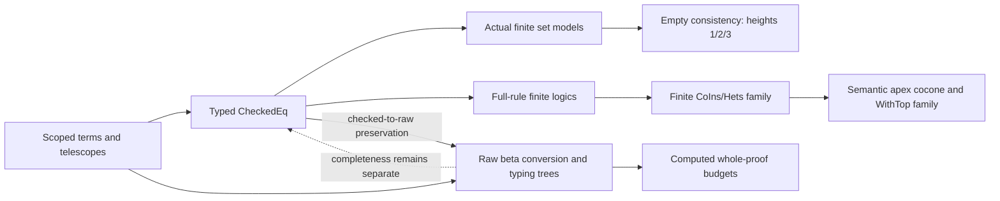

## Source audit and next steps

The main guarantees can be checked at these public declarations. Paths below
start at `Silmaril/Logic/TypeTheory/IntensionalMLTT/`; they distinguish results
about original typing from the separate checked-equality production task.

| Claim | Source and declaration |
|---|---|
| All-rule realizability and closed Empty consistency | [RawRealizability/Soundness/Thms.lean](../../Silmaril/Logic/TypeTheory/IntensionalMLTT/RawRealizability/Soundness/Thms.lean): `Derivation.realizes`, `RawRealizability.empty_consistency` |
| All-path original strong normalization | StrongNormalization/Thms.lean: `Typing.strongly_normalizing` |
| Executable typed normalization and conversion comparison | Normalizer/Thms.lean: `normal`, `typed`, `compare_eq_true_iff`, `decideConversion` |
| Original directed reachability and typed confluence | OriginalNormalization/Thms.lean: `Normalizer.original_reduces`, `Typing.original_confluent` |
| Completion paths schedule as original computation | CompletionSimulation/Thms.lean: `StrongCandidates.SN.completion_iff_original` |
| Exact certificate acceptance characterization | Certificates/Thms.lean: `typing_iff`, `wellFormed_iff` |
| Executable generation from derivation data | Certificates/Encode/Thms.lean: `typing_correct`, `context_correct` |
| Finite checked universe threshold needs a tower premise | CheckedUniverseHeight.lean: `checked_universe_typing_iff` |
| Two-edge checked identity cancellation | CheckedIdDetours/Thms.lean: `CheckedAtomStep.id_detour_components` |
| Checked global certificate production is a specification | NormalizationCertificate/Defs.lean: `NormalizationCertificate.Production : Prop` |
| Source grammar, exact six computations and proof-relevant typing | [Rules/Defs.lean](../../Silmaril/Logic/TypeTheory/IntensionalMLTT/Rules/Defs.lean): `Conversion`, `Derivation`, `TypedEq`, `motiveContext` |
| Raw head separation and strict universe generation | [RawHeadSeparation/Thms.lean](../../Silmaril/Logic/TypeTheory/IntensionalMLTT/RawHeadSeparation/Thms.lean): `Convertible.rigidHead_eq`, `typing_univ_iff` |
| Unrestricted LinearJ reflection is false | ConversionCompletion/Preservation/Examples.lean: `unrestricted_reflection_false`, `mismatch_not_typable` |
| Typed LinearJ preservation and reflection | ConversionCompletion/Preservation/Thms.lean: `Derivation.linear_subjectReduction`, `LinearJ.convertible_iff_original_of_typing` |
| Conservative completion and original component conversion | ConversionCompletion/Thms.lean: `original_convertible_iff_join`, `convertible_pi_iff`, `convertible_sigma_iff`, `convertible_id_iff` |
| Exact-carrier compatible preservation | SubjectReduction/Thms.lean: `Derivation.subjectReduction`, `Typing.reduces` |
| All-rule checked-to-raw map with interpreted hypotheses | Bridge/Thms.lean: `CheckedEqH.toRaw`, `CheckedContextH.toRaw` |
| Same-height checked structure and newest-declaration transport | CheckedContext/Thms.lean: `CheckedEq.context`, `Lookup.checkedFormation`, `CheckedEq.changeLast` |
| Checked regularity costs one extra level | CheckedRegularity/Thms.lean: `CheckedEq.type_formation`, `CheckedEq.instantiate₂` |
| Uniform checked functionality independent of telescope length | CheckedSubstitutionFunctionality/Thms.lean: `CheckedEq.subst_congr_uniform`, `subst_congr_regular_uniform` |
| Checked J computation needs explicit endpoint/path equalities | CheckedFunctionality/Thms.lean: `CheckedEq.j_of_endpoint_path_eq` |
| Finite set membership and concrete consistency | SetModel/Thms.lean: `CheckedEqH.sound`, `empty_consistency_one`, `empty_consistency_two`, `empty_consistency_three` |
| Finite checked institutions and actual tower premises | Finite/Thms.lean: `logic_sound`, `model_nonempty`, `inclusion_satisfaction` |
| Full set-hierarchy apex and finite sentence capture | Apex/Thms.lean: `cocone`, `family`, `sentence_finite_capture` |
| Semantic extensional corridor | Extensional/Thms.lean: `valid_judgment`, `finiteEntailment`, `natural` |
| Actual syntactic extensional preservation | ExtensionalSyntax/Thms.lean: `checked`, `context_checked`, `judgment_checked` |
| Fixed successor-height preservation and carrier formation | ExtensionalHeight/Thms.lean: `judgment_checked_successor`, `judgment_checked_successor_formation` |
| Syntactic proof maps commute with stage inclusions | ExtensionalInference/Thms.lean: `successorInference_naturality`, `successorInference_map_finite` |
| Concrete realizers and strict recursive universe codes | [RawRealizability/Codes/Defs.lean](../../Silmaril/Logic/TypeTheory/IntensionalMLTT/RawRealizability/Codes/Defs.lean): `CodeLayer`, `Code`, `IdentitySpace` |
| Exact-original quotient closed canonicity | OriginalRealizability/Canonicity/Thms.lean: `closed_nat_computation`, `closed_unit_computation`, `closed_identity_conversion` |
| Full annotated normal grammar and executable recognizer | NormalForms/Defs.lean: `Normal`, `Neutral`, `isNormal` |
| Open candidates retain normal witnesses and future tests | KripkeCandidates/Defs.lean: `Candidate.Mem`, `Family`, `PiProperty`, `IdentityProperty` |
| Actual Kripke code stages and cross-cap functionality | KripkeCodes/Functionality/Thms.lean: `Code.functional`, `Code.pi_inv`, `Code.sigma_inv`, `Code.univ_inv` |
| All-original-rule open normalization fundamental | KripkeFundamental/Source/Thms.lean: `Derivation.kripke_valid`, `ContextDerivation.kripke_variables`, `Typing.normal_convertible` |
| Dependent neutral reconstruction and Nat/J validity | KripkeFundamental/Elimination.lean: `j_motive_normal`, `Valid.j`, `Valid.natrec`; `NeutralElimination.lean`: `eval_j_neutral` |
| Raw saturation and explicit dependent fibre coherence | SaturatedCandidates/Defs.lean: `SaturatedCandidate`, `SaturatedFamily`, `SaturatedPiMem` |
| Least natural candidate and actual recursor step contract | SaturatedNatrec/Thms.lean: `NatMem.eliminates`, `SaturatedFamily.natrec_mem`; `SaturatedNat/Thms.lean`: `NatMem.least` |
| Original based-J candidate membership | SaturatedJ/Thms.lean: `SaturatedPathFamily.j_mem` |
| Normalization-only codes use maximal accessibility at Empty/Unit/Id | SaturatedUniverses/Codes/Defs.lean: `CodeLayer`, `codeSystem`, `SaturatedCode` |
| Constructed coherent families and independent cap meanings | SaturatedUniverses/Functionality/Thms.lean: `SaturatedCode.functional`, `SaturatedCode.family`, `pi_of_instances`, `sigma_of_instances` |
| Original hypotheses, unchanged caps and exact finite semantics | [RawRealizability/FiniteSoundness/Thms.lean](../../Silmaril/Logic/TypeTheory/IntensionalMLTT/RawRealizability/FiniteSoundness/Thms.lean): `DerivationH.realizesAt`, `BoundedDerivation.realizesAt` |
| Actual capacity models and source-exact finite/apex consequence | [OriginalInstitution/Thms.lean](../../Silmaril/Logic/TypeTheory/IntensionalMLTT/OriginalInstitution/Thms.lean): `canonicalModel`, `finite_derives_empty_iff`, `top_derives_empty_iff`, `top_proof_finite_capture` |
| Conversion-free source restriction and positive proof cap | ConversionFreeBridge/Thms.lean: `Derivation.toChecked_of_conversionFree`, `toChecked_atOwnStage` |
| All compatible raw positions reify from conversion-free sources | CompletedConversionBridge/Thms.lean: `Derivation.compatible_completedEq_of_conversionFree`, `exists_completedEq_of_step` |
| Arbitrary completed typings: compatible lifting plus a supplied root law | CompletedReduction/Thms.lean: `ReductionWitness.toCompletedComputation`; `Defs.lean`: `completedCost`, `RootComputation` |
| Actual lambda and pair carrier equalities at successor supply | AnnotationLambdaCarrierEquality/Thms.lean: `AnnotationCheckedEq.lam_generation_carrier_eq`; `AnnotationPairCarrierEquality/Thms.lean`: `pair_generation_carrier_eq` |
| Exact original successor enumeration | OriginalSuccessors/Thms.lean: `mem_iff`, `decideStep`, `decideNormal` |
| Total original strategy and bounded unchecked execution | RawEvaluator/Thms.lean: `sound`, `complete`, `convertible_iff`; `OriginalEvaluator/Thms.lean`: `result_eq_canonical` |
| Proof-carrying body/function action interfaces | NormalizationCertificate/FunctionActions/Defs.lean: `BodyAction`, `FunctionAction`; `Thms.lean`: `lambdaIntro`, `identity`, `reifyLambda` |
| Native application with actual requested-fibre formation | NormalizationCertificate/NativeComputability/PiPresentation/RequestedCarriers.lean: `TermData.applicationWithFormation`; `RequestedCarriers/Examples.lean`: `applicationExact`, `applicationChecked` |

This whole-page source review checks statements, hypotheses, definitions,
implementation boundaries and representative source examples. It does not rerun
Lean or the displayed evaluations, or audit transitive axioms. Example execution
claims describe the checked-in `#guard_msgs`/`#eval` declarations; their current
runtime success requires a build. The source maps identify theorem statements,
not an independent mathematical validation of every proof dependency.

The reference is [mr-ohman/logrel-mltt](https://github.com/mr-ohman/logrel-mltt)
at `9d6e290064962a1987c9e1a131c2fb967d6ef928`, accompanying Abel–Öhman–Vezzosi,
*Decidability of Conversion for Type Theory in Type Theory* (POPL 2018).
The upstream grammar has one universe and no primitive Id/J. It uses
unannotated lambdas and has additional typed eta/equality rules. Universe
indices/cumulativity, domain annotations and Id/J here are explicit
extensions. This is a source-informed calculus and fresh Lean development,
not a claim that upstream's logical relation or metatheory has been ported.

The inspected `Consistency.agda` result rules out judgmental equality of
zero and successor-zero. Its exact theorem and the source file identities
are recorded in the provenance receipt.
That dated receipt records the import's earlier coverage and pending-work list;
the current theorem boundaries are the declarations mapped on this page.
The four pinned upstream source/license hashes were independently matched during
this review; the paper hash below is the recorded receipt, not a fresh PDF check.
The upstream MIT notice is preserved in
the license receipt. The paper PDF
SHA-256 is `9b1e10047c66efa194ff0d5dac406c8ec712b46ba9c0bfc32180eb9f81c88cb0`.

Next come raw-to-checked completeness, hypothetical structural closure, complete
type inference and connections to the LF/Dedukti calculus network. Full original
all-path strong normalization now applies to certified original typings, as do
the existing executable normalizer and conversion decider. Follow
Dedukti will build on reviewed binding/model interfaces rather than add
assumed-soundness fields.

The targeted build entry point is (the build wrapper supplies `--wfail`):

```sh
bin/mor build Silmaril.Logic.TypeTheory.IntensionalMLTT.Thms
```

### Code functionality and inversion

`KripkeCodes.Code.functional` proves that actual codes for the same original
conversion class have equivalent candidate membership at every future scope,
even when their universe caps differ. Product and sum inversion recover their
actual domain code and dependent fibre codes for every future domain member.
Identity inversion retains actual endpoint membership; universe inversion
recovers the strict cap bound and the fixed lower-stage interpretation.

Neutral/type-constructor separation uses actual neutral normal forms and
confluence; a neutral may still have a variable or absurd rigid head. Examples
transfer zero and the dependent pair `(0, refl 0)` into arbitrary interpretations,
compare renamed Nat interpretations, and exclude a code for `U₀` at cap zero.
These results supply coherence for the full original-source fundamental theorem
and its unique-normal-representative corollary.

`KripkeFundamental.EmptyIdentity` supplies source validity rules for Empty
elimination, identity formation and reflexivity. Empty realizers are genuine
neutral classes; elimination reconstructs the normal result annotation and
reflects the resulting neutral term. Identity endpoints are transported into
one actual carrier interpretation. An inhabited reflected Empty environment
and source-typed examples check the open case directly. No equality reflection
is added to the source rules.

### Lambda generation in the annotation completion

`AnnotationLambdaGeneration` recovers domain formation, codomain formation and
body typing from either lambda endpoint of any `AnnotationCheckedEq` derivation.
All recovered premises use the original finite universe supply. Conversion,
cumulativity and beta-exposed lambda heads are covered; a conversion-free source
tree is not required. The proof follows actual checked substitutions so that a
lambda introduced by substitution also retains its native premises.

`lam_annotation_native` uses those premises to change a lambda annotation with
three additional levels, at a recovered native product. `AnnotationLambdaCarrier.lam_generation_transport` additionally recovers inclusion
of this native product into the requested carrier: any completed equality at the
product transports to the requested carrier, at the same or any larger supply.
`lam_annotation_requested` therefore changes the domain annotation of an arbitrary
completed lambda while retaining its exact requested carrier, with three extra
levels. The transport proof handles conversion, cumulativity and beta-exposed
lambda heads using the same checked-substitution invariant as generation.
This does not yet remove the source restriction from `CompletedConversionBridge`.

The examples recover native premises from an identity typed at a computed Pi
domain and from the right endpoint of a lambda-annotation computation.

### Application generation and requested carriers

`AnnotationApplicationCarrier` recovers native function and argument typings
from either application endpoint at the original finite supply. It also
recovers transport of any equality at the native dependent result into the
requested carrier, using two additional levels. This covers conversion,
cumulativity, applications exposed by beta substitution, and the application
produced by the natural-recursion successor equation. The two-level reserve
provides formation of a function's Pi carrier and equality of its dependent
result instances; it is not an optimality claim.

The example changes a natural-number argument under a function returning its
reflexivity proof. The right result `Id Nat zero zero` differs syntactically
from the retained left result `Id Nat redex redex`. Generation and transport
therefore account for dependent argument changes rather than identifying the
two result types by syntax.

### Compositional computations on completed typings

`CompletedComputation reserve t u` means that every actual completed typing
of `t` gives a checked equality from `t` to `u` at the exact same requested
carrier, after adding `reserve` available universe levels. It is a preservation
property, not a replacement syntax or an assertion that an untyped term is typable.
The examples supply actual source typings, including an explicit carrier conversion.

Computations compose by adding reserves. They lift through function and argument
positions of application (two additional levels), lambda domains (three), and
lambda bodies (none). All six J positions are supported with one additional
level. `j_fields` computes several fields simultaneously at a shared reserve;
`weakenReserve` pads individual computations to that reserve. Based J computation is available with reserve one. These
results apply to arbitrary completed source derivations, including conversion
and cumulativity. They do not require a conversion-free source tree.

The converted example computes a J redex in an application argument while
retaining a requested type that itself is a beta redex. The later formation, value and eliminator rules below complete compatible
lifting. Primitive beta and pair-projection certificates from arbitrary completed
typings remain needed for an unconditional full reduction theorem.

The J example changes an outer J's fixed endpoint by computing an inner J.
Its other endpoint and reflexivity path remain unchanged, so the derived rule
must transport the path type. The whole computation also retains an explicitly
converted requested carrier.

### Type formation and requested carriers

`AnnotationFormationCarrier` strengthens Pi, Sigma and identity-type inversion:
it recovers native component formation together with transport from the native
universe into the exact requested carrier, at the same or any larger supply.
The earlier inversion API is derived from this stronger result.

`CompletedComputation` consequently lifts through Pi/Sigma domains and codomains
and all three identity-type fields with no extra reserve. Examples compute under
Pi, Sigma and identity formation while retaining a cumulatively raised requested
universe. The value/eliminator rules below complete compatible lifting;
unconditional primitive beta and pair-projection certificates remain open.

### Successor and reflexivity values

`AnnotationValueCarrier` recovers the native data and requested-carrier transport
for successor and reflexivity endpoints, at the original universe supply.
`CompletedComputation.succ` and `refl_value` lift computations through these
constructors with no additional reserve. Reflexivity transport covers the right
endpoint of a proof equality even when its native identity type differs from the
retained left identity type. Examples cover this dependent change and successor
computation at an explicitly converted carrier.

### Projections

`AnnotationProjectionCarrier` recovers native pair typing for either projection
endpoint at the original supply, and transport to the exact requested carrier
with two additional levels. For second projection this includes the change
from `B[fst p]` to `B[fst p′]`, proved using dependent functionality. The proof
covers substitution-exposed projections and both primitive pair equations.

`CompletedComputation.fst` and `snd` lift computations in the pair with two
additional levels. The dependent example computes a pair returning a number
and its reflexivity proof while retaining the old second-projection carrier.
A first-projection example retains an explicitly converted requested type.
This does not itself establish primitive pair projection computation from
arbitrary completed source typing. The pair-generation and carrier-equality
results below supply native premises, while unrestricted checked component
injectivity remains open.

### Dependent pairs

`AnnotationPairCarrier` recovers native Sigma formation and both component
typings from either pair endpoint, with one additional universe level. The
second component of a right endpoint is transported from `B[a]` to `B[a′]`
using checked dependent functionality. Any equality at the recovered Sigma
carrier then transports to the original requested carrier.

`CompletedComputation.pair_fields` computes both components at a shared reserve,
plus one level; `pair_left` and `pair_right` compute one component. The dependent
example computes a number and its reflexivity proof together, then recovers
actual native typings of the resulting right pair. Arbitrary primitive
projection computation still needs the relationship between the pair's
recovered native Sigma and the Sigma used by its projection; generation alone
does not identify these types.

### Empty elimination

`AnnotationEmptyCarrier` recovers the annotated type's formation, the Empty
argument's typing and transport into the exact requested carrier at the same
supply. `CompletedComputation.absurd_fields` computes both fields at a shared
reserve without extra levels; `absurd_type` and `absurd_term` select one field.
The example is explicitly open over an assumed Empty variable. It computes both
fields while retaining the original computed result annotation; it supplies no
closed inhabitant of Empty.

### Natural recursion

`AnnotationNatStep.natStepType_congr` constructs equality of step-function types
from equality of actual motives at the same universe supply, using a checked
successor assignment under both binders. `AnnotationNatrecCarrier` recovers
motive, zero-branch, step-branch and scrutinee typing at the original supply.
It transports the native result into the requested carrier with one extra level,
including right endpoints whose motive and scrutinee have changed.

`CompletedComputation.natrec_fields` lifts all four fields at a shared reserve
plus one level, with separate motive/zero/step/scrutinee rules. Both primitive
zero and successor equations are also completed computations with reserve one,
for arbitrary completed source typings. Examples retain explicitly converted
requested carriers and recover the right step branch after an actual motive
change. Unrestricted beta and primitive projection computation remain separate.

### Compiling raw computation positions

`CompletedReduction` connects `ReductionWitness` to `CompletedComputation`.
Supply `s.RootComputation r`, a computation certificate for the primitive leaf
of a witness `s`. `s.toCompletedComputation` then lifts it through every raw
compatible position, using the reserve `s.completedCost r` and retaining the
exact requested carrier of any completed source typing.

The completed cost differs from `s.cost`, which belongs to the earlier
conversion-free original-derivation construction. Application and projection
positions add two levels; pair and natural-recursion positions add one; all six
J positions add one; lambda domains add three. Other positions add no overhead.
A checked example gives costs one and three for the same argument-position
witness and computes an actual source with an explicitly converted result type.

`conv_of_completed_witness` and its reverse variant use this construction to
change the carrier of a completed equality. They require completed formation of
the contraction's source type, rather than a conversion-free original formation
tree. The reverse variant needs no separate formation premise for the reduct.

This construction supplies all compatible lifting, not the missing primitive
laws: a beta or pair-projection leaf still requires its own completed computation
certificate. J and natural-recursion leaves have unconditional certificates.

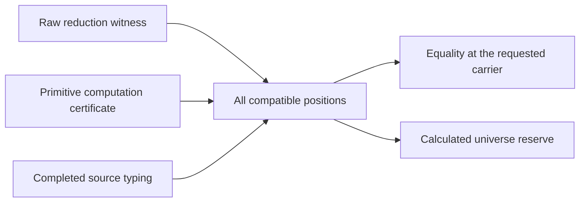

### Executable original one-step reduction

`OriginalSuccessors.successors t` enumerates every original compatible
one-step reduct of arbitrary scoped syntax, including annotations and the
one- and two-binder motives. Each internal entry carries a `ReductionStep`
certificate; proof fields erase at runtime. `mem_iff` proves exact agreement
with the original reduction relation. The list retains duplicates and follows
root-first, then field order; it is not a performance-tuned evaluator.

`decideStep t u` decides original one-step reduction without a typing premise.
`decideNormal t` decides original normality by checking whether the list is
empty. The J root requires all endpoint copies to be syntactically equal.
Examples cover a beta root competing with annotation reduction, reduction
inside a blocked J motive, and matched versus mismatched J endpoints.

This supplies an executable stepping API. It does not close the separate
raw-to-checked completeness gap or the missing general checked beta and
projection computation certificates.

### Total execution using original steps

`OriginalEvaluator.normalize t h` repeatedly chooses the first certified
original successor, with `h : StrongCandidates.SN t` proving termination.
`OriginalEvaluator.result t ht` obtains this certificate from original source
typing. Neither function takes fuel. The proof fields erase during execution.

`normalize_spec` proves original reachability and original normality for any
accessible raw input. `typed` preserves the exact requested carrier for typed
inputs. `result_eq_canonical` identifies the returned syntax with the existing
canonical normalizer, so typed results also satisfy the stronger annotated
normal-form grammar. Arbitrary raw accessible terms need only be original-normal:
a mismatched J can be stuck in the original relation.

This evaluator uses the complete successor list, root-first and then field
order. It is a reference execution strategy, with no performance claim. The
examples execute natural recursion, J, a lambda annotation, a dependent second
projection and an open recursor. Checked presentation completeness remains
separate work.

### Running unchecked syntax

`RawEvaluator.run fuel term` executes without a typing or termination proof.
A positive fuel unit either recognizes normality or takes the first certified
original successor. `none` records exhaustion of this observation bound; it
is not a type error or a proof of divergence. Normal input needs one unit.

- `sound` proves that every successful result is reached by original steps and
  is original-normal, including for untyped inputs.
- `terminates` proves success at some finite bound for every strongly
  normalizing input.
- `complete` supplies such a bound for every actually typed input and identifies
  the result with the existing canonical normalizer.
- `typed` preserves the exact requested carrier.
- `convertible_iff` proves that two successful raw runs have equal outputs
  exactly when their inputs are originally convertible. Both inputs may be
  untyped; their successful runs supply the normal forms.

Consequently a computed successful run can yield an actual source conversion
proof, and two distinct successful results can refute conversion. The examples
check reduction inside a lambda annotation, distinguish zero from its successor,
retain the mismatched J guard, and execute Natrec and J without typing arguments.
The interface adds no typing inference or raw-to-checked completeness theorem.

```sh
bin/mor build Silmaril.Logic.TypeTheory.IntensionalMLTT.RawEvaluator.Examples
```

### Complete checking of original rule certificates

`Certificates.Certificate Γ t A` is an untrusted rule tree for an original typing
judgment. `ContextCertificate Γ` supplies its telescope premises. These are
separate data types from `Derivation` and `ContextDerivation`. Their dependent
indices enforce syntactic agreement of premises and conclusions; they do not
prove the judgment. `verify` checks every original rule recursively, including:

- the declared type at a variable's de Bruijn index;
- the direction of each cumulative universe inequality;
- normalization of both endpoints of a conversion at supplied finite bounds;
- all formation, introduction and elimination premises, including J's full
  endpoint/path-dependent motive context.

`typing_iff` proves that a judgment has an original typing derivation exactly
when it has an accepted certificate. `wellFormed_iff` proves the corresponding
context result. Completeness covers every original derivation, including
arbitrary conversion nodes: regularity gives typed conversion endpoints, whose
normalization supplies sufficiently large finite bounds. No conversion
certificate is accepted by assuming its requested equality.

The verifier executes without a typing proof, conversion proof, lookup proof,
or inequality proof. Successful checks yield actual original typing theorems
through `sound`. Rejection concerns this certificate; an invalid rule choice
or an insufficient conversion bound does not refute the judgment. The examples
accept identity, a dependent pair, J and a converted carrier, and reject wrong
variable types, downward universe steps, unequal conversion endpoints and an
insufficient bound.

This is a checker for the indexed Lean certificate data.
`Certificates.Encode.typing`, described below, generates certificates from
supplied original derivation trees. A serialized-file parser and a frontend
that infers derivations from unchecked terms remain to be added.
It does not identify the separate `CheckedEq` presentation with original raw
conversion.

```sh
bin/mor build Silmaril.Logic.TypeTheory.IntensionalMLTT.Certificates.Examples
```

### Producing certificates from original derivations

`Certificates.Encode.typing` translates every original derivation tree to an
untrusted rule certificate; `Encode.context` handles contexts. Unlike the
existential completeness theorem, these are executable functions.

At a conversion node the encoder counts the observations needed to normalize
both type endpoints using the original reference strategy. Type regularity and
strong normalization justify termination; their proofs erase during execution.
The resulting certificate stores the two numeric bounds and child certificates,
without retaining the original conversion proof. Lookup and inequality proofs
are also omitted and recomputed by the verifier.

`typing_correct` and `context_correct` prove acceptance of every generated
certificate. The examples generate and recheck identity, natural recursion,
J, cumulativity and a beta-converted carrier. The latter computes conversion
bounds `(1, 2)`. Generation currently consumes an original derivation tree;
it does not infer a derivation from unchecked syntax. Serialization remains a
separate boundary.

```sh
bin/mor build Silmaril.Logic.TypeTheory.IntensionalMLTT.Certificates.Encode.Examples
```

## Additional left-linear bridge and canonicity proofs

`ConversionCompletion.Preservation` relates unconditional `LinearJ` computation
to the guarded completion on actually typed source terms. It preserves the exact
requested carrier and reflects conversion between two actually typed endpoints.
The raw counterexample in its examples explains why endpoint typings are needed.

`ClosedCanonicity` retains an independent proof through the earlier raw
realizability model. Its Nat, Unit and identity results overlap the current
`OriginalRealizability.Canonicity` API; its examples also exhibit a well-formed
open impossible-identity assumption, separating closed identity canonicity from
open equality reflection. Neither proof route adds an equality-reflection rule.
### Checked equality of native and requested lambda carriers

`AnnotationCheckedEq.lam_generation_carrier_eq` recovers native lambda formation
and body typing from an arbitrary completed equality endpoint. It also proves
an actual checked equality between the native product and the original requested
carrier. One additional available universe level supplies the common carrier
`U_levels`. The right-endpoint variant applies to a lambda exposed by equality.

The proof covers every existing rule, conversion, substitution-exposed lambdas,
and J-annotation completion. A lambda cannot have a universe as its requested
carrier: that would identify a product with a universe in original conversion.
The cumulative case is excluded using this proved head separation. Conversion
instead composes actual checked type equalities at the common universe.

The example starts from an inhabited identity function whose requested product
has a computed domain different from the function's annotation. It obtains
checked equality of those products, rather than assuming that they coincide.

This strengthens the earlier carrier-transport function. Checked injectivity of
products and sums is still needed to extract component equalities and complete
the arbitrary-typing beta and primitive pair-projection computation certificates.

### Checked equality of native and requested pair carriers

`AnnotationCheckedEq.pair_generation_carrier_eq` strengthens pair generation
with actual checked equality between its recovered native Sigma and the exact
requested carrier. Formation, both component typings and the carrier equality
use one additional available universe level. The common carrier is `U_levels`.
A right-endpoint variant also transports the dependent second component to the
changed first component.

The all-rule proof includes converted requested types, pairs exposed by
substitution, and J-annotation completion. As for lambdas, a cumulative universe
carrier is excluded by proved raw head separation. The existing transport-only
API remains available with its original bounds.

One example types the inhabited pair `(zero, star)` at a beta-redex whose result
is `Sigma Nat Unit`. The requested carrier differs syntactically from every
Sigma, so the resulting checked carrier equality cannot just be reflexivity.
A second example uses a dependent pair whose second component is reflexivity of
its changing first component.

Checked product/sum component injectivity and unconditional completed beta and
pair-projection computation certificates remain further work. The new equalities
provide actual checked inputs for that injectivity step; they do not replace it
with raw component conversion.

### Checked normalization certificates and conditional component cancellation

`NormalizationCertificate` pairs a full normal form with an actual completed
equality from its source at the requested carrier. Its data is stronger than
raw conversion to a normal form: the equality itself is checked by Lean.
Certificates can be supplied by a future proof-producing normalizer.

The current API provides certificate construction for:

- Already normal inputs, using their actual completed typing.
- Typed variable reflection and neutral application.
- Pi and Sigma formation from component certificates.
- Lambda annotations and bodies, retaining the original requested product with
  four additional universe levels.
- Prefixing a checked computation, changing the carrier or final context
  declaration, increasing the supply, and cumulative universe typing.

Once two inputs have certificates, comparing their normal syntax decides their
completed equality and produces a checked proof in the positive case.
`result_eq_iff` reuses the existing uniqueness of normal forms; it also compares
certificates obtained in different contexts, carriers, and universe supplies.

`pi_components` and `sigma_components` cancel arbitrary completed equalities
when normalization certificates for the four endpoint components are supplied.
Their results are checked component equalities. The right codomain certificate
is transported to the left context using the derived domain equality. There is
no restriction to equality paths whose intermediate terms have the same head.

The examples build component certificates using actual beta rules, reify Pi and
Sigma codes, cancel a product path through a non-product intermediate, and
transport a dependent sum codomain across changed declaration types.
A lambda example computes its domain annotation and reflects its body variable.

The named next obligation, `NormalizationCertificate.Production`, specifies
that every completed typing has a certificate at some larger finite universe
supply. No theorem of this property or typeclass instance is supplied yet.
Consequently this is conditional component cancellation, not unrestricted
checked Pi/Sigma injectivity, a complete checked normalizer, or full
raw-to-checked completeness. The next step is to connect these certificate
producers to the Kripke normalization fundamental theorem, including beta and
eliminator reification; the existing raw normalizer does not supply these
checked proofs by itself.

### Proof-carrying function actions

`BodyAction` describes normalization after substituting a certified argument
into an open body. `FunctionAction` describes normalization of an application.
Both range over larger finite universe supplies, well-formed future contexts,
and context-preserving renamings. Their outputs contain actual checked
normalization certificates and an explicit supply bound.

- `BodyAction.lambdaIntro` turns a body action and native lambda premises into
  an application action using the checked beta rule.
- `BodyAction.reifyLambda` obtains a body certificate by applying the action to
  the fresh typed variable in the extended context. It then reifies the lambda
  with four additional universe levels.
- `BodyAction.identity` returns its certified argument. Examples use it to
  normalize an application with a beta-redex argument, a lambda with a computed
  domain annotation, and an identity lambda over Empty. The last example needs
  no closed inhabitant of Empty.

These are explicit interfaces and constructor theorems. Existence of actions
for every checked function remains open, as does stability of a recursive
semantic interpretation under arbitrary checked type conversion. In particular,
native lambda beta closure does not establish beta closure from arbitrary
converted requested-product typings. The global `Production` obligation remains
unproved.

### Native application at the requested dependent carrier

`TermData.applicationWithFormation` takes full native data for a function of
syntactic type `Π A, B`, an independently coded argument `a : A`, and native
formation data for `B[a]`. It returns full native data for `f a` at exactly
`B[a]`, with one checking reserve covering all three input supplies. The inputs
may use different semantic caps. The result uses the stage determined by the
formation universe.

The proof recovers the actual function constructor through its native wrappers,
aligns and applies the independent argument, and transports the resulting full
predicate using native formation and carrier conversion. No target term code or
normal-head evidence is an input. This supplies the application step needed by
a native source fundamental theorem when the induction also supplies codomain
formation. It does not establish the remaining all-rule `Production` theorem.

The open regression reflects a variable of type `Π n : Nat, Id Nat n n` and
applies it to zero, obtaining both full native data and an actual checked
normalization certificate at `Id Nat zero zero`. The argument uses a separate
semantic cap. This tests dependent application without assuming a closed
function value.

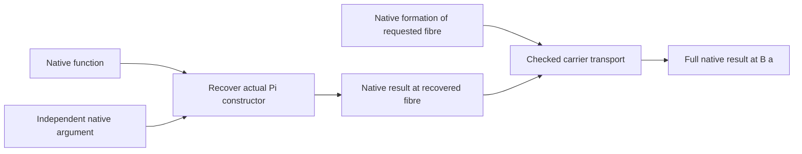

Checked primitive paths now admit two-edge identity detour cancellation, including actual beta and J intermediate redexes. Arbitrary longer-path injectivity remains open.


## Finite and unrestricted W rule budgets

A universe is a type of types. A rule budget limits which universe indices
may occur in a derivation's inference rules. For example, `finite 2` admits
indices 0 and 1 throughout the proof. W is the separate extensional calculus
for well-founded tree types. Its binding rules use cofinite premise families:
a premise must hold for every fresh variable name outside a finite excluded
set. A finite exclusion set need not bound the universe indices used by all
of those premise derivations.

`W.Ctx.JEqB budget H Γ A a b` checks the universe parameters in every rule,
including every member of a cofinite premise family. `W.RuleBudget` has two
cases:

- `finite n` admits precisely the indices below `n`.
- `unbounded` admits every natural-number index, without a common finite bound.

Natural-number budgets coerce to `finite`, preserving the finite-stage APIs.
`RuleBudget.capacity` maps these cases to `WithTop ℕ`; `allows_iff` proves the
index policies agree. `RuleBudget.succ` reserves one extra finite universe for
an encoding and retains an unrestricted budget unchanged.

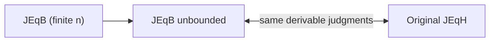

No finite capture theorem is assumed for cofinite premise families. A bounded
conclusion alone does not certify a finite-budget derivation.

Finite soundness and consistency remain stated using natural-number budgets
and actual finite set towers. Unrestricted soundness uses the original
hierarchy semantics and its supplied infinite hierarchy. This proof-budget API
does not construct such a hierarchy or add an object-language universe.

The primitive source compiler and indexed/mutual apex
use the same abstraction. The source compiler preserves unrestricted budgets;
its finite target budget remains one level larger than the source budget. The
apex accepts unrestricted closed-source primitive schemas. These source-schema
premises still use the empty judgment theory, independently of the universe
budget.

Check the public equivalence with:

```sh
bin/mor build Silmaril.Logic.TypeTheory.ExtensionalMLTT.Inductives.W.Unbounded.Thms
```

[RuleBudget/Defs.lean](../../Silmaril/Logic/TypeTheory/ExtensionalMLTT/Inductives/W/RuleBudget/Defs.lean)
defines the two cases and `Allows`;
[RuleBudget/Thms.lean](../../Silmaril/Logic/TypeTheory/ExtensionalMLTT/Inductives/W/RuleBudget/Thms.lean)
defines `succ`, `capacity` and `allows_iff`.
[Unbounded/Thms.lean](../../Silmaril/Logic/TypeTheory/ExtensionalMLTT/Inductives/W/Unbounded/Thms.lean)
proves `toUnbounded` and `unbounded_iff` with arbitrary judgment hypotheses.


## Typed dependent function eta

Eta says that `fun x => f x` equals `f` at its function type. Beta is the
computation `(fun x => body) a = body[a/x]`. Function extensionality gives
equality of two functions from equality of their results at every argument.
“Dependent” means the output type may mention the input: for example,
`f : Π n : Nat, Id Nat n n` returns an equality proof about its argument.
MLTT means Martin-Löf type theory; this page uses its extensional variant.

`ExtensionalMLTT.FunctionEta` derives function eta from the existing beta and
function-extensionality rules. Given actual formation of `A` and its dependent
codomain `B`, and an actual typing `f : Pi A B`, it proves both typing of the
eta expansion and judgmental equality with `f` at that same product.


`ECtx.JEqH.eta_expansion` and `ECtx.JEqH.function_eta` permit nonempty local
contexts and an argument-dependent codomain. They use empty global judgment
hypotheses. The example returns reflexivity at its actual natural-number
argument, so its codomain depends on that argument.

This provides a target rule needed for interpreting LF eta. It does not yet
translate LF judgments or arbitrary raw beta-eta conversions into extensional
MLTT. Raw conversion can pass through untyped intermediate terms; lifting its
formed endpoints to target typed equality remains a separate obligation.
No source rule, normalization assumption or soundness axiom is added.

The [public unbounded theorems](../../Silmaril/Logic/TypeTheory/ExtensionalMLTT/FunctionEta/Thms.lean)
require domain and codomain formation at a common universe `n`, as well as
the supplied function typing. The codomain premise holds for every fresh
name outside an explicit finite exclusion set. The
[finite-budget variants](../../Silmaril/Logic/TypeTheory/ExtensionalMLTT/Finite/FunctionEta/Thms.lean)
are `ECtx.JEqB.eta_expansion` and `ECtx.JEqB.function_eta`. Given `n < levels`
and the same premises at `levels`, they retain that exact rule budget.

```sh
bin/mor build Silmaril.Logic.TypeTheory.ExtensionalMLTT.FunctionEta.Examples \
  Silmaril.Logic.TypeTheory.ExtensionalMLTT.Finite.FunctionEta.Examples
```


## Primitive compilation and judgment hypotheses

`Tm.compile_fsubst` proves that free-name substitution commutes with the full
primitive source compiler. This includes all nested indexed and finite mutual
family fields, their local binders, and their W expansions. Its proof is a
syntax induction, independent of typing and universe budgets.

`compile_fsubst_ofW` uses the existing ordinary-W section to handle every raw
target substitution term. The `open` and `lst` variants retain the same equality
when a binder is opened or instantiated before free-name substitution.

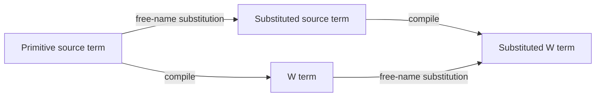

A judgment theory is a set of typing/equality assumptions. An axiom schema
here is closed under the context and syntax operations stated below, with no
claim that its instances are true.

`SyntacticTheory H` describes context-independent source axiom schemata whose
membership is closed under free-name substitution. It requires membership in
every replacement context, so it is stronger than typed structural closure.
It neither asserts validity nor applies automatically to arbitrary contextual
judgment theories.

`SyntacticTheory.compile` derives the actual W `StructuralTheory` laws for the
exact image `Jdg.compile '' H`, at any finite or unrestricted rule budget. A
target context has its ordinary source representative `Ctx.ofW`; a target
substitution term has its source representative `Tm.ofW`. Source closure gives
an actual member of `H`, and compiler naturality gives the requested target
hypothesis inference. The theorem takes no target structural certificate and
does not enlarge the target theory or its rule budget.

`weaken_compiled` and `substitute_compiled` apply this certificate to whole W
derivations. They retain the exact compiled theory and budget, with actual
formation of the target context and actual typings for substitution images.

The example `unitTheory` contains `star = star : Unit` in each ambient context.
It is nonempty, is not the universal theory, and satisfies the source closure
conditions. Every axiom in its exact compiled image is valid in every set-level
interpretation `U : ℕ → ZFSet`, including finite universe supplies.

## Compiled indexed schemata from source hypotheses

`OpenFormationData S levels n Γ H` records the descriptor's actual source
context, index, shape, position and next-index derivations over `H`. Its fields
may contain primitive indexed and mutual syntax. `FormationData.toOpen` embeds
existing empty-theory source descriptors, and `monoTheory` transports fields
along every inclusion `H ⊆ K`, without a closure condition.

`OpenFormationData.compile` compiles each of these source inferences into
`IndexedFormationData S.compile levels.succ n Γ.compile (Jdg.compile '' H)`.
Finite source budgets add one target universe; unrestricted budgets stay
unrestricted. This construction needs no structural certificate.

Given `SyntacticTheory H`, the derived exact-image structural laws yield four
compiled indexed schemata. All motive, method, index, shape, children and fibre
premises are source derivations:

| Source premises | Compiled conclusion |
| --- | --- |
| descriptor and index | primitive fibre formation |
| descriptor, index, shape and original children | primitive node typing |
| descriptor, motive, method, index and fibre term | dependent eliminator typing |
| descriptor, motive, method, index, shape and original children | iota with original children and recursive source calls |

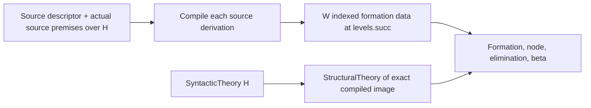

The nullary regression uses a nonempty, proper source theory of Unit-formation
axiom schemata. Its index and shape fields use actual source hypothesis leaves;
its motive, method, children and inhabitant are independently proved source
terms. All four compiled schemata hold at target cap three from source cap two.
The elimination and iota bridges require only `Allows levels m`, as do the
original primitive source rules. The extra target motive level follows from
`hm.succ_index` at the compiler's existing successor budget. The current closed
two-lambda motive example needs source cap two for ordinary type formation;
this example does not claim a closed motive at cap one.

These are compiled schema theorems, not new primitive source inference
constructors. Existing primitive indexed and mutual constructors retain their
empty-theory descriptor premises and unrestricted theory monotonicity. The
proved `syntacticTheory_not_mono` counterexample shows why making a closure
certificate mandatory in those constructors would break their monotonicity:
the empty theory is syntactically closed, while a singleton can fail context
replacement closure.

## Remaining theory generalization

The W indexed-induction typing API accepts a structural judgment theory:
canonical motives, coherent child/IH reconstruction, reconstructed-node
equalities, original source-step application and abstraction, and synthesis of
the actual ordinary-W step and indexed eliminator retain that theory and the
exact rule budget. A closed nullary example uses a nonempty theory and actual
hypothesis leaves in its source description. Existing empty-theory names remain
available as specializations. Whole-recursion computation also retains these
hypotheses: raw recursor reduction reconstructs original children and dependent
IHs, then `indexedInduction_node_beta_of_hypotheses` computes to the original
source step with actual recursive calls on its original children.
W formation and node APIs already accept a supplied structural theory, and can
use the derived certificate above.

The general bridge from source *derivability-based* structural laws needs more
work. `compile (ofW t) = t` holds on W syntax, while `ofW (compile t) = t` does
not hold syntactically on primitive source terms. A source expansion comparison
and explicit finite-budget accounting are needed before using that route.


## Source-constructor design to review

A future hypothetical source schema must preserve both theory inclusion and
proof substitution (`Ctx.JEqB.bind`). Requiring a syntactically closed local
theory `K ⊆ H` preserves inclusion, but does not suffice for proof substitution:
replacing `H` leaves by proofs over `H'` need not make `K` a subset of `H'`.

A candidate constructor instead keeps its descriptor and schema premises over
`K`, retains `SyntacticTheory K`, and takes positive discharge data:

```text
∀ q ∈ K, Ctx.JEqB levels H q.Γ q.A q.a q.b
```

For inclusion, map each discharge proof into the larger ambient theory. For
`bind`, compose each discharge proof with the supplied replacement of ambient
leaves. The local theory and its closure certificate stay unchanged. These
recursive occurrences are in function codomains; their quantifier domains do
not contain the inference relation. A minimal kernel positivity check remains
part of implementing this design.

Compilation would first derive the indexed schema over exactly
`Jdg.compile '' K` using the local structural certificate. Compiling the
discharge proofs and applying W `bind` then yields exactly `Jdg.compile '' H`.
Both steps use `levels.succ`; discharge adds no further universe. Finite
soundness follows from the existing W soundness theorem under valid ambient
hypotheses. Choosing `K = ∅` recovers the existing empty-theory constructor
applications, with vacuous discharge data.

The syntax-only factoring prerequisite is already present:
`Syntax.NamedSubstitution.Defs` defines the syntax operation and
`Syntax.Theories.Defs` defines `SyntacticTheory`, independently of source
inference and compilation. The higher `Theories.Defs` still imports compiler
and context-bound theorems, so a future rule definition should use the lower
syntax header. `OpenFormationData` already refers to source inference; using
that record inside its own inference definition would be circular. Inline the existing formation premises for the first constructor
prototype, or first check a lower-level relation-parameterized record for
strict positivity.

The current source weakening and substitution proofs explicitly target the
empty theory. Their inductions cannot simply reuse `K = ∅` in the new schema
case. Strengthen the internal induction to accept transformed proofs of local
theory leaves into the empty target theory; the discharge-proof induction
hypotheses then provide those local leaf maps. Reconstruct the existing
empty-theory schema with the transformed premises. Keep the public empty-theory
structural results and their original budgets, and test this before extending
the calculus. Arbitrary-theory source structural substitution is a separate
claim requiring its own leaf-transport contract.

## Source map and review boundary

| Claim | Source |
| --- | --- |
| Schema closure and its inference-independent location | Syntax theories, higher header |
| Compiler/substitution naturality, including arbitrary W payloads | Named-substitution compilation, syntax induction |
| Exact-image structural laws and Unit schema validity | Theory theorems |
| Open descriptors, compiled schemata and their budgets | Open formation definitions, theorems |
| Nonempty-theory schemata and failure of closure monotonicity | Open examples |
| W induction and computation under structural hypotheses | [Step synthesis and typing](../../Silmaril/Logic/TypeTheory/ExtensionalMLTT/Inductives/Encoding/W/Induction/RawStep/Thms.lean), [raw computation](../../Silmaril/Logic/TypeTheory/ExtensionalMLTT/Inductives/Encoding/W/Induction/Computation/Thms.lean), [indexed computation](../../Silmaril/Logic/TypeTheory/ExtensionalMLTT/Inductives/Encoding/W/Induction/Indexed/Thms.lean), hypothesis-bearing example |
| Current primitive rules, bind and empty-theory weakening | Rules, bind/compile, weakening |

The source-constructor section is a proposed design, not an implemented rule or
kernel positivity result. The review matched the implemented claims against the
listed APIs, premises, examples and compiler/schema proof implementations.
No fresh Lean/runtime execution or transitive axiom audit was performed.


## Finite tags for mutual families

A **tag** is a small label selecting one family, such as “expression” or
“statement” in a mutually defined syntax. **Object language** means the MLTT
syntax represented inside Lean; native Lean types are a separate representation.

`Inductives.Encoding.Object.FiniteTag` gives a finite type in the
existing W object language, using only Nat, Sigma and identity types. For a
count `q`, it is `Σ n : Nat, Id Nat (cutoff q n) zero`. The primitive-recursive
cutoff is zero exactly when `n < q`, and one otherwise. For `q = 2`, numbers
0 and 1 pass the cutoff test; 2 and larger numbers fail it. `Sigma` is a
dependent pair type, and `Id` supplies the proof that the selected number passes.

The checked one-universe derivations include cutoff typing, computation on
every object numeral, tag formation, and a canonical object inhabitant for
each `i : Fin q`. The two-tag instance has closed derivations for both tags,
and their denotations are unequal in every supplied set interpretation.

The exact set membership theorem proves that every interpreted tag is a
canonical pair for some `i : Fin q`. `semanticEquiv` packages this as an
equivalence with `Fin q`. It is proved for arbitrary universe lookups and
free-variable environments, so it does not assume an infinite hierarchy.

This supplies the finite tag component of a mutual-family encoding. It does
not by itself provide mutual constructors, simultaneous induction, or an
equivalence with an independent primitive mutual syntax.

| Claim | Public declaration |
| --- | --- |
| Cutoff test and numeral computation | `code_eq_zero_iff`, `cutoff_compute` |
| Formation and canonical tags | `formation`, `canonical_typing` |
| Exactly the intended interpreted tags | `mem_denoteIn_iff`, `semanticEquiv` |
| Two distinct tags | `first_of_two`, `second_of_two`, `two_tags_distinct` |

The declarations are in [FiniteTag/Thms.lean](../../Silmaril/Logic/TypeTheory/ExtensionalMLTT/Inductives/Encoding/Object/FiniteTag/Thms.lean).
Their contexts must be well formed at rule budget one. This review matched
source definitions and theorem signatures; it did not run a new Lean build.


## Base MLTT and the ordinary W extension

`Silmaril.Logic.TypeTheory.ExtensionalMLTT.Inductives.W.Systems` packages the existing syntax
inclusion as institution and logical-system comorphisms. The finite maps retain
the universe count. `Embedding.preserves_bounded` translates every inference
constructor, every theory leaf, and every cofinite premise at that same bound.
Here a cofinite premise is required for every fresh name outside a finite set.
The map does not obtain a bounded derivation merely from a bounded conclusion.

| API | Checked behavior |
| --- | --- |
| `Embedding.finiteLogical n` | Base `MLTT(n)` derivations map to ordinary-W derivations at count `n` |
| `Embedding.finiteInclusion_include` | Adding W commutes with increasing the finite count |
| `Institution.logic` | Hierarchy-level ordinary W calculus with arbitrary judgment hypotheses |
| `Embedding.hierarchyLogical` | Base hierarchy derivations map to ordinary W derivations |
| `SetTheoryInterpretation.toSetTheoryLogic` | W inference realizes soundly as general set constraints |
| `SetTheoryInterpretation.interpret_base` | Realizing an included base sentence agrees with its original interpretation |

The model reducts for adding W and for realizing set constraints are identity
functors. The existing evaluator-agreement proofs supply their satisfaction
conditions. Consequently semantic consequence is preserved and reflected by
these translations. No reflection of proof-theoretic derivability is asserted.
Finite towers are the existing actual Grothendieck-universe supplies; hierarchy
models remain explicit supplied parameters.

`Silmaril.Logic.TypeTheory.ExtensionalMLTT.Inductives.W.Hets` registers the translations in two
logic graphs. The finite graph contains both languages at every natural-number
count, the existing count-inclusion edges, and a base-to-W edge at each count.
Its `Finite.extensionPath` and flat `extensionLift` borrow semantic consequence
through that edge. The separate hierarchy graph includes the two calculi and
the independent set-constraint language. Its two-edge `Hierarchy.realizationPath`
adds W and then realizes the result; `Hierarchy.path_borrows` proves borrowing
in the flattened Grothendieck institution. Finite sentences and hierarchy
sentences have different Lean universe levels, so these are separate graphs.

Set constraints are environmental equality-and-membership predicates, not
first-order ZF/ZFC syntax. These APIs neither construct an infinite hierarchy
nor assert that a finite model extends to one.

Source map:

| Claim | Source |
| --- | --- |
| Sentence maps, identity reducts and logical-system maps | [Systems definitions](../../Silmaril/Logic/TypeTheory/ExtensionalMLTT/Inductives/W/Systems/Defs.lean) |
| Model expansion, semantic equivalences and commuting count square | [Systems theorems](../../Silmaril/Logic/TypeTheory/ExtensionalMLTT/Inductives/W/Systems/Thms.lean) |
| Same-count inference translation | [Bounded embedding proof](../../Silmaril/Proofs/Logic/TypeTheory/ExtensionalMLTT/Inductives/W/BoundedEmbedding.lean) |
| Graph nodes, edges, paths and flat lifts | [Hets definitions](../../Silmaril/Logic/TypeTheory/ExtensionalMLTT/Inductives/W/Hets/Defs.lean) |
| Semantic borrowing along those paths | Hets theorems |

A comorphism maps sentences forward and models backward, with a satisfaction
condition relating them. Model expansion here means every source model is the
reduct of a target model; the identity reducts supply this immediately.
The flattened Grothendieck institution combines the graph's languages and their
signatures into one institution. This categorical construction is separate from
the Grothendieck set universes used to interpret MLTT.

The review matched this page against the definitions, theorem premises and
embedding proof. No fresh Lean execution or transitive axiom audit was performed.
Suggested targeted checks:

```sh
lake build Silmaril.Logic.TypeTheory.ExtensionalMLTT.Inductives.W.Systems \
  Silmaril.Logic.TypeTheory.ExtensionalMLTT.Inductives.W.Hets --wfail
./bin/mor check
scripts/check-layout.sh
```


## W-types in a fixed set universe

`Silmaril.Logic.TypeTheory.ExtensionalMLTT.WSet` constructs a set representing all
well-founded trees with labels in a set `A` and branches in a family `B a`.
Its main results are:

| API | Contract |
|---|---|
| `WSet.Tree A B` | Mathlib's native W-type, with label type `A` and branch type `B a` |
| `WSet.encode_injective` | Different native trees have different set codes |
| `WSet.mem_carrier_iff` | The carrier contains exactly those tree codes |
| `WSet.carrier_congr` | Equal branch fibres on `A` give equal carriers, regardless of fibres outside `A` |
| `WSet.equiv` | An equivalence between native trees and elements of the carrier |
| `WSet.carrier_mem` | The whole carrier belongs to any Grothendieck universe containing `A` and every `B a` for `a ∈ A` |

Branches can be infinite. Trees can have unbounded finite path lengths;
there is no common finite-depth bound on the trees represented by the carrier.
The examples check nullary constructors, their nonempty observation codes,
and the empty-label case.

## Construction

A path records a finite sequence of branch positions, each tagged by the
label that owns it. Observing a tree at a path returns its node label, or
nothing if that path does not follow the tree. Observations determine the
tree; this is proved by induction on native W-trees.


Path lists use empty nil and Kuratowski-pair cons. All path codes lie in the
union, indexed by omega, of their finite construction stages. Grothendieck
closure puts that path set, and then the set of path-label pairs, in the
same universe. Each tree code is a subset of this common observation set.
The carrier is a separation of its powerset, so the whole carrier belongs
to the universe. The proof does not infer whole-carrier membership merely
from membership of individual tree codes.

`WSet.equiv` identifies the carrier with the actual inductive W-type, rather
than just exhibiting a solution of the polynomial fixed-point equation.
Native dependent elimination is transported along this equivalence in
`WSet.Operations`. The separate `WSet.Graph` API supplies set graph
operations (`node` and `wrec`), membership results and their computation law.
These operations return the empty set on inputs outside their typed domains;
the membership and computation theorems state the required domain premises.

## Relationship to MLTT

The object language in `ExtensionalMLTT.Inductives.W` adds W formation, introduction,
dependent elimination and computation to the extensional MLTT calculus.
`Ctx.JEqH.sound` validates all 38 inference rules, plus the theory-hypothesis
constructor, in a supplied set-hierarchy model under validity of those hypotheses. The W family and its motive can live at different universe levels.

`ExtensionalMLTT.Inductives.W.Finite` supplies the finite-universe institution and
logical system. `Ctx.JEqB levels H` gives every inference rule a common
universe bound, including both the W family level and its motive level.
The same bound applies to every member of each cofinite premise family
(a premise required for every fresh variable name outside a finite set).
`Ctx.JEqB.sound` interprets these rules directly in `FiniteTower levels`,
with validity of theory hypotheses as its explicit premise.

`consistent_one`, `consistent_two` and `consistent_three` exclude closed
Empty inhabitants using the concrete finite towers. They require no
infinite `SetHierarchy`. The bounded example `Finite.Examples.leaf_closed`
constructs a closed W inhabitant at count one, rather than relying solely
on conditional formation. `Finite.inclusionLogical` preserves bounded
derivability as more universe levels become available; its sentence map
and model reduct are those of the finite institution inclusion.

The count bounds available universe levels, not tree depth. It does not
eliminate a universe hierarchy into one object-language universe. A
bounded sentence also need not bound an arbitrary derivation ending in
that sentence. Indexed and mutual object-language families remain a
separate extension.

The closure theorem uses one supplied **Grothendieck set universe**. It is
not a syntactic encoding of W-types in the existing MLTT language. Whether
particular inductive families can be defined using its other type formers,
and with which elimination/computation laws and universe budgets, is tracked

The native W-type and its eliminator are reused from Mathlib's
`Mathlib.Data.W.Basic`, through Silmaril's pinned Silmaril dependency. The set
closure laws are Silmaril's existing Grothendieck-universe development; the
finite-path encoding and its injectivity proof are new here.

## Source map and review boundary

| Claim | Source |
| --- | --- |
| Tree codes, exact carrier, equivalence and closure | [WSet definitions](../../Silmaril/Logic/TypeTheory/ExtensionalMLTT/WSet/Defs.lean), [theorems](../../Silmaril/Logic/TypeTheory/ExtensionalMLTT/WSet/Thms.lean), [encoding and closure proofs](../../Silmaril/Proofs/Logic/TypeTheory/ExtensionalMLTT/WSet.lean) |
| Native constructor/elimination transport; set graph operations | [Operations](../../Silmaril/Logic/TypeTheory/ExtensionalMLTT/WSet/Operations/Thms.lean), [Graph](../../Silmaril/Logic/TypeTheory/ExtensionalMLTT/WSet/Graph/Thms.lean) |
| Empty labels and nullary examples | [Examples](../../Silmaril/Logic/TypeTheory/ExtensionalMLTT/WSet/Examples/Thms.lean) |
| Ordinary W rules and supplied-model soundness | [Rules](../../Silmaril/Logic/TypeTheory/ExtensionalMLTT/Inductives/W/Rules/Defs.lean), [Soundness](../../Silmaril/Logic/TypeTheory/ExtensionalMLTT/Inductives/W/Soundness.lean) |
| Uniform derivation budget and finite consistency | [Bounded rules](../../Silmaril/Logic/TypeTheory/ExtensionalMLTT/Inductives/W/Finite/Derivation/Defs.lean), [finite results](../../Silmaril/Logic/TypeTheory/ExtensionalMLTT/Inductives/W/Finite/Derivation/Thms.lean), [inclusion](../../Silmaril/Logic/TypeTheory/ExtensionalMLTT/Inductives/W/Finite/Logic/Thms.lean), [closed leaf proof](../../Silmaril/Proofs/Logic/TypeTheory/ExtensionalMLTT/Inductives/W/FiniteExamples.lean) |

This page was reviewed against the definitions, theorem premises, examples and
selected proof implementations. No fresh Lean execution or transitive axiom
audit was performed for this prose review. Suggested targeted checks:

```sh
lake build Silmaril.Logic.TypeTheory.ExtensionalMLTT.WSet --wfail
lake build Silmaril.Logic.TypeTheory.ExtensionalMLTT.Inductives.W.Finite --wfail
```


## W-types and natural-number codes

A **W-type** is a type of well-founded labeled trees: each node's label
specifies its available child positions. **Countable** means that its values
can be distinguished by natural-number codes; **uncountable** means that no
such injective coding exists. **Injective** means different inputs have
different codes.

A W-type with countably many labels and countably branching nodes can have
uncountably many semantic trees, even when every child of the root is a leaf.
Consequently arbitrary W-types cannot all have lossless natural-number codes.

Import `Silmaril.Logic.TypeTheory.ExtensionalMLTT.Inductives.W.Countability`.

## The counterexample

The Mathlib `WType` family uses natural labels:

- Label `0` has one child for each natural number.
- Label `n + 1` is a leaf.
- For each sequence `f : ℕ → ℕ`, `heightTwo f` has root label `0` and child
  `n` is a leaf labelled `f n + 1`.

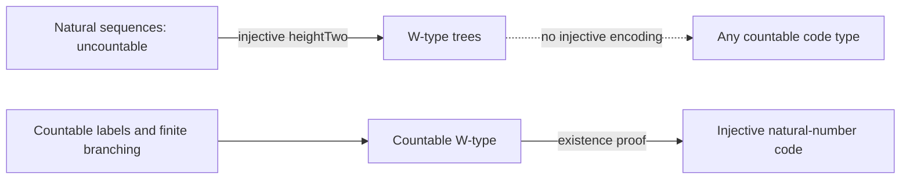

`heightTwo_injective` distinguishes the sequences by their leaf labels.
`branchingTree_uncountable` uses Cantor diagonalization. `no_countable_code`
and `no_countable_roundtrip` rule out injective encoding and lossless decoding
through any countable type, in any ambient Lean universe.
`no_countable_sigma_code` includes `Σ n : ℕ, Code n` when every fibre is
countable. It does **not** exclude arbitrary natural-indexed sums: their
fibres can themselves be uncountable.

The positive result `finitary_countable` reuses Mathlib's W-type encoding for
countable labels and finite branching. `finitary_nat_code` gives existence of
an injective natural-number code. Its use of classical countability is not an
executable compiler for source terms.

## Corresponding source shape

`Countability.Source` defines the ordinary W source expression with labels
`Nat` and position family

```text
B(k) = natrec (motive U₀) (step λ _ : U₀. Empty) (base Nat) k
```

`Source.tree_formation` proves that its W-type is formed in `U₀` at finite
rule budget two. `Source.positions_zero` and `Source.positions_succ` prove the
actual source computations `B(0) = Nat` and `B(succ k) = Empty`.

This is a checked source formation/computation connection. No theorem here
identifies its supplied set denotation with Mathlib's `WType`, proves a source
encoding underivable, or proves budget two is necessary.

## Scope of the result

The cardinal counterexample concerns **all semantic trees** in the Mathlib
W-type. Source expressions and definable proof terms remain countable; this
result does not prevent encoding their syntax as natural numbers.

It refutes a lossless coding of arbitrary semantic W-trees by natural numbers
or countable dependent sums. It is not a proof-theoretic separation of MLTT
variants, a universe-strength lower bound, or an obstruction to encodings
using higher function types. In particular, it does not settle the remaining
unit/counit comparison of primitive indexed/mutual source families with their
actual ordinary Sigma/W encoding. A typed compiler collision alone likewise
does not prove nonconservativity.

The source evidence is Countability/Thms.lean
and Source/Thms.lean.
The positive countability theorem requires finite child-position types for every
label. `positions_succ` requires an actual closed typing of its argument as a
natural number at budget two. These are source-signature checks; no new build
or execution was performed for this documentation review.


## An admissible indexed-W source presentation

`Silmaril.Logic.TypeTheory.ExtensionalMLTT.Inductives.Indexed` adds explicit indexed
judgments and inference rules for family formation, construction, fully
dependent elimination and the actual indexed iota equation. Their encoding
uses the existing ordinary W and extensional equality terms.

The source `Derivation` constructors consume source premise derivations.
`Derivation.compile` recursively compiles those premises, then invokes the
proved fibre, node, dependent-elimination or computation rule. No indexed
constructor takes a proof of its desired W conclusion as a certificate. The
existing checked `IndexedFormationData` supplies the actual source index,
shape, position and requested-child-index derivations. All derivations retain
the same finite universe cap, and `Derivation.include` increases only that cap.
The nullary examples exercise all four indexed rules, including elimination
of a value obtained by the source constructor rule.

This is an admissible rule presentation over W terms. It is not an independent
primitive indexed term grammar, and it does not claim to formalize a general
mutual-inductive declaration language. The new indexed rules are closed-theory
contextual rules: their ambient free-variable contexts are arbitrary, but the
judgment-hypothesis theory is empty. The W structural API separately supports
arbitrary contextual leaves under an explicit `HypothesisTransport` contract,
or by enlarging the theory to `ContextClosure`; these indexed constructors
retain their empty-theory premises.

`Consequence` explicitly completes this rule presentation with arbitrary source
theory leaves, ordinary W inference over their exact encoded images, and the
closed-theory indexed derivations. Compilation and substitution of source
consequences are proved. This gives fixed-stage logical systems without
pretending that the indexed rule schemas themselves already support arbitrary
theory leaves under binders. `Consequence.ordinary_iff` proves conservativity
on the ordinary W language.

The finite institutions use the existing actual set towers. Source satisfaction
is interpretation of the explicit W elaboration. Compilation and ordinary
inclusion are institution and logical-system comorphisms, with an exact
retraction on ordinary W syntax. Source annotations, all description fields
and the whole elaborated judgment obey the sentence bound. Compilation commutes
with increasing the finite count. Identity model reducts give semantic
borrowing; they do not assert an inverse on distinct source presentation tags.
The Hets graph registers both count towers, both translation directions, and
the flattened compilation path with its borrowing theorem.

`Indexed.Apex` provides the hierarchy presentation and both proof-preserving
maps to ordinary W. Its ordinary core retains full unbounded inference;
`Apex.Consequence.ofFinite` forgets an actual finite source proof cap. It does
not extract a uniform cap from arbitrary unbounded cofinite proofs. Both
finite and apex ordinary fragments have exact W conservativity and retraction.

`Apex.Stage` explicitly lifts the original finite sentences to the hierarchy
sentence universe; satisfaction and derivability are proved equivalent to the
original finite definitions. The stage-to-apex institution/logical-system map
reduces each supplied hierarchy to `hierarchyFiniteModel` at the actual proof
cap. These maps commute with increasing finite counts. Their Hets graph gives
a genuine finite-stage-to-apex-to-W-to-set route. Semantic entailment transports
forward from a finite stage. Reflecting that entailment would additionally
require finite models to admit hierarchy expansions; no such expansion is
assumed. Borrowing equivalence is proved for the apex-to-W-to-set path.

The successor-description examples form source families at the distinct
natural indices zero and one. Their requested child indices have provably
unequal actual set denotations, and the position domain has an actual member.
These are formation and child-request examples; constructor inhabitants of
these particular fibres are not supplied.

The independent primitive container grammar now
retains indexed and finite mutual operations as source syntax, with scoped
substitution and a recursive W compiler. Its indexed and finite mutual formation,
constructor, dependent-elimination and iota rules compile with one extra target
universe for finite source budgets. Their `W.RuleBudget` also admits an
unrestricted branch, whose compilation remains unrestricted. The indexed and
mutual schema premises still use an empty source theory; this is independent
of whether the budget is finite. Equivalence with this admissible presentation
remains separate work. The native-tree/set-fibre correspondence
is a separate semantic result.

## Source map and review boundary

Here a theory leaf is an assumed contextual judgment, and a finite count limits
the universe indices admitted by one proof. A comorphism translates sentences
forward and models backward while preserving satisfaction. Borrowing here is
an equivalence of semantic entailment along the stated map, not a bijection of
source tags or an equivalence of all object syntax.

Paths below are under
`Silmaril/Logic/TypeTheory/ExtensionalMLTT/Inductives/` unless stated otherwise.

| Claim | Source declarations |
| --- | --- |
| Explicit judgments, complete elaboration and recursive rule compilation | `Indexed/Defs.lean`: `Judgment`, `Judgment.encode`, `annotationBound`, `Derivation`, `Consequence`; `Silmaril/Proofs/Logic/TypeTheory/ExtensionalMLTT/Indexed.lean`: `Derivation.compile`, `Derivation.include`, `Consequence.compile`, `bind`, `ordinary_iff` |
| Finite soundness, both logical maps, exact ordinary retraction and borrowing | `Indexed/Systems/{Defs,Thms}.lean`: `Finite.logic`, `toWLogical`, `fromWLogical`, `inclusionLogical`, `logic_sound`, `fromW_toW`, `entails_iff`, `toW_include` |
| Finite compilation graph and flattened borrowing | `Indexed/Hets/{Defs,Thms}.lean`: `graph`, `compilationPath`, `compilationLift`, `path_borrows` |
| Unbounded ordinary inference and finite indexed rules at the hierarchy apex | `Indexed/Apex/{Defs,Thms}.lean`: `Consequence`, `ofFinite`, `ordinary_iff`, `toWLogical`, `fromWLogical`, `Stage.toApexLogical`, `Stage.satisfaction_iff`, `Stage.derives_iff`, `Stage.entails_toApex`, `Stage.toApex_include` |
| Hierarchy realization route and its restricted borrowing theorem | `Indexed/Apex/Hets/{Defs,Thms}.lean`: `graph`, `stagePath`, `realizationPath`, `realizationPath_modelExpansive`, `path_borrows` |
| All four nullary rules and nonconstant successor requests | `Indexed/Examples/Thms.lean`: `nullary_family`, `nullary_node`, `nullary_eliminate`, `nullary_compute`; `Indexed/Examples/Successor/Thms.lean`: both family derivations, `successor_position_inhabited`, `successor_next_nonconstant` |
| Separate primitive budgets and context transport | `Primitive/Rules/{Defs,Thms}.lean`: `Ctx.JEqB`, `Ctx.JEqB.compile`; `W/RuleBudget/Defs.lean`; `W/Derivability/Weakening/{Defs,Thms}.lean`: `HypothesisTransport`, `ContextClosure`, `weaken_of_hypotheses` |

The complete page was compared with these definitions, theorem premises,
compilation proofs and populated examples. No fresh Lean build, runtime run or
transitive axiom audit is claimed. The command below is a targeted build recipe.


```sh
lake build Silmaril.Logic.TypeTheory.ExtensionalMLTT.Inductives.Indexed \
  Silmaril.Logic.TypeTheory.ExtensionalMLTT.Inductives.Indexed.Apex --wfail
```


## A finite mutual-family source presentation

`Inductives.Mutual` presents finitely many families with varying local index
types. A description contains an object local-index family under a finite
tag, constructor shapes under tag/index, constructor positions under
tag/index/shape, and two recursive-target terms: a target tag and its local
index. Those terms may depend on the source tag, index, shape, and position.

The compiler flattens the result index to `Σ tag : Tag count, localIndex tag`.
Shapes and positions unpack that pair by explicit bound substitutions. Each
recursive target is the pair of its target-tag and target-index terms. The
exact set-membership theorem proves that every interpreted total index has
a tag in `Fin count`; the underlying finite-tag encoding is in
`Encoding.Object.FiniteTag`, including `mem_denoteIn_iff`.

Source judgments name a member by `tag : Fin count` and a local object index.
The family and constructor rules consume a source derivation of that local
index. The compiler builds its tagged Sigma typing using actual finite-tag
inhabitance. Constructors also consume source shape and cross-family children
derivations. Simultaneous elimination has one dependent motive and one method
over the whole tagged family, so its recursive hypotheses can range over all
tags. The computation rule compiles the actual dependent indexed iota equation.

Every source premise is recursively compiled first. Compilation preserves the
unchanged finite universe cap, and increasing the cap preserves the source
derivation. Hypothetical consequence supports arbitrary theory leaves and
ordinary W inference, with the mutual schemas entering as closed-theory
contextual derivations. Theory substitution, exact theory-image compilation,
and conservativity on ordinary W judgments are proved.

`Mutual.Systems` uses the existing actual finite set towers for source
institutions. Logical comorphisms compile to the explicit indexed source
system and ordinary W system, preserving the cap and exact theory images.
Ordinary W embeds back with an exact retraction. The indexed/W compilation
triangle and universe-count squares commute. The Hets graph includes the
actual mutual-to-indexed-to-W path, and identity model expansions prove
semantic borrowing along that path.

`Mutual.Apex` retains full unbounded ordinary W inference and actual finite-cap
mutual source derivations. It has hierarchy institutional/logical maps to the
indexed apex and ordinary W hierarchy, with the same compilation triangle and
ordinary-language retraction. Finite source sentences are explicitly lifted
to the apex sentence universe. Genuine stage-to-apex maps use restriction of
a supplied hierarchy to the finite set tower, preserve proofs and forward
entailment, and commute with both count inclusions and mutual flattening.
The Hets graph registers both routes to the hierarchy and the actual set
realization. Semantic borrowing is proved only along the hierarchy
mutual-to-indexed-to-W-to-sets path; no expansion of an arbitrary finite
model to an infinite hierarchy is assumed.

`LocalFormationData` states the original cofinite local formation premises for
tag-dependent indices, shapes, positions and both recursive-target components.
`LocalFormationData.compile` derives every flattened formation field at the same
universe bound. It packs tag/index into a Sigma, weakens the local telescope
into the packed context, and instantiates it at the projections and actual
shape/position variables. No separately checked flattened tail is required.

`Source.Instantiation` and `Source.FourInstantiation` provide reusable same-cap
instantiation for arbitrary dependent judgments under three or four declarations.
`Source.Weakening` preserves every original local premise in a well-formed larger
context. Exact syntax and interpretation equations identify the resulting shape,
position and recursive target with the existing flattening. The earlier
`withFlattenedTail` and `withFlattenedNext` adapters remain available.

The two-nullary example discharges every formation obligation, constructs an
inhabitant in each of two distinct finite-tagged fibres, and exercises the
family, constructor, simultaneous eliminator, and computation source rules
for either tag. These nullary examples do not demonstrate recursive calls
across tags.

`Examples.Cross` supplies a nonvacuous recursive example. Both families have a
zero-shape leaf and successor-shape unary constructors, using a Nat recursor
to select Empty or Unit positions. A closed family-one leaf supplies the
child of a closed family-zero constructor. The recursive position has an
actual closed inhabitant, applying the children function at that inhabitant
has the family-one fibre type, and the source/target indices denote different
values in every interpretation. Simultaneous elimination and the dependent
iota source rule are exercised on this cross-family constructor.

`Packing` derives the actual recursive-target tag and local-index typings,
combines them with the Sigma pair rule, and constructs the full source formation
interface. The local and packed APIs use the same `levels` and `n` throughout.
`Examples.Cross.Local` supplies the original local premises for the inhabited
cross-family example and uses only their compiled formation data for its source
node, simultaneous elimination and iota rule at cap two. Its children retain the
existing checked typing, including the actual family-one child at an inhabited
recursive position.

This remains an admissible derived-rule presentation over the existing W
object terms. It does not claim equivalence with an independent primitive
mutual syntax or a primitive mutual inference system.

The independent primitive container grammar retains
finite mutual operations and recursively source description fields beneath
ambient binders. Its indexed and finite mutual rules preserve derivations with
one extra target universe at finite source budgets. Their `W.RuleBudget` also
admits an unrestricted branch, whose compilation stays unrestricted. The schema
premises retain an empty source theory in both cases; that restriction is
distinct from requiring a finite universe budget. Equivalence with this
derived-rule presentation remains separate work.

## Source map and review boundary

A tag selects one of the finitely many families; a local index selects a member
within that family. Cofinite premises hold for every bound-variable name outside
an explicit finite excluded set. The comorphisms translate source sentences
forward and models backward. Borrowing equates semantic entailment along the
specified path; the ordinary-language retraction does not identify distinct
mutual source tags.

Paths below are under
`Silmaril/Logic/TypeTheory/ExtensionalMLTT/Inductives/Mutual/` unless stated otherwise.

| Claim | Source declarations |
| --- | --- |
| Original field scopes, flattening, source rules and exact theory images | `Defs.lean`: `Description`, `flatten`, `Judgment`, `Derivation`, `Consequence`; `Silmaril/Proofs/Logic/TypeTheory/ExtensionalMLTT/Mutual.lean`: `taggedIndex_typing`, `compileIndexed`, `compile`, `include`, `bind`, `ordinary_iff`, `mem_index_denoteIn_iff` |
| Finite soundness, both compilations, ordinary retraction and commuting maps | `Systems/{Defs,Thms}.lean`: `toIndexedLogical`, `toWLogical`, `fromWLogical`, `inclusionLogical`, `fromW_toW`, `toIndexed_toW`, `toW_include`, `toIndexed_include`, `entails_iff`, `indexed_entails_iff` |
| Finite flattened path and borrowing | `Hets/{Defs,Thms}.lean`: `graph`, `compilationPath`, `path_borrows` |
| Hierarchy ordinary core, finite mutual rules, exact stage lifting and forward entailment | `Apex/{Defs,Thms}.lean`: `Consequence`, `ofFinite`, `ordinary_iff`, logical maps, `Stage.satisfaction_iff`, `Stage.derives_iff`, `Stage.entails_toApex`, `Stage.toIndexed_toApex`, `Stage.toApex_include` |
| Both stage routes and hierarchy-only borrowing | `Apex/Hets/{Defs,Thms}.lean`: `graph`, `stagePath`, `indexedStagePath`, `realizationPath`, `realizationPath_modelExpansive`, `path_borrows` |
| Original local premises, weakening, instantiation and complete packing | `Source/{Defs,Thms}.lean`, `Source/Instantiation.lean`, `Source/FourInstantiation.lean`, `Source/Weakening.lean`, `Packing/{Defs,Thms}.lean`: `LocalFormationData`, `instantiate_three`, `instantiate_four`, `weaken`, `flattened_position`, `flattened_next`, `compile`; exact interpretation equations in `Silmaril/Proofs/Logic/TypeTheory/ExtensionalMLTT/MutualSource.lean` |
| Populated nullary and cross-family source rules | `Examples/{Defs,Thms}.lean`, `Examples/Cross/{Defs,Thms}.lean`, `Examples/Cross/Local/Thms.lean`; public results from `Silmaril/Proofs/Logic/TypeTheory/ExtensionalMLTT/MutualExamples.lean`, `MutualCross.lean`, `MutualCrossLocal.lean`: `crossPosition_inhabited`, `crossChild_typing`, `source_target_distinct`, `crossNode_source`, `cross_eliminate`, `cross_compute` |
| Independent primitive finite/unrestricted budget distinction | `Silmaril/Logic/TypeTheory/ExtensionalMLTT/Inductives/Primitive/Rules/{Defs,Thms}.lean`: `Ctx.JEqB`, `Ctx.JEqB.compile` |

The complete page was compared with definitions, exact theorem premises,
compilation and interpretation proofs, and populated example statements and
proof uses. No fresh Lean build, runtime run or transitive axiom audit is claimed.


## Dependent contexts in the inductive-to-W translation

Import `Primitive.Encoding.Contexts` under
`Silmaril.Logic.TypeTheory.ExtensionalMLTT.Inductives`.

The primitive source language has indexed and finite mutual families. Their W
implementation uses different type expressions. Relating the two requires
transporting dependent contexts and substitutions, as well as individual trees.

Here substitution replaces one free named variable `x` by a bound-closed source
term `v`. `Ctx.SubstB` requires an actual target typing for every substituted
source variable lookup; the derivation APIs also require a well-formed target
context. This is distinct from a general simultaneous substitution interface.
A cofinite premise holds for every fresh name outside an explicit finite set.

The contextual substitution API proves:

- `Ctx.Lookup.of_compile`: a variable lookup in a compiled context comes from
  an actual source declaration. The proof does not invert compiled types.
- `Ctx.SubstB.compile`: a source variable substitution with actual image typings
  becomes a typed W substitution between the compiled contexts.
- `OriginalMutual.Derivation.substitute`: typed free-name substitution preserves
  the full recursive original-mutual source proof system, at the same budget.
- `OriginalMutual.Derivation.compile_substitute`: compiling and then substituting
  in W proves the same complete judgment as source substitution followed by
  compilation, including substitution in the dependent carrier.
- `OriginalMutual.Derivation.instantiate` and `compile_instantiate`: cofinite
  binder instantiation works in the recursive source profile and commutes with
  compilation. The target proof compiles every open premise and uses W's own
  instantiation theorem.

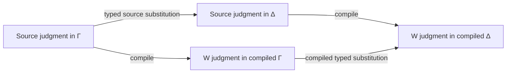

The theorem applies to arbitrary source terms and carriers with actual source
proofs, including primitive indexed/mutual formation, constructors, recursion,
and their equations. It uses the existing theorem that the recursive original
profile and literal primitive inference prove the same judgments. It adds no
semantic preservation assumption.

## Dependent mutual-family example

`Primitive.Encoding.Contexts.Examples` starts with the source context

```text
i : Nat, t : Family₁(i)
```

and substitutes `i := 0`, retaining `t : Family₁(0)`. It proves the actual source
variable-image typings and their compiled W counterparts. An original-method
mutual recursor using the height method is typed in the first context and
substituted into the second. Its W typing follows independently by target
substitution after compilation. The primitive family has two tags, and its
height method consumes recursive hypotheses.

The example uses source capacity two and target capacity three. The same typed
context substitution is also checked at the unrestricted apex. The general
API accepts any `RuleBudget`: finite compilation uses one additional level,
and unrestricted compilation stays unrestricted. These are sufficient existing
compiler bounds, not claims of minimum capacity.

## Remaining comparison work

These results concern empty judgment theories and actual typed substitutions;
contexts may be nonempty and dependent. They do not transport arbitrary
hypothesis theories through a source substitution. The existing
`SyntacticTheory.substitute_compiled` API supplies target-side structural
transport for its explicitly substitution-closed theory profile.

This is a contextual compatibility result for the forward translation. It does
not supply an inverse context translation, identify a primitive family type
with its W representation, or prove an equivalence of the whole institutions.
The existing fixed-fibre reconstruction laws remain source equalities at their
specified carriers. The compiler's raw syntax collisions establish neither
underivability nor a proof-theoretic strength separation.

## Independent W endpoints

Import `Primitive.Encoding.Endpoints` for the endpoint-level target bridge.
`W.Endpoints.Endpoint` stores a W term and its actual W typing derivation.
Its equality quotient identifies typed endpoints when W derives their equality
at that exact carrier and budget. It uses W's inference relation directly, without a source
representation or a semantic preservation certificate.

`Encoding.Endpoints.translate` maps recursive source equality classes into these
independent W equality classes. Source capacity `n` maps to W capacity `n + 1`;
the unrestricted source maps directly to unrestricted W. The source carrier
`A` becomes the distinct W expression `A.compile`.

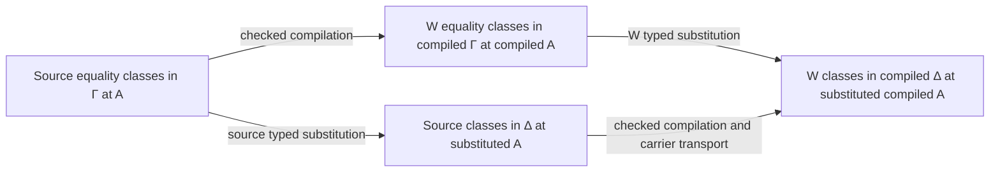

`translate_natural` proves this square using W's own substitution theorem.
Compiled variable typings and target-context formation are derived from the
source proofs. A concrete example substitutes zero for the index in
`i : Nat, t : F(i)` and checks equality of whole W endpoints and their classes.

This is a map into the independent target, with a proved substitution law.
It does not yet provide a source decoding of arbitrary W endpoints or reflect
all W equalities back to source derivations. Those require an additional
representation/completeness theorem; syntactic compiler injectivity would be
false.

## Source map and review boundary

| Claim | Source |
| --- | --- |
| Typed one-name substitution contract | Named substitution definitions |
| Lookup reconstruction, substitution and binder compilation squares | Context APIs, target substitution proof |
| Recursive-profile/literal-inference equality | Literal reflection |
| Dependent-context recursor example and unrestricted substitution | Context examples |
| Explicit theory profile's target-side transport | Theory theorems |
| Independent W endpoints, equality and typed reindexing | W endpoint definitions, substitution |
| Forward quotient map, equality characterization and substitution naturality | Encoding definitions, theorems, examples |

The review matched the page against definitions, exact theorem premises and
examples, and inspected lookup reconstruction, target substitution and endpoint
naturality proofs. No fresh Lean/runtime execution or transitive axiom audit
was performed for this prose review.


## HOL into extensional MLTT with choice

The goal is an interpretation from HOL into extensional MLTT with extensional
Hilbert choice, compatible with the finite-universe inclusions. This connects
the HOL node to the existing MLTT/set-theory network. The current code supplies
a syntax compiler with term-typing preservation, a universe-free sentence
institution and a conditional semantic choice theorem. The institution map is

## Choice and excluded middle

There are two different choice principles to distinguish.

- **Dependent Σ choice** rearranges supplied witness data: from
  `h : Π x, Σ y, R x y`, take `f x = (h x).1` and the proofs `(h x).2`.
  `Choice.dependentSigmaChoice` defines this directly by projections.
- **Extensional Hilbert choice** selects from a predicate whenever it is
  merely inhabited. The selected value must agree for pointwise logically
  equivalent predicates. This principle implies excluded middle.

`Choice.Epsilon A` is an explicit selector structure on one carrier.
`Choice.Epsilon.nonempty` proves that such a carrier is inhabited, and
`Choice.noEpsilonEmpty` excludes a selector on Empty. In particular, a general
selection rule must take evidence that its carrier is inhabited.

`Choice.BooleanEpsilon` states just the Boolean part of the second principle:

```text
select  : (Bool → Prop) → Bool
witness : (∃ b, p b) → p (select p)
congr   : (∀ b, p b ↔ q b) → select p = select q
```

`Choice.BooleanEpsilon.excludedMiddle` proves `P ∨ ¬P` for every Lean
proposition, from these three explicit contracts. There is no global selector
instance; the proof uses the supplied contracts and Boolean case analysis. The congruence contract includes the
required extensionality; equality reflection and function extensionality alone
do not supply it for propositions-as-types.

The proof uses `U b = (b = false ∨ P)` and `V b = (b = true ∨ P)`. Both predicates
are inhabited. Their selected-membership proofs either give `P` or force the
selected values to be distinct. If `P` held, congruence would make the selections
equal, giving a contradiction in the latter case.

This theorem is about an explicit semantic interface on Lean propositions. It
is not yet a derivation using an MLTT choice rule. Separately, the existing HOL
kernel already has the object-level theorem
`Silmaril.Logic.HOLLight.Derives.excludedMiddle`, derived from the HOL selection
axiom in the explicit `classicalTheory`. The bare kernel logical system does
not automatically add this theory. The new bridge must transport that proof to
actual target derivations.

## What zero universes means

A universe-free dependent type theory can have ordinary types and a separate
judgment `A type` without an internal type of all types. That is the intended
zero-universe endpoint for this interpretation.

The existing `Finite.logic 0` has a different meaning. Its Russell presentation
bounds *every* rule parameter by zero. Type formation and context extension
require a level below the bound, so they are unavailable. The theorems
`Finite.zero_context` and `Finite.zero_no_formation` prove that every empty-theory
zero-budget derivation has the empty context and cannot conclude `A : Uᵢ`.
Data rules such as `zero : Nat` still work at this budget.

`UniverseFree` uses universe-free sentences (`Finite.Sentence 0`) with actual
`JEqB 1` derivations and one-universe tower models. `U₀` serves as an auxiliary
formation classifier; `U₀ : U₁` remains unavailable. Its soundness and inclusion
into `Finite.logic 1` are proved. This gives an explicit sentence/proof-budget
separation. It does not identify this encoding with a separately presented
universe-free type-formation judgment, and it does not change the existing finite
tower's counting convention. The supplied set model still has one universe.

## Translation and institution-map obligations

The source is the public HOL Light institution, with signature extensions,
nonempty types, full function spaces and polymorphic constant schemes.
The target compiler uses actual extensional `ETm` syntax, with an explicit
vocabulary for Boolean types, equality, selection, type operators and constants.
An explicit environment handles raw HOL bound variables. Application and lambda
abstraction compile to actual MLTT application and abstraction.

`HOLSyntax.translateTerm_typing` proves that every well-typed source term has
its translated type under the actual target rules. The target result uses unrestricted `ECtx.JEqH`; no uniform finite proof-budget
bound is claimed by this theorem. The assumptions include target context
well-formedness and a lookup-preserving embedding from the vocabulary context.
They state both formation and inhabitants for the primitive type vocabulary,
the types of primitive constants, the typings of variable images, and transport
for the target theory's original hypothesis leaves. Compound type formation,
inhabitants, applications and lambda abstractions are derived. The compiled Nat
identity also has a closed target derivation without vocabulary assumptions.

Typing the primitive vocabulary does not yet establish its logical laws. Those
laws belong to the chosen classical MLTT extension and its signature/model
interpretation.

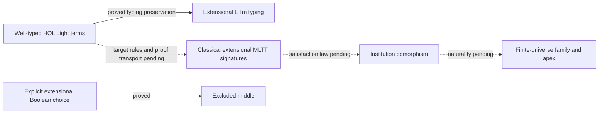

To complete the bridge:

1. Add a genuine signature/theory extension for target types, constants and
   classical selection, including a two-valued Boolean type and its elimination
   laws. HOL's nonempty carriers must remain explicit: MLTT also has Empty.
2. Establish a concrete primitive vocabulary with beta/extensionality and
   selection laws, then transport all HOL kernel proof rules. Term typing and
   the structural term/type-substitution laws are already proved under the
   explicit vocabulary interface. No whole-proof translation is assumed.
3. Define a logical-system **comorphism**: its signature functor and sentence
   map go from HOL to MLTT; its model reduct goes from target models back to
   HOL models. Prove satisfaction equivalence and signature-extension naturality.
   Target signature constants need fixed interpretations: turning them into
   unrestricted free variables would incorrectly vary them in every judgment.
4. Account for polymorphic valuations. The public HOL semantics quantifies over
   all nonempty carriers in an ambient Lean universe; quantification over the
   members of a single object universe is a restriction. A restricted HOL
   institution, a general target model API or a proved resizing result must make
   this boundary explicit.
5. Account for selection semantics. The public `HOLLight.Model` has type
   operators and user constants as fields, but `ConstEval.select` uses the fixed
   metatheoretic `Carrier.choose`. Arbitrary target selectors satisfying the
   selection laws need not agree with that fixed function. Prove exact selector
   compatibility, or explicitly generalize the source models and relate the two
   source institutions before claiming a satisfaction equivalence.
6. Prove compatibility with every finite inclusion and the apex. Add the Hets
   edge only when the comorphism exists, with separate evidence for derivability
   preservation and any consequence-reflection theorem.

To check the implemented pieces:

```sh
lake build Silmaril.Logic.TypeTheory.ExtensionalMLTT.Choice.Thms \
  Silmaril.Logic.TypeTheory.ExtensionalMLTT.Finite.Zero.Thms \
  Silmaril.Logic.TypeTheory.ExtensionalMLTT.UniverseFree.Thms \
  Silmaril.Logic.TypeTheory.ExtensionalMLTT.Translations.HOL.Typing.Thms --wfail
```

## Source map and review boundary

| Claim | Source |
| --- | --- |
| Explicit selectors, Sigma choice and conditional excluded middle | Choice definitions, theorems, Boolean proof |
| Zero proof-budget limitations | Zero-budget theorems, induction proof |
| Universe-free sentences, budget-one proofs and inclusion | UniverseFree definitions, soundness and examples |
| Compiler and exact primitive formation/inhabitance obligations | Syntax definitions |
| Conditional structural substitution laws | Structural definitions, theorems |
| Actual target typing and assumption-free Nat identity | Typing theorems, proof implementation |

The public HOL comparison uses `Silmaril/Logic/HOLLight/Semantics/{Type,Term}.lean`
(nonempty carriers, full arrows and fixed `Carrier.choose`),
`Classical/ExcludedMiddle.lean` and `Theory.lean` in the Silmaril revision pinned by
lake-manifest.json. These source interfaces explain the
model and selection obligations above; this review did not execute a new axiom
inspection or build. The six remaining steps are prospective obligations, not
implemented institution or whole-proof translation results.


## λΠ-modulo, LF and Dedukti

`Silmaril.Logic.TypeTheory.LambdaPi` defines a dependent function calculus with
global declarations, explicit rewrite schemas, structural translations and
term-valued encodings. Both translation categories have proved functors to
institutions and Hets logic graphs.

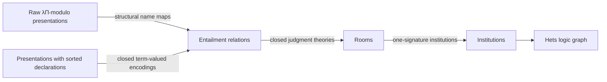

**λΠ** is lambda calculus with dependent function types: in `Π x : A, B x`,
the result type may depend on the argument. **Modulo** means typing also uses
specified equations as conversions. **LF** (the Edinburgh Logical Framework)
is the β-only profile here; **Dedukti** is a separate implementation used as a
comparison reference, not a parser or kernel implemented by this development.
A β step evaluates `(λ x : A, t) a` by substituting `a` for `x`; an η equation
identifies a function with `λ x : A, f x` when `x` is fresh.

Read the results by profile:

| Profile | What is established | Required boundary |
| --- | --- | --- |
| Raw λΠ-modulo | Structural/term-valued translation and syntactic closed-theory institutions | Arbitrary scoped rules need not preserve typing or terminate. |
| Checked β-only LF | Total inference, exact judgment/signature checking, normalization and concrete realizability | Ordered checked declarations; no external judgment hypotheses. Inputs are Lean syntax data. |
| βη LF | Compatible βη preservation through annotation erasure | The β-only checker and normalization results do not automatically extend. |
| Certified finite rewriting | Source normalization from strict LF simulation; source conversion decisions with independent confluence | Matching profile, actual typings and each displayed certificate remain inputs. |
| Certified native semantics | Concrete models and changing-presentation institution maps | Models use the chosen checked LF encoding and realizing parameter assignments. |

A **closed derivation** below means `Derives C ∅ J`: there are no external
judgment hypotheses. Its local variable context may be nonempty. A **closed
term** instead has no free local variables. Contexts and declaration lists are
stored newest first. De Bruijn index `0` denotes the nearest binder; entering a
binder shifts references to outer variables. A **telescope** is an ordered list
of declarations in which a newer type may depend on older entries.

An **institution** packages sentences, models and satisfaction across symbol
signatures; a **comorphism** translates sentences forward and models backward
with an exact satisfaction law. **Hets** is the Heterogeneous Tool Set; the
Hets graphs here are mathematical data in Lean, not an external Hets execution.

## Calculus

The raw syntax and binding operations reuse Silmaril's `LambdaCube.Pseudo`.
Atoms distinguish `Type`, `Kind` and global names. `Term.Scoped n` checks free
variable indices; each rewrite schema supplies an arity and scope proofs for
both sides. Instantiating a schema uses simultaneous capture-avoiding substitution.
Conversion closes β and the instantiated schemas under equivalence and all
term constructors, including annotations.

| Typing operation | Contract |
|---|---|
| Sort axiom | `Type : Kind`; no axiom types `Kind` |
| Context extension | The new declaration's type has sort `Type` |
| Product | A `Type`-sorted domain; a `Type`- or `Kind`-sorted codomain |
| Constant | Its declared type has a derivable sort |
| Abstraction/application | Dependent Π introduction and substitution in the codomain |
| Conversion | Convert the subject's type to another sorted type |
| Theory hypotheses | Explicit judgment assumptions, with proved substitution and monotonicity |

`Calculus.lf` gives the β-only profile over a declaration relation. It is the
starting point for the Edinburgh LF account. `Calculus.lfBetaEta` is the
separate η-extensional profile described below. The rewrite profile is a
λΠ-modulo foundation compared with Dedukti. The finite first-order matcher
and its typed rewrite checks are described below. Dedukti's parser, full production pattern
matcher and admissibility checks, AC/ACU symbols and optional Calculus of
Constructions mode remain separate work. AC matching treats an operator as
associative and commutative; ACU also gives it a unit. The Calculus of
Constructions adds type dependencies beyond this LF profile.

## Translations and semantics

A `Morphism C D` maps constant names, preserves declarations, and carries each
source rewrite schema to a target schema. Identity and composition satisfy the
category laws. Every morphism preserves conversion and all hypothetical typing
rules; the proof uses the public PTS atom-map renaming/substitution theorems.
`Encoding C D` also permits compound constant images, as described below.

`calculusToEntailment` packages the actual inference rules as Tarskian
consequence relations: hypotheses imply themselves, adding hypotheses preserves
consequences, and derived hypotheses may be substituted into a derivation. `calculusToInstitutions` then uses closed judgment
theories as models: satisfaction is membership, and model reduction is inverse
image of judgment translation. The satisfaction condition and functor laws are
proved. Generated theories prove soundness and completeness for this syntactic
model class. The resulting comorphisms are registered in `hets`.

The concrete LF interpretation described below also covers rewrite presentations
with a certified encoding into checked LF. Concrete semantics for arbitrary
rewrite presentations and general normalization remain open.
Preservation and confluence of user rewriting require admissibility conditions
on the rewrite presentation. Compatible β preservation is proved below. Closed-theory completeness supplies none of those automatically.
Raw presentations intentionally permit arbitrary declarations and scoped rewrite
schemas; they are useful for stating the restrictions which later admissible
calculi must satisfy.

## Checked examples

For a signature `A : Type, a : A`, the term `λ x : A, x` has type
`Π x : A, A`, and `(λ x : A, x) a` β-reduces to `a`. These globals
are declarations; choosing an interpretation of `A` and `a` is a separate step.

The examples derive a type declaration, an inhabitant, a closed identity function,
its application and its β computation. A second presentation declares a named
identity and instantiates the separate user rewrite `id x → x`. Its inclusion is
an actual declaration/rewrite-preserving morphism.

```sh
bin/mor build Silmaril.Logic.TypeTheory.LambdaPi
```

## Ordered LF signatures

`Silmaril.Logic.TypeTheory.LambdaPi.Signature` adds finite, ordered signatures
for the β-only LF profile. `Signature.Checked` requires each inserted name
to be fresh and its type to be closed and sorted in the earlier signature.
Theorems prove unique declaration types, preservation under signature inclusion,
and typing of every declared constant in the final signature.

Checked signatures form a category using the same structural translations.
`checkedSignatureInstitutions` and `checkedSignatureHets` reuse the calculus
functor. Examples check a global type parameter and its inhabitant, and reject
a repeated name. Signature checking is represented by actual derivations. The executable LF
checker below constructs these derivations; parsing and rewrite-admissibility
checking for unrestricted user rules remain separate work.

```sh
bin/mor build Silmaril.Logic.TypeTheory.LambdaPi.Signature
```

The public λP presentation permits local type parameters, while this LF profile
uses global declarations for them. The checked elaboration below translates
those declarations into an ordered parameter context.

## Term-valued encodings

`TypedPresentation` pairs a raw calculus with actual sorting derivations for
every declaration type. Its morphisms, `Encoding C D`, supply:

- A closed target term for each global constant.
- A target typing derivation for each source declaration's image, at the
  translated source type.
- A target conversion between the translated sides of each source rewrite
  schema.

Theorems prove that these local certificates preserve all instantiated
conversions and hypothetical typing rules. Closed images make translation
commute with renaming and simultaneous substitution beneath binders. Identity
and composition give a category; composition translates the entire constant
image rather than just its name.

`Encoding.ofMorphism` retains existing structural maps in this larger class.
`checkedSignaturesToEncodings` embeds the checked-signature category.
`encodingsToEntailment`, `encodingInstitutions` and `encodingHets` give the
corresponding institution/Hets connections, using the same closed-theory model
class as above. Theorems show that both the entailment and institution routes
from checked signatures commute with the existing structural functors.

The example implements a source constant `id : A → A` by `λ x : A, x` in a
β-only target. The source rewrite `id x → x` becomes target β conversion,
and typing preservation derives the target identity's type. The target has
no user rewrite rules. This demonstrates a translation that eliminates a
rewrite rule by implementing its constant.

Sorted declaration types and locally certified encodings do not establish
rewrite admissibility or consistency of either presentation. Encodings prove
preservation in one direction; they do not supply conservativity or equivalence.

```sh
bin/mor build Silmaril.Logic.TypeTheory.LambdaPi.Encoding
```

## Optional η extension

`Calculus.withEta` adds the capture-avoiding equation `λ x : A, f x ≡ f`
through one scoped rewrite schema. The default `Calculus.lf` stays β-only;
`Calculus.lfBetaEta` names the extension. A theorem characterizes its raw
conversion exactly as an independently defined annotated βη relation.

η extension is functorial for both structural maps and term-valued encodings.
Every original derivation is preserved, and the structural inclusion is a
natural transformation. These translations participate in the existing
institution and Hets machinery through its functors.

`Derives.etaApplication` applies an actual dependent function to the fresh
variable and retains its dependent codomain exactly. `Derives.etaExpansion`
then types its η expansion at the original product type. Both results hold in
the original calculus, including open contexts and products of either sort;
they require no rewrite-admissibility or normalization assumptions.

`Calculus.withEta_conversion_iff_pointwise` gives function conversion exactly
when the two fresh-variable applications are convertible in the η extension.
The typing lemmas supply the actual endpoints for dependent functions.
Examples cover `p : Πx:A. P x`, the Kind-sorted family `P : A → Type`, and an
open function whose free variable must shift under the new binder. The
uninterpreted and dependent examples also prove that their η equations are
absent from β-only conversion. Head η contraction for ordinary eta-extended
typing is proved below. Compatible η subject reduction is implemented through
the annotation-erasure API below; βη normalization and its complete typed semantic interpretation
remain separate tasks.

`BetaEtaConversion.identity_annotations` records a boundary of the raw relation:
`λ x : A, x` and `λ x : B, x` are βη-convertible for arbitrary annotations.
Expand the second identity by η with domain `A`, then contract the inner β
redex. The example with `Type` and `Kind` annotations proves that these
identities are distinct β-normal forms. The raw annotation equation supplies
no common typing for its endpoints.

The annotation-erasure bridge characterizes this
entire raw conversion theory using a syntax without lambda annotations, while
retaining dependent product domains and codomains. Erasure preserves and reflects
conversion, and commutes with capture-avoiding renaming and substitution.
Annotation-free beta–eta reduction is confluent. This proves product
compatibility, sort separation, and beta subject reduction for ordinary
eta-extended LF typings; see the compatibility API.
Head eta contraction preserves ordinary eta-extended LF typing via actual
product recovery and strengthening. `Derives.lfBetaEta_nativeStep` extends this
to every compatible beta–eta reduction position; `lfBetaEta_nativeSteps` covers
finite sequences. The complete typed interpretation remains a separate task.

`Expr.BetaStep.lift` and `Expr.BetaReduces.lift` recover genuine annotated beta
computation from an erased step or path, starting from the actual source term
with its existing annotations. `Expr.BetaReduces.lift_typed` retains its original
type under the calculus's beta-preservation conditions. These results cover beta
computation; they do not supply a lifting theorem for erased eta contraction.

`Expr.Reduces.beta_eta_factor` factors raw erased reduction into beta contractions
followed by eta contractions. Together with beta lifting and beta subject
reduction, this recovers an actual sorted source product from conversion to a
product and separates sorted types from the unsorted `Kind`.
`Derives.lfBetaEta_reflectRenaming` and `lfBetaEta_strengthen` use these results
to reconstruct the typing of a subject independent of an extra binder.
`Derives.lfBetaEta_headEta` then contracts an eta redex at its original result
type, using only the source redex's typing.

```sh
bin/mor build Silmaril.Logic.TypeTheory.LambdaPi.Eta
```

## Typed local substitution

`ContextOK` records actual domain-formation derivations. `Lookup` shifts each
stored declaration type into the whole newest-first context.
`TypedSubstitution C Γ Δ σ` certifies a well-formed target context and a
typing derivation for every source variable's image.

`Derives.subst` proves simultaneous substitution for every typing rule, using
the already proved substitution stability of raw β/rewrite conversion.
`Derives.substOne` discharges the newest variable and substitutes into both
the subject and dependent result type. Identity, lifting and composition of
typed substitutions are proved. These results use no judgment hypotheses;
their local contexts may be nonempty. They apply to all current conversion
profiles, including β-only, βη and arbitrary schema presentations.

The same development proves variable bounds for derivable subjects/types,
well-formedness of their contexts, closed weakening, and product-domain
formation. `LocalContext C` has a category of contravariant `ContextMap`s;
morphism equality compares complete natural-number-indexed assignments.

Examples instantiate an actual dependent term family and substitute beneath
a nested lambda, retaining the inner binder. The substitution layer alone does
not establish subject reduction or concrete semantic soundness; later sections
give these results for their stated profiles.

```sh
bin/mor build Silmaril.Logic.TypeTheory.LambdaPi.Substitution
```

## Context conversion

`ContextConversion C Γ Δ` pairs local declarations by raw conversion, with
actual Type-formation derivations on both sides. Reflexivity, symmetry and
transitivity are proved. The unchanged variables form a typed substitution,
so `Derives.changeContext` preserves every closed typing judgment.

`LocalContext.isoOfConversion` packages the two unchanged-variable maps as an
isomorphism in the local-context category. The example replaces a domain
with a β-convertible type beneath a later declaration that depends on its
variable. Formation is derived in both contexts, and the dependent variable
judgment is transported by the general theorem.

```sh
bin/mor build Silmaril.Logic.TypeTheory.LambdaPi.ContextConversion
```

## Generation and head β preservation

`Derives.typeCorrectness` proves that every type in a closed derivation is
`Kind` or has an actual sort derivation. Product, application and abstraction
generation recover their typing premises through weakening and conversion.
These results hold for every rewrite presentation, with no judgment hypotheses
and with arbitrary well-formed local contexts.

`Calculus.ProductCompatible` says that convertible products have convertible
domains and codomains. It is proved for every β-only LF signature using the
public raw β confluence theorem. Under this local condition,
`Derives.headBeta` proves that contracting an application of a lambda preserves
its original result type. `Derives.lf_headBeta` discharges the condition for LF.
Examples exercise a dependent codomain, a converted function domain, a converted
result type and weakening as the final typing rule.

This API isolates head contraction; the next layer proves preservation under
every compatible β position, including when typing admits eta conversion.
Compatible eta subject reduction for LF is supplied by the annotation-erasure
API above. Unrestricted user rewrite admissibility remains separate work.
Beta–eta product compatibility uses its own annotation-free confluence theorem.

```sh
bin/mor build Silmaril.Logic.TypeTheory.LambdaPi.Generation
```

## Compatible β subject reduction

`Derives.lf_betaParallel` proves type preservation for the public raw
`Pseudo.Par` relation. It reduces β redexes at any depth, including lambda
annotations, product domains and codomains, and bodies under dependent binders.
`Derives.lf_betaReduction` extends the result to finite reduction sequences.
Both preserve the original result type, which may itself contain unreduced
redexes. They apply to every β-only LF declaration relation; each constant use
still requires the existing actual type-formation derivation.

For general λΠ-modulo presentations, `Derives.betaParallel` and
`Derives.betaReduction` require product compatibility and `Calculus.SortRigid`:
convertible sorts are equal. Both conditions are proved for LF. Sort separation
handles products whose result type is `Kind`, for which the conversion rule
cannot obtain a sorted target-type premise. The proof transports dependent
binder contexts by the existing context-conversion theorem.

Examples reduce a redex beneath a lambda, a lambda annotation while retaining
its unreduced function type, a Kind-sorted product domain and an actual
two-contraction sequence. The theorem executes β steps, not user rewrite
schemas. It does not establish normalization, concrete semantic soundness or
subject reduction for arbitrary rewriting. The optional βη profile uses
the separate compatible-preservation results above.

```sh
bin/mor build Silmaril.Logic.TypeTheory.LambdaPi.BetaReduction
```

## Checked LF elaboration into λP

`Silmaril.Logic.TypeTheory.LambdaPi.PTS` translates β-only LF into Silmaril's
public lambda-P corner. `Signature.ptsContext` elaborates global declarations
into local parameters, in declaration order. `Term.toPTS` maps global names to
their parameter variables and shifts those images whenever it enters a binder.
The original local variables retain their indices.

`Signature.Checked.toPTS` proves preservation of every typing rule, including
dependent application and conversion, for every derivation over a checked
signature. The signature proof constructs actual target typings for all the
constant images; callers supply no additional preservation certificate.
`Signature.ptsInferenceMorphism` packages the translation as an arrow into the
public category of inference systems. The more general `Derives.toPTS` permits
arbitrary open constant images with actual target typings.

Examples translate `A : Type, a : A`, a local binder over that signature,
and a dependent family `F : A → Type` with `b : F a`. They check the target
contexts and shifted indices explicitly. This is one-way typing preservation
for β-only LF. Reflection and conservativity remain separate obligations; source
normalization and concrete semantic soundness are proved in later sections.
No η or user rewrite schemas are mapped.

```sh
bin/mor build Silmaril.Logic.TypeTheory.LambdaPi.PTS
```

## Executable β normalization

`Term.betaNormalize? fuel t` repeatedly runs the public complete β development,
checking for redexes throughout the term, including annotations. It returns a
normal form or reports fuel exhaustion. A successful run supplies a proved
finite reduction and preserves the original LF typing judgment.
Every reachable β-normal form is found with some finite budget: the procedure's
domain is exactly the weakly β-normalizing terms. β-convertible terms share a
successful normal form whenever either has one.

`Term.betaCompare? fuel t u` compares successful normal forms. Its `true` and
`false` answers certify β conversion and nonconversion respectively; `none`
means the budget was exhausted. Successful results are stable under increasing
the budget. Fuel counts complete developments, not runtime or output size.

The examples normalize typed terms beneath binders and in annotations, and
exercise both comparison answers and exhaustion. The untyped looping term Ω
is fixed by complete development but still contains a redex; it exhausts every
budget. The implementation therefore checks redex absence, rather than treating
an unchanged term as a normal form.

On arbitrary raw terms this remains a partial conversion procedure. On actual
LF typings under checked signatures, the strong-normalization result below
proves eventual success at some finite budget. It performs no user rewriting or
η reduction, so negative answers apply to β-only LF and do not rule out
conversion in stronger profiles.

`Normalization.Arity` supplies structural object-type arities used in the
normalization proof. `Term.familyArity?` retains dependent product
domains and codomains while erasing object arguments and family parameters.
It handles family-level β redexes that reveal products. An accepted structural
family retains exactly the same arity under actual capture-avoiding simultaneous
substitution, renaming and compatible β reduction, including below binders.
Two accepted families related by raw β conversion have equal arities: the proof
uses their common reduct, so the conversion path may leave the family grammar.

The grammar rejects variable family heads. This matters: an arbitrary raw
substitution or β expansion may replace such a variable by a product and reveal
an arity that was absent before. A checked signature with `P : A → Type`
supplies an actually typed `λx:A. Πy:P x. P x`; application to `a : A`
reduces to `Πy:P a. P a`, retaining the computed function arity. A raw expansion
outside the grammar is proved untypable in ordinary LF.

`Normalization.Classification` extracts this grammar from actual ordinary LF
derivations with empty external judgment hypotheses. Proper families are built
from constant heads, application, abstraction and products; kinds are `Type`
or products ending in a kind. Compatible beta reduction preserves both classes,
and Church–Rosser separates their conversion classes. Induction on the typing
derivation then classifies kinds, families and object types. Consequently every
typed family with an actually formed kind has an arity, and every result type
of an actual LF derivation has one. This works under checked signatures, with
actual local object contexts, dependent family lambdas and applications. It
needs no declaration functionality: each constant rule already carries its
actual sorted declaration derivation. An explicit external-hypothesis example
shows why the empty-hypothesis condition cannot be dropped.

`Normalization.Erasure` now sends every actual LF typing under a checked
signature to an actual simply typed derivation. Its target reuses the de Bruijn
pseudo-term syntax, with fixed arity annotations and neutral constants; the
target typing rules exclude dependent products. Global declarations receive the
arity computed from their actual checked declaration type. A source annotation
is retained as the argument of an administrative beta redex, and a product as a
neutral constructor applied to its domain and an abstracted codomain. Their
subterms therefore remain available for reduction. Erasure commutes with every
renaming and with actual capture-avoiding simultaneous substitution once source
binder domains have arities; actual LF typing supplies that condition throughout
the term. Checked examples include the dependent family lambda, its application,
the dependent body under a local context, and literal substitution equations.

`Normalization.Steps` defines one genuine compatible beta contraction with no
reflexivity constructor, including annotations and both product components. Its
normal terms are exactly the normalizer's existing redex-free terms. Every
source step embeds into the public parallel reduction and preserves LF typing.
`Erasure.Simulation` proves that each such step from an actual LF subject gives
a **nonempty** target beta sequence. A root source contraction first removes
the administrative annotation wrapper, then performs the body contraction;
steps inside annotations and product subterms stay visible in target contexts.
Checked examples exercise the root redex, a lambda annotation, a product domain
and a dependent product codomain.

`Erasure.StrongNormalization` translates the simply typed target into CSLib's
locally nameless STLC, with a concrete finite context for its visible constants
and outer variables. Opening, weakening and actual one-binder substitution
commute with that translation. Every genuine target step gives one actual
CSLib full-beta step. CSLib's proved `Stlc.strong_norm` theorem therefore gives
strong normalization of the target; no normalization certificate is assumed.

`Signature.Checked.strongNormalization` transports that accessibility back
through the nonempty erasure simulation. Actual source subject reduction
supplies the required typing and annotation conditions at every descendant.
Thus every actually typed ordinary LF term under a checked signature strongly
normalizes for compatible beta reduction, including annotations and both
product components. Result types strongly normalize too, with `Kind` already
normal. External judgment hypotheses are empty: an explicit bare-hypothesis
derivation of the looping Ω term is proved not strongly normalizing.

`Signature.Checked.betaNormalize_total` proves the existing normalizer succeeds
at some finite budget and returns an actually typed normal form at the original
source type. `Signature.Checked.betaCompare_total` similarly supplies a common
finite budget giving a certified conversion or nonconversion answer for two
actually typed terms. These are ordinary LF theorems; η and user-rewrite
admissibility are not included.

`Normalization.Total` makes this termination result executable on known typed
inputs. `CheckedSignature.normalize` searches for the least successful
development budget with `Nat.find`, then returns the certified normal form.
Its termination proof comes from the actual source derivation; callers supply
no fuel or normalization certificate. The output is normal, beta-convertible
to its input, actually typed at the original type, and normalization is
idempotent. `CheckedSignature.compare` normalizes two actually typed inputs
and compares their forms; `compare_spec` proves its Boolean answer decides
ordinary LF conversion. Checked examples cover the dependent family redex,
an open body, an annotation redex, and both comparison answers. The next section
uses these typed interfaces to check raw inputs.

```sh
bin/mor build Silmaril.Logic.TypeTheory.LambdaPi.Normalization
```

## Executable LF inference and signature checking

`CheckedSignature.infer?` takes a term, an inference budget and an actually
well-formed local context. Every successful result contains its inferred type
and an LF derivation of the input term at that type. Variable lookup computes
dependent shifts. Application normalizes the function type to a product and
recovers its actual domain formation from proved type correctness and β
preservation; it then checks the argument by certified β comparison.

`Inference.Lookup` proves that both executable lookups find every actual local
lookup or declared name. Local lookup returns exactly the declarative shifted
type. Global exact-type lookup additionally requires an actually checked
signature; an unchecked duplicate-name example proves why freshness matters.

`Signature.check?` takes raw newest-first declarations, checks them oldest first,
and returns an actual `Signature.Checked` proof on success. Each declaration's
type is inferred and sorted in the earlier signature. Inference also establishes
closedness. `Signature.checked?` packages the result as the existing checked
signature object. No caller-supplied declaration proofs are needed.

Examples check the inhabited and dependent-family signatures, infer nested
lambdas and dependent applications, and accept a β-convertible annotated domain.
They also exercise missing names, unbound variables, ill-formed applications,
duplicate names, forward references, open declarations and exhausted budgets.

The checker works on Lean term data; it has no text parser. Success is sound.
Failure of this bounded interface can reflect exhaustion or a typing route the
algorithm did not find. Each declaration receives the same inference budget,
and each recursive inference call decreases that budget.

`Inference.Total` provides fuel-free `CheckedSignature.inferTotal?` and
`inferTypeTotal?` interfaces. They recurse structurally on input syntax and use
the proved total typed normalizer for function-type recognition and conversion.
Normalization is called only after obtaining actual formation derivations.
`Term.formationSort` computes the sort of each actual non-top inferred type;
its correctness follows from the LF family/kind classification. This permits
lambda inference without recursing on a computed type.

`Signature.checkTotal?` checks ordered declarations with the same fuel-free
inference and returns an actual checking proof on success. Every successful
inference result retains an actual LF derivation; `inferTypeTotal_sound`
certifies the projected type. These algorithms terminate on all syntax. The
completeness layers below certify failed inference and rejection of raw ordered
signatures. Both interfaces handle ordinary
β-only LF, with no η or user rewrite schemas.

`Inference.Total.Checking` proves declarative completeness of the two local
helpers. Given an actual inferred derivation and an actually formed expected
type, `checkInferredTotal_spec` characterizes success by actual typing at that
expected type. `inferredSortTotal_spec` similarly characterizes recognition of
each actual sort, including the literal `Kind` result. Type uniqueness and the
existing separation of sorted LF types from `Kind` justify the rejected top
branch. Converted dependent-family examples exercise both input and expected
types. These local helpers support the complete recursive inference and ordered
signature checking below.

`Inference.Total.FunctionRecognition` proves that an actual alternative typing
at a dependent product forces `inferredFunctionTotal?` to succeed, even when
the inferred result type is hidden behind beta redexes. Its exact returned
witness has an actually typed normal domain and an actually formed normal
codomain under that domain. Separate beta-conversion links relate both returned
components to those of the alternative product typing. The regression uses an
outer type redex and a codomain depending on the function's bound variable.
This supplies the product-recognition step of the inference-completeness proof below.

`Inference.Total.Completeness` proves that every actual typing under a checked
signature and an actually formed local context is found by `inferTotal?`.
`inferTotal_spec` characterizes success by existence of an actual derivation;
`inferTypeTotal_complete` supplies an inferred type convertible to any actual
declarative type. Both `none_iff` interfaces prove that failure excludes every
actual type in that context. The structural proof uses generation to recover
actual premises, exact sort recognition for products, actual body-type formation
for lambdas, and product recognition plus complete checking for applications.
Regressions cover the dependent family/application, an open dependent body, and
exact rejection of `Kind` and the looping self-application. External judgment
hypotheses remain empty; η and user rewrite schemas are outside these results.

`Inference.Total.Signature` proves that every actually checked ordered signature
is accepted by `checkTotal?`, using actual declaration typing in its earlier
tail signature, inference completeness, exact sort recognition and freshness.
`Signature.checkTotal_spec` characterizes success by the original `Checked`
judgment; `checkTotal_none_iff` certifies rejection of raw declarations. The
interface requires no caller-provided signature certificate. Actual dependent
declarations are accepted, while forward references and duplicate names are
rejected.

`Inference.Total.Context` checks raw newest-first local contexts. It checks each
domain in the older tail and accepts exactly `ContextOK`, retaining its actual
formation proof. `checkContextTotal_none_iff` certifies malformed contexts.
The dependent-context regression checks an older dependent declaration beneath
an additional binder. Missing globals, unbound dependencies, and `Type` or
`Kind` used as object-binder domains are rejected. The checker takes no local
formation certificate; its signature is still an actual `CheckedSignature`.

`Inference.Total.Judgment` removes the remaining input certificates.
`CheckedSignature.inferRawTotal?` infers terms in raw local contexts;
`checkJudgmentTotal?` checks the exact raw context, subject and expected type.
Its success theorem is equivalent to the original `Derives` judgment, and
failure proves underivability. Expected `Kind` is handled separately because
it has no sort. Other expected types are inferred, sorted and compared by the
total typed conversion checker, including beta-redex expected types.
`checkJudgmentTotal_entails` identifies the same success condition with
empty-premise entailment in the existing closed-theory institution.

`Signature.checkJudgmentTotal?` also checks the raw ordered signature. Its
exact success condition is the conjunction of signature formation and judgment
derivability; rejecting a malformed signature does not by itself show that the
judgment is underivable in that unchecked calculus. These interfaces consume
Lean term data, without a text parser. They cover ordinary beta-only LF with
empty external judgment hypotheses, not eta or arbitrary Dedukti rewrite rules.

```sh
bin/mor build Silmaril.Logic.TypeTheory.LambdaPi.Inference
```

## Uniqueness of types

`Signature.Checked.typeUnique` proves that two actual typings of the same term
in the same local context have β-convertible types. The proof compares the
syntax recursively, using generation through weakening and conversion.
Fresh declaration names supply unique global types; product compatibility and
sort separation are the already proved LF theorems. There are no judgment
hypotheses, and the local variable context may be nonempty.

`Derives.uniqueType` also applies to rewrite presentations that separately
establish product compatibility, sort separation and declaration functionality.
These local conditions do not assume the theorem's global uniqueness conclusion.
An unchecked example gives one global name two unrelated, actually sorted
types and derives both typings, showing why the declaration condition matters.

`CheckedSignature.inferType_conversion` compares a successful inferred type with
any declarative typing of the input. `CheckedSignature.inferType_rejects` combines
that theorem with a certified negative β comparison to rule out a proposed type.
These budgeted interfaces give negative typing results after successful inference;
their inconclusive failure does not certify rejection. The total interfaces above
provide exact rejection theorems. The examples rule out typing an
ordinary inhabitant as `Type`. The development also proves that `Kind` has no
type in any current profile, including arbitrary rewrite schemas.

```sh
bin/mor build Silmaril.Logic.TypeTheory.LambdaPi.Uniqueness
```

## Executable checking of encodings

`FinitePresentation.encodingToLF?` checks a finite λΠ-modulo presentation,
a target LF signature and a table of constant implementations. It checks both
ordered declaration telescopes, scope of the implementations, target typing of
each implementation at its translated declaration type, and β conversion of
every translated rewrite schema. Success returns `CertifiedEncoding` containing
an actual `Encoding` arrow. Callers supply term data, not preservation proofs.

`CertifiedEncoding.map_derives` and `map_conversion` use the existing all-rule
preservation theorems, including hypothetical judgments and arbitrary schema
instances. `institutionMap` and `hetsEdge` send the resulting arrow through the
existing institution functor and Hets graph. Their models remain closed judgment
theories, as described above.

The example eliminates both `id x → x` and `K x y → x` into closed LF lambdas.
Both open schemas are checked. An actual source application has a proved target
typing and β computation. Other examples reject an open implementation, a
wrongly typed implementation, a false translated equation, an out-of-scope
schema and exhausted fuel. Unlisted constants keep their names; the first entry
for a name supplies its implementation, and all supplied entries must be closed.

The source declaration telescope must check in β-only LF before its equations
are added. Source equations must become β equations in the target. This supports
certified elimination of user rewriting; it is not a parser or an implementation
of Dedukti's pattern matcher. It does not prove source subject reduction,
confluence, normalization, reflection or concrete consistency. Failure is not
a general impossibility theorem for other budgets or encodings.

```sh
bin/mor build Silmaril.Logic.TypeTheory.LambdaPi.EncodingCheck
```

## Metatheory for definitional encodings

`Encoding.ExpandsBack` requires a source equation from each constant to its
implementation. Combined with a checked encoding into LF, this proves that
source conversion is exactly target β conversion after expansion. The requirement
is local to constant images. It is proved directly for the closed definitions
in the examples; an application-only rewrite such as `id x → x` does not by
itself give the equation `id ≡ λ x, x` in the β-only source.

`Encoding.toLF_productCompatible` derives source product compatibility from that
conversion characterization. Sort separation and the impossibility of a sorted
type convertible to `Kind` follow from every encoding into LF, without the
expansion-back requirement. For a finite checked source, the resulting theorems
supply type uniqueness and type preservation of compatible β reduction, including
annotations and dependent binders. No source preservation theorem is assumed.

`CertifiedEncoding.replaceConstant` checks the other local obligation for δ
replacement: an actual closed typing of the definition body at its declared
type. Replacement then retains any actual original type, including after final
conversion and weakening. The example defines identity and constant functions
and a type alias `B ≡ A`; it replaces the named identity at type `B → B` under
a local `B` declaration while retaining the body's `A` annotation.

`Encoding.expandedCompare?` compares the expanded terms. With expansion back,
both successful answers certify source conversion or nonconversion. Exhaustion
remains inconclusive. `Calculus.HeadStep` separately records directed head β
and instantiated-schema steps; every such step induces source conversion.
This definitional layer covers compatible β and typed head constant
replacement. Later layers prove compatible preservation for checked open
schemas under their displayed conditions.

These local certificates do not establish directed confluence or termination.
A checked example adds `a → a`, proves expansion back, and proves that the
resulting head-reduction relation is not well founded. Conversion reflection
is distinct from typing reflection and from an equivalence of institutions.

```sh
bin/mor build Silmaril.Logic.TypeTheory.LambdaPi.Definitions
```

## Compatible closed-definition computation

`CheckedDefinition` records a declared constant, an actually typed closed body,
and its actual directed source step. `DefinitionReduction` closes these steps
and parallel β reduction under application, lambda annotations and bodies, and
product domains and codomains.

For a certified LF encoding with expansion back,
`CertifiedEncoding.definitionReduction` preserves the original context and type
through every such step. `definitionReductions` covers finite mixed computations.
Dependent argument substitutions and changes to binder domains are transported
using source conversion and context conversion. The preservation theorem is
proved from the local certificates.

The examples expand an alias inside a lambda annotation and combine identity
expansion with β contraction. This accepted class consists of checked closed
constant definitions; arbitrary open rewrite schemas need their own admissibility
results. Directed confluence and termination remain separate obligations.

```sh
bin/mor build Silmaril.Logic.TypeTheory.LambdaPi.DefinitionReduction
```

`CheckedFinitePresentation.definition?` constructs those local certificates
from a constant name and proposed body. It looks up the declaration, infers the
body in declaration-only LF, checks its type and finds an exact source equation.
The result retains the requested name and body. Identity and type-alias examples
succeed; wrong bodies, missing declarations/equations and exhausted fuel fail.
Definitions whose body typing needs user equations can use `CheckedDefinition`
directly. Checker failure is inconclusive.

```sh
bin/mor build Silmaril.Logic.TypeTheory.LambdaPi.DefinitionCheck
```

## Typed open rewrite instances

`CheckedRewrite` records an actual source rule, an arity-matched variable
telescope, a sorted common type, and actual typings of both sides there.
With `Encoding.ExpandsBack`, `CertifiedEncoding.rewriteInstance` uses an actual
typed substitution to prove
that the instantiated right side retains any original type of the left side.
The proof uses substitution and source type uniqueness. It also handles an
original result type obtained by conversion.

The example checks a real one-variable `id x → x` schema, instantiates it with
a typed constant, and retains an alias type `B` although the schema type is `A`.
This theorem does not assume a global rewrite-preservation certificate. It
requires typed instances explicitly. The later spine profile reconstructs them
from actual instance typing; arbitrary raw pattern matching supplies no such
certificate. Confluence and termination need separate profile-specific proofs.

```sh
bin/mor build Silmaril.Logic.TypeTheory.LambdaPi.TypedRewrite
```

## Compatible typed-schema computation

`RewriteReduction C Γ` records beta steps, typed schema instances and checked
closed definitions, with closure under application, lambda annotations/bodies,
and product domains/codomains. Each open-schema occurrence records its own
actual typed assignment in the local context. Body computation uses the original
binder domain; preservation transports the result when that domain changes.

Under the same expansion-back condition, `CertifiedEncoding.rewriteReduction`
and `rewriteReductions` preserve the
original context and type for single steps and finite runs. Examples rewrite
`id x` inside a lambda body and run nested identity rules through argument
positions. A further example simultaneously beta-reduces a binder domain and
rewrites its body, retaining the original product type. The accepted relation
requires typed assignments explicitly. This
provides compatible preservation for those instances while leaving raw matcher
admissibility and unrestricted user-rewrite metatheory separate.

```sh
bin/mor build Silmaril.Logic.TypeTheory.LambdaPi.RewriteReduction
```

## Sources and next steps

The section-by-section source map at the end records the APIs reviewed at
source checkpoint `3e14a5355`. The commands here are targeted build recipes;
they are not a record that this documentation audit reran every target.

lambda-pi-references.bib records the exact Dedukti
revision and hashes of the term interface, typing implementation and licence
examined for the core profile. This development reuses Silmaril code through the
pinned public dependency. The Dedukti sources are comparison references.

Next: extend checked rewrite admissibility and βη metatheory, then apply
term-valued encodings to larger logical presentations. The concrete semantics
and normalization results for checked LF and certified native encodings are
described below; arbitrary user-rewrite presentations require further conditions.

## Checking open rewrite schemas

`CheckedFinitePresentation.rewrite?` checks a supplied rule, dependent telescope
and common endpoint type using declaration-only LF inference. It checks exact
rule membership and arity, forms the telescope oldest-first, and checks both
endpoints at the supplied sorted type. Success returns a `CheckedRewrite`
retaining the exact inputs, ready for `RewriteReduction.schema`.

Instances still require a typed assignment; the checker does not reconstruct
typing from arbitrary raw pattern matches. Inference fuel or equations needed
during type checking can cause failure.

```sh
bin/mor build Silmaril.Logic.TypeTheory.LambdaPi.RewriteCheck
```

`CheckedFinitePresentation.assignment?` checks a simultaneous assignment against
a dependent telescope. It checks older entries first, substitutes their actual
values into each newer expected type, and returns an actual `TypedSubstitution`
in the source calculus. `rewriteInstance?` uses this certificate to construct a
compatible source rewrite from a checked schema and supplied assignment.
Neither operation needs caller-supplied entry typing proofs. The examples check
`a : A, b : B a` against the dependent source telescope `x : A, y : B x`.
Matching raw input terms to assignments is a separate step.

## Rewriting raw inputs

`RewriteRule.match?` matches applications, annotated binders, constants and
variables. It removes binder shifts from inferred assignments, rejects capture,
and requires repeated occurrences to agree. It then rechecks the exact
capture-avoiding substitution equation before returning a certificate. All
declared schema variables must occur in the pattern; matching is syntactic,
without β normalization.

`CheckedFinitePresentation.rewriteInput?` follows matching with dependent
assignment checking and returns the output together with an actual
`RewriteReduction`. `CertifiedEncoding.rewriteTypedInput?` additionally retains
the input's original type using the proved expansion-back preservation theorem.
Examples include free variables beneath a binder, inconsistent repeats, capture
and a syntactically matching input whose inferred assignment is ill typed.


## Bounded compatible execution

`rewriteCompatible?` tries an ordered list of checked schemas at the root,
then searches applications, annotations and binder bodies from left to right.
Under a binder it checks assignments in the extended context. Each success
contains an actual compatible `RewriteReduction`; a failed search is not a
normal-form certificate.

`compute` alternates complete beta developments with compatible schema search,
giving beta priority whenever the term contains a beta redex. The step budget
and LF checking fuel are separate. The result always includes a finite source
trace, including when a budget runs out or matching fails. A checked self-loop
or an unchanged beta development can consume the entire budget; this executor
does not assert termination or confluence. It runs the supplied checked schemas,
not every rule of the presentation automatically, and does not unfold closed
definitions unless supplied as checked schemas.

`CertifiedEncoding.computeTyped` uses expansion-back preservation to retain
the original input type along the entire trace. The examples include a closed
typed execution, nested schemas, a mixed beta/schema computation, binder-context
checking, a rejected ill-typed instance and an exhausted computation prefix.


## Checking every source rule

`RewriteSpecification` supplies a raw rule, its telescope and a common type.
`CheckedFinitePresentation.program?` checks every schema with the existing LF
checker and verifies that the resulting ordered rule list equals the source
presentation's rule list. A `CheckedRewriteProgram` therefore includes every
source rule, including closed definitions. Missing, extra or reordered rules
are rejected; repeated source rules retain their original multiplicity.

The program's `compute` runs that complete checked list. The certificate is
about schema typing and rule coverage: matching remains syntactic and fuel
bounded, and a rejected program may simply need more checking fuel or equations
that declaration-only LF does not use. `computeProgramTyped` retains the actual
input's original type under the same expansion-back condition as `computeTyped`.
The examples check a presentation containing an open identity schema and three
closed definitions, then execute both the open rule and definition/beta steps.


## Preservation from conversion laws

`TypedPresentation.rewriteReduction` and `rewriteReductions` prove preservation
directly for a presentation with four established conversion laws:

- Products have convertible corresponding components.
- The two sorts remain distinct.
- A name's declared types are convertible.
- A sorted type cannot be convertible to `Kind`.

The proof uses actual schema endpoint typings and typed assignments, closed
definition typings, dependent context transport and beta subject reduction.
These laws are prerequisites to prove for a chosen presentation; none assumes
subject reduction, normalization or semantic soundness.

`CheckedRewriteProgram.computeTyped` accepts the product and sort laws directly.
Ordered checked declarations discharge declaration functionality automatically.
Pure LF supplies the sort-separation laws; an LF encoding can also discharge
them. The examples execute a concrete LF beta redex without an encoding
certificate and the existing mixed-schema program through the generic API.


## An application rule beyond expansion-back

`ProjectionRewrite` proves a complete-development diamond for beta computation
combined with the single rule `id x → x`. Conversion is exactly joinability;
product components remain convertible and the two sorts stay distinct. The
proof extends the public lambda-cube parallel-beta development and reuses its
capture-avoiding substitution equations.

The concrete checked example implements `id` by an LF identity lambda. Its
source does not equate the unapplied `id` with that lambda: both have distinct
normal heads. `not_expandsBack` proves that the earlier expansion-back
condition fails. Source confluence supplies product compatibility, the LF
encoding supplies sorted-type/Kind separation, and the generic preservation
theorem still executes the checked application rule at its original type.


`ProjectionRewrite.StrongNormalization` adds the genuine compatible `Step`
relation for beta contraction and this application projection, including lambda
annotations and both product components. Its constructors contain no reflexive
parallel step. Every actual head beta/schema step of the singleton source
calculus is included by `headStep_toStep`. Implementing the projection constant by an identity lambda maps
each source contraction to one genuine LF beta contraction. Actual typing
preservation by the encoding and checked LF strong normalization then prove
`Encoding.projectionStrongNormalization`, with no source normalization
certificate or expansion-back assumption.

Every actually typed input has a native `Step`-normal form and a finite trace;
for the singleton projection calculus that trace induces actual source
conversion. The concrete presentation above satisfies the implementation
equation directly, so all its actual typings with empty external judgment hypotheses strongly
normalize, including computation under a binder. The relation includes beta
and the selected projection only; additional user schemas require their own
termination argument.

`ProjectionRewrite.Normalization` makes that native normal form executable.
`findStep?` deterministically chooses a genuine beta/projection contraction;
`step?` exposes the next raw term. Returning `none` is equivalent to having no
outgoing genuine step anywhere, including lambda annotations and both product
components. `normalizeAcc` uses computable well-founded recursion on terms
carrying local accessibility: each recursive call follows the actual step just
found. `Encoding.projectionNormalize` obtains that accessibility from actual
source typing and the checked identity implementation. Its result carries a
finite contraction path and all-position normality, with no normalization
budget. An already-normal input is unchanged and the normalizer is idempotent.

Native normal forms are source-convertible exactly when syntactically equal.
`compareAcc` therefore decides singleton beta/projection conversion for locally
accessible inputs, and `Encoding.projectionCompare_spec` gives exact conversion
checking for actually typed terms of the actual singleton source calculus.
The concrete examples compute projection and beta steps under a binder and
compare `id a` with `a` successfully. They reject comparison of the unapplied
source `id` with the identity lambda, even though their LF implementations
agree. The raw omega example has a genuine self-step and cannot supply the
accessibility witness required by the total normalizer.

`ProjectionRewrite.Preservation` proves that native parallel computation,
genuine contraction and finite contraction paths retain the original source
context and requested type. Its local assumptions are declaration functionality
and an actual closed identity typing for the projection constant; source
confluence supplies the required product compatibility and sort rigidity.
`normalizeAcc_typed` and `Encoding.projectionNormalize_typed` apply that result
to the computed finite path. The latter requires the actual singleton source
calculus. The original checked certificate supplies declaration functionality
and the actual identity typing. A second checked source with a dependent family
normalizes an open argument, a dependent lambda body and a lambda annotation
while retaining their original, possibly unreduced requested types. Neither
preservation nor typed normalization requires expansion back.

```sh
bin/mor build Silmaril.Logic.TypeTheory.LambdaPi.ProjectionRewrite
```

## Strict computation for arbitrary rewrite schemas

`StrictRewrite` defines `Calculus.NativeStep` from every actual `HeadStep` of
an arbitrary source calculus and its compatible closure. Beta and instantiated
user schemas reduce in functions, arguments, lambda annotations and bodies,
and both product components. There is no reflexivity constructor, although a
raw looping schema can still contract to itself.

`ConstantAssignment.StrictRules` requires each open schema to translate to a
nonempty path of genuine target beta contractions. Genuine beta steps and
nonempty paths are stable under capture-avoiding substitution, so a single
open certificate covers every actual schema instance. `HeadStep.map_strict`
and `NativeStep.map_strict` preserve that nonempty computation in every
compatible position. Several target steps may implement one source step.

`Encoding.strictStrongNormalization` combines these strict computational
certificates with actual typing preservation through an encoding into checked
LF. It proves local accessibility for the full native source relation;
`strictTypeStrongNormalization` also covers actual result types, and
`strictHeadStrongNormalization` covers authentic head computation.
`strictNormalForm` gives a finite native contraction path to a normal output.
These results use target accessibility, without source subject reduction,
source confluence, expansion back or equality reflection.

The actual finite `EncodingCheck.Examples.source` supplies two distinct
schemas: `id x → x` computes in one target beta step, and `K x y → x` computes
in two. The mixed source term `K (id a) (id a)` is actually typed, has a native
trace using both schemas, and strongly normalizes. A separate checked finite
encoding admits the actually typed self-loop `a → a` because its equation is
preserved by target conversion. That source term fails native strong
normalization and its encoding cannot satisfy `StrictRules`. Conversion
preservation alone therefore does not supply computational strictness.

The raw LF inference and judgment checkers still use beta-only LF conversion.
This generic strict-simulation theorem does not provide a redex finder,
confluence proof or exact conversion checker for arbitrary rewrite schemas;
those require separate proved properties of the selected source profile.

```sh
bin/mor build Silmaril.Logic.TypeTheory.LambdaPi.StrictRewrite
```

## Exact finite-schema search and native normalization

`FiniteRewrite` reuses `RewriteRule.match?` and proves its completeness on an
explicit first-order fragment: fixed left-hand-side syntax consists of atoms,
variables and applications, and every declared schema variable occurs. Repeated
variables are supported, each variable may match arbitrary full syntax including
lambdas, and the right-hand side remains arbitrary scoped syntax.
`match?_isSome_iff` characterizes exact substitution instances;
`match?_none_iff` gives actual rejection completeness. This is syntactic matching,
without beta/eta matching. Fixed lambda/product left-hand sides lie outside this
new theorem, while the existing matcher's binder behavior remains unchanged.
An omitted-variable example really is an instance yet is rejected by the matcher,
so the occurrence condition is essential. `firstOrder?` checks the entire finite
profile without a search budget.

`FinitePresentation.findStep?` first tries genuine root beta, then the exact
ordered source rule list, then all compatible positions. Every successful
schema step uses the existing matcher's actual substitution certificate and
actual source membership. Success is sound for arbitrary finite sources. When
every rule lies in the stated fragment, returning `none` is equivalent to having
no outgoing full `Calculus.NativeStep`, including annotations and both product
components. The projected `step?` exposes the raw next term. This search does not
run the earlier fuel-bounded assignment-type checker; it certifies actual raw
schema contractions, rather than claiming output typing.

`FinitePresentation.normalizeAcc` follows these actual contractions by computable
local-accessibility recursion. `CertifiedEncoding.normalizeNative` obtains local
SN from actual input typing, checked LF and the strict open-rule certificates
above. No normalization or checking fuel is supplied. The result carries a finite
native path, all-position normality and therefore forward source conversion;
already-normal input is unchanged and normalization is idempotent. Actual mixed
`id`/`K`, beta/schema, binder and open-context examples compute to their expected
outputs at runtime. Raw sort/variable root-pattern examples ensure the finder
searches every root shape. The generic results do not assert output typing or
source confluence. Comparing normal outputs requires a separately proved source
normal-form/confluence theorem. The generic interface below combines these
independent obligations; source/target equality reflection is not needed.

```sh
bin/mor build Silmaril.Logic.TypeTheory.LambdaPi.FiniteRewrite
```


## Source typing for complete declared constant spines

`SpineRewrite` closes the assignment-typing gap for a stronger, independently
checkable profile. A rule's left side is a declared constant applied to every
schema variable in telescope order, `c x_(n-1) ... x_0`. The constant has an actual
closed typing at the full dependent telescope type, and `CheckedRewrite` retains
independent open typings of both endpoints. `spineRewrite?` checks the exact
constant declaration, left-hand-side syntax and open endpoints from raw data.
The telescope may be dependent, and assignments remain arbitrary full terms.

`CheckedSpineRewrite.typedSubstitution` reconstructs every actual assignment
entry from a typing derivation of the raw instance. Application inversion first
recovers the older assignment. Substitution into the independently checked
function type, type uniqueness and product compatibility then recover the next
argument's dependent type. `match_typedSubstitution` applies this to the actual
substitution returned by syntactic matching. No instance preservation or output
typing is stored in the profile.

`TypedPresentation.nativeStep` and `nativeSteps` derive preservation for the
original raw `Calculus.NativeStep`, including binder annotations, dependent
contexts and both product components. They retain the exact original context
and requested type, under explicit product compatibility, sort rigidity,
declaration functionality and sorted-type/Kind separation.
`CertifiedEncoding.normalizeNativeTyped` uses that theorem on the existing
complete raw normalizer's actual finite path. Its result is typed at the
original requested type and has no raw native redex. The encoding supplies sort
rigidity, declaration functionality, Kind separation and strict SN; source
product compatibility remains a separate obligation. The spine profile itself
implies the earlier first-order matching eligibility condition.

The concrete singleton identity source discharges product compatibility using
its existing source confluence proof and computes closed and open typed outputs
without expansion back. A dependent source also computes open arguments, binder
bodies and annotations while retaining unreduced dependent requested types. Both mixed `id`/`K` schemas have executable spine checks;
the source-confluence result below discharges product compatibility for this
actual mixed calculus. A separate actual dependent telescope `[y : P x, x : A]` reconstructs
an assignment into the open context `[x : A]` under concrete conversion laws.
Its rule is reflexive and has a genuine self-step, so that example claims
assignment reconstruction rather than strict normalization.

The earlier first-order/all-variables-occurring condition alone cannot reconstruct
a proposed schema telescope. A checked reflexive `x y` rule leaves conversion
beta-only and satisfies all four local conversion laws. Its raw matcher accepts
an actually typed application at a different domain, while the assignment is
proved not to inhabit the checked schema context. This is a counterexample to
inverse typing, not a counterexample to subject reduction of a reflexive rule.
General algebraic patterns, arbitrary-source confluence, source/target conversion
reflection and a general conversion decider remain outside this result. The
category, institution and Hets functors above still use syntactic closed-judgment
theories as models; the new source typing theorem does not change that semantics.

```sh
bin/mor build Silmaril.Logic.TypeTheory.LambdaPi.SpineRewrite
```


## Direct source confluence for mixed id/K computation

`ProjectionRewrite.Mixed` extends the source parallel-development argument to
one unary identity constant and one binary keep-first constant with distinct
names, over arbitrary declarations. Its parallel relation includes beta,
identity and K contractions, every lambda annotation and body, and both product
components. Parallel reduction commutes with actual simultaneous substitution.
The complete development contracts the original source redexes, including the
partial-K application case; a head exposed by another contraction remains
available for subsequent source steps.

The source triangle gives diamond/joinability directly. Parallel finite paths
coincide exactly with the existing raw `Calculus.NativeStep` paths. Conversion
is therefore exactly genuine source joinability, and every raw source fork
joins. Inversion of the common reduct of two products proves product
compatibility. No target encoding, target confluence or conversion reflection
enters these proofs. A same-name counterexample has two actual normal reducts
that cannot join, showing why the distinct-name premise matters.

The actual checked `EncodingCheck.Examples.source` is identified with this
source calculus. Its `products` theorem supplies the missing obligation to
`CertifiedEncoding.normalizeNativeTyped`; the concrete `normalize` wrapper now
requires only an actual source typing derivation. It computes mixed K/id,
application, beta, binder and open-context examples to their expected terms,
retaining the exact original context/type and raw all-position normality.
Additional source paths check beta substitution against K contraction inside a
body and lambda heads exposed by identity and K contraction. This is a source
confluence theorem for the stated two-rule profile, rather than for arbitrary
finite rewrite presentations.

```sh
bin/mor build Silmaril.Logic.TypeTheory.LambdaPi.ProjectionRewrite.Mixed
```

## Generic source conversion decisions and the certified network

`NativeConfluence` names raw source confluence independently of any target
encoding or termination argument. For arbitrary declarations and scoped schemas,
this certificate proves that the original `Calculus.Conversion` is exactly
joinability by finite genuine `NativeStep` paths. Any two actual native normal
outputs therefore characterize conversion of their original inputs. The proof
covers annotations, binder bodies and both product components. Beta-only LF
supplies this interface by the public beta Church-Rosser theorem.

`FiniteConversion` combines that independent source certificate with the exact
finite first-order matcher and the existing native normalizer.
`FinitePresentation.compareAcc` compares actual source normal forms from local
SN evidence. With raw source confluence, `compareAcc_spec` proves exactness and
`decideConversion` returns either a proof of the original source conversion or
its negation. It supplies no arbitrary-source confluence or termination theorem.

`CertifiedEncoding.compareNative` and `decideNativeConversion` obtain local SN
from actual source typing and strict checked-LF schema simulation. Result types
also have local SN, giving `compareNativeTypes` and `decideNativeTypeConversion`.
No normalization/checking fuel, source subject reduction, product compatibility,
expansion back or target equality reflection is required for these raw conversion
decisions. Actual typings remain inputs; these APIs are not yet a complete
inference algorithm for untyped Dedukti syntax.

The actual mixed source discharges matching, strictness and confluence with the
existing independent proofs. Its comparison accepts `K (id a) (id a) ≡ a`,
rejects `var 0 ≡ var 1` even in the same context and at the same type, and both
accepts equal result types and rejects a product versus its domain. The positive
and negative decisions carry proofs. A separate same-name collision source has
two distinct native normal forms that are nevertheless convertible; its exact
normal-form comparison rejects them. This formally shows why first-order matching
and local SN alone cannot justify the conversion specification.

`ConfluentPresentation` retains actual term-valued encodings between independently
certified sources. Its forgetful functor feeds the existing entailment,
institution and Hets functors. Checked LF signatures enter this network, and the
institution route is proved equal to their original route. The actual mixed
source's compound id/K encoding is an arrow to its checked LF target; its
institution map is exactly the previous checked-encoding map. Models remain
syntactic closed judgment theories. Confluence alone is not asserted to imply
product compatibility for arbitrary root-changing schemas.

```sh
bin/mor build Silmaril.Logic.TypeTheory.LambdaPi.FiniteConversion
```

## Conservative registration of derived rewrite schemas

`RuleExtension` adds arbitrary scoped schemas while keeping exactly the same
declarations. Its actual structural `includeRules` map preserves every original
judgment and conversion. `DerivedRules` requires an original source conversion
between each added rule's open endpoints. Substitution extends that certificate
to every raw instance, so `extendRules_conversion_iff` and
`extendRules_derives_iff` prove reflection as well: every conversion and every
hypothetical typing judgment of the extension already holds in the source.
No sorting, product compatibility, target encoding or normalization is assumed
for these raw conservation theorems.

Actual derivations depend on their declaration and conversion laws, rather than
literal membership of each rewrite schema. `Derives.changeCalculus` exposes
that general transport theorem. The existing generic source subject-reduction
API (`TypedPresentation.rewriteReduction`) already uses independently checked
open schemas and actual typed assignments under explicit local conversion laws;
the extension theorem reuses source reasoning without an LF target.

The structural inclusion and proved identity retraction form an actual ER
isomorphism and therefore an isomorphism of the existing closed-theory
institutions. For typed presentations, the two directions are genuine identity
encodings and form `TypedPresentation.derivedRuleIso`. Their institution route
agrees with the raw structural route, and both directions are available in the
existing encoding Hets graph. The reverse encoding requires the source equation;
it does not pretend that a removed schema is literally present in the old rule
set.

Structural morphisms now transport genuine head/native steps and finite native
paths. A source-derived rule extension preserves raw native confluence: any
extended fork is source-convertible, its source common reduct exists by source
confluence, and both old reduction paths remain available in the extension.
Thus the same identity isomorphism lifts to the certified-confluence category
from the preceding section.

A checked declaration source registers an open beta equation as a real user
schema, with an actual typed application, reflection theorem and Hets arrows.
A separate reflexive schema `a → a` demonstrates the computational boundary:
the actual encoding/institution isomorphisms and raw confluence still hold, but
the formerly native-normal declared inhabitant gains a genuine self-step and
is proved not strongly normalizing. No reflection of native computation or
preservation of termination is claimed by derivational conservation.

```sh
bin/mor build Silmaril.Logic.TypeTheory.LambdaPi.RuleExtension
```


## Concrete realizability semantics for checked LF

`MLTT` composes checked LF-to-lambda-P elaboration with an interpretation into
our cumulative intensional MLTT core. The LF sorts `Type` and `Kind`
become universe codes zero and one; LF keeps its rule `Type : Kind` and gains no
`Kind` sorting axiom. All seven public lambda-P typing rules are preserved.
The translation commutes with renaming and substitution and sends arbitrary raw
beta-conversion trees to actual original MLTT conversion trees. Conversion
intermediates need not be well scoped: raw source variables receive arbitrary
scoped target images, and binder extension weakens those images.

`Signature.Checked.toMLTT` supplies actual target typing with every source global
and local declaration retained as a target parameter. There is no assumed
soundness field. `Signature.Checked.realizesMLTT` then reuses the proved concrete
quotient-code realizability soundness of the unchanged intensional core.
`realizesMLTTAt` gives validity at some actual finite code stage from the whole
target proof's universe budget; the two sort codes alone do not establish a
uniform two-universe bound.

The dependent-signature example specializes `A, a, F, b` to `Nat`, zero, the
constant Nat family, and zero, and constructs an actual quotient realizer.
`free_type_uninhabited` proves that the LF signature containing only `A : Type`
cannot derive a term of `A`, by interpreting its free type parameter as Empty.

`CertifiedEncoding.realizesMLTT` also covers actual source rewrite presentations
with a checked term-valued encoding into LF. Every source typing rule is
preserved, including its user-rewrite conversions. `mlttEquation` proves that
every encoded source conversion is equality in the concrete quotient algebra.
The existing id/K source supplies both a typed application and an actual K
rewrite example. These interpretations may identify source terms; reflection
and object-language adequacy are separate obligations.

A checked LF signature may declare an uninhabited object type. Its semantic
conclusion therefore quantifies assignments that actually realize the parameter
context; it does not assert an inhabited intended interpretation of every LF
signature. This is a concrete semantic theorem for checked beta-only LF, separate
from the existing syntactic closed-theory institution and Hets maps. The
assignment-model institution below supplies a restricted semantic comorphism. Adequacy for arbitrary object languages and semantic soundness for
arbitrary rewrite presentations remain separate obligations.


```sh
bin/mor build Silmaril.Logic.TypeTheory.LambdaPi.MLTT
```


## Institutions with actual parameter values

`MLTT.Institution` gives the concrete assignment-model interpretation described
in MLTT parameter semantics. Its MLTT target has
well-formed telescopes as signatures, typed substitutions as signature arrows,
and actual closed quotient assignments as models. Model reducts evaluate the
parameter images; actual typing and concrete soundness prove that every source
declaration is realized. Simultaneous substitution proves exact satisfaction
and the reduct identity/composition laws.

A fixed checked LF signature maps to its elaborated telescope by an actual
semantic institution comorphism. Closed source sentences use declared globals;
source satisfaction is carrier-code membership at a particular parameter
assignment. A fixed certified source encoding supplies another comorphism, and
the two maps form a commuting semantic Hets triangle. The examples construct an
actual Nat/zero model of the id/K source and an Empty interpretation refuting
`t : A` for a free `A : Type`.

`MLTT.Parameters` extends this to changing checked LF signatures. Its arrows
pair an existing LF encoding with an actual typed MLTT parameter substitution.
A finite compatibility check, one equality for each declared source name,
proves that compilation commutes for every closed supported source term.
Identity and composition preserve the check; model reducts evaluate the typed
images and satisfy the exact institution law.

This supplies a natural semantic comorphism from the varying LF institution to
the MLTT telescope institution. Certified rewrite sources enter at their checked
target, and the corresponding semantic Hets triangle is proved to commute.
A concrete extension `A : Type` to `A : Type, a : A` has a genuinely typed
parameter shift; its reduct forgets `a = zero` and retains `A = Nat`.

`MLTT.Automatic` constructs that typed substitution and proves compatibility
for every existing encoding between checked LF signatures. The two signature
categories are equivalent: the parameter data is uniquely determined by the
encoding. Their concrete semantic institution is functorial on all these
encodings. Sentences are closed and use declared globals; the code hierarchy
is unrestricted, without a uniform finite-cap claim.

The existing certified id/K encoding illustrates compound images and changing
signatures: four source parameters become actual terms over the target's two
parameters. The automatic reduct supplies a canonical source-parameter model
with `A = Nat`; the actual native K application is true, and the native K rewrite
is equality of values in that model. These native-source conclusions use the
chosen certified encoding. A semantic functor for arbitrary rewrite calculi
without such a certificate remains separate work.


## Varying native rewrite presentations

`NativeInstitution` supplies a category of certified native presentations and
finite commuting native/LF encoding squares. The actual native calculus retains
its user rewrite schemas. Finite syntactic checks imply all-term commutation;
the LF target encoding automatically supplies the concrete model reduct and
exact satisfaction. Native hypothetical derivations and beta/user-schema
conversions are preserved.

`institutions` is a direct functor from that category to `CoIns`, with actual
assignment models, sentences, and reducts. `institution` is the Room-valued
functor, and `bundled` packages the varying presentations as a single `Inst`.
Its natural LF interpretation composes into MLTT telescopes. The Hets triangle
commutes.

The example changes both the actual native presentation and LF target by adding
`b : A`, preserving the native id/K schemas. Its new certificate is constructed
by the checker. The concrete Nat/zero model reduct, preserved native K proof and
conversion, and semantic naturality square are all proved. See
certified native semantics for the API and exact
encoding-relative model scope.


## Reading the metatheory and finding its source

**Conversion** is the symmetric equivalence used by the typing conversion rule;
**reduction** is directed computation. A **compatible** relation permits steps
inside larger terms, including annotations and binder bodies. **Subject
reduction** means a step preserves the input's type. **Product compatibility**
means conversion of two Π types implies conversion of corresponding domains
and codomains. **Sort rigidity** means convertible sorts are equal. These are
separate conditions for arbitrary rule sets.

A term is **normal** when it has no outgoing genuine step. **Weak normalization**
means some reduction path reaches a normal form; **strong normalization (SN)**
excludes every infinite path. **Local accessibility** is the well-foundedness
proof for descendants of one input, used by `normalizeAcc`. **Confluence** means
any two finite paths from one input can be continued to a common output.
Two terms are **joinable** when they have such a common reduct. Confluence
alone does not assert termination. A **complete development** contracts the
redexes selected from one input in parallel; it is not necessarily a normal form.
For example, the raw looping term Ω develops to itself while retaining a redex.

**Preservation** transports a source judgment or equation to the target;
**reflection** recovers a source fact from its target translation. A
**conservative** extension proves no new judgments in the original language.
An **encoding** here has local typing/conversion certificates; **strict
simulation** additionally translates each genuine source step to a nonempty
sequence of target steps. A reflexive source rule `a → a` illustrates why
conversion preservation does not supply strictness or termination.

The syntactic models are sets of judgments closed under inference. Concrete
**realizability** instead interprets types by carrier codes and terms by quotient
values: a realizing assignment gives every parameter a value in its carrier.
A **universe budget** bounds the code stages used by a whole derivation; mapping
LF's two sorts to codes zero and one does not bound every proof by stage one.
**Adequacy** for an object language would additionally relate the encoded LF
judgments to that language's own judgments; the semantic theorems here do not
supply that result for arbitrary languages. **PTS** means pure type system;
**STLC** means simply typed lambda calculus.

The table maps each layer to declarations, including the conditions which must
be supplied. It is a source-contract review, not a new audit of every transitive
proof axiom or a reproduction of historical runtime observations.

| Layer | Source and declarations |
| --- | --- |
| Raw calculus and hypotheses | [Defs](../../Silmaril/Logic/TypeTheory/LambdaPi/Defs.lean): `Term.Scoped`, `RewriteRule`, `Calculus.Conversion`, `Derives`; [Thms](../../Silmaril/Logic/TypeTheory/LambdaPi/Thms.lean): `lf_conversion_iff`, `Derives.bind`, `Derives.mono`. |
| Structural and syntactic institution maps | [Category](../../Silmaril/Logic/TypeTheory/LambdaPi/Category/Thms.lean): `calculusToEntailment`; [Institution](../../Silmaril/Logic/TypeTheory/LambdaPi/Institution/Defs.lean): `calculusToInstitutions`, `hets`; [soundness/completeness](../../Silmaril/Logic/TypeTheory/LambdaPi/Institution/Thms.lean): `logic_sound`, `logic_complete`. |
| Ordered signatures and compound encodings | [Signature](../../Silmaril/Logic/TypeTheory/LambdaPi/Signature/Defs.lean): `Signature.Checked`; [Encoding](../../Silmaril/Logic/TypeTheory/LambdaPi/Encoding/Defs.lean): `TypedPresentation`, `ConstantAssignment`, `Encoding`; [encoding laws](../../Silmaril/Logic/TypeTheory/LambdaPi/Encoding/Thms.lean). |
| η equation and compatible LF preservation | [Eta](../../Silmaril/Logic/TypeTheory/LambdaPi/Eta/Thms.lean): `lfBetaEta_conversion_iff`, `identity_annotations`; [typing](../../Silmaril/Logic/TypeTheory/LambdaPi/Eta/Typing/Thms.lean): `etaApplication`, `etaExpansion`, `withEta_conversion_iff_pointwise`; compatible preservation: `lfBetaEta_nativeStep`, `lfBetaEta_nativeSteps`. The annotation-erasure and compatibility guides map the intermediate APIs. |
| Local substitution and context transport | [Substitution](../../Silmaril/Logic/TypeTheory/LambdaPi/Substitution/Thms.lean): `Derives.subst`, `substOne`, `ContextMap`; [ContextConversion](../../Silmaril/Logic/TypeTheory/LambdaPi/ContextConversion/Thms.lean): `changeContext`, `isoOfConversion`. |
| Generation, β preservation and λP elaboration | [Generation](../../Silmaril/Logic/TypeTheory/LambdaPi/Generation/Thms.lean): `typeCorrectness`, `headBeta`; BetaReduction: `betaParallel`, `lf_betaReduction`; PTS: `Derives.toPTS`, `Signature.Checked.toPTS`. |
| Bounded β execution | Normalizer: `betaNormal`, `betaNormalize?`, `betaCompare?`; specifications. |
| Classification, erasure and LF termination | Classification: `lf_stratified`, `lf_typeArity`; simulation: `lf_erase_step`; target SN: `SimpleTyping.strongNormalization`; source SN: `strongNormalization`, `betaNormalize_total`; total execution: `normalize_typed`, `compare_spec`. |
| Inference and exact raw judgment checking | Total inference: `inferTotal?`, `checkTotal?`; completeness: `inferTotal_spec`, `inferTotal_none_iff`; raw judgments: both `checkJudgmentTotal_spec` and `none_iff` interfaces. |
| Type uniqueness | Uniqueness: `Derives.uniqueType`, `Signature.Checked.typeUnique`, budgeted rejection wrappers. |
| Checking encodings | Checker: `encodingToLF?`; certified maps: `map_derives`, `map_conversion`, `institutionMap`. |
| Closed definitions and expansion back | Definitions: `toLF_conversion_iff`, `replaceConstant`; compatible computation: `definitionReduction`; checker: `definition?`. |
| Typed open schemas | TypedRewrite: `rewriteInstance`; RewriteReduction: `rewriteReduction`. These certified wrappers require `ExpandsBack`; generic preservation instead takes four explicit conversion laws. |
| Checking, matching and bounded execution | Schema checker: `rewrite?`; assignments: `assignment?`; matcher: `match?`, `rewriteTypedInput?`; executor: `computeStep?`, `compute`; program coverage: `program?`. |
| Projection and mixed id/K profiles | Projection root and mixed root; mixed source proof: `productCompatible`, `nativePaths_iff_parallelPaths`, `conversion_iff_nativeJoin`, `native_confluent`, with distinct names. |
| Generic strict computation and exact finite search | StrictRewrite: `map_strict`, `strictStrongNormalization`; matching: `match?_isSome_iff`; finder: `findStep?_none_iff`; normalization: `normalizeNative_normal`. |
| Recovering typed spine assignments | SpineRewrite: `typedSubstitution`, `match_typedSubstitution`, `TypedPresentation.nativeStep`, `normalizeNativeTyped`. |
| Confluence and source conversion decisions | NativeConfluence: `conversion_iff_join`; FiniteConversion: `compareAcc_spec`, `decideNativeConversion`; certified network. |
| Derived-rule conservation | RuleExtension: `extendRules_conversion_iff`, `extendRules_derives_iff`; derivedness certifies open source equations, not directed termination. |
| Concrete LF and encoded-source semantics | MLTT: `toMLTT`, `realizesMLTT`, `realizesMLTTAt`; encoded semantics: `mlttEquation`; assignment models: `Model`, `Satisfies`, `interpretation`; automatic parameter maps: `ofEncoding`, `parameterEquivalence`, `encoding_satisfaction`. |
| Varying native presentations | NativeInstitution: `Map.satisfaction`, `institutions`, `bundled`, `hets_triangle`; models remain relative to the chosen LF target certificate. |

Small positive and negative inputs live alongside these APIs: basic identity,
encoding checks,
source conversion decisions,
derived-rule extension,
concrete realizability, and
changing native presentations.


## Calculus of Inductive Constructions

The supported fragment has a bounded set-theoretic typing soundness theorem,
a semantic institution and an institution tower over natural-number budgets.
Sentences are raw context/term/type triples. Models supply actual universe sets
and interpretations of global declarations; satisfaction quantifies over actual
local valuations. A concrete two-universe dependent-record case has both a
supported source derivation and an inhabited model/context.

This result covers syntactically supported structural rules and primitive
source cases. Full CIC typing soundness, general inductive/fix/cofix semantics,
full-calculus consistency and Hets translations remain open. The operational
extensions described below establish their own evaluation properties; they do
not extend the supported typing theorem automatically. See
the supported institution guide for the precise
model and budget boundaries. `CoreTyping.CaseTraceSupported.mono` preserves
the same source derivation at a larger bound; `Derivable.mono` and
`Derivable.successor` expose this for raw assertions.

| Entry point | Contents |
|---|---|
| `Silmaril.Logic.TypeTheory.CIC.Semantics.Fundamental.Cases.Recursive.Thms` | Typing, conversion and cumulativity soundness for recursive syntactic source support, including primitive cases |
| `Silmaril.Logic.TypeTheory.CIC.SupportedInstitution.Bounds.Thms` | Supported derivability at larger bounds, preserving the original source proof |
| `Silmaril.Logic.TypeTheory.CIC.SupportedInstitution.Thms` | Raw typing assertions, actual bounded models, semantic satisfaction and soundness of external supported derivability |
| `Silmaril.Logic.TypeTheory.CIC.SupportedInstitution.Examples` | Actual two-universe dependent-record case derivation, constructed model, satisfaction and inhabited local context |
| `Silmaril.Logic.TypeTheory.CIC.SupportedInstitution.Tower.Thms` | Institution over natural budgets; identity sentence maps, exact-lookup model reducts and identity/composition laws |
| `Silmaril.Logic.TypeTheory.CIC.SupportedInstitution.Tower.Examples` | Concrete model restriction preserving case satisfaction, including the zero-budget obligations boundary |
| `Silmaril.Logic.TypeTheory.CIC.Universes` | Named universe expressions; valuation, substitution and renaming laws; sort formation, product sorts and cumulativity |
| `Silmaril.Logic.TypeTheory.CIC.Syntax` | Raw terms, local lifting and parallel substitution; identity laws and binding examples |
| `Silmaril.Logic.TypeTheory.CIC.Syntax.Local.Thms` | Concrete local insertion/substitution composition and commutation laws |
| `Silmaril.Logic.TypeTheory.CIC.Instantiation.Thms` | Same-level universe substitution preserving declaration caches; identity law |
| `Silmaril.Logic.TypeTheory.CIC.Instantiation.Reduction.Thms` | Actual universe substitution commutes with local lifting/substitution, fix unfolding and definition-free iota reducts |
| `Silmaril.Logic.TypeTheory.CIC.Environment.Defs` | Constants, mutual indexed-inductive blocks, projections, universe declarations and raw lookup |
| `Silmaril.Logic.TypeTheory.CIC.Reduction.Thms` | β, ζ, local/global δ, ι, projection and fix/cofix reduction; context and unfolding laws |
| `Silmaril.Logic.TypeTheory.CIC.Reduction.Contexts.Scoped.Iota.Thms` | Actual iota transport for parameter-scoped constructor-local definitions; runtime arguments count assumptions, source binders count all declarations |
| `Silmaril.Logic.TypeTheory.CIC.Reduction.Local.Thms` | Local insertion/substitution transports actual fix unfolding and definition-free iota reducts with their real binder scopes |
| `Silmaril.Logic.TypeTheory.CIC.Declarations.Thms` | Strict positivity, checked core declarations, sort/elimination and projection invariants; checked natural-number environment |
| `Silmaril.Logic.TypeTheory.CIC.Declarations.Lookup.Thms` | Actual lookup recovers the exact checked preceding environment, genuine constructor-sort witnesses and dependent projection caches |
| `Silmaril.Logic.TypeTheory.CIC.Semantics.Projections.Caches.Thms` | Generic dependent projection realization from actual raw field telescopes, checked caches, universe-instance worlds and constructor-layer inversion |
| `Silmaril.Logic.TypeTheory.CIC.Typing.Thms` | Universe scoping/constraints, local context formation, typing through cases/projections and typed identity examples |
| `Silmaril.Logic.TypeTheory.CIC.Guards.Thms` | Explicit conservative structural guards; positive recursive fields; guarded recursive example and typed fix identity with actual unfolding |
| `Silmaril.Logic.TypeTheory.CIC.Productivity.Thms` | Explicit conservative constructor guards; productive cofix typing; checked coinductive record with typed primitive observation and actual unfolding |
| `Silmaril.Logic.TypeTheory.CIC.Budgets.Thms` | Fixed-valuation finite bounds for raw declaration data, all reduction premises, conversion intermediates and current cumulativity witnesses |
| `Silmaril.Logic.TypeTheory.CIC.Budgets.Reduction.Thms` | Actual fix/beta and definition-free iota reducts use only the original source universe expressions |
| `Silmaril.Logic.TypeTheory.CIC.Budgets.Typing.Thms` | Exhaustive fixed-valuation bounds for every premise of the current mutual typing/context/fix/cofix judgments; supply monotonicity and exact unbounded union |
| `Silmaril.Logic.TypeTheory.CIC.Budgets.Declarations.Thms` | Bounds for checked declaration derivations and constructor-sort witnesses; checked satisfiable typing as the exact union of common finite supplies |
| `Silmaril.Logic.TypeTheory.CIC.Semantics.Thms` | Concrete ZFSet trace beta and dependent Pi/Prop laws; actual CIC local evaluation and rule instances; explicit finite universe-closure obligations |
| `Silmaril.Logic.TypeTheory.CIC.Semantics.Coherence.Thms` | Deterministic kernel evaluation; actual local lifting and simultaneous substitution; dependent application and same-value beta/zeta endpoints |
| `Silmaril.Logic.TypeTheory.CIC.Semantics.Local.Thms` | Actual local variable and let rules; interpreted declarations and same-value local/global delta endpoints |
| `Silmaril.Logic.TypeTheory.CIC.Semantics.Instantiation.Thms` | Actual universe substitution/instantiation preserves evaluated values, local realizations and inhabited term/type pairs under explicit global reindexing |
| `Silmaril.Logic.TypeTheory.CIC.Semantics.Instantiation.Reflection.Thms` | Evaluation, local realizations and inhabited term/type pairs reflect through actual universe substitution/instantiation; exact equivalences |
| `Silmaril.Logic.TypeTheory.CIC.Semantics.Bounded.Thms` | Actual finite footprints control evaluation/local realization/inhabitation; correspondence for finite tower restriction and same-carrier extensions agreeing on old levels |
| `Silmaril.Logic.TypeTheory.CIC.Semantics.Carrier.Thms` | Concrete liftSet preserves all trace operations, evaluation and actual local/global interpretations; bounded realizations transfer to actual raised towers |
| `Silmaril.Logic.TypeTheory.CIC.Semantics.Universes` | Actual trace Pi closure and UniverseSets adapters for concrete finite Grothendieck towers |
| `Silmaril.Logic.TypeTheory.CIC.Semantics.Constructors.Universes.Thms` | Actual carrier and complete constructor-product membership in larger Grothendieck universes, exact finite-tower stage shifts, and source constructor types realized at higher sorts |
| `Silmaril.Logic.TypeTheory.CIC.Semantics.Constructors.Universes.Examples.Thms` | Nonempty two-stage carrier placement, three-stage successor placement, actual source Type 1 realization and Type 1 : Type 2 |
| `Silmaril.Logic.TypeTheory.CIC.Semantics.ConstructorValues.Thms` | Injective tagged constructors and argument tuples, preserved by actual carrier lifting |
| `Silmaril.Logic.TypeTheory.CIC.Semantics.Constructors.Thms` | Constructed dependent constructor telescopes and tagged ZFSet layers; actual source abstraction/application and declaration realization |
| `Silmaril.Logic.TypeTheory.CIC.Semantics.Constructors.Recursive.Thms` | Constructed least carriers for dependent nonrecursive labels and finitely many direct recursive fields; closure, inversion, induction, source constructor realization and strict-height binary trees |
| `Silmaril.Logic.TypeTheory.CIC.Semantics.Constructors.Indexed.Thms` | Simultaneously constructed dependent member/index fibres, exact constructor-fibre fixed points, mutual induction, actual source index/declaration realization and strict-stage alternating indexed families |
| `Silmaril.Logic.TypeTheory.CIC.Semantics.Constructors.Positive.Thms` | Constructed native W-tree images with arbitrary dependent positive function fields, exact tagged/trace constructor-layer equality and a countably branching tree beyond every finite stage |
| `Silmaril.Logic.TypeTheory.CIC.Semantics.Constructors.IndexedPositive.Thms` | Coherent native W-tree fibres with arbitrary branch-dependent mutual references and indices, exact constructor-fibre equality, leastness, induction and actual source declaration realization |
| `Silmaril.Logic.TypeTheory.CIC.Semantics.Constructors.Positivity.Thms` | Actual source positive-field product derivation and mutual-arity substitution; a fully checked Nat-to-tree function-field environment with constructor typing and concrete declared-type realization |
| `Silmaril.Logic.TypeTheory.CIC.Semantics.Constructors.Positivity.Synthesis.Thms` | Source recursive/product positivity and local domain/index evaluations synthesize the semantic field telescope and branch map internally |
| `Silmaril.Logic.TypeTheory.CIC.Semantics.Constructors.Interleaved.Thms` | Constructed coherent W carrier for genuinely interleaved recursive and dependent nonrecursive fields, exact original constructor-layer equality, leastness, induction and actual source declaration realization |
| `Silmaril.Logic.TypeTheory.CIC.Semantics.Constructors.IndexedInterleaved.Thms` | Constructed simultaneous coherent W fibres with interleaved recursive fields, dependent later labels and terminal field-dependent result indices; exact original constructor-fibre equations, leastness, induction and actual source declaration realization |
| `Silmaril.Logic.TypeTheory.CIC.Semantics.Constructors.Synthesis.Examples.Thms` | Complete interleaved source-constructor synthesis from local domain/index evaluations and independent source positivity; computed mutual/indexed example with actual dependent recursive values |
| `Silmaril.Logic.TypeTheory.CIC.Semantics.Cases.Constructors.Thms` | Generic case preservation by exact constructor-layer inversion, recovered actual field contexts and local branch hypotheses at checked branch types |
| `Silmaril.Logic.TypeTheory.CIC.Semantics.Naturals.Thms` | Concrete set of finite natural-number constructor trees, actual zero/successor declared-type inhabitants, checked source typing and one-tower domain membership |
| `Silmaril.Logic.TypeTheory.CIC.Semantics.Cases.Thms` | Actual tagged cases without constructor-local definitions; checked Nat elimination/predecessor values and same-value actual iota endpoints |
| `Silmaril.Logic.TypeTheory.CIC.Semantics.Cases.Dependent.Thms` | Actual checked Nat case with arbitrary dependent motive; evaluated branch fibres and both actual result-type presentations |
| `Silmaril.Logic.TypeTheory.CIC.Semantics.Cases.Generated.Thms` | Structural soundness for an explicit actual Nat variable/constructor/case/let grammar and its concrete nonconstant dependent choice |
| `Silmaril.Logic.TypeTheory.CIC.Semantics.Recursion.Naturals.Thms` | Checked recursive-zero trace/body equation and actual decreasing fix/beta/iota computations on all canonical Nat inputs |
| `Silmaril.Logic.TypeTheory.CIC.Semantics.Recursion.Identity.Thms` | Genuinely recursive identity with checked guard/typing, nonconstant trace/body realization and actual canonical identity computations |
| `Silmaril.Logic.TypeTheory.CIC.Semantics.Recursion.Dependent.Thms` | Constructed arbitrary-family dependent Nat recursor trace, genuine Pi membership, constructor equations and uniqueness; checked-body specializations |
| `Silmaril.Logic.TypeTheory.CIC.Semantics.Recursion.Source.Thms` | Actual motive/base/step source locals, guarded dependent fix typing, interpreted recursive context and actual open-body realization |
| `Silmaril.Logic.TypeTheory.CIC.Semantics.Recursion.Source.Computation.Thms` | Actual open-source fix/beta/iota equations and finite canonical computation; final source iteration agrees with arbitrary dependent trace application |
| `Silmaril.Logic.TypeTheory.CIC.Semantics.Operational.Thms` | Separate deterministic operational extension with general unary constructor-directed fix/beta and tagged iota; derived source-reduction bridge and compatibility with original kernel values |
| `Silmaril.Logic.TypeTheory.CIC.Semantics.Operational.Instantiation.Thms` | Actual universe substitution and declaration instantiation preserve all staged operational rules under explicit valuation/global reindexing |
| `Silmaril.Logic.TypeTheory.CIC.Semantics.Operational.Local.Thms` | Arbitrary local insertion and simultaneous substitution by kernel-evaluated replacements preserve exact staged values under actual CIC operations |
| `Silmaril.Logic.TypeTheory.CIC.Semantics.Operational.Carrier.Thms` | Actual liftSet embeds every staged value into a larger Lean set carrier, with lifted local and global assignments |
| `Silmaril.Logic.TypeTheory.CIC.Semantics.Operational.Bounded.Thms` | Original source footprints control all staged values; exact bounded agreement and actual finite-tower restriction/extension/raising |
| `Silmaril.Logic.TypeTheory.CIC.Semantics.Recursion.Source.Evaluation.Thms` | Original checked canonical dependent recursor calls evaluate by the general staged rules, without a self trace premise, to the exact dependent trace application |
| `Silmaril.Logic.TypeTheory.CIC.Semantics.Recursion.Source.Evaluation.Soundness.Thms` | Any actual interpretation of the source motive/base/step declarations yields canonical call evaluation and membership in the actual interpreted result type |
| `Silmaril.Logic.TypeTheory.CIC.Semantics.Recursion.Generated.Thms` | Actual guarded unary Nat recursors with arbitrary generated local/constructor/case/let branch bodies have checked fix typing and canonical applied-fix value soundness from interpreted surrounding declarations |
| `Silmaril.Logic.TypeTheory.CIC.Cases.Examples.Indexed.Thms` | Checked two-parameter indexed family; genuinely dependent case with constructor-local let and actual index substitution |
| `Silmaril.Logic.TypeTheory.CIC.Cases.Thms` | Canonical dependent-case contexts and branch types; typed natural predecessor and actual iota computations |
| `Silmaril.Logic.TypeTheory.CIC.Thms` | Combined API |

Longer proofs live under `Silmaril/Proofs/Logic/TypeTheory/CIC/`.

## Syntax and binding

Terms include dependent products and functions, lets, applications, globals
with universe instances, inductive and constructor references, dependent cases,
primitive-record projections, and mutual fix/cofix blocks. Term variables use
de Bruijn indices; index zero denotes the nearest binder. Global names are
abstract strings. Elaborator evars and Rocq's machine primitives are outside
this initial syntax profile.

The binding operations follow `PCUICAst.v`:

- Case parameters and the scrutinee use the surrounding local context.
- A case motive's return type binds its predicate context; each branch body
  binds its branch context.
- Predicate and branch context metadata stays in declaration scope under local
  lifting and substitution. It is not a second copy of the surrounding context.
- A mutual block's declared types use the surrounding context. Every recursive
  body additionally binds all names in the block.

`lift_zero` and `subst_nil` cover every constructor, including nested case and
mutual block records. The case/fix/cofix examples check the distinction between
bound variables, free local variables and declaration metadata.

Raw terms and declarations can contain invalid references, unguarded recursive
bodies, nonpositive inductive uses and ill-typed applications. Declaration
records preserve constructor arguments/indices, projection types, elimination
classifications and variance metadata; they do not certify those fields.

`Step env Γ` specifies the operational rules, including reduction inside case
motives/branches and mutual recursive bodies. Case iota reduction instantiates
the declaration cache, expands its local definitions, then substitutes the
nonparameter constructor arguments. Fixpoints unfold on constructor-headed
recursive arguments; cofixpoints unfold when observed by case or projection.
Reduction alone requires no typing or guard evidence, just as the source's
raw reduction relation. `Step.environment_mono` proves stability when constant
lookup is preserved. The case-let and two-member mutual-block examples check
argument consumption, reverse substitution order and recursive context lifts.

`CoreTyping sig Γ t A` and `CoreWfLocal sig Γ` are mutually inductive judgments.
They cover sorts, dependent products/functions, lets, application, constants,
inductive references, constructors, dependent cases, projections, structurally
guarded fixpoints and productive cofixpoints, with
explicit universe-instance checks. The case rule computes canonical motive and
branch contexts from the declarations, checks cached contexts up to printable
names, checks typed parameter/index instances and all branch types, and enforces
elimination sorts, relevance and the exclusion of coinductive case analysis.
Primitive projection typing checks the first constructor and parameter count.
The closed proposition-identity function and its application to a local
proposition are derived using these rules. Raw conversion is the equivalence
closure of reduction; `CoreCumul` adds semantic sort inequalities and product
cumulativity. It does not yet include variance-aware inductive cumulativity or
typed SProp proof irrelevance.

`PositiveArgument` and `PositiveConstructor` now express strict positivity of
direct mutual-block occurrences. A recursive argument may be a dependent
function only when its domain excludes every mutual member; its recursive
conclusion must have the declared full arity and closed arguments. Constructor
lets are expanded before positivity is checked. The proved negative-function
example rejects a mutual member in the domain of an arrow.

`CoreCheckedEnvironment` checks ordered, nonshadowing declarations and scoped,
satisfiable universe constraints. Its inductive checks include canonical
parameter/index arities and constructor result shapes, argument sorts,
dependent index instances, strict positivity, projection caches, relevance,
and constructor-size or Prop/SProp elimination restrictions. The source's
`indices_matter = false` and `lets_in_constructor_types = true` profile is used.
Variance annotations are rejected in this layer. The natural-number block,
including zero and successor, has a proved checked environment. Bodyless
constant declarations remain language-level assumptions; consistency cannot
be asserted for arbitrary such signatures without interpretations.

`CoreCheckedEnvironment.declaration_checked`, `inductive_checked`,
`constructor_checked` and `projection_checked` recover checks from actual raw
lookup. They retain the exact preceding declaration suffix and its original
universe names and constraints. Constructor witnesses include the actual
sort lists, typing and strict positivity; projection witnesses include the
single constructor, absence of indices, elimination policy, field count and
the actual dependent cache. `projection_field_typed` uses that cache to type
the source projection at its computed field type. The checked `Packed`
example exercises lookup beneath an unrelated newer checked constant and
recovers its second field's dependent source type. Raw projection lookup ignores
`ProjectionRef.parameterCount`: a malformed `Packed` projection reference
still looks up successfully, so source parameter agreement remains a separate
typing premise. These results supply general checked-source prerequisites;
they do not construct a semantic interpretation of an arbitrary environment.

`Semantics.Projections.Caches` derives the projected result's actual type
interpretation from the raw constructor field telescope. A telescope point
supplies the selected value and its dependent domain. The checked cache is
then evaluated by inserting the record, replacing preceding fields by its
actual projections, replacing mutual names by actual global references,
instantiating universes and substituting the actual record and parameters.
Constructor-layer inversion supplies the needed tuple, including for a
carrier contained in that layer. `checked_projection_source_and_value` joins
this realization to the actual checked source projection rule. Field and
parameter contexts must contain no local definitions. The constructor
telescope, mutual-reference evaluation and scrutinee carrier interpretation
remain explicit local hypotheses; no projected-type evaluation is assumed.
The checked `Packed` specialization retains its actual Type-one placement
in the constructed two-stage tower. A second raw parameterized declaration
checks its actual cache and exercises parameter offset one with a genuine
code/element/record instance; it does not assert a fully checked environment
or a universe model for that raw declaration.

`Semantics.Projections.Caches.Definitions` removes that definition-free
restriction. `SourceTelescopeData` supplies actual source domains and evaluated
local definition values, and computes the dependent runtime telescope. Its
points retain every source local value, while runtime tuples count only
assumptions. Substitution proves interpretation of the exact `Context.smash`
used by checked caches. The general projection rule then derives the selected
domain from that smashed telescope, including definitions anywhere among
parameters or fields. The constructed record layer fixes the actual runtime
parameter prefix; checked lookup recovers the block's assumption count.
No smashed-field interpretation or projected-result evaluation is supplied.
Local domain/value, mutual-reference, parameter-term and scrutinee
interpretations remain explicit; this does not derive arbitrary declaration
interpretations from checked typing. `DefinedRecord` has one runtime parameter,
a parameter definition, and a genuinely dependent field reached through a
field definition. All three actual caches are checked, and its dependent item
projection has an explicit inhabited instance in the constructed two-stage
tower. Its complete checked environment includes actual source sorts, zeta
conversion for both definitions, strict positivity, all three caches and the
real assumption counts. `Examples.Universes` also proves declared Type 1
placement: assuming universe 1
is Grothendieck and universe 0 belongs to it, every parameter fibre belongs to
universe 1 and the complete let-shaped constructor type is realized there.
`declarations_two_nonvacuous` supplies the constructed two-stage instance, actual
constructor application and dependent item projection. These are concrete
record results; arbitrary checked declarations still need interpretations.

The checked natural-number environment also supports a typed predecessor
case. Its motive and both branch types are derived through the actual case
rule, and zero/successor computations are proved using actual iota steps. This
example uses a constant motive.

The second example is `PointedAt (A : Type 0) (a : A) : Type 0 → Type 1`.
Its constructor has a cached `let B : Type 0 := A` and returns the family at
index `B`. Its environment is proved checked. Its case motive returns the type
index itself, so the concrete case at index `A` is proved to have type `A`.
The branch proof uses local delta conversion of the constructor let, and the
computed motive/branch contexts use both actual parameters and the index.
Actual iota reduction returns `a`, consuming no constructor argument for the
local definition.

All typing judgments are relative to raw signatures and can refer to arbitrary
declaration records. The checked-environment predicate supplies additional
explicit invariants. The supported semantic theorems below require their own
source support and declaration interpretations, including inhabitants for
bodyless constants. The raw typing and declaration rules alone establish no
full-calculus semantic soundness, guard completeness or confluence theorem.

`StructuralFix` now requires explicit derivations for every mutual member.
Recursive names cannot appear as values through `RecursionFree`; the selected
structural argument is marked as the original value, and recursive calls must
use a strict subterm. Case branch fields acquire strict-subterm provenance only
from `RecursiveField`, whose positivity is proved, and from the actual
constructor declaration rather than arbitrary cached field types. Positive
function-valued recursive fields carry their remaining application arity.
The original argument is proved not to be a strict subterm of itself.

`ProductiveCoFix` requires explicit constructor-guard derivations for every
mutual body and a coinductive result from the same block for every signature.
Only actual positive recursive fields of a coinductive constructor admit
corecursive calls. Parameters, ordinary fields, call arguments, let-bound
values and case scrutinees exclude recursive names. Positive function-valued
fields require the corresponding lambdas before entering their guarded result.
An unguarded recursive variable is proved inadmissible, and argument checking
is proved to consume exactly the constructor context's assumptions.

## Universe profile

`UniverseExpr Level` consists of named levels, zero, successors and finite
binary maxima. Evaluation assigns each name a natural-number level. This is
a tree representation, rather than MetaRocq's canonical nonempty sets of
level expressions. No correspondence theorem to MetaRocq's representation or
algorithmic universe-constraint checker is claimed. `GlobalContext` separates
local universe parameters from global names and states constraint entailment
by numerical valuations. Valid universe instances require atomic entries,
correct length, scope and declared constraints. Raw contexts may have
unsatisfiable constraints; model construction must require a satisfying
valuation rather than silently using entailment from an impossible context.

The selected sort policy follows MetaRocq's standard checked-universe profile
with `prop_sub_type = true`:

- `Type 0` is Set. `Type u : Type (u+1)`.
- `Prop : Type 1` and `SProp : Type 1`.
- Products into Prop and SProp are impredicative.
- Ordinary Prop cumulatively embeds into Type, including Set.
- SProp cumulatively embeds into neither Prop nor Type.

`AllowedElimination` records the four source target-family classifications:
SProp; Prop/SProp; Set/Prop/SProp; and unrestricted. Choosing a classification
requires checking an inductive declaration. Merely putting a classification
on a declaration would not establish that its eliminator is sound.

`UsesBelow ρ n` means the evaluated Type levels are below `n`. Thus a ground
`Type k` requires at least `k+1` available levels. This counts levels, not
universe-variable names or the span between symbolic levels. The proved product
law preserves a common supply. Typing a sort consumes another level; the
successor-budget theorem requires `1 ≤ n` because Prop and SProp have super-sort
Type 1. These are expression/sort budgets. The derivation budgets below also
bound every premise and intermediate universe of a **derivation**. These syntactic bounds alone do not prove
consistency; the supported-fragment consistency theorem additionally uses an
actual model.

The `Budgets` layer starts that derivation-level work at one fixed numerical
valuation. Universe footprints include every declaration type/body,
constructor/projection cache, local definition, case metadata, universe
instance and declared constraint, as well as unused global levels and local
universe parameters. Every finite footprint has a proved computable supply.
`BudgetedStep` mirrors every operational rule and bounds every node and nested
operational premise in a common supply. `BudgetedConversion` additionally
bounds reflexivity nodes and every intermediate conversion term;
`BudgetedCoreCumul` bounds conversion witnesses, nested product premises and
transitivity intermediates. Erasure, supply monotonicity and existence of a
finite supply are proved for every witness of the current raw reduction,
conversion and cumulativity profile. A high-sort rejection theorem checks that
the cutoff is enforced. No bound uniform over all polymorphic valuations is
claimed.

The mutual `BudgetedTyping`, `BudgetedWfLocal`, `BudgetedContextInstance`,
`BudgetedFixTypes` and `BudgetedFixBodies` judgments now extend the common
supply through every premise of the current typing profile, including actual
fix/cofix signatures/bodies and every case-branch context/body/type proof.
Finite-list lookup uniformization is proved before the mutual induction; no
uniform bound on an infinitary family is assumed. Every current typing
derivation has a finite supply at each fixed valuation, certificates erase to
the original judgments and are preserved by increasing the supply. Thus the
original core typing relation is exactly the union of its finite-supply
relations. A concrete `Type 0 : Type 1` derivation fits two available levels;
one level is proved insufficient even though the term alone mentions only
`Type 0`.

`BudgetedContextSorts` and the bounded checked constructor/member/block,
constant and ordered-environment judgments now cover all typing premises of
the current declaration checker as well. Constructor-sort witnesses, their
typing derivations and every member/constructor check share the same supply;
the finite lookup uniformization is proved. Original positivity, projection
cache, relevance, scoping and satisfiability conditions are retained. Erasure,
monotonicity and existence of a finite supply are proved. Every checked
environment has such a supply at an actually satisfying global valuation.
`BudgetedCheckedTyping` requires the actual signature's constraints to hold at
its valuation, and shares one supply between checked declarations and the
entire typing derivation. Checked, satisfiable core typing is proved exactly
the union of these finite-supply layers. This is a syntactic tower theorem:
it supplies no semantic denotations, interpretations of bodyless constants,
bounded model, consistency theorem or semantic institution.

## Guard checking and the next steps

The audited source declares two assumptions:

- [`PCUICTyping.v`](https://github.com/MetaRocq/metarocq/blob/c8cd46054518193103c3bb33aa6e15c7f489e72c/pcuic/theories/PCUICTyping.v):
  `Axiom guard_checking : GuardChecker`.
- [`PCUICGuardCondition.v`](https://github.com/MetaRocq/metarocq/blob/c8cd46054518193103c3bb33aa6e15c7f489e72c/pcuic/theories/PCUICGuardCondition.v):
  `Axiom guard_checking_correct : GuardCheckerCorrect`.

These assumptions are not imported. Structural recursion and productive
corecursion now have the explicit conservative judgments described above.
The next stages must prove the necessary semantic properties of the judgments, and
then implement and verify a checker against them.
An opaque Boolean oracle with a soundness field would hide the outstanding
work.

The rest of #131 includes variance-aware typed conversion and declarations,
general semantic preservation for checked positive indexed-inductive
declarations and elimination, and guarded fix/cofix semantics,
substitution and subject reduction, extending the existing supported bounded
models to full-calculus soundness and consistency, and a full-calculus
institution apex with Hets/MLTT translations. Finite derivation budgets and
the supported semantic institution tower are already available.
Normalization is a separate target and does not gate model construction or
consistency proofs. Each source assumption and supported calculus fragment
must remain explicit.

## Concrete semantic boundary

The `Semantics` layer now uses actual Mathlib `ZFSet` values. An Aczel-style
lambda trace contains `(x,y)` for each member `y` of the function value at
`x`; application collects those second components. Typed-domain beta,
dependent Pi introduction/elimination and exact truth-value product closure
are proved. Propositions denote either the empty set or its singleton; the
trace of an all-empty proof-valued function is empty, so products into Prop
and SProp remain impredicative over every set domain. This does not impose
ordinary Prop proof irrelevance on the syntax or add SProp cumulativity.
A proved empty-domain counterexample rules out extending beta to arguments
outside the semantic domain.

`Evaluates` connects these operations to actual CIC variables, sorts,
products, lambdas, applications, lets and explicitly assigned globals.
`InterpretsLocal` realizes assumptions and definitions with values inhabiting
their evaluated types. The lambda rule uses these actual extended local
environments; Prop/SProp product rules and typed-domain application are
proved. The closed proposition identity and its application to a local
proposition have both actual CIC typing derivations and concrete semantic
witnesses. Constant interpretation requires a genuinely assigned inhabitant
and agreement with any declared body; missing declarations have no fallback.
Every interpreted local lookup realizes the declaration's correctly lifted type,
and local definitions give same-value endpoints of actual local delta steps.
The let rule uses an interpreted local definition and evaluates the actual
let-shaped type. Appending older values preserves evaluation, so closed
constant interpretations apply in arbitrary local environments, and actual
global delta endpoints have the assigned value. These facts retain the
explicit declaration interpretation, including inhabitants for bodyless axioms.
Actual universe substitution and declaration instantiation preserve evaluated
values, local realizations and inhabited term/type pairs by composing the
numerical valuation and reindexing explicit optional global assignments.
This reindexing supplies no missing value. Since substitution preserves term
shape, all target evaluations also reflect to the same original values.
Evaluation, inhabited pairs and local realizations are thus equivalent in
both directions. These raw substitution laws leave instance length, scope
and constraint validity as separate typing obligations.

At each fixed numerical valuation, the existing raw universe footprints also
control actual evaluations. Universe supplies agreeing below a finite syntax
bound have exactly the same term values, inhabited term/type pairs and local
realizations, with global and local value assignments fixed. Every term has
a computable sufficient bound. Restricting an actual finite tower retains its
raw lookup, and larger same-carrier towers agreeing on old levels retain all
old-bounded realizations. Separately, concrete `liftSet` preserves trace
abstraction, application and the full dependent trace product. It therefore
lifts actual evaluations, local realizations, inhabited term/type pairs and
genuine constant interpretations into a larger Lean carrier. Combining this
embedding with finite-footprint agreement transfers old-bounded evaluations
and local realizations to the actual `FiniteTower.raise` supply. Optional
global assignments lift only present values. These correspondences concern
the defined evaluation kernel, not full CIC soundness or consistency.

Generic constructor layers are now built from actual dependent value
telescopes. Their tuple types are proved small, so finite tagged images form
actual ZFSets with exact inversion. Interpreting an actual oldest-first source
telescope recovers its full local field context in de Bruijn order and
evaluates source product/lambda abstraction and argument application. The
constructed curried constructor traces inhabit their genuine dependent
products; explicit constructor assignments realize their actual declared
source types. Generic case preservation inverts a scrutinee in such a layer,
recovers the actual canonical `caseBranchContext`, and invokes a local branch
induction hypothesis at the actual `caseBranchType`. Deterministic type
evaluation transfers its inhabitant to the motive fibre and actual case
result type. Definition-free runtime fields, source cache agreement,
telescope interpretation, branch realization and motive/type compatibility
remain explicit local obligations. This supplies a constructor/case induction
interface; it does not construct fixed-point carriers for all strictly-positive
declarations or assume global typing soundness.

For a single-carrier finitary signature, arbitrary dependent nonrecursive label
telescopes followed by finitely many direct recursive children now generate an
actual least carrier. The union of its finite stages equals the generic tagged
constructor layer at that carrier, so the preceding case interface applies.
Exact inversion, leastness and constructor-generated induction follow from the
construction. Interpreted actual source field declarations also evaluate the
declared constructor products and realize their explicit constructor traces in
the constructed carrier. A nullary/binary signature has a concrete chain whose
tree at height `n` first appears at stage `n + 1`, witnessing nonempty recursive
growth at every finite stage. Function-valued recursive fields, arbitrary
branching, dependent recursive families, mutual/indexed fixed points and the
full checked positivity grammar still require further interpretation.

The finite direct-field construction also works simultaneously across a finite
mutual block and genuine dependent index telescopes. Each constructor selects
its child member/index fibres and its output index from its nonrecursive
labels. Every constructed fibre equals the tagged constructor layer restricted
to that exact output index. The family is least among simultaneously closed
families and supports mutual indexed induction. Actual inductive references
are interpreted as traces over their index telescopes; evaluation of the
actual constructor conclusion's index expressions derives the declared
dependent result product. The generic checked-branch case rule also accepts
such fibres as subsets of the full constructor layer. A two-member example
switches members and increments its actual Nat index at each recursive step,
with strictly new inhabitants at every stage. Recursive-value-dependent
indices and function-valued recursive fields remain outside this fragment.

Single-carrier constructors now also admit finitely many arbitrary positive
function fields, each an actual dependent nonrecursive argument telescope
ending in the recursive carrier. The empty field telescope is a direct child;
nonempty telescopes produce exactly the iterated function traces used by the
source evaluator. Shrinking the small label and branch-position tuple types
puts native well-founded trees in the set universe. The range of their actual
tagged/trace serialization is an actual ZFSet, proved equal to its generic
constructor layer, least among closed sets, and equipped with induction at
every recursive branch. Actual interpreted field declarations realize source
constructor products. A countably branching example lies in this carrier but
outside every finite-height stage and their union. This construction retains
one result carrier and orders nonrecursive labels before recursive fields;
the indexed/mutual extension is described next. Interpreting the complete
checked positivity grammar remains open.

Arbitrary positive function fields also combine with mutual indexed families.
Native labels record the actual member and constructor, and a recursively
defined coherence predicate requires each child root to equal its declared
branch-dependent member/index key. Each family fibre is the actual image of
coherent trees with exactly that root key. Its exact constructor-fibre fixed
point, simultaneous leastness and induction are proved without supplied family
closure. Actual source field and result-index evaluation derives declared
constructor realization and the generic checked-branch case interface still
applies. A concrete two-member Nat-indexed example has a function field with a
child at every Nat index in the other member. The nonrecursive-label-first
ordering and the interpretation of the full source positivity derivation
remain outstanding restrictions.

Source-structural positive-field certificates now follow actual raw recursive
heads, dependent products and lets. They retain the real `PositiveArgument`
checks and derive the whole recursive dependent product from only the local
nonrecursive domain/value/index evaluations. Real `inductiveSubstitution`
then removes interpreted mutual arity traces and gives the actual source type
with global inductive references. The resulting field interpretation composes
directly into the constructor telescope. A concrete source block with a
`Nat → Tree` recursive field passes full declaration/environment checking;
the source constructor is typed and realizes its actual declared product
using the constructed coherent W carrier. Certificates retain explicit local
evaluations and global arity assignments. Automatic interpretation of every
positivity derivation and zeta aliases needing substitution reflection remain
open. The later interleaved constructions handle recursive fields followed by
dependent nonrecursive fields under explicit local evaluation/bound premises.

For recursive/product source fields, the existing source `PositiveArgument`
derivation and local nonrecursive domain/index evaluations now synthesize the
entire semantic telescope and branch-to-member/index map. No semantic field
shape is supplied to this theorem. Product-codomain positivity is recovered
even when the source checker used the wholly closed rule, and stays separate
from domain inhabitance. The synthesized certificate then derives the actual
globally substituted recursive-field product. The checked Nat-to-tree source
example also supplies these shape-free data. Let synthesis remains open.
The later source-local synthesis constructs complete
field telescopes for its supported product/conclusion grammar.

A separate interleaved construction now lets every recursive field choose the
remaining telescope using its actual recursive function value. Later
nonrecursive domains can therefore depend on earlier recursive arguments.
Actual Grothendieck-universe bounds make the ambient tuples and extracted
branch positions small; native W coherence links each proposed child value to
a genuine well-founded child. Universe bounds on node values are proved from
those field bounds. Bidirectional tuple restriction then proves equality to
the original generic constructor layer, without assuming carrier closure or a
fixed point. W induction and leastness hold even for candidate closed sets not
contained in the ambient universe. Actual preceding-scope source field
evaluations derive declared constructor products and realization. A concrete
example has a recursive child followed by a label in that child's singleton,
with source constructor positivity, actual source application/local evaluation
and constructor-type realization; its supplied global singleton family is an explicit evaluator
assignment, not a fully checked source environment. This slice has one
unindexed carrier and explicit local universe bounds. The source-local synthesis layer below derives complete telescopes for a supported raw grammar.

Interleaving also works simultaneously across actual mutual members and
dependent index telescopes. Each recursive function branch chooses its actual
member/index key; a terminal telescope node chooses the result index after
all earlier fields, including recursive values. Embedding and restriction
preserve both the complete actual argument tuple and that terminal index.
Native W coherence requires each child's exact key and extracted actual
value. The image of coherent trees in each root fibre is therefore exactly
the original constructor fibre, with simultaneous W induction and leastness
among all closed families; no candidate ambient-bound assumption is needed
for leastness. Actual source index-reference application, field evaluation
and result-index evaluation derive the full declared constructor product and
realization. A two-member Nat-indexed example has two distinct children at
each zero fibre; the actual child controls a later singleton label and two
provably different terminal indices, instantiated in a concrete universeSet.
Its raw source constructor is positive, and actual source field/index
applications yield constructor HasValueAt. Its global singleton and index
families are explicit evaluator assignments, without a fully checked source
environment claim. Each fibre is a subset of the ambient universe. The universe-placement layer
below upgrades this to actual membership at a higher stage. The source-local synthesis layer below handles a supported whole-constructor grammar; local universe-bound derivation remains an explicit outstanding obligation.

If an ambient Grothendieck universe U belongs to a larger Grothendieck
universe V, the constructed carrier and every mutual/indexed fibre belong to
V. Actual recursive function domains and their interleaved continuations are
also bounded in V, so complete constructor result-products belong to V using
the existing trace Pi closure theorem. In a finite tower the premises are
exactly `i < j` and `j < count`: ambient stage i gives carrier and constructor
product membership at stage j. The successor specialization uses ambient
stage n, carrier stage n+1, and a supply of n+2 levels. Concrete examples use
`FiniteTower.two` at stages 0 and 1 in carrier `u+2`, and
`FiniteTower.three` at stages 1 and 2 in carrier `u+3`; the placed two-level
carrier contains an actual recursive node. An actual inductive reference and
a complete source indexed constructor type have HasValueAt interpretations
in Type 1. Sorting Type 1 itself uses Type 2 and the three-level supply.
The concrete `mutualDependentBlock` still declares Type 0. Its source
constructor-type expression is realized at Type 1 here; this does not
interpret that original declaration at its declared Type 0. Deriving ambient
bounds remains separate from the source-local synthesis layer below.

Source-local data now synthesize the complete interleaved constructor
signature for a supported product/conclusion grammar. The input gives static
member/index/count data, actual recursive-reference lookups, and local
nonrecursive-domain/index evaluations uniform over candidate families bounded
by U. It supplies no recursive field telescope, branch key map, whole field Pi
or `InterpretsTelescope`. Independent raw source positivity remains required.
The construction computes arbitrary dependent recursive field products,
continuations over their actual function values, and terminal output indices;
it derives the full ambient bounds, full source product evaluation and actual
mutual-arity substitution before constructor realization. Unreachable
continuations outside the ambient function product use an empty label domain,
so no result-index inhabitant is assumed. A source-derived two-member example
constructs real leaves and recursive nodes in two provably different computed
output fibres, with a later singleton domain depending on the actual child.
Its global singleton/index assignments are still explicit evaluator data,
without a checked source-environment or original declared-sort claim. Raw
source lets/zeta aliases and constructor-local definitions are unsupported by
this synthesis grammar; deriving local ambient bounds and extending to all
checked source declarations remain open.

The checked natural-number block now has a concrete set denotation consisting
exactly of finite zero/successor constructor trees. Constructor tags and their
argument tuples are injective. Zero and the successor trace inhabit their
actual declared CIC types, and every domain member has unique finite index,
constructor case decomposition and constructor-generated induction. The domain
belongs to the actual constructed one-universe supply. Public theorems pair
these denotations with the checked source environment and genuine inductive
reference/constructor typing derivations. This is a concrete checked declaration
instance. The evaluation kernel now also selects actual tagged constructor
cases, passing nonparameter fields to the selected branch in de Bruijn order.
The selected constructor context must have no local definitions, and its arity
is checked explicitly. All earlier determinism, lifting/substitution, universe
instantiation, finite-support and carrier laws hold for the extended kernel.
Actual checked natural elimination and predecessor typing derivations have
concrete case values, and actual zero/successor predecessor iota endpoints
have equal values. Constructor tags distinguish slots and arguments within a
type domain; they do not assert global disjointness of inductive references.
The actual checked natural case now also admits an arbitrary dependent motive.
Its semantic rule evaluates the real motive lambda and the actual zero/successor
branch types, using genuine interpreted predecessor contexts. It derives a
value in the family at the scrutinee and inhabitation of both the actual motive
application and the return type after CIC's actual substitution; substitution
coherence is proved rather than supplied as an extra premise. The source rule
retains explicit branch-type sortedness premises. Branch realizations are local
induction hypotheses and are not inferred from source typing by an unproved
global theorem. A concrete checked type-valued family returns Nat at zero and
Nat → Nat at successors, with its two denotations proved unequal. A dependent
case returns zero in the first fibre and the successor function in the second;
its actual source typing and both result-type inhabitants are proved without
additional branch premises. A separate explicit syntax-generation judgment
now closes natural computations under local assumptions/definitions,
zero/successor, cases and lets. Structural induction derives actual source
typing and value realization for every generated term, discharging the branch
realization premises internally. Each natural computation denotes exactly one
finite constructor index; this is a denotation theorem, not an operational
normalization claim. The generated extension also permits the nonconstant
dependent family choice at any such natural computation. A closed let/case
example and its dependent choice are checked and realized. Recursive natural
induction and fixpoint interpretation are outside this grammar. General dependent-case soundness, constructor-local definitions
and general checked-inductive interpretation remain open.

A separate concrete recursive-zero bridge now reuses the existing genuinely
recursive checked fixpoint. Every domain member has a selected finite
constructor index, successor increases it by exactly one, and the predecessor
index is strictly smaller. Natural recursion constructs a trace inhabiting the
actual declared Nat → Nat type. In the genuinely interpreted recursive context,
the actual open source body evaluates back to that same trace. Separately,
induction on the finite source input proves actual fix-unfold, beta and iota
reduction to zero for every canonical numeral; evaluated inputs/final
constructors agree with trace application. This does not add a fixpoint rule
to `Evaluates`: evaluation of the original fix term, arbitrary noncanonical
input computation and general guarded-fix soundness remain open.

A second concrete bridge checks a genuinely recursive identity: zero maps to
zero, while successor applies successor to the recursive result on the
predecessor. Its structural guard and actual fix typing are proved from the
source judgments. A function constructed by natural recursion yields a trace
returning each original constructor tree, with different results at zero and
successor zero. Its actual open source body evaluates back to that trace in
the interpreted recursive context. Actual fix/beta/iota reduction followed by
reduction beneath successor returns every original canonical numeral. This
exercises the recursive result rather than discarding it; the same explicit
general-fixpoint semantic boundary remains.

Dependent natural recursion is now constructed for every actual set family
over the natural domain, a base inhabitant and a typed successor operation.
Recursion on the finite constructor index first produces values in their exact
fibres; reconstruction transports them to arbitrary actual domain members.
The resulting trace inhabits the genuine dependent product and satisfies the
zero/successor equations. Actual functions and genuine dependent-product traces
satisfying those equations are proved unique; arbitrary sets with extra graph
pairs are not covered by that uniqueness claim. The trace realizes actual
sorted dependent-function local declarations, including their lifted variable
types. Keeping the previous result or applying successor specializes it to the
checked recursive-zero and recursive-identity traces, and therefore to their
actual open source-body realizations.

The general dependent recursor also has an actual checked source declaration.
Its locals are a motive `P : Nat → Type 0`, a base `z : P 0`, and a step
`s : Π n, P n → P (S n)`. Its actual recursive body cases on the input and
applies the step to the predecessor and the smaller recursive call. Source
context formation, both dependent branch types, the strict predecessor guard
and actual fix typing are proved. Given any set family whose fibres belong to
the actual zero universe, its family/base/curried-step traces interpret these
locals and the recursive self declaration. The actual open body evaluates back
to the constructed dependent recursor trace and inhabits its actual lifted
source signature. The body equation itself needs no universe membership
hypothesis. This source slice is restricted to motives into Type 0. The staged
evaluator below evaluates canonical applied calls. Bare-fix evaluation and
general guarded-fix soundness remain open.

The same generic source recursor now has actual canonical computation
proofs. Its real self substitution lifts the open fixpoint over input and
predecessor binders; beta and iota retain the motive/base/step locals at their
correct indices. Zero returns the source base, and successor applies the
source step to the canonical predecessor and smaller recursive call. Induction
therefore reduces every canonical input to a finite source iteration. Both
the original call and finite result have actual source typing at the same
motive-applied input type; result typing is proved directly from the base/step
locals. In the interpreted source context, that final expression evaluates to the exact
dependent trace application and inhabits the actual motive-applied input type.
This evaluates the finite result of source reduction. The staged evaluator
below evaluates the original applied call on canonical inputs. Bare-fix
evaluation, arbitrary noncanonical source computation and general conversion
coherence remain open.

A separately named `OperationalEvaluates` relation extends kernel values with
compatible trace application, general unary constructor-directed fix/beta
computation, and actual tagged source iota without constructor-local definitions.
Its fix rule requires actual `unfoldFix = some (0, lambda)` and evaluates the
actual beta-substituted body; it supplies no recursive self trace. The iota
rule checks actual argument/spine kernel values, preserving compatibility with
partial global assignments. The extension is deterministic and agrees with
every original kernel evaluation. Induction on each staged derivation constructs
an actual finite source reduction to a same-valued kernel expression. This
source-reduction bridge is proved from the concrete rules, not assumed as a
general reduction-closure premise. The original kernel rejects bare fixpoints
and direct fix applications by inversion and is unchanged. General fix typing
soundness remains open.
Actual universe substitution and declaration
instantiation preserve every staged derivation under the corresponding
numerical valuation and explicit global reindexing. These proofs transport the
actual fix unfolding equation, constructor trigger, argument/spine kernel
evaluations and definition-free iota reduct. A raw parameter-sort fix call
computes the universe selected by its actual declaration instance. Reflection
through universe substitution remains open for the staged relation. Inserting
arbitrary values at any local prefix also preserves every staged value under
actual de Bruijn lifting. The proof transports concrete mutual fix unfolding
and iota binder scopes using proved insertion/substitution composition laws.
A raw open fix/beta example computes its external local before and after
arbitrary insertion; it supplies no recursive self value. Actual simultaneous
substitution also preserves each staged value for kernel-evaluated replacements
in the surviving local suffix, including under arbitrary prefixes. Its proof
transports the actual source unfolding and iota reduct, rebuilding the latter's
kernel argument/spine premises. This replacement premise matches the original
kernel substitution theorem; arbitrary staged replacements are not claimed.
The open-fix substitution example computes the actual value supplied for its
external local.
Every staged derivation also transports through the concrete `liftSet` map
into a larger Lean set carrier. The actual term, fix unfolding and iota syntax
premises stay the same; local/global values and iota argument tuples are
embedded using the original kernel carrier laws.
The original source term's universe footprint controls every staged value.
Actual local substitution, mutual fix unfolding and definition-free iota
introduce no universe expression absent from their source/replacements, so
agreement below the original source bound gives exact same-value evaluation
equivalences. Every source term therefore has a computable finite support.
Actual finite-tower restriction preserves all staged values; same-carrier
extension preserves original-source-bounded values when old levels agree;
actual tower raising embeds those values through `liftSet` in the next carrier.

In this general staged relation, every original generic dependent recursor
application on canonical Nat syntax now evaluates directly. Decreasing
induction derives actual fix/beta and tagged-iota computations, with the
smaller original source call evaluated by the induction hypothesis; no self
trace is supplied. The resulting value equals the constructed dependent trace
application. The original call has actual source typing, its motive-applied
result type evaluates in the original kernel, and the computed value inhabits
that exact fibre. The source context is genuinely interpreted when its fibres
belong to the actual zero universe. This is a canonical applied-fix fragment
in the new relation; the original `Evaluates` relation still rejects those
calls, and no bare fixed-point value or global guarded-fix soundness is claimed.

Canonical applied-fix soundness now follows from any interpretation of the
actual source motive/base/step declarations. Inverting those declarations and
using deterministic type evaluation reconstructs their genuine set family,
base inhabitant and dependent step; trace-product eta recovers the exact
original local values. The actual checked function signature evaluates to the
family's dependent product, inhabited by the constructed recursor trace.
Every canonical call then has its actual source typing and a staged value in
its actual interpreted result type. Determinism also proves membership for
any staged result and any kernel interpretation of that source result type.
No family, self trace or result-membership premise is supplied by the caller.
The existing constructed source contexts witness the premise whenever their
fibres belong to the supplied zero universe. This remains a canonical
applied-fix fragment: bare-fix evaluation, arbitrary noncanonical inputs and
general inductive/fix/cofix soundness remain open.

Unary structural recursion now ranges over generated source branch bodies in
any surrounding well-formed, interpreted context. A syntax-only certificate
generates a natural base and a natural step body binding its predecessor and
recursive result; both bodies may use natural locals, constructors, cases and
lets. Their actual source guard and fix typing are derived from that grammar.
The step is an actual curried lambda applied to the predecessor and smaller
original fix call. Structural branch soundness constructs its genuine set
function internally, and decreasing recursion evaluates every canonical call
to a member of the actual interpreted natural type. No branch evaluation,
recursive trace or result-membership hypothesis is supplied. A closed
nonzero-base example with a let/case step computes exactly `2*n + 1`, exercising
the recursive result. This broadens the source programs beyond a single fixed
recursor; its result type is still Nat, inputs are canonical numerals, and
branch bodies do not themselves contain nested recursive programs. Bare-fix
evaluation and general inductive/fix/cofix soundness remain open.

`UniverseSets count` states only the local closure obligations within a finite
supply: cumulative universe sets, successor membership, Prop/SProp in Type 1,
Prop codes in every Type level, and predicative Pi closure. Given those explicit
obligations and the relevant bounds, sort formation, source sort cumulativity
and every source product-sort policy preserve the set interpretation. This
hierarchy is constructed from every actual `FiniteTower count` by
`UniverseSets.ofFiniteTower`. Trace function spaces stay inside the universe:
traces lie in a powerset of a Cartesian product bounded by the union of the
codomain sets. Cumulativity handles distinct domain and codomain levels at
their maximum. Actual towers give height-one, height-two and height-three
supplies, in Lean set carriers `u + 1`, `u + 2` and `u + 3`. Concrete examples
interpret Prop : Type 1, Type 0 : Type 1 and Type 1 : Type 2. No infinite tower
in one fixed carrier is assumed or constructed.

These supplies establish local universe closure. Evaluation is deterministic on the defined kernel. Lifting and simultaneous
substitution use the actual CIC operations and preserve exact values, including
under arbitrary binder prefixes. The dependent application rule now derives
the syntactically substituted codomain from evaluation under its binder; both
endpoints of actual beta and zeta steps have the same value (beta retains its
typed-domain condition). Full conversion coherence, general checked
inductive/case/projection denotations, guarded fix/cofix
semantics, full typing soundness, full-calculus model construction and
consistency remain open. Concrete finite models and semantic institutions are
available for the supported fragment above. No global CIC soundness theorem
is stored as a model field.

## Cached case definitions and runtime footprints

The pure cache foundation records relative closure of cached definition values,
proves that locally closed syntax is unchanged by lifting and substitution
outside its scope, and shows that actual let expansion depends only on cached
values, independently of declaration names and types. A separate universe
footprint follows the original finite syntax and the actual declaration-cache
universe instances. The footprint of the instantiated, expanded branch body is
bounded by its body, source parameters and instantiated cached values. Actual
expansion is the identity for caches containing only assumptions. For scoped
cached values, expansion commutes with lifting and simultaneous substitution
at the runtime assumption count, while the source body uses the full declaration
width. Universe transport holds for substitutions fixing global names. These are
syntax theorems; the evaluator and checked-source certificates are unchanged.

Concrete source-reduction examples explain the boundary. An ambient cached
local breaks unrestricted lift transport, and a closed cached global universe
breaks transport under substitutions that change global names. A cached
parameter universe instantiated at a composite level can exceed the raw source
footprint. A positive alias example has two source declarations but one runtime
argument, with a cached definition referring to the preceding assumption.

A source-parameter alias example exercises both transport laws with two source
declarations and one runtime argument; a composite universe instance exercises
successive instantiation and universe substitution.

This pure cache foundation does not itself evaluate branches containing cached
definitions; the operational extension below supplies that evaluation.
Computational case-metadata congruence and automatic checked-source obligations
remain pending. The foundation supplies no full CIC soundness, full-calculus
semantic institution or Hets result.

## Reading the source and semantic claims

A source judgment is a derivation in `CoreTyping`; a support certificate selects
which of those derivations the semantic theorem covers. It does not replace
typing or certify arbitrary CIC syntax. `SemanticTyping` quantifies over actual
interpreted local contexts, and `HasValueAt` supplies a term value, a type value
and membership of the former in the latter. Empty local-context interpretations
can make an open assertion vacuous; the populated examples cited here separately
construct local valuations.

A telescope is an ordered sequence of dependent arguments. Source telescopes
retain local definitions as binders, while runtime argument tuples contain only
assumptions. For example, `x : A, y := x : A` has two source binders but one
runtime argument. This distinction controls the cache and iota transport laws.

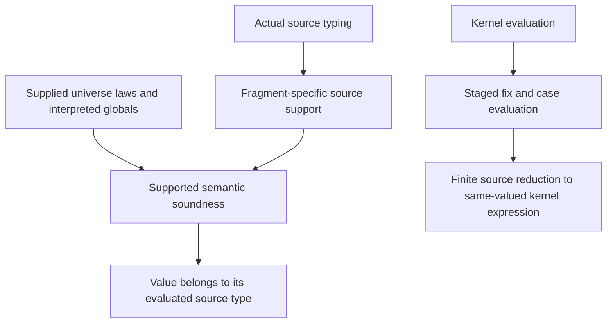

The last two arrows describe operational results. They do not extend the
supported typing institution automatically. An institution here packages raw
sentences, model categories and satisfaction; the supported proof-soundness
theorem is a separate result. Model categories are discrete. The supported apex
uses a supplied infinite hierarchy and the union of finite supported proofs;
it is not a constructed full CIC model or an equivalence with MLTT.

### Claim-to-source map

The module table above lists the broad interface. These links identify the main
contracts and concrete boundaries used in the prose:

| Claims | Definitions and theorem interfaces |
| --- | --- |
| Syntax, actual binding, raw reduction and typing | [`Syntax/Defs`](../../Silmaril/Logic/TypeTheory/CIC/Syntax/Defs.lean), [`Reduction/Defs`](../../Silmaril/Logic/TypeTheory/CIC/Reduction/Defs.lean), [`Typing/Defs`](../../Silmaril/Logic/TypeTheory/CIC/Typing/Defs.lean) |
| Declaration checks, strict positivity and conservative guards | [`Declarations/Defs`](../../Silmaril/Logic/TypeTheory/CIC/Declarations/Defs.lean), [`Positivity/Defs`](../../Silmaril/Logic/TypeTheory/CIC/Positivity/Defs.lean), [`Guards/Defs`](../../Silmaril/Logic/TypeTheory/CIC/Guards/Defs.lean), [`Productivity/Defs`](../../Silmaril/Logic/TypeTheory/CIC/Productivity/Defs.lean) |
| Exact checked lookup, including malformed projection parameter counts | `Declarations/Lookup/Examples`: `packed_exact_preceding`, `invalid_parameter_metadata`, `invalid_parameter_count` |
| Finite derivation supplies at a fixed valuation | `Budgets/Typing/Thms`: `coreTyping_iff_exists_budget`; `Budgets/Declarations/Thms`: `checkedTyping_iff_exists_valid_budget` |
| Concrete traces, partial globals, universe laws and kernel evaluation | [`Semantics/Defs`](../../Silmaril/Logic/TypeTheory/CIC/Semantics/Defs.lean); `Semantics/Universes/Thms`: `ofFiniteTower`, `one`, `two`, `three` |
| Supported typing and conversion, primitive source cases and interpreted globals | `Fundamental/Defs`, `Fundamental/Cases/Recursive/Thms` |
| Supported institution, exact-lookup tower, conditional apex and fragment consistency | `SupportedInstitution/` (`Defs`, `Thms`, `Tower`, `Apex`, `Consistency` and populated `Examples`) |
| Record definitions, dependent caches and declared Type 1 placement | `Projections/Caches/Definitions/Thms`, `Examples/Universes/Thms`: `arity_has_value`, `constructorType_has_value`, `declarations_two_nonvacuous` |
| Exact constructor fixed points, induction and leastness | [`Constructors/`](../../Silmaril/Logic/TypeTheory/CIC/Semantics/Constructors/): `Recursive`, `Indexed`, `Positive`, `IndexedPositive`, `Interleaved`, `IndexedInterleaved`, each with `Carriers/Thms` and its own declaration premises |
| Local source synthesis and larger-stage membership | `Constructors/Synthesis/Defs`, `Synthesis/Thms`, `Constructors/Universes/Thms` |
| Canonical dependent and generated Nat fix calls | `Recursion/Source/Evaluation/Soundness/Thms`, `Recursion/Generated/Thms`: `generatedRecursor_sound`, `generatedOddCall_value` |
| Operational rules and derived reduction bridge | [`Operational/Defs`](../../Silmaril/Logic/TypeTheory/CIC/Semantics/Operational/Defs.lean); [`OperationalEvaluation`](../../Silmaril/Proofs/Logic/TypeTheory/CIC/OperationalEvaluation.lean): `operationalEvaluates_source_bridge` |
| Scoped cache/iota transport and definition-bearing evaluation | `Scoped/Iota/Thms`, `Operational/Caches/` (`Defs`, `Thms`, `Cases`, `Cases/Composition/Examples`) |
| Source-derived arbitrary motive telescopes | `Fundamental/Telescopes/Parameters/Thms`, `Cases/Parameters/Source/Telescopes/Thms`, `Examples/Thms` |

The historical source review recorded in the documentation inventory checked
the upstream hashes and quoted guard assumptions at the pinned commit. The
current whole-page review receipt
binds this page to the current local interfaces, named examples and selected
implementation proofs. It preserves that upstream provenance without claiming
a new upstream fetch. No fresh Lean or runtime execution, full build or
transitive proof/axiom audit was performed. The build command below is a
reproduction command.

## Source receipts

The adaptation retains MetaRocq's MIT licence and copyright notices in
`licenses/MetaRocq-MIT.txt`. The hashes below
identify exact files at the pinned commit; these are source hashes, not paper
hashes or claims that all corresponding metatheory has been ported.

| Source path | SHA-256 |
|---|---|
| `common/theories/Universes.v` | `3c7332bbd8a9be8779737b753c7b66124166d17eed4e8a0ebb962b4cb3ca4171` |
| `common/theories/BasicAst.v` | `b3205d7d67424c1fa22392c784e23b5bd351bf5d0ddf84822c8ac32371a6e77b` |
| `common/theories/config.v` | `1285b7f4697b59a5e6b641586119dc8a30857cda1bde3dd4edfff5b81f30c25f` |
| `pcuic/theories/PCUICAst.v` | `13d4957b2cf06a3107169a74c523cbc9c9fd983b1cd187029009f0df8ce85500` |
| `pcuic/theories/PCUICTyping.v` | `849f5ab38a62e319c3a6a4163dfc904ef1fcbe6c8a9f8f0c4457c25b2ec158ab` |
| `pcuic/theories/PCUICReduction.v` | `ed6fbb088d120edc3e12ce5d02d166ea2c5199e2e1c1e4d53283c0d4d61dd629` |
| `pcuic/theories/PCUICInductives.v` | `59dd9091ab70f84aff934e06b0eef8ada39bca7f00a1d0d37aba78dc7d1e2cb1` |
| `pcuic/theories/PCUICGuardCondition.v` | `e176ba6b140a590a36c0d95d4799ca7699a0da6153a52084fe4c8f9559a96d46` |
| `common/theories/EnvironmentTyping.v` | `82439e01e58dafbee91a3176c7050ae5b139bab00d724c4987ced51c950abebe` |
| `common/theories/Environment.v` | `034022ff47d496b174b2e1cf2ad2c88dfd7378519ff2c5499b7a7e3c4d8935c8` |
| `pcuic/theories/Syntax/PCUICCases.v` | `1094eda80c85b1e6214fe1b6c58f93526a3b59c6c7354ffba7d9955a2f75a956` |
| `pcuic/theories/utils/PCUICAstUtils.v` | `ddfbc2adec401fb24daf12f90be0046572d174b60cb5d36b5744527d523d7c1e` |
| `LICENSE` | `310ccd944e4d5aa1a024ec1a4a1a182492aa2b4d1e540c0158cb7d60b1a1f437` |

To check the Lean slice:

```sh
bin/mor build Silmaril.Logic.TypeTheory.CIC.Thms --wfail
```

### Scoped actual iota transport

`Reduction.Contexts.Scoped.Iota.Thms` proves lifting, simultaneous local
substitution, and universe substitution laws for the actual `iotaReduce`
operation with constructor-local definitions. Local values must satisfy
`DefinitionsScoped`; universe substitution must fix global universe names.
Lifting and local substitution require one runtime argument per assumption,
after dropping constructor parameters. The branch body cutoff instead uses
the full source context width, including definitions.

`Scoped.Iota.Examples.Thms` checks a branch whose two source declarations
contain one assumption and one definition aliasing an external parameter.
Its actual iota reduct transports under nonzero lifting and external
substitution. The existing definition-free laws remain available.

These are syntactic transport theorems. They do not extend the evaluator's
supported cases or establish general CIC typing soundness, consistency, or
a full-calculus semantic institution or CIC Hets registration.

### Evaluating definition-bearing cache expansion

`Semantics.Operational.Caches` relates runtime assumption fields to the full
source locals of a declaration cache. `RealizesCache` evaluates each actual
local definition in its source tail; it does not check declaration types.
The source list has one entry per declaration, while the runtime list has one
entry per assumption.

The cache-expansion theorem proves that evaluating a body in those full source
locals gives the same value after `expandLets` in the smaller runtime locals.
Its iota corollary evaluates actual constructor argument syntax and substitutes
it into the expanded branch. A concrete regression uses one runtime field and
a local definition aliasing a distinct external parameter, then evaluates the
actual iota reduct to that parameter.

This supplies a semantic prerequisite for extending the case evaluator. The
existing `Evaluates.caseOf` and `OperationalEvaluates.iota` rules still require
definition-free branches. The additive profiles below supply definition-bearing
cases with their own compatibility, determinism and transport results. No general typing
soundness or CIC consistency follows from cache expansion alone.

### Definition-bearing operational cases

`Semantics.Operational.Caches.Cases` adds `CacheCaseEvaluates`, an additive
profile embedding every existing `OperationalEvaluates` derivation. Its new
case rule evaluates a tagged constructor scrutinee and its actual argument
syntax, computes local definitions using `RealizesCache`, and evaluates the
branch body in the resulting full source locals, using the kernel or existing
staged evaluator. The rule does not assume
an evaluation certificate for the iota reduct.

The profile is deterministic and agrees with every old operational value.
A new case with a kernel-evaluated branch takes one actual source iota step
to a kernel expression with the same value. A staged branch can require
further source reductions after that iota step; `source_bridge` proves a
finite reduction sequence to a same-valued kernel expression in both cases.
Arbitrary ambient local insertion, simultaneous substitution with evaluated replacements, and universe substitution fixing global universe
names preserve these values. Cache realization is functional and ignores
changes to binder names/types when ordered definition expressions agree.

The concrete regression theorem `CacheCaseExamples.actual_case` uses an actual natural
successor scrutinee with one runtime field and a constructor-local definition
aliasing an external parameter. It evaluates the full case to that parameter,
which may differ from the runtime field.

The original kernel-body case constructor remains available. `stagedCaseOf`
also permits an existing `OperationalEvaluates` computation in the source
branch body, including its constructor-directed fix/beta rules. Recursive
application and fix/beta constructors compose the extended profile: a new
case can occur as an application operand or inside an unfolded fix call.
Cases inside branch bodies in this profile use the existing staged evaluator.
The additive recursive case evaluator evaluates actual
iota reducts recursively and supports arbitrary finite nesting through branch
bodies, with determinism, inclusion of this profile and a source-reduction bridge.
The original `Evaluates`, `OperationalEvaluates` and `CacheCaseEvaluates`
definitions are preserved.
Carrier/budget transport for this extension, typing soundness, consistency,
and an institution interpreting this operational extension remain further work.
The supported kernel-typing institution above does not cover this extension.

`Cases.Composition.Examples` checks a new case as an actual identity-lambda
argument, a new case executed after fix unfolding/beta, and a local-definition
case whose original source body performs staged fix/beta computation.
The latter body is also proved to have no kernel evaluation, distinguishing
the new branch-body support from the original kernel-only profile.


### Source predicates for assigned parameterized families

`Semantics.Fundamental.Parameters` extends the ordinary source typing
certificate by one fixed actual inductive declaration and its constructors.
`AssignedTraceSupported` stores source lookup equations and the original
structural typing premises. A separately supplied
`ParameterizedConstructorLayerAssignment` derives semantic typing for these
certificates, including parameterized family applications and dependent
products, lambdas and applications. Case typing and new conversion rules are
outside this certificate.

`Semantics.Cases.Parameters.Source` uses an actual supported predicate typing
and a syntactic equation for its computed singleton predicate context to
construct its runtime family. It derives evaluation of both the actual motive
application and the substituted return type. Runtime parameter evaluation and
local branch-body realization remain explicit obligations; no result-type
evaluation is assumed.

`Semantics.Lists.Cases.Parameters.Source` instantiates this bridge with the
checked recursive List declaration, the actual source predicate of tail, and
the actual nil/cons global assignment. The original `CoreTyping` judgment and
semantic typing are proved for the same tail. A singleton element type
populates both nil and cons source contexts. The source Pi-formation proof
uses the constructed three-level universe supply. This List motive is constant
in its scrutinee; the generic predicate bridge accepts supported dependent
motives. Deriving all parameterized case branch realizations from recursive
source typing, indexed predicate contexts and constructor-local definitions
remain further work.

`Semantics.Fundamental.Telescopes.Parameters` now constructs source telescope
data directly from arbitrary supported context-sort derivations for the same
assigned declaration. Each dependent domain and local definition is checked in
its original preceding context. The runtime telescope keeps assumptions; its
source environments also retain evaluated definitions.

`Semantics.Cases.Parameters.Source.Telescopes` uses this synthesis and actual
source return-type typing to construct a `SourceMotiveData`. The resulting
family has an evaluation and sort-membership proof at every runtime tuple.
Original lambda/let abstraction evaluates to its curried trace, and that trace
inhabits the iterated dependent product. Applying the original abstraction to
the complete tuple evaluates to the corresponding family member. This motive
API accepts any number of dependent indices and local definitions, without a
supplied semantic predicate telescope or family. Connecting it to general
indexed constructor inversion and the full source case rule remains work.

`Source.Telescopes.Examples` checks `A : Type 0, x : A, y := x : A ⊢ A : Type 0`
using actual source rules and the constructed three-universe List model. Its
source-derived motive has two runtime arguments and three source binders.
The family returns `{∅}` and `{{∅}}` at two inhabited tuples, and these results
are proved distinct. Thus neither the telescope nor its index dependence is
vacuous.


## Constructor-local definitions

CIC constructor fields may contain local definitions. A declaration such as
`A : Type₀; let Alias := A; x : Alias` has three source locals and two runtime
constructor arguments. `SourceTelescopeData` retains interpretations of the original field domains
and definition values. Its `telescope` and `sourceValues` functions then produce
the runtime telescope and the full source-value list. This is semantic evidence,
not a type-inference procedure over unchecked source syntax.

The public entry point is
`Silmaril.Logic.TypeTheory.CIC.Semantics.Fundamental.Cases.Definitions`.

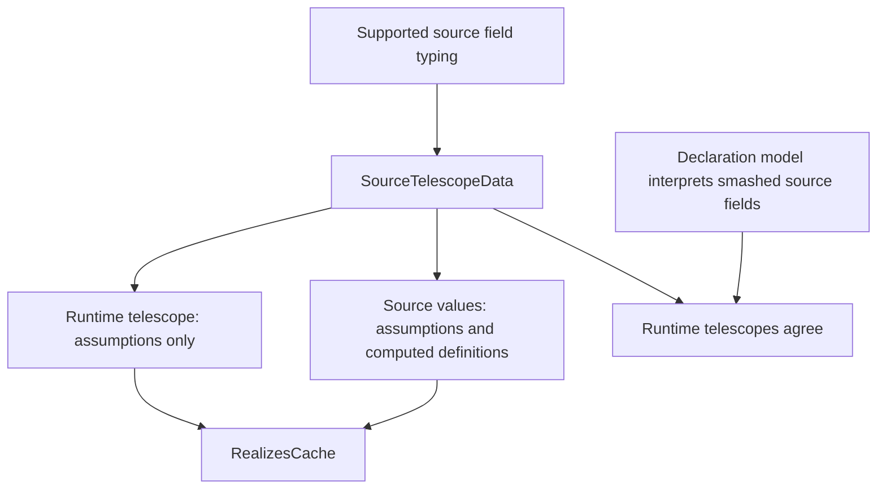

- `SourceTelescopeData.realizesCache` reconstructs every source local from a runtime tuple.
- `SourceTelescopeData.evaluatesArguments` evaluates the constructor's argument variables, skipping definitions while retaining their de Bruijn slots (variables are
  numbered by their distance from the newest local declaration).
- `DefinedSourceFields.sourceData_telescope` identifies the telescope generated by checked source fields with the declaration model's runtime telescope.
- `DefinedPacked.source_fields_supported` checks the Alias example's source declarations. `DefinedPacked.two_nonvacuous` realizes them at an explicit inhabited singleton code in the existing two-level set tower.

The definition-aware case records retain original source judgments and scoped
cache definitions. They add no semantic branch values or soundness conclusions.
Their declaration model supplies interpretation of the actual source field
expressions after definitions are eliminated. Existence of such a model is a
separate obligation.

`Fundamental.Cases.Definitions.Values.Thms` connects these declarations to
`DefinitionAwareEvaluates` and proves `hasValueAt` from the original source
case derivation. `Fundamental.Cases.Definitions.Contexts.Thms` proves
`semanticTyping` over every definition-aware valuation of a supported ambient
source context. The Alias example supplies a populated three-level model.

The separate evaluator preserves the original kernel APIs. The later
recursive case profile supports definition-bearing
cases in branch bodies. The declaration profile on this page still requires no
parameters or indices; it does not prove general fix/cofix or full CIC soundness. See
cic-definition-aware-semantics.md.

## Source evidence

| Claim | Declaration |
| --- | --- |
| Semantic source data and the two computed outputs | [Semantics/Constructors/Definitions/Defs.lean](../../Silmaril/Logic/TypeTheory/CIC/Semantics/Constructors/Definitions/Defs.lean): `SourceTelescopeData`, `telescope`, `sourceValues` |
| Reconstructing cached locals and evaluating argument variables | Semantics/Constructors/Definitions/Caches/Thms.lean: `realizesCache`, `evaluatesArguments` |
| Source telescope agreement additionally requires interpreted globals, source support, a local valuation and a declaration assignment | Semantics/Fundamental/Cases/Definitions/Thms.lean: `DefinedSourceFields.sourceData_telescope` |
| No semantic result in source records; exact shape, scope and support requirements | Semantics/Fundamental/Cases/Definitions/Defs.lean: `DefinedCaseBranchDeclarationSource`, `DefinedCaseDeclarationSource`, `DefinedCaseTraceSupported` |
| Alias source fields and inhabited two-level cache | Semantics/Constructors/Definitions/Caches/Examples/Thms.lean: `DefinedPacked.source_fields_supported`, `two_nonvacuous` |
| Case values in old local valuations; all new valuations require supported context formation | Semantics/Fundamental/Cases/Definitions/Values/Thms.lean: `hasValueAt`; Semantics/Fundamental/Cases/Definitions/Contexts/Thms.lean: `semanticTyping` |
| Populated three-level example | Semantics/Fundamental/Cases/Definitions/Contexts/Examples/Thms.lean: `source_case_three_semanticTyping` |

This review matched source definitions, public theorem signatures and the named
example statements. It did not rerun Lean or audit transitive proof dependencies.

## Concrete syntax

`Silmaril.Logic.TypeTheory.ExtensionalMLTT.SExp` writes extensional MLTT terms, contexts and
judgments as S-expressions (`(jdg (ctx (x nat)) nat (fv x) (fv x))`, with de Bruijn indices
`(bv n)` checked against the binders in scope). The byte round trip `parseJdg_printJdg` holds
exactly for the judgments whose names are legal atoms. Institutions and consequence systems over
this syntax are in `Silmaril.Logic.Consequence.Concrete` ([consequence.md](consequence.md),
"Concrete syntax").
