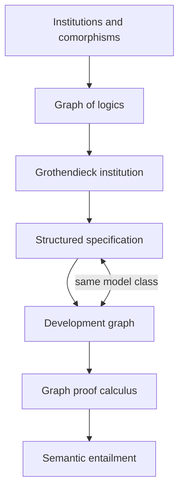

# Institutions and logics

Silmaril relates proof systems through explicit translations, models and
satisfaction laws. This development includes institution theory, Hets-style
structured specifications, HOL, Metamath, set theory and arithmetic.

An **institution** assigns sentences and models to each signature, with a
satisfaction relation that agrees with translation and model restriction.
A **signature** declares the symbols available to a language. A **theory** is a
set of sentences. An **entailment system** adds syntactic consequence: which
sentences follow from which assumptions.

## Start here

```sh
make cache
lake build Silmaril.Logic.Examples
lake build Silmaril.Logic.Hets.Thms \
  Silmaril.Logic.Metamath.SetMM.Regression \
  Silmaril.Logic.Metamath.SecondOrder.Tests
```

`make library` checks every included module. The same pinned Lean, Mathlib and
CSLib dependencies serve the Wasm toolkit and these logics.

| Guide | Definitions, results and examples |
| --- | --- |
| [HOL](logic-hol.md) | Two HOL calculi, standard-model soundness, classical consistency and rule translations |
| [Metamath](metamath.md) | Text checker soundness, tree/string correspondence, theory morphisms and concrete presentations |
| [Arithmetic and set theory](logic-arithmetic.md) | Q, PA, second-order subsystems, scoped ZF/ZFC, proof compilation and shared-fragment correspondence |

## Institution API

Import `Silmaril.Logic.Institution.Defs` for the central interfaces and `.Thms`
for their laws and applications. These interfaces use Mathlib's categories.

| Interface | Meaning |
| --- | --- |
| `Room` | Sentences, a category of models, and satisfaction at one signature |
| `Corridor` | A sentence map and a model-reduct functor satisfying the satisfaction law |
| `ClassicInstitution` | Sentence and model functors indexed by a signature category |
| `Inst.Hom`, `Inst.CoHom` | Institution morphisms and comorphisms, with their two translation directions |
| `Theory` | Theories over an institution, with consequence-preserving signature maps |
| `Metatheory.LogicalSystem` | An institution equipped with syntactic consequence |

The direct definition of an institution and the functor-to-rooms definition are
proved equivalent. Institution morphisms and comorphisms form categories;
adjoint signature functors induce a correspondence between the two kinds of
translation. The theory includes consequence borrowing, theory colimits and
Grothendieck constructions for combining a graph of institutions.

A comorphism's satisfaction law transports truth. Borrowing consequence in the
opposite direction additionally needs model expansion: every source model must
come from a target model, or the appropriate weaker condition in the theorem.
Faithfulness here means reflection of semantic consequence. The API also covers
expansion up to elementary equivalence or model isomorphism, with the stated
satisfaction-invariance hypotheses.

HOL Light supplies a signature-indexed sound logical system. A conservative
logic comorphism connects its two syntactic presentations, preserves and reflects
consequence, and transports soundness through their common models. Metamath supplies
an entailment functor and sound model rooms; model reducts for arbitrary
Metamath syntax rewrites remain a separate construction. The arithmetic and
set-theory guides identify their concrete proof-system translations.

## Hets

**Hets** is the Heterogeneous Tool Set. This library formalizes mathematical
structures used to describe specifications across logics. Its public imports are
`Silmaril.Logic.Hets.Defs` and `.Thms`.



A **structured specification** combines axiom presentations using union,
translation and hiding. A **development graph** records specifications as nodes
and their relationships as links. The semantics assigns models to nodes and
interprets theorem links as semantic obligations.

The main results are:

- `StrSpec.models_devGraph`: a specification and its graph node have the same
  models. The graph contains all specification terms, with links from immediate
  subterms; its well-foundedness is proved.
- `StrSpec.entails_iff_localImpl` and `refines_iff_globalThm`: specification
  entailment and refinement agree with the corresponding graph obligations.
- A sound development-graph calculus, including hiding. Relative completeness
  uses complete basic entailment, signature pushouts, model amalgamation and
  an explicit semantic conservativity oracle.
- Concrete propositional, equational and first-order institutions, translations
  between them, heterogeneous graph examples, and selected CASL algebra and order
  presentations with Lean model witnesses.

The [verification theorem header](../../Silmaril/Logic/Institution/Hets/Verification/Thms.lean)
keeps the model-preservation statements short; its construction and induction
proofs are separate. Other implementation modules retain their detailed proofs
and original theorem names. The library models the specification mathematics;
running the Hets Haskell tool or importing arbitrary CASL files requires an
additional executable integration.

## Relation to compilers

The [compiler APIs](compilers.md) express behavioral specification transport for
program transformations. The institution API gives the general signature-indexed
language for this kind of reasoning. Their concrete adapter, and game-semantics
instances, can be added without making the logic modules depend on Wasm.

Scholarly sources, exact artifact hashes and pinned upstream rule references
are recorded in [references.bib](../../references.bib). Consistency results use
Lean's ambient models and standard axioms; they are external metatheorems about
the stated object calculi.
