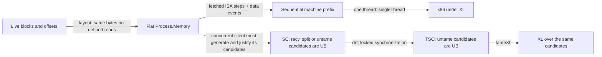
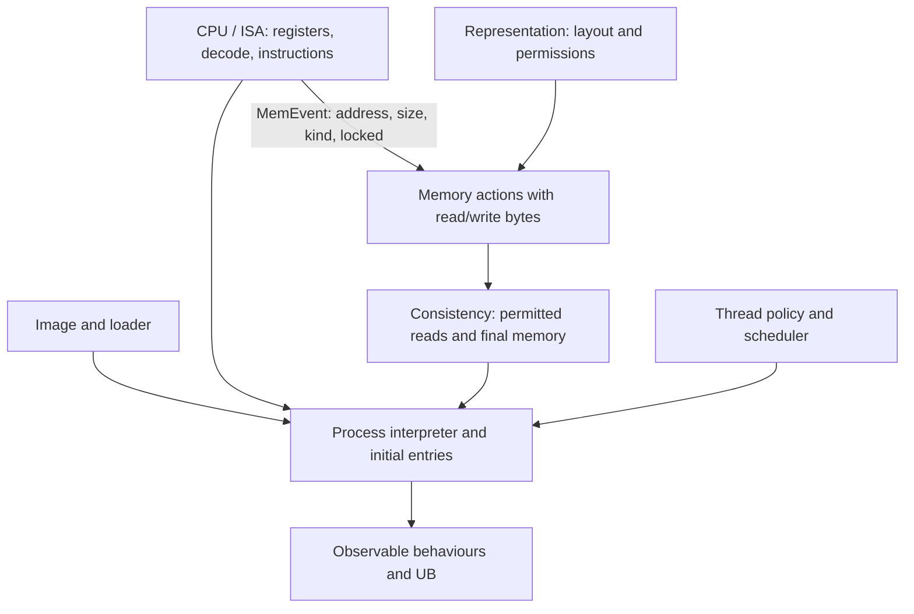

# Memory models: prove on objects, run on bytes

**Decision.** Fix what a caller can observe, not what the machine state looks like. Relate the *entries* of two models. On a safe abstract entry, the concrete entry must also be safe, and **every concrete observation must be allowed by the abstract model**. A relation can record where objects were placed without pretending that machine addresses carry object identities.

The smallest useful test is [`sqlite3_threadsafe`](../../Silmaril/Elf/Corpus/SqliteBuildQueries/Memory/Thms.lean). It takes no arguments, but it is not memory-free: `ret` reads the caller's return address. We prove one property, `returns caller`, of an eight-byte object. The same property holds after executing the actual getter on one x86 thread under XL. It says nothing about whether two SQLite clients can safely share a connection.

Start with the smallest model whose no-UB obligation the caller can meet. Here that means one live block and a bounds check, not a proof about store buffers. The two instruction cases live in the adapter, not in the caller's postcondition.

## The rule a client uses

An entry can be an object and a pointer, an initial register/memory state, or all the candidate executions generated by a program. A [model](../../Silmaril/Semantics/MemoryRefinement/Defs.lean) answers two questions about an entry: what may a client observe, and is undefined behaviour (UB) possible? These are independent: an infinite computation need not have a return value **or** reach UB. When termination matters, include it in the observation/contract. For the bounded machine below, failure to complete the prefix is explicitly unsafe.

```text
wp A P a  =  not (A.ub a)  AND  (for every o, A.may a o implies P o)

f : A → B,   f.rel a b,   wp A P a
------------------------------------  f.transport
                  wp B P b
```

This is a weakest precondition for *this* notion of correctness: the entries it selects are exactly the ones that meet the two tests. `wp A True` just excludes UB. If a nondeterministic source has one good run and one UB run, it fails the test. For a partial evaluator, [`wp_ofEval`](../../Silmaril/Semantics/MemoryRefinement/Thms.lean) instead reads “there is a successful evaluation and its result satisfies `P`.”

A morphism carries a relation `R` and one proof: `R a b → safe A a → safe B b ∧ (B.may b ⊆ A.may a)`. [`soundAt_iff`](../../Silmaril/Semantics/MemoryRefinement/Thms.lean) proves this is **exactly** preservation of all WPs: take the source's own set of observations as the postcondition to recover the inclusion. There is no extra progress axiom or backwards reconstruction of private state.

For a fixed observation type these models form a Mathlib `Category`. Identity relates equal entries. Composition relates `a` and `c` if **some** intermediate entry `b` satisfies both relations. The first soundness proof gives safety at `b`; the second can therefore be used immediately. Identities and associativity reuse the existing [relational composition laws](../../Silmaril/Semantics/Operational/Policy/Thms.lean). Inclusion orders the arrows between two models: a 2-cell witnesses that a second certified relation covers at least the first one's entry pairs. Composition preserves this order (`Hom.comp_mono`). The mere existence of an arrow proves nothing about a call: even the empty relation is sound. The client supplies the actual related entries.

## Two meanings of “memory”



**Representation asks “which byte?”** The [block interface](../../Silmaril/Process/BlockRead/Defs.lean) has live byte strings indexed by identities and a request `(block, offset, width)`. Its [WP](../../Silmaril/Process/BlockRead/Thms.lean) is exactly: the block exists, the width is positive, the slice fits, and the postcondition holds of the slice. The layout chooses one base per block. Distinct live intervals must be disjoint; each whole live block must read back with its bytes and permissions in [`Process.Memory`](../../Silmaril/Process/Memory.lean). The requested slice is a *conclusion*, by `Memory.readBytes_sub_range`, not another layout premise. Other mappings may exist. A flat load may succeed across an abstract object boundary: no converse is expected.

This is a read-only **snapshot**, not a reimplementation of [Cerberus memory](../../Silmaril/Cerberus/Memory/Defs.lean) or [CompCert memory injections](https://compcert.org/doc/html/compcert.common.Memory.html). An absent identity rejects a stale read. There is no conversion from bits to a block pointer, but also no theorem about clients manufacturing or recycling identities. Stores, allocation/free transitions, typed pointers, and enforcing exclusive/shared/read-only ownership across threads are further work. A natural extension is to put ownership evidence in the entry relation and prove that each store preserves it; [`X86.Sep`](../../Silmaril/X86/Sep/Thms.lean) and the [CIR ownership rules](../../Silmaril/X86/Concurrency/Cir/Csl/Defs.lean) already supply spatial assertions. No ownership bit belongs in the x86 bytes.

**Consistency asks “which write may this read see?”** Keep the [existing execution lattice](../../Silmaril/X86/MemoryModel/Lattice/Thms.lean). Its inclusion `small ⊑ big` gives a proof arrow **from `big` to `small`** (`ofLe`), for RA, `cfPlain`, `top`, etc., as well as SC/TSO/XL. In the more interesting direction, do *not* infer SC guarantees under TSO from `sc ⊑ tso`.

For a program's candidate set `D`, [`guarded M G`](../../Silmaril/X86/MemoryModel/Refinement/Defs.lean) admits observations `D(x) ∧ M(x)` and is unsafe unless **every** `D(x)` meets `G`. Thus `tso ⊑ cf` gives SC reasoning on TSO when all candidates are unsplit and race-free under locked synchronization. Tame XL candidates satisfy TSO. [`xl_of_drf_tame`](../../Silmaril/X86/MemoryModel/Refinement/Thms.lean) composes the two morphisms: prove these guards and the SC post; get the post for every XL candidate. The intermediate model retains the tameness obligation rather than assuming a new fact halfway through. `D` must cover actual candidates before consistency filtering; proving no races only among SC outcomes is not the premise. An over-approximation of `D` is conservative but may make the guard unprovable.

The dotted edge in the diagram is deliberately **not** a theorem about arbitrary object programs. Changing representation and changing consistency are different operations. A concurrent client needs a layout preserved by its steps, a sound account of emitted events, and guards for the resulting candidate set. For one thread there is a shorter, proved route: [`Cir.Seq`](../../Silmaril/X86/Concurrency/Cir/Seq/Thms.lean) relates final observations to sequential replay; [`Lift`](../../Silmaril/X86/Concurrency/Lift/Thms.lean) builds a `RunUnder` certificate for a machine run. The trace exists and its *only* possible final backing memory is the sequential one. `solo` and `singleThread` use these results as arrows; `totalUnder_iff_wp` identifies the existing `Spec.TotalUnder` contract with the bounded WP at some prefix length. No race or alignment hypothesis is necessary on this route.

## Plugging into a process



The choices are **values**, not global instances. [`onMachine`](../../Silmaril/Containers/MemoryRefinement/Defs.lean) takes a loader, a process interpreter parametrized by CPU and memory, the CPU, the memory system, a thread policy and an observation relation. It builds the existing [`MachRuntime`](../../Silmaril/Containers/Machine/Defs.lean); it does not claim that an arbitrary interpreter implements Linux. A policy that permits cloning needs a machine that really creates and schedules threads. [`Process.Mt`](../../Silmaril/Process/Mt/Defs.lean) already separates `UIsa`, `MemSys`, primitives and base/process steps; `MemSys` distinguishes thread-local views, synchronization and silent buffer flushes. [`MemEvent`](../../Silmaril/X86/MemEvent/Thms.lean) supplies instruction footprints. `FlatStep` is the glue used here: the actions of a *successful* ISA step replay to its post-memory. Permission checks and instruction fetch remain on the ISA/representation side; they are not data-read events.

Machine extension is another axis. [`Isa.Extends`](../../Silmaril/X86/Extends/Defs.lean) supplies a state lens (`view`, `put`) and preserves each defined source step. [`ofExtends`](../../Silmaril/X86/MemoryModel/Refinement/Thms.lean) reads a finite target prefix through that lens, counting an unsupported source prefix as UB. It does not promise a converse for newly decoded opcodes. For whole function contracts, keep [`FnContract.lift`](../../Silmaril/X86/FnContract/Thms.lean); for linking exports and callees keep [`link_compose`](../../Silmaril/X86/Link/Contract/Thms.lean). Neither an ISA extension nor a linker theorem, by itself, selects a consistency model.

## Which formulations survived the tests?

| Formulation | Discriminating test | Decision |
|---|---|---|
| Equality, or a simulation in both directions | An object ends at byte seven while flat memory permits an eight-byte load. The real `ret` can succeed. | Reject: it would forbid a useful layout. An erased pointer or ownership proof need not be recoverable. |
| Forward inclusion of successful behaviours only | A source that only returns `false` is included in a target that also returns `true`. “Result is `false`” does not transfer. Dropping faults can even make a proof true of a stuck machine. | Reject for universal safety. Keep forward simulation when the question is *existence* of a run. |
| An unconditional SC → TSO → XL arrow | The lattice's `sb` separates SC from TSO. `mpNt` is unsplit, race-free, XL, **not SC and not tame**. | Reject: preserve the race, split and tame guards, or use the stronger single-thread theorem when it applies. |
| Primitive rule: “for every postcondition, WPs move” | `soundAt_iff` proves equivalence. Composition is function composition, but a layout author still needs the same byte read-back lemma. | Keep WP transport as the client API; use the first-order safety and behaviour obligations for implementers. |
| Prefix-sensitive catch-fire closure for all models | The [container definition](../../Silmaril/Containers/Behaviour/Defs.lean) can still constrain the prefix *before* UB. A single getter return or a block slice has no such alphabet. | Keep both. `ofRefinesUB` forgets prefix precision; [`wp_iff_vpre`](../../Silmaril/Containers/MemoryRefinement/Thms.lean) recovers exactly the container verification precondition. `safeRefines_iff` likewise recovers the existing [operational `SafeRefines`](../../Silmaril/Semantics/Operational/Policy/Defs.lean) on equal entries. |

**Where an institution helps.** An observation type is a signature; its sentences are predicates on observations. A change of view `v : O → V` pushes the possible results into `V` while preserving UB. [`wp_map`](../../Silmaril/Semantics/MemoryRefinement/Thms.lean) proves satisfaction is invariant: checking `P` in the new view is equivalent to checking `P ∘ v` in the old one. This is how the SQLite layout arrow is reused at the caller's observation. It is the same change-of-alphabet principle as the [container institution](../../Silmaril/Containers/Institution/Defs.lean), not a new `Inst` registration. Refinement *between* models at one alphabet is implication, **not** an institution isomorphism. A [consequence system](consequence-systems.md) can register `wp model : (Obs → Prop) → Entry → Prop` or its flipped entailment; it does not establish the soundness evidence. [Acceptor correctness](../../Silmaril/Semantics/Acceptors/Defs.lean) similarly distinguishes observations of a particular protocol from all possible client sessions; no new protocol language is needed for a single return.

## SQLite: what to audit

1. **Identify the code.** The [kernel-checked parse](../../Silmaril/Elf/Staged/Corpus/Sqlite/X8664/Libsqlite3So/Thms.lean) and [`threadsafe_at` / `threadsafe_symbol`](../../Silmaril/Elf/Corpus/SqliteBuildQueries/Thms.lean) identify the six bytes `b8 01 00 00 00 c3` at virtual offset `0x13830` in [the pinned ELF](../../corpus/elf/sqlite/x86_64/SHA256SUMS) (SHA-256 `fcdd0cd75ea98cee14f2743832c6ad2ed4dd4229e2b5093f8bce7dc33c9c17f8`). [`directCall_of_roLoaded'`](../../Silmaril/Elf/BindEq/Thms.lean) turns that file fact into fetchable bytes using placement and the loader's read-only segment relation. Fetch success is **derived**, not an extra hypothesis of `threadsafe_xl`.
2. **Prove at the object.** `stackObject caller` is one live object holding the eight little-endian bytes of the caller address. `object_wp` needs no machine, thread or layout premise. It proves no UB and `returns caller`: result register value 1, control returned to `caller`, stack popped once, memory unchanged. The abstract result 1 is justified at the machine boundary by decoding `mov eax,1`; it is not an ABI assumption.
3. **Transport.** [`toXL`](../../Silmaril/Elf/Corpus/SqliteBuildQueries/Memory/Thms.lean) is `layout.map fromBytes` followed by `fetched` followed by `singleThread`. `fetched` decodes **both** instructions and obtains `ret`'s word from the placed read. `threadsafe_returns_xl` exposes an actual two-step `Open.step` run, the `RunUnder XL` certificate and the register/stack/memory result. [Regression checks](../../Silmaril/Elf/Corpus/SqliteBuildQueries/Memory/Checks.lean) exercise a concrete placement and fail the same `ret` on a seven-byte readable slot.

| Status | Boundary |
|---|---|
| **Proved** | Category/2-cells, WP and change-of-view laws; block-read layout; guarded lattice and single-thread/ISA/contract adapters; the pinned getter, including its stack access, under one-thread XL. |
| **Entry hypotheses** | A legal ELF placement, the read-only segments loaded there, RIP at the getter, and eight readable bytes at RSP encoding the caller. No C source equivalence, whole-process startup, full ABI preservation, running the caller, or multi-thread interference is claimed. |
| **Model/trust boundary** | Lean's kernel and the repository's permitted axioms; included bytes, the specified loader relation, handwritten ISA and axiomatic x86 models. No assumption that a host CPU or `ld.so` implements those models is proved here. The [operational/axiomatic TSO bridge](../../Silmaril/X86/MemoryModel/OpAx/Thms.lean) has its own event-program hypotheses. Hardware validation is [evidence, not proof](../mt-validation.md). |
| **Stated only** | [`Task.openExecClose`, `Task.queryResults`, `Task.serialized`](../../Silmaril/Containers/SqliteMemory/Defs.lean). Respectively: an admitted path loads and is UB-free; a reference-defined query completes with the specified callback rows; every finite prefix on one shared serialized connection has a legal sequential explanation respecting real time. The latter reuses [`Linearizable`](../../Silmaril/Servers/State/Defs.lean), including pending calls. The driver, allowed workloads, SQL evaluator and sequential API must actually be instantiated and validated. No placeholder theorem is used. |

**Next proof boundary.** Extend snapshots with writes and lifetime/ownership transitions; connect those events to the actual SQLite API and its VFS and pthread calls. [`Atomic9.Thms`](../../Silmaril/X86/Atomic9/Thms.lean) already proves `step_of_open9`, has `Atomic9.isa`, and lifts an Open9 contract. That is **not** a proof that a SQLite mutex body implements a lock under XL. Reuse the [locked-event extraction](../../Silmaril/X86/Litmus/Extract/Thms.lean) and [pthread primitives](../../Silmaril/Process/Mt/Pthread/Glibc/Thms.lean); discharge their premises on the real executed paths and prove ownership, candidate coverage and linearization there. `sqlite3_threadsafe` reports a [compile-time option](https://www.sqlite.org/c3ref/threadsafe.html), not the runtime mode or any of these theorems.

## Glossary

| Term | Meaning here |
|---|---|
| Model, entry, behaviour, observation | Rules for one layer; its input/setup; something it may do; the part a client can see (bytes, a return, or a call history). |
| Category, object, morphism/arrow | A collection of models (objects) and certified ways to relate them (arrows), with identity and associative composition. The *allocation* in “object memory” is a different use of “object.” |
| Relation, composition, identity, 2-cell | A set of matched pairs; chaining them through a shared middle entry; relating an entry to itself; inclusion between two such relations. |
| Transport, refinement, soundness | Reuse a proof; implement a specification without introducing forbidden observations; the guarantee justifying that reuse. Equivalence would additionally require the reverse direction. |
| UB, catch-fire, demonic, WP, postcondition | Undefined behaviour releases a model's guarantee; catch-fire permits anything after UB; demonic means **all** possible runs; a weakest precondition tells which entries guarantee the desired result (the postcondition). |
| Layout/injection, block, provenance, ghost ownership | Placement of abstract allocations into non-overlapping address ranges; an allocation's identity and bytes; where a pointer originated; proof-only permission to access bytes, erased at runtime. |
| SC, TSO, XL, RA | Sequential consistency: one shared order respecting thread order. x86 Total Store Order permits store buffering. XL is a looser x86 model including weak stores and tearing. Release/acquire constrains what synchronized reads and writes may see. |
| Execution candidate, lattice, `⊑`, `top` | A proposed event history with reads-from and ordering choices; models ordered by allowed candidates; inclusion; the model allowing every candidate. |
| Race, DRF-SC, `cf`, `cfPlain` | An unordered conflict between threads. Data-race-free SC is the scoped guarantee that the allowed execution is SC. Catch-fire excuses racy or split candidates; `cf` counts communication between locked accesses for synchronization, `cfPlain` does not. |
| Split, tame, RMW, memory event | One access represented by several units; no weak or tearable units; atomic read-modify-write; a reported load/store/RMW/fence, distinct from an instruction fetch. |
| ISA, ELF, ABI, RIP/RSP/RAX, VFS | Instruction-set architecture; executable/shared-library file format; caller/callee convention; x86 instruction pointer, stack pointer and result register; SQLite's virtual filesystem interface. |
| CIR, replay, lens | Concurrency intermediate representation; applying an event list to memory in order; a way to read/replace a smaller state inside a larger one. |
| Institution, signature, sentence, satisfaction | A discipline for changing vocabulary without changing truth; the observation alphabet; a predicate over it; all allowed observations satisfy the predicate (and the WP also excludes UB). |
| Linearization, prefix, scheduler | Explaining concurrent calls as legal sequential calls while respecting completed-before-started order; a finite initial part of a history; what chooses which thread steps. |

**Check** from the repository root (pinned toolchain):

```sh
lake build --wfail +Silmaril.Elf.Corpus.SqliteBuildQueries.Memory.Checks \
  +Silmaril.Containers.MemoryRefinement.Thms +Silmaril.Containers.SqliteMemory.Defs
```
