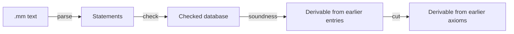

# Metamath

Silmaril provides a Metamath parser and proof checker with Lean soundness
proofs, tree/string correspondence, models and a category of theories.
These are library APIs.

## Check the examples

```sh
lake build Silmaril.Logic.Metamath.Verify.Kernel \
  Silmaril.Logic.Metamath.SetMM.Regression \
  Silmaril.Logic.Metamath.SecondOrder.Tests
```

| Import | What it provides |
| --- | --- |
| `Metamath.Verify.Defs` / `.Thms` | The pure `verifyText` checker and end-to-end soundness |
| `Metamath.Verify.Kernel` | A small proof whose machine acceptance is proved by kernel reduction |
| `Metamath.Text.Normalize` | Parser/printer normalization laws |
| `Metamath.Grammar.Correspondence` | Tree/string derivability correspondence for unambiguous grammars |
| `Metamath.Category.Basic` | Grammatical axiom sets and theorem-preserving syntax rewrites |
| `Metamath.Category.Strings` | A natural isomorphism between tree and flattened-string derivability |
| `Metamath.Category.Examples` | A conservative definitional extension |
| `Metamath.Category.Universal` | An initial object and explicit obstructions to terminal objects, products and coproducts |

Prefix imports with `Silmaril.Logic.`. The original `Verify.EndToEnd` import
re-exports the new theorem header; proof bodies live under `Silmaril/Proofs/`.

## Checker contract

A Metamath assertion has disjoint-variable conditions, ordered hypotheses and
a conclusion. A **floating hypothesis** assigns a typecode to a variable; an
**essential hypothesis** supplies a logical premise. A substitution must satisfy
the frame's disjoint-variable conditions.



`Verify.verifyText_provable` retains each source `$p` statement's label, typecode
and body tokens, and proves it derivable from preceding `$a` statements.
Cut admissibility eliminates dependencies on preceding theorems. The theorem
takes the checker's successful-result equality as a hypothesis.

The checker supports normal and compressed proofs, scoping, frame computation
and disjoint-variable checks. Include commands must be resolved before
`verifyText` accepts a file. `Text.parse_print` proves that printing a valid
statement sequence and parsing it returns that sequence; the printer normalizes
comments and whitespace.

There are two distinct ways to exercise the checker:

- Executable regressions run the parser/checker and compare its outputs.
- `Verify.Kernel.th1_derivable` proves a small example's machine acceptance by
  kernel reduction, then applies soundness. Its seven axioms and proof are
  explicit Lean data corresponding to the book's `demo0` example.

The full text checker uses hash-based collections whose operations do not
currently reduce by the same kernel-computation method. Its general soundness
theorem still applies when acceptance is established.

## Theories, models and translations

`GAxSet` objects bundle a grammar and well-formed tree axioms. A morphism contains
a typecode map, an injective variable renaming, a well-sorted template for each
syntax rule and a theorem-preservation proof. With infinitely many target
variables, `Hom.ofAxioms` constructs such a morphism by proving the translated
source axioms in the target.

For a fixed grammar with infinitely many variables, deductively closed theories
form a complete lattice. `Category.Embedding` embeds their derivability order
faithfully into `GAxSet`. `Category.Strings.flattenIso` relates tree and string
derivability for unambiguous grammars and strings that encode well-formed tree
assertions. Its inverse uses classical choice.

The conservative-extension example adds disjunction, defined by
`φ ∨ ψ := ¬φ → ψ`, to an implicational calculus and proves that every
old-language theorem was already derivable. The category also has an initial
object and concrete nonexistence results for other universal constructions.
These results concern the selected template-and-injective-renaming morphisms.

`Institution.Metatheory.Metamath` packages an entailment functor, model rooms,
their soundness and the presentation-morphism criterion. A complete institution
would additionally need model reducts along arbitrary syntax rewrites.

## Concrete presentations

| Presentation | Established result |
| --- | --- |
| Selected set.mm ZFC axioms and four connective definitions | `ZFSet` model, soundness and nonderivability of `|- -. x = x` |
| Hand-transcribed Peano presentation | Standard-model arithmetic and Σ₁ soundness, plus ω-consistency |
| Locally authored `z2.mm` | Full `𝒫(ℕ)` model and subsystem inclusions |

`SetMM.Regression` compares every selected grammar rule and labelled ZFC axiom,
including exact frames, against the checker's reading of `set-axioms.mm`.
`SecondOrder.Tests` compares all 101 `z2.mm` entries in order: 17 syntax axioms,
80 logical axioms and four theorems. Their source hashes and CC0 terms are in
[data/metamath](../../data/metamath/README.md).

The Peano encoding is Lean data rather than a checked external `peano.mm` file.
The second-order presentation named `WKL0` uses Σ⁰₁ separation; equivalence to
the conventional binary-tree statement remains a proof obligation. See the
[arithmetic guide](logic-arithmetic.md) for independent proof systems and the
exact scope of their Metamath bridges.

The [bibliography](../../references.bib) pins Megill–Wheeler's *Metamath* book,
Carneiro's *Models for Metamath* and the set.mm source revision. The model and
consistency theorems are proved within Lean's ambient logic.
