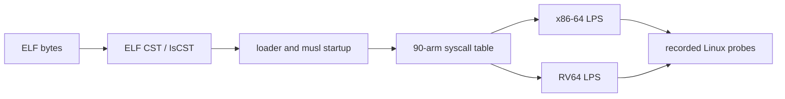

# Linux process semantics

This promotion brings the reviewed process-model slice from source commit
`288ee492ad09224b78ac44f8456e2ffcd6482384` into the public curated tree.  It
includes the syscall table and translated-arm checks, the x86-64 and RV64 LPS
models, ELF CST/`IsCST` facts, musl launch models, the recorded probe
families, and the two SHA-256 programs proved end to end
([sha256sum.md](sha256sum.md)).  The selected closure contains 638 Lean
modules (`module_count` in `.process-promotion.json`).

The public headers are `Silmaril.Process.Defs` and `Silmaril.Process.Thms`.
Long proofs remain in their source topic modules so reviewers can promote them
incrementally.  The source repository's full replay check is still pending
because its latest run exhausted the runner while checking the complete tree.
