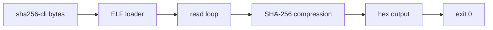

# SHA-256 process demonstrations

The freestanding `apps/sha256-cli` image and its process transcription are
included with the exact image hash recorded in the generated Lean module and
the release manifest.  The demo is a 2,368-byte x86-64 ELF with six syscall
sites.

The GNU `sha256sum-min` bytes and proof cone are kept in the separate
`Silmaril.Apps.Sha256sum` area in this draft because the upstream artifact is
GPLv3.  A final release must either remove that area or merge its complete
license notice and provenance review; this draft does not silently relicense
it.
