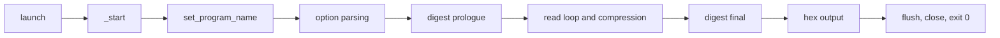

# SHA-256 process demonstrations

Two x86-64 Linux programs print the SHA-256 digest of their standard input.
Both are proved correct end to end in the LPS process model, from the
executable's bytes to its observable system calls, for every input.

| Program | What it is | Image | Theorem (`Silmaril.Process.Thms`) | Status |
| --- | --- | --- | --- | --- |
| `sha256-cli` | Our own freestanding filter: prints the 64 hex digits and `"\n"` | 2,368 bytes, `apps/sha256-cli` | `sha256Cli_total` | VERIFIED end to end |
| `sha256sum-min` | A libc-free reimplementation of GNU coreutils 9.4 `sha256sum`: prints the digits and `"  -\n"` | 35,512 bytes, `apps/sha256sum-min` | `gnuSha256sum_lpsTotal` | VERIFIED end to end on the stdin tier |
| both | Agreement: on the same input, `sha256sum-min` writes what `sha256-cli` writes with the final `"\n"` replaced by `"  -\n"` | | `gnuSha256sum_agree` | VERIFIED |

Glossary:

- **stdin tier:** `argv` is just the program name and there is no file
  operand; the program reads standard input to its end.
- **refusal:** a system call that the model lets fail spuriously; the
  statements quantify over every refusal configuration.
- **unmodelled:** an outcome the model does not describe (any outcome
  allowed). The statements require that no run reaches one.

## The statement in plain words

For every finite standard input, every flag oracle, every refusal
configuration, every budget and every valid launch (stack placement within
the Linux randomization windows):

- no run raises an error or reaches an unmodelled state;
- every observable trace is a prefix of the ideal trace: read the input,
  write exactly the expected bytes to fd 1, exit 0 with the file system
  unchanged;
- every execution exits, and the complete ideal trace occurs.

For `sha256sum-min` the expected bytes are `(Apps.Sha256sum.sha256sum w).stdout`,
the output of the executable specification of GNU `sha256sum`
(`Silmaril/Apps/Sha256sum`), on every stdin-tier world `w`
(`GnuSha256sum.expected_eq_spec`). The definitions are
`LPS.Problems.Sha256Cli.TotalGoal` and `LPS.Problems.GnuSha256sum.TotalGoal`.

The GNU program has six release theorems, all without hypotheses, in
`Silmaril/Process/LPS/Problems/GnuSha256sum/Close.lean` and restated in
`Silmaril.Process.Thms`:

| Problem | Theorem | Meaning |
| --- | --- | --- |
| `sys-total` | `gnuSha256sum_sysTotal` | total correctness over the `X86Sys` middle model |
| `lps-total` | `gnuSha256sum_lpsTotal` | total correctness in LPS |
| `lps-bounded-1024` | `gnuSha256sum_lpsBounded` | total correctness for inputs of at most 1024 bytes |
| `lps-partial` | `gnuSha256sum_lpsPartial` | safety only |
| `agree-sha256-cli` | `gnuSha256sum_agree` | agreement with `sha256-cli` |
| `profile-total` | `gnuSha256sum_profileTotal` | the same result in the parity `ProfileProblem` format |

The problem records, with their statement hashes and check records, are in
`problems/sha256/gnu-sha256sum-x86-64/`.

## Proof structure

Each proof is split into segments between cut points of the binary; each
segment is a theorem about every run from one cut to the next.



- **`sha256-cli`:** loop, tail, output and launch-bridge segments in
  `Silmaril/Process/LPS/Problems/Sha256Cli/`, composed in `EndToEnd.lean`.
- **`sha256sum-min`:** start-up (`_start`, `set_program_name` including the
  `"/.libs/"` and `"lt-"` cases, option parsing, digest prologue) in
  `Silmaril/Apps/Sha256sum/Binary/Startup/` and
  `GnuSha256sum/{StartEntry,StartupCmain,Prologue}.lean`; the read loop and
  digest in `Binary/Digest/` and `GnuSha256sum/{ReadLoop,DigestLoop,DigestFinal}.lean`;
  output formatting in `Silmaril/Apps/Sha256sum/Stdout/` and
  `GnuSha256sum/FormatGlue.lean`; the composition in `GnuSha256sum/Wire.lean`
  and `Close.lean`.

## Rerunning

```sh
make cache
make demo-sha256            # both end-to-end theorems
python3 apps/sha256sum-min/build.py --verify-only
```

`build.py --verify-only` checks the recorded source and generator identities
of `sha256sum-min` without rebuilding; see
[`apps/sha256sum-min/README.md`](../../apps/sha256sum-min/README.md) for a full
rebuild.

## Licence

`sha256sum-min` and the Lean development about it are GPLv3
([`NOTICES/GPLv3/SHA256SUM-MIN.md`](../../NOTICES/GPLv3/SHA256SUM-MIN.md)).
`sha256-cli` is under the repository's licence.

## Scope

- `sha256sum-min` is proved on the stdin tier; file operands and the other
  options are specified in `Silmaril/Apps/Sha256sum` but not proved about the
  binary.
- The digest specification pads with the bit length modulo `2^64`; FIPS
  180-4 limits messages to below `2^64` bits.
- Compiler correctness and realization on actual Linux and hardware are
  outside the model.
