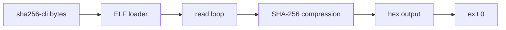

# SHA-256 process demonstrations

The freestanding `apps/sha256-cli` image and its process transcription are
included with the exact image hash recorded in the generated Lean module and
the release manifest.  The demo is a 2,368-byte x86-64 ELF with six syscall
sites.

The GNU `sha256sum-min` source, build recipe, byte hash, and LPS problem cone
are kept in the separate `Silmaril.Apps.Sha256sum` / `GnuSha256sum` area under
the GPLv3 notice. `python3 apps/sha256sum-min/build.py --verify-only` checks the
historical source and generator identities without rebuilding on the host.
The GNU total-correctness and LPS-bridge entries remain explicit open problem
goals in the registry; the freestanding `sha256-cli` end-to-end theorem is the
closed permissive demonstration in this release.
