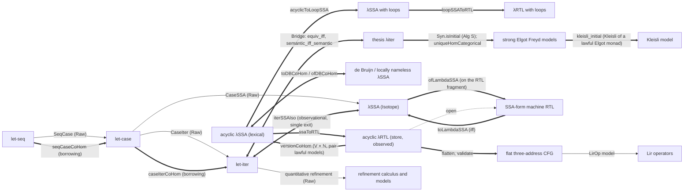

# SSA calculi, λRTL and the SSA-form machine RTL

This project collects Silmaril's effectful SSA calculi and the register-transfer
languages around them: the let-family calculi (let-seq, let-case, let-iter), λSSA,
λRTL (λSSA's dominator-tree syntax read with overwritable registers), a flat
three-address CFG with a validator, and the SSA-form machine RTL with its
translations to and from λSSA. It is the IR layer of the System V x86 lifting and
C correspondence problems: an IR function here has a semantics, a typed syntax and
checked translations, so a problem can state "this RTL/λSSA function is a lift of
that machine function" against definitions a reviewer can read.

Every module is in the root `Silmaril` library; there is no executable.

## The calculi and translations



Double arrows are checked institution comorphisms, isomorphisms or checked
semantic translations; single arrows are Raw syntactic translations with their
own Raw soundness developments; the dashed arrow is an open obligation (below).
"thesis λiter" is the Raw port of the thesis formalisation (`Silmaril.Thesis`), a
second copy of the let-iter calculus beside `Silmaril.Isotope.LetIter`; the
bridge relates the two.

## Modules

| Area | Header | Contents |
| --- | --- | --- |
| λRTL, acyclic | `Silmaril.SSA.LambdaRTL.{Defs,Thms}` | `Region V L F` (values, operands, `let1`, `let2`, `case`, `join`, `br`), the lexical reading `evalSSA`, the store reading `evalRTL`/`evalObs`, `NoClobber`, `IsSSA`; agreement theorems and the clobbering counterexample |
| Institutions | `Silmaril.SSA.LambdaRTL.Institution.Defs` | `ssa R`, `rtlObs R`, `rtlFull R` over instruction-alphabet signatures, the comorphism `ssaToRTL R`, the Hets logic graph `hets R` |
| Loops | `Silmaril.SSA.LambdaRTL.Loop.{Defs,Thms}`, `.Loop.Institution.Defs` | `loop r ℓ x t` (a self-recursive `where`) over a lawful Elgot monad; frame lemma, agreement, necessity counterexample; `loopSSA`, `loopRTLObs`, `loopSSAToRTL`, `acyclicToLoopSSA` |
| Versioning | `Silmaril.SSA.LambdaRTL.Version.{Defs,Thms}`, `.Version.Institution.Defs` | `versionTop : Region V L F → Region (V × ℕ) L F` (fresh versions, live-ins packed through jumps), SSA-ness, soundness, `versionCoHom` |
| Names | `Silmaril.SSA.LambdaRTL.Nameless.{Defs,Thms}`, `.LocallyNameless.{Defs,Thms}`, `.Nameless.Institution.{Defs,Thms}`, `.Quotient.Defs` | de Bruijn and locally nameless presentations, `Supply V`, adequacy, round trips, α-equivalence, comorphisms both ways and their inverse pair modulo semantic equivalence |
| Flat CFG | `Silmaril.SSA.LambdaRTL.CFG.{Defs,Thms}` | three-address `CFG`, `flatten`, `toRegion`, relabelling, the syntactic validator `validate` |
| Lir operators | `Silmaril.Machine.LambdaRTLLir.{Defs,Thms}` | instruction alphabet `LirOp`, values `LVal`, `model : Model LirOp Option LVal` built from `Lir.Unop.eval`/`Lir.Binop.eval`; the validated `absDiff` example |
| Machine RTL | `Silmaril.Machine.RTL.Thms` | re-exports the SSA-form RTL (`Silmaril.Raw.Machine.RTL`: syntax, small-step and big-step semantics with call oracles, behaviours, dominance, `Lir` syntax, little-endian words), `toLambdaSSA` and `ofLambdaSSA` |
| RTL fragment of λSSA | `Silmaril.Machine.OfLambdaSSA.{Defs,Thms}` | `Shape`, `TmFits`, `RegionFits`, `RootFits`; correctness of `ofLambdaSSA` on the fragment and two counterexamples outside it |
| λSSA and the let family | `Silmaril.SSA.Isotope.Thms` | re-exports the Raw let-seq, let-case, let-iter and λSSA developments (`Silmaril.Raw.SSA.Isotope`: locally nameless syntax, typing, equational theories, monadic, operational, categorical and machine semantics, observations, the let-family translations); the reviewed λSSA headers `Silmaril.SSA.Isotope.{LambdaSSA,Types}` were already public |
| Elgot iteration | `Silmaril.Semantics.Elgot.{Defs,Thms}`, `Silmaril.Semantics.ElgotMonads.{Defs,Thms}` | `Iterate`, `LawfulElgotMonad` (fixpoint, naturality, codiagonal, uniformity); instances for `Part`, `SetM`, `StateT`, `ReaderT`, `ExceptT`, `OptionT`, `WriterT` |
| Categorical support | `Silmaril.Semantics.Categories.Thms` | re-exports Raw premonoidal, Freyd, distributive Freyd and Elgot-monad category theory used by the categorical let-iter semantics |
| Behaviours | `Silmaril.Semantics.Behaviour.Thms` | re-exports Raw labelled traces, contracts, refinement, the compilation relation `Implements`, simulation conventions and equivalence over `Silmaril.Machine.Behaviour` |
| Let-family institutions | `Silmaril.SSA.Isotope.Institution.Thms` | re-exports the Raw equational institutions of let-seq, let-case and let-iter, inclusion comorphisms with borrowing, syntactic initiality, refinement institutions and `eqToRef`, observational institutions and `iterSSAIso` |
| Thesis initiality | `Silmaril.SSA.Thesis.Thms` | re-exports the Raw port of the thesis λiter and λcase (`Silmaril.Raw.SSA.Thesis`): `Syn.isInitial` in `Alg S`, equational completeness |
| Thesis categorical models | `Silmaril.SSA.Thesis.Categorical.Thms` | λiter derivations denoted in strong Elgot Freyd categories, `Alg.ofCategorical`, initiality into those models, non-vacuity of `Alg S` |
| Thesis Kleisli model | `Silmaril.SSA.Thesis.Kleisli.Thms` | the Kleisli category of a lawful Elgot monad as a λiter model: `TypingCoherent` and `LawfulModel` instances, initiality into it, and the instance at `Part` |
| Quantitative refinement | `Silmaril.SSA.Isotope.Refinement.Thms` | re-exports the Raw quantitative refinement calculus (`Silmaril.Raw.SSA.Isotope.Refinement`): usage-annotated typing, refinement theories, initiality among algebraic and ordered models, completeness, categorical interpretation in seq/case/iter models |
| Let-iter bridge | `Silmaril.SSA.Isotope.Bridge.{Defs,Thms}` | term and context translations between `Silmaril.Isotope.LetIter` and the thesis λiter, preservation of typing, axioms and equivalence, agreement of the two completeness theorems |
| Dataflow | `Silmaril.Calculi.Dataflow.{Defs,Thms}` | round-robin (Gauss–Seidel) iteration over `Silmaril.Semantics.Dataflow` equation systems |

## Main results

λRTL and λSSA (acyclic), in `Silmaril.SSA.LambdaRTL.Thms`:

- `Region.evalSSA_congr`: the lexical semantics reads only free variables.
- `Region.evalRTL_frame`: λRTL writes only registers it assigns (bind-congruence
  form, any lawful monad).
- `Region.evalObs_eq_evalSSA`: under `NoClobber` the observable store semantics
  equals the lexical semantics; `Region.noClobber_of_isSSA` and
  `Region.evalObs_eq_evalSSA_of_isSSA` give it for dominance-scoped SSA.
- `clobber_counterexample`: without `NoClobber` the readings differ, so reading
  λRTL as λSSA by the identity is not semantics-preserving.

Loops (`Loop.Thms`), in every lawful Elgot monad: `Loop.Region.evalRTL_frame`,
`Loop.Region.evalObs_eq_evalSSA(_of_isSSA)`, the embedding lemmas
`evalSSA_ofAcyclic`/`evalRTL_ofAcyclic`, `selfClobber_counterexample` (the loop
clause of `NoClobber` is necessary), and `evalObs_eq_evalSSA_part` (the hypotheses
hold for `Part`).

Versioning (`Version.Thms`): `versionTop_isSSA` (every acyclic λRTL region becomes
dominance-scoped SSA), `versionTop_evalSSA` and `versionTop_evalObs`
(`(versionTop r).evalSSA m ρ = r.evalObs m σ` when `ρ (y, 0) = σ y`), assuming the
model is pair-lawful (`unpair (pair a b) = pure (a, b)`).

Names (`Nameless.Thms`, `LocallyNameless.Thms`, `Nameless.Institution.Thms`):
`Region.eval_toDB` (adequacy), `DB.Region.toDB_ofDB` (round trip),
`Region.alphaEq_ofDB_toDB`, `Region.evalSSA_eq_of_alphaEq`, `Region.close_toLN`
(`close ∘ toLN = toDB`), `Region.alphaEq_iff_toLN_eq`, `Region.evalObs_rename`
(register renaming), and `ofDB_toDB_quot`/`toDB_ofDB_quot` (the comorphisms are
mutually inverse on sentences modulo semantic equivalence).

Flat CFG (`CFG.Thms`): `run_flatten`
(`(flatten r).run m σ = (fun e => (inl e.1, e.2)) <$> r.evalRTL m σ`),
`run_eq_toRegion`, `run_relabel`, and validator soundness `run_of_validate` in every
model and lawful monad.

Machine RTL (`Machine.RTL.Thms`, `Machine.OfLambdaSSA.Thms`):
`toLambdaSSA_eval_iff` (SSA-form RTL to λSSA preserves finite outcomes exactly,
assuming the call oracle matches the signatures), `ofLambdaSSA_eval_iff` (the
converse compiler is correct on the RTL fragment `RootFits`),
`pairExample_differs` and `aliasRegion_not_compiles` (what the fragment excludes).

Let-family institutions (`Silmaril.SSA.Isotope.Institution.Thms`):
equational institutions `Silmaril.Isotope.Institution.{LetSeq,LetCase,LetIter}.inst`
with `entails_base_iff`/`entails_theory_iff` (semantic consequence is derivable
equivalence); comorphisms `seqCaseCoHom`, `caseIterCoHom` with unconditional
borrowing (`seqCase_entails_iff_of_any`, `caseIter_entails_iff_of_any`);
`syntaxIsInitial` and `syntacticModelIsInitial` with completeness `semantic_iff`
(initiality among algebras of the equational presentation); `Refinement.eqToRef`
(`eqToRef_modelExpansive`); observational institutions with the compilations
`Observational.caseIter`, `Observational.iterSSA` and the isomorphism
`Observational.iterSSAIso` in `CoIns` between let-iter and single-exit λSSA modulo
observational equivalence.

Thesis ports (`Silmaril.SSA.Thesis.Thms`, `.Categorical.Thms`), for a signature
`S`: `Syn.isInitial : IsInitial (Syn S)` in `Alg S` and `Syn.denote_eq_iff_eqv`
(λiter; λcase analogues `Syn.denote_eq_iff_equiv`); `Alg.ofCategorical` and
`Categorical.uniqueHomCategorical` (the unique algebra morphism from syntax into a
strong Elgot Freyd model computes the categorical denotation), conditional on the
coherence classes `TypingCoherent` and `LawfulModel`; `Alg.const_not_terminal`,
`Alg.constHom_ne_id`, `Alg.powReindex_ne_id`.

Thesis Kleisli model (`Silmaril.SSA.Thesis.Kleisli.Thms`), for a lawful Elgot monad
`m` with a monadic instruction model: `kleisli_typingCoherent` and
`kleisli_lawfulModel` (the instances the categorical initiality assumed), and
`uniqueHomKleisli`/`kleisli_initial` (exactly one algebra morphism from `Syn S`
into the Kleisli model, computing the denotation); `uniqueHomKleisliPart` at `Part`.

Quantitative refinement (`Silmaril.SSA.Isotope.Refinement.Thms`, namespace
`Silmaril.Isotope.Refinement`): `Models.syntaxIsInitial`, `Models.fold_unique`,
`Models.syntacticModelIsInitial`, `Models.orderedSyntacticModelIsInitial`,
completeness `Models.{refinement,mutual_refinement,equation}_iff_all_models`,
`RewriteSystem.generatedTheory_{renaming,substitution}`, the contextual categories
`Theory.{refinement,equational}Functor`, and the categorical interpretation
`Models.Denotation.denote{Seq,Case,Iter}` with `fold_unique`.

Bridge (`Silmaril.SSA.Isotope.Bridge.Thms`), under the explicit compatibility
hypotheses `TypeCompat`, `InstrCompat`, `EffCompat` (each discharged by `rfl` for
the canonical instances): `hasType_iff`, `pure_iff`, `coreAxiom_iff` (the same 19
axiom schemes), `equiv_iff` (in every free context), and `semantic_iff_semantic`
(closed terms: validity in every Isotope equational model iff validity in every
thesis algebra).

## Status

| Item | Status |
| --- | --- |
| Acyclic λRTL: syntax, both semantics, frame, agreement under `NoClobber` and on SSA, counterexample | proved |
| Institutions `ssa`, `rtlObs`, `rtlFull`, comorphism `ssaToRTL`, logic graph `hets` | proved (functoriality, satisfaction conditions) |
| λRTL/λSSA with a self-recursive `where` over lawful Elgot monads, loop institutions, `loopSSAToRTL`, `acyclicToLoopSSA` | proved |
| Versioning λRTL → λSSA, soundness, `versionCoHom` | proved; assumes pair-lawful models (a hypothesis of the theorems, not an axiom) |
| de Bruijn and locally nameless presentations, round trips, α-equivalence, comorphisms, inverse pair modulo semantic equivalence | proved; infinitude enters only through `Supply V` |
| Flat CFG, `flatten`, validator soundness | proved for acyclic CFGs; the validator is syntactic (flattenings up to relabelling) |
| λRTL over `Lir` operators, `absDiff` example | proved (`decide` / kernel evaluation, no `native_decide`) |
| `toLambdaSSA` exact for finite outcomes; `ofLambdaSSA` correct on `RootFits` | proved (Raw development and `Proofs`), under the stated call-oracle and frame hypotheses |
| Let-family and λSSA Raw developments, Elgot instances, behaviour refinement | proved (Raw: valid, unrefined) |
| Let-family equational, refinement and observational institutions; borrowing; `syntacticModelIsInitial`; `iterSSAIso` | proved (Raw) |
| Thesis λiter/λcase initiality in `Alg S`, equational completeness | proved (Raw port); initiality among algebras of the presentation, not among Freyd or Elgot categories |
| Thesis λiter initiality into strong Elgot Freyd models | proved (Raw port), assuming the coherence classes `TypingCoherent` and `LawfulModel` (hypotheses) |
| Instances of `TypingCoherent` and `LawfulModel` for the Kleisli category of a lawful Elgot monad; initiality into the Kleisli model, and at `Part` | proved (Raw port) |
| Quantitative refinement calculus: initiality among algebraic and ordered models, completeness, categorical interpretation | proved (Raw); initiality among algebras of the presentation, not among Freyd/Elgot categories |
| Soundness and initiality of the categorical refinement models | open |
| Bridge: typing, axioms, equivalence, completeness agreement | proved under `TypeCompat`, `InstrCompat`, `EffCompat` |
| A translation of models between the Isotope equational models and `Alg S`; equivalence of the model categories; bridges for let-seq and let-case | open |
| The paper's "syntax is the initial distributive Elgot category" | open |
| Mutually recursive `where` | open |
| Syntactic round trip λSSA → λRTL → λSSA up to α; an equivalence of the SSA subinstitutions | open: erasing version tags is not a left inverse; register-renaming invariance is proved for global injective renamings only |
| Typing (first-order types, effects) on λRTL and typed sentences | open |
| Categorical (distributive Freyd–Elgot) models for λRTL; categorical initiality for λseq, λcase, acyclic λSSA, λSSA, λRTL | open |
| Lowering flat CFGs to `Lir.Func` (registers, memory, calls) with a simulation against `Lir` execution, for translation validation | open; `ofLambdaSSA` is correct only on the stated fragment |

There is no `sorry`, no `axiom` declaration, no `native_decide` and no `Task`
declaration in this project. Every constant in its modules depends only on
`propext`, `Classical.choice` and `Quot.sound`.

## Building

```sh
lake build --wfail Silmaril.SSA.LambdaRTL.Thms Silmaril.SSA.LambdaRTL.CFG.Thms \
  Silmaril.Machine.LambdaRTLLir.Thms Silmaril.Machine.OfLambdaSSA.Thms \
  Silmaril.SSA.Isotope.Thms Silmaril.SSA.Isotope.Institution.Thms \
  Silmaril.SSA.Isotope.Bridge.Thms Silmaril.SSA.Thesis.Categorical.Thms \
  Silmaril.SSA.Thesis.Kleisli.Thms Silmaril.SSA.Isotope.Refinement.Thms
```

The root target `lake build --wfail Silmaril` builds all of them.

## Layout notes

- The Raw trees (`Silmaril.Raw.SSA.Isotope`, `Silmaril.Raw.Machine.RTL`,
  `Silmaril.Raw.Semantics.{Behaviour,Categories}`) are valid but unrefined proofs
  behind thin headers. They are not an API; use the headers.
- `Silmaril.Semantics.Behaviour` and its Raw tree import
  `Silmaril.Machine.Behaviour.{Outcome,Semantics}`, an exception to the region map
  (`Semantics` does not list `Machine`). Moving them under `Machine` is a
  follow-up.
- Several Raw modules use `Silmaril.Foundations.InfiniteTrace`, which is not a
  region, like the existing x86 and process modules.
- `Silmaril/Raw/SSA/Isotope/Logic/Metatheory/Theory/` extends the public
  `Silmaril.Logic.Metatheory` theory-model API (reindexing, ordered models,
  generated congruences) for the let-family institutions; it declares into that
  namespace but adds no clashing names. Its promotion into `Logic` is a follow-up.
- The Raw modules that no header imported are imported by
  `Silmaril.SSA.Isotope.Institution.Thms` and `Silmaril.SSA.Thesis.Categorical.Thms`,
  so the root build checks them.
- The flowgraph-to-λSSA translation of the Cambridge optimising-compilers
  exercises is not included: it depends on an exercise course, and library
  regions do not import courses.

## Sources

- Ghalayini and Krishnaswami, *The Denotational Semantics of SSA* (2024), arXiv
  preprint: three-address code and dominator trees (§2.1), λSSA syntax (§3), the
  equational theory (§4) and distributive Freyd–Elgot semantics (§5).
- Ghalayini, *Categorical Imperative Programming* (PhD thesis), and its
  formalisation, [imbrem/thesis](https://github.com/imbrem/thesis) at
  `69a8126f2d3eb6d32050e0bd9511251b33dbcea7` (CC0-1.0). `Silmaril/Raw/SSA/Thesis/`
  (71 modules) is a port of its λiter and λcase formalisation; the module map and the
  licence are in [`NOTICES/imbrem-thesis`](../../NOTICES/imbrem-thesis/README.md).
  The Elgot interfaces follow
  its Freyd–Elgot and monad-transformer chapters by content; the CFG flattening's
  structural block addresses are modelled on
  `formalization/thesis/Isotope/TAC/Bridge/DomFlat.lean`, with a new construction;
  the Raw let-family `RawTheory` modules follow its locally nameless presentation.
  None of those modules is a copy of thesis code.

Apart from the thesis port (CC0), the code in this project originates in Silmaril
and is released under the repository's MIT licence. No other third-party code, no
fixtures and no binaries are included.
