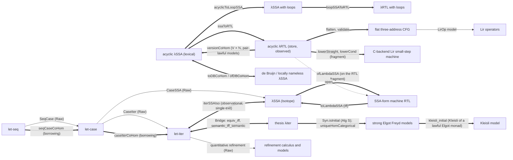

# SSA calculi, λRTL and the SSA-form machine RTL

This project collects Silmaril's effectful SSA calculi and the register-transfer
languages around them: the let-family calculi (let-seq, let-case, let-iter), λSSA,
λRTL (λSSA's dominator-tree syntax read with overwritable registers), a flat
three-address CFG with a validator, and the SSA-form machine RTL with its
translations to and from λSSA. It is the IR layer of the System V x86 lifting and
C correspondence problems: an IR function here has a semantics, a typed syntax and
checked translations, so a problem can state "this RTL/λSSA function is a lift of
that machine function" against definitions a reviewer can read.

Every module is in the root `Silmaril` library; there is no executable.

The [LambdaIter family matrix](lambda-iter-family.md) records the assumptions of
the semantics comparisons and the forward flat SSA/RTL commuting square.

The [LetIter heap reindexing note](letiter-heap-reindexing.md) describes the typed
allocation dialect and its finite trace theorem.

## The calculi and translations



Double arrows are checked institution comorphisms, isomorphisms or checked
semantic translations; single arrows are Raw syntactic translations with their
own Raw soundness developments; the dashed arrow is an open obligation (below).
"thesis λiter" is the Raw port of the thesis formalisation (`Silmaril.Thesis`), a
second copy of the let-iter calculus beside `Silmaril.Isotope.LetIter`; the
bridge relates the two.

## Modules

| Area | Header | Contents |
| --- | --- | --- |
| λRTL, acyclic | `Silmaril.SSA.LambdaRTL.{Defs,Thms}` | `Region V L F` (values, operands, `let1`, `let2`, `case`, `join`, `br`), the lexical reading `evalSSA`, the store reading `evalRTL`/`evalObs`, `NoClobber`, `IsSSA`; agreement theorems and the clobbering counterexample |
| Institutions | `Silmaril.SSA.LambdaRTL.Institution.Defs` | `ssa R`, `rtlObs R`, `rtlFull R` over instruction-alphabet signatures, the comorphism `ssaToRTL R`, the Hets logic graph `hets R` |
| Loops | `Silmaril.SSA.LambdaRTL.Loop.{Defs,Thms}`, `.Loop.Institution.Defs` | `loop r ℓ x t` (a self-recursive `where`) over a lawful Elgot monad; frame lemma, agreement, necessity counterexample; `loopSSA`, `loopRTLObs`, `loopSSAToRTL`, `acyclicToLoopSSA` |
| Versioning | `Silmaril.SSA.LambdaRTL.Version.{Defs,Thms}`, `.Version.Institution.Defs` | `versionTop : Region V L F → Region (V × ℕ) L F` (fresh versions, live-ins packed through jumps), SSA-ness, soundness, `versionCoHom` |
| Names | `Silmaril.SSA.LambdaRTL.Nameless.{Defs,Thms}`, `.LocallyNameless.{Defs,Thms}`, `.Nameless.Institution.{Defs,Thms}`, `.Quotient.Defs` | de Bruijn and locally nameless presentations, `Supply V`, adequacy, round trips, α-equivalence, comorphisms both ways and their inverse pair modulo semantic equivalence |
| Flat CFG | `Silmaril.SSA.LambdaRTL.CFG.{Defs,Thms}` | three-address `CFG`, `flatten`, `toRegion`, relabelling, the syntactic validator `validate` |
| Lir operators | `Silmaril.Machine.LambdaRTLLir.{Defs,Thms}` | instruction alphabet `LirOp`, values `LVal`, `model : Model LirOp Option LVal` built from `Lir.Unop.eval`/`Lir.Binop.eval`; the validated `absDiff` example |
| λRTL to Lir | `Silmaril.Machine.LambdaRTLLir.Sim.{Defs,Thms}` | lowering of a word fragment of λRTL (straight-line `let1` code, then one `br` or one test-`case`) to `Lir` functions, with exact simulation theorems against the C-backend `Lir` small-step machine `Silmaril.Machine.Lir.step`/`Behaves` |
| Machine RTL | `Silmaril.Machine.RTL.Thms` | re-exports the SSA-form RTL (`Silmaril.Raw.Machine.RTL`: syntax, small-step and big-step semantics with call oracles, behaviours, dominance, `Lir` syntax, little-endian words), `toLambdaSSA` and `ofLambdaSSA` |
| RTL fragment of λSSA | `Silmaril.Machine.OfLambdaSSA.{Defs,Thms}` | `Shape`, `TmFits`, `RegionFits`, `RootFits`; correctness of `ofLambdaSSA` on the fragment and two counterexamples outside it |
| λSSA and the let family | `Silmaril.SSA.Isotope.Thms` | re-exports the Raw let-seq, let-case, let-iter and λSSA developments (`Silmaril.Raw.SSA.Isotope`: locally nameless syntax, typing, equational theories, monadic, operational, categorical and machine semantics, observations, the let-family translations); the reviewed λSSA headers `Silmaril.SSA.Isotope.{LambdaSSA,Types}` were already public |
| Elgot iteration | `Silmaril.Semantics.Elgot.{Defs,Thms}`, `Silmaril.Semantics.ElgotMonads.{Defs,Thms}` | `Iterate`, `LawfulElgotMonad` (fixpoint, naturality, codiagonal, uniformity); instances for `Part`, `SetM`, `StateT`, `ReaderT`, `ExceptT`, `OptionT`, `WriterT` |
| Categorical support | `Silmaril.Semantics.Categories.Thms` | re-exports Raw premonoidal, Freyd, distributive Freyd and Elgot-monad category theory used by the categorical let-iter semantics |
| Behaviours | `Silmaril.Semantics.Behaviour.Thms` | re-exports Raw labelled traces, contracts, refinement, the compilation relation `Implements`, simulation conventions and equivalence over `Silmaril.Machine.Behaviour` |
| LetIter denotational soundness | `Silmaril.SSA.Isotope.LetIter.Thms` | proof-relevant typed equations preserve direct monadic denotations and the corresponding categorical arrows in the Kleisli model of a lawful Elgot monad |
| LetParIter | [Use and model contract](letpariter.md) | Independent typed pairing in the shared let syntax, native feedback, and monadic soundness under explicit parallel laws |
| λSSA categorical semantics | `Silmaril.SSA.Isotope.LambdaSSA.Categorical.{Defs,Thms}` | expression and region denotation graphs, totality for exact typing, and uniqueness under the respective coherence hypotheses |
| Let-family institutions | `Silmaril.SSA.Isotope.Institution.Thms` | re-exports the Raw equational institutions of let-seq, let-case and let-iter, inclusion comorphisms with borrowing, syntactic initiality, refinement institutions and `eqToRef`, observational institutions and `iterSSAIso` |
| Free UB | [Construction and coverage](ssa-ub.md) | Fresh instruction symbols, a monad on ordered specifications, greatest elements in the initial syntax quotient, and a typed LetCase translation |
| Thesis initiality | `Silmaril.SSA.Thesis.Thms` | re-exports the Raw port of the thesis λiter and λcase (`Silmaril.Raw.SSA.Thesis`): `Syn.isInitial` in `Alg S`, equational completeness |
| Thesis categorical models | `Silmaril.SSA.Thesis.Categorical.Thms` | λiter derivations denoted in strong Elgot Freyd categories, `Alg.ofCategorical`, initiality into those models, non-vacuity of `Alg S` |
| Thesis Kleisli model | `Silmaril.SSA.Thesis.Kleisli.Thms` | the Kleisli category of a lawful Elgot monad as a λiter model: `TypingCoherent` and `LawfulModel` instances, initiality into it, and the instance at `Part` |
| Quantitative refinement | `Silmaril.SSA.Isotope.Refinement.Thms` | usage-annotated typing, rewrite theories, ordered constructor models, and strict categorical models of letseq, letcase and letiter |
| Let-iter bridge | `Silmaril.SSA.Isotope.Bridge.{Defs,Thms}` | term and context translations between `Silmaril.Isotope.LetIter` and the thesis λiter, preservation of typing, axioms and equivalence, agreement of the two completeness theorems |
| Dataflow | `Silmaril.Calculi.Dataflow.{Defs,Thms}` | round-robin (Gauss–Seidel) iteration over `Silmaril.Semantics.Dataflow` equation systems |

## Main results

See the [pinned LambdaSSA theorem crosswalk](lambdassa-theorem-crosswalk.md)
for the scope of the paper and Lean results and the conventional φ-node
to block-argument port plan.

λRTL and λSSA (acyclic), in `Silmaril.SSA.LambdaRTL.Thms`:

- `Region.evalSSA_congr`: the lexical semantics reads only free variables.
- `Region.evalRTL_frame`: λRTL writes only registers it assigns (bind-congruence
  form, any lawful monad).
- `Region.evalObs_eq_evalSSA`: under `NoClobber` the observable store semantics
  equals the lexical semantics; `Region.noClobber_of_isSSA` and
  `Region.evalObs_eq_evalSSA_of_isSSA` give it for dominance-scoped SSA.
- `clobber_counterexample`: without `NoClobber` the readings differ, so reading
  λRTL as λSSA by the identity is not semantics-preserving.

Loops (`Loop.Thms`), in every lawful Elgot monad: `Loop.Region.evalRTL_frame`,
`Loop.Region.evalObs_eq_evalSSA(_of_isSSA)`, the embedding lemmas
`evalSSA_ofAcyclic`/`evalRTL_ofAcyclic`, `selfClobber_counterexample` (the loop
clause of `NoClobber` is necessary), and `evalObs_eq_evalSSA_part` (the hypotheses
hold for `Part`).

Versioning (`Version.Thms`): `versionTop_isSSA` (every acyclic λRTL region becomes
dominance-scoped SSA), `versionTop_evalSSA` and `versionTop_evalObs`
(`(versionTop r).evalSSA m ρ = r.evalObs m σ` when `ρ (y, 0) = σ y`), assuming the
model is pair-lawful (`unpair (pair a b) = pure (a, b)`).

Deversioning (`RoundTrip.Thms`): `roundTrip_evalObs` compares acyclic λRTL with
its versioned region renamed back to the original register type. Both runs use
the same initial store and have equal computations of the exit label and
payload. The theorem assumes a lawful monad, a pair-lawful model, decidable
register and label equality, and infinitely many register names. Deversioning
fixes version-zero registers and injectively assigns the remaining versions
used by the region to fresh names.

For cyclic named CFGs, [`Cyclic.Versioning.roundTrip_run_obs`](../../Silmaril/SSA/LambdaRTL/CFG/Cyclic/RoundTrip/Thms.lean)
gives the same-store equality of the whole Elgot computation of the exit
label and payload. The mutable readback keeps each incoming packet and its
decoder. A block receives its live-ins in that packet, so decoding never
depends on stale register values. The result adds lawful Elgot iteration to
the acyclic assumptions and projects away the final store.

In the lexical-to-mutable-to-lexical direction, [`Cyclic.RoundTrip.runSSA_deversion_reversion`](../../Silmaril/SSA/LambdaRTL/CFG/Cyclic/RoundTrip/Thms.lean)
compares the original and re-versioned graphs in the same lexical environment.
The entry reads only version-zero names and each labelled body reads its free
inputs from its packet parameter. The general renaming theorem only requires
agreement on the entry's free inputs after renaming. The source can use a
handwritten packet layout, as in the [non-image back-edge regression](../../Silmaril/Proofs/SSA/LambdaRTL/CFG/Cyclic/RoundTrip/Regression.lean).

[Named cyclic observational classes](../../Silmaril/SSA/LambdaRTL/CFG/Cyclic/Comparison/Thms.lean)
fix the register and label types, instruction alphabet, value carrier and
lawful Elgot monad. Equivalence compares the entire exit-label and payload
computation for every pair-lawful model and every common store on the original
register type. Lexical entry inputs are the corresponding version-zero values,
and every block has a singleton packet context. `classEquiv` makes versioning
and deversioning inverse maps on these classes, including admitted handwritten
tables. The satisfaction theorems transport equations between classes in each
common model, with signatures held fixed.

[Named cyclic equation institutions](../../Silmaril/SSA/LambdaRTL/CFG/Cyclic/Institution/Thms.lean)
use primitive alphabets as signatures and functions as renamings. The model
category at each signature is discrete on the pair-lawful models. Reduct
precomposes the primitive interpretation and preserves the packet operations.
Both signature actions preserve identity and composition and satisfy the
change-of-signature law on equations. `comparisonIso` is a natural isomorphism
of room functors over this signature category. Its sentence translations
commute with renamings on observational classes, with identity on models.

[Named cyclic refinement](../../Silmaril/SSA/LambdaRTL/CFG/Cyclic/Institution/Refinement/Thms.lean)
uses the same signatures and the inclusion order on `Part`. A sentence
`lhs ≤ rhs` requires every terminating exit and payload of `lhs` to be
returned by `rhs` at the same store. Divergence and failure both give the
empty result, and the final store is projected out. Versioning and
deversioning give an order isomorphism on the observational classes and a
natural isomorphism of the two refinement institutions. The comparison
transports semantic refinement between the named interfaces.

[Plugging exit continuations](../../Silmaril/SSA/LambdaRTL/CFG/Cyclic/Institution/Refinement/Plugging/Thms.lean)
is monotone in both the program and a pointwise ordered continuation on the
exit label and packet. A continuation can use a common external store. For a
raw handler called with the producer's final store, independence from that
store is equivalent to factoring through the observed label and packet.
A packet-closed continuation table has this property: each labelled body
reads its free inputs from the incoming packet, even across back edges.
With a store-reading continuation, a single discarded assignment suffices
to [distinguish equal classes](../../Silmaril/Proofs/SSA/LambdaRTL/CFG/Cyclic/Institution/Refinement/Plugging/Regression.lean).

[Executable cyclic linking](../../Silmaril/SSA/LambdaRTL/CFG/Cyclic/Link/Thms.lean)
uses finite input and output ports carrying one value of the common carrier.
Every private address names a packet-closed block. Linking allocates disjoint
private ranges and a forwarding block per intermediate port. The right stage
can loop within its own range and can exit through its public ports. Running
the resulting ordinary named CFG agrees with staged exit plugging.
Observational classes of these graphs form a category with the wire identity
and linker composition, which is monotone for terminating-result inclusion.

[The named refinement interpretation](../../Silmaril/SSA/LambdaRTL/CFG/Cyclic/Link/Institution/Thms.lean)
widens private addresses to naturals and keeps public ports tagged. It maps
each packet arrow to one named program class per input port, with the packet
in the designated register. Refinement of the arrow agrees with named
refinement at every port. Primitive renaming commutes with the executable
linker and wire identity and acts by monotone functors on classes. The named
interpretations commute with this action. Versioning and deversioning
compare the images on classes. The ordinary versioner wraps internal
transfers in a carry tuple, including version-zero live-in slots at entry,
so the resulting syntax can have a wider entry interface than a single wire.

[Syntactic packet CFG simulation](../../Silmaril/SSA/LambdaRTL/CFG/Cyclic/Link/Simulation/Thms.lean)
checks a finite map on private labels and preserves public exits. A source
block either matches a target block after relabelling or forwards its packet
unchanged to the same mapped address. The forwarding check tracks which
registers hold the packet, starting with the block parameter. A copy reads
from that context before adding its destination. A final variable jump must
read from the resulting context. The typed body returns exactly the checked
jump target and incoming packet in every lawful monad. The simulation preserves
every terminating `Part` result, and the executable linker combines the
certificates, including at handoff blocks.

Against direct wiring, `CopyChain.check` follows each chain of typed forwarding
bodies for at most the number of private blocks. A terminating chain cannot
revisit a private label, so that bound finds its unique terminal port.
`CopyChain.certificate` maps each private block to its computed port and checks
the wire's routing at each input. With a common pair-lawful `Part` model, the
check is complete for refinement when every private block reaches a public
port through typed forwarding bodies, including blocks unused by the inputs.

For a table of typed forwarders, a failed terminal search at an input implies
`Part.none` there. The older one-way simulation may still certify inclusion
from a cycle into a wire, since the cycle contributes no terminating result.
The total traversal also rejects cycles in unused blocks, even when their
absence from all input paths makes them observationally invisible. The
[regressions](../../Silmaril/Proofs/SSA/LambdaRTL/CFG/Cyclic/Link/Simulation/Regression.lean)
exercise a linked multi-block chain and both reachable and unused cycles.

`CopyChain.refinement?` decides the same comparison on the larger fragment in
which only private blocks reachable from the inputs must be typed forwarders.
It visits each private label at most once per input. A repeat witnesses a
reachable typed cycle and `Part.none`, including when all private labels have
been visited. A terminating path must match the wire's port, while any
reachable unsupported body yields `none` for the decision. Unused blocks can
contain cycles or unsupported bodies. The decision gives a proved semantic
verdict. `CopyChain.certificate` is the separate total-table API for obtaining a
label map usable with the linker.

`CopyChain.refinementBetween?` compares two entry-typed graphs with the same
external ports. A source cycle contributes no result and refines either
supported target outcome. A source return requires a target return at the same
port. Unsupported syntax reached on either side gives `none`. With a common
pair-lawful `Part` model, the verdict decides refinement for these graphs.
Using a wiring graph as the target gives the same verdict as `refinement?`.
The decision is exact for satisfaction by the compiled named SSA classes at
every input port and initial store in each pair-lawful `Part` model. When
compiling after primitive renaming, the same verdict applies by model reduct.

Entry outcomes compose through the executable linker. A left cycle ends the
scan in its own stage. A left return selects a right input through the matching
handoff port, and private diagnostics use the linked address of their stage.
The linked graph is entry-typed exactly when the left inputs are supported and
the right inputs are supported at the intermediate ports those inputs return.

[Packet field routing](../../Silmaril/SSA/LambdaRTL/CFG/Cyclic/Link/Fields/Thms.lean)
checks named blocks that copy registers, build pairs, and destructure known
pairs. The interface uses one fixed width and the usual right-nested pairs
ending in unit. Each output slot selects an input slot, so blocks can permute
fields or discard a field by duplicating another. The executable traversal
composes these selections along the path and checks for repeats. Checked
cycles stay private and preserve packet shape even when the payload changes.

The verdict compares actual `Part` observations on packed inputs. Soundness
holds in every pair-lawful model. Completeness in a given model requires that
distinct field maps can be distinguished by some packed input. Pair-lawfulness
and two distinct field values suffice. Branches, primitive calls, and
destructuring opaque fields are outside the checker.

[Variable-width routing](../../Silmaril/SSA/LambdaRTL/CFG/Cyclic/Link/Fields/Width/Thms.lean)
assigns widths to each port and private label. It checks that each
input agrees with its entry label, and checks each reachable jump at the
declared target width. Routes have type `Fin target → Fin source` and compose
at their common width. Linking requires the same width family at the left
exits and right inputs, which the handoff blocks preserve. The `Part`
observation theorem also applies to the compiled named SSA classes when
the designated register holds the packed input. Zero fields encode as unit,
and all routes to an empty packet agree without a field-separation premise.

`Width.packedSat` uses the existing compiled named SSA sentence sides and
pair-lawful `Part` models. The checker decides this restricted satisfaction in
a separating model. Primitive relabelling preserves the verdict, and packed
satisfaction after relabelling is satisfaction in the reduct. Both laws
allow noninjective renamings. For compatible intermediate widths, linking
preserves packed refinement when the source left stage is checked and thus
produces a packed input for the right stage. All-store satisfaction implies
packed satisfaction. The converse fails for a one-field block that normalizes
the tail of a raw pair, while a wire keeps it.

[Boolean packet control](../../Silmaril/SSA/LambdaRTL/CFG/Cyclic/Link/Fields/Boolean/Thms.lean)
checks a block with one sum-case on a Boolean input field and a jump in the
selected arm. The model splits its Boolean tags to left and right with unit
payloads. The checker explores finite label/packet pairs over Boolean fields,
using the same width profiles and named SSA observation. A repeat of the full
state gives no terminating result. An unsupported instruction on a selected
path gives no verdict. The per-input theorem covers supported packets and the
whole-interface decision enumerates every Boolean packet at each input port.

Names (`Nameless.Thms`, `LocallyNameless.Thms`, `Nameless.Institution.Thms`):
`Region.eval_toDB` (adequacy), `DB.Region.toDB_ofDB` (round trip),
`Region.alphaEq_ofDB_toDB`, `Region.evalSSA_eq_of_alphaEq`, `Region.close_toLN`
(`close ∘ toLN = toDB`), `Region.alphaEq_iff_toLN_eq`, `Region.evalObs_rename`
(register renaming), and `ofDB_toDB_quot`/`toDB_ofDB_quot` (the comorphisms are
mutually inverse on sentences modulo semantic equivalence).

Flat CFG (`CFG.Thms`): `run_flatten`
(`(flatten r).run m σ = (fun e => (inl e.1, e.2)) <$> r.evalRTL m σ`),
`run_eq_toRegion`, `run_relabel`, and validator soundness `run_of_validate` in every
model and lawful monad.

λRTL to `Lir` (`Machine.LambdaRTLLir.Sim.Thms`): `prefix_sim` (the lowered
operations and the λRTL prefix fail or succeed together, keeping the store and
frame in agreement); `behaves_straight_iff` and `lowerStraight_behaves_iff`
(straight-line code: `Behaves p s b ↔ b = expect (k.evalObs cmodel σ) s.mem`, in
both directions), with `straight_returned_iff` and `straight_stuck_iff`;
`behaves_cond_iff` (one conditional lowered to `branch c 1 2` and two returning
blocks); the `|x - y|` example `absDiffProg_behaves`, with the `Lir` run
evaluated by `decide`.

Machine RTL (`Machine.RTL.Thms`, `Machine.OfLambdaSSA.Thms`):
`toLambdaSSA_eval_iff` (SSA-form RTL to λSSA preserves finite outcomes exactly,
assuming the call oracle matches the signatures), `ofLambdaSSA_eval_iff` (the
converse compiler is correct on the RTL fragment `RootFits`),
`pairExample_differs` and `aliasRegion_not_compiles` (what the fragment excludes).

Let-family institutions (`Silmaril.SSA.Isotope.Institution.Thms`):
equational institutions `Silmaril.Isotope.Institution.{LetSeq,LetCase,LetIter}.inst`
with `entails_base_iff`/`entails_theory_iff` (semantic consequence is derivable
equivalence); comorphisms `seqCaseCoHom`, `caseIterCoHom` with unconditional
borrowing (`seqCase_entails_iff_of_any`, `caseIter_entails_iff_of_any`);
`syntaxIsInitial` and `syntacticModelIsInitial` with completeness `semantic_iff`
(initiality among algebras of the equational presentation); `Refinement.eqToRef`
(`eqToRef_modelExpansive`); observational institutions with the compilations
`Observational.caseIter`, `Observational.iterSSA` and the isomorphism
`Observational.iterSSAIso` in `CoIns` between let-iter and single-exit λSSA modulo
observational equivalence.

### Lower parallel observation institutions

Import `Silmaril.SSA.Isotope.Institution.Parallel.Inclusions.Thms` for
`Silmaril.Isotope.LetPar.observation`, `Silmaril.Isotope.LetParCase.observation`
and their comparison theorems. Each institution has the existing `InstrSig`
category of instruction alphabets over fixed type and effect universes. An arrow
preserves the exact source, target and effect of each opcode, so it preserves
the chosen purity judgment as well. Both free and bound contexts retain their
types. The value interpretation and its product, unit and, where available,
coproduct and empty equivalences are fixed throughout.

Sentences carry two particular native `Parallel.Derivation` witnesses in a
common scope and result type. The interpreter evaluates these witnesses with
the supplied `ParOp`. Satisfaction compares full computations at every
environment. Reusing an endpoint's denotation with a different witness of
the same term and type requires a separate agreement proof.

A model has a lawful monad, a typed primitive interpreter and an explicit
parallel operation. Strict model arrows preserve monadic operations,
parallel pairing and primitive evaluation. Signature reducts restrict primitive
evaluation and retain the action of these arrows on computations.
`denote_mapInstr` and `denote_hom` are the corresponding interpreter squares.

`LetPar.mapInstr_equiv` and `LetParCase.mapInstr_equiv` take a derivable
native `Equiv` equation to a derivable equation between its relabeled terms.
This includes the purity-guarded schemes.

The observation institutions accept an arbitrary supplied `ParOp`.
The parallel institution fixture in `tests/ssa/LetIterWeakTreeSoundness.lean`
derives a relabeled native swap and refutes its satisfaction in the ordered
writer model, where the two endpoints log
`[2, 7]` and `[7, 2]`. The same swap holds in the writer model whose
parallel operation orders the two branch logs by their first tag. The
fixture also shows that ordinary pairing keeps left-to-right order in
that model.

The restrictions transport specific witnesses in the same monad and
primitive interpretation.

| Inclusion | Witness transport used in satisfaction | Native syntactic equation preservation |
| --- | --- | --- |
| LetSeq → LetPar | `LetPar.derivation` on both endpoints, checked by `LetPar.denote_derivation` | `LetPar.embed_equiv` |
| LetCase → LetParCase | `LetParCase.derivation` on both endpoints, checked by `LetParCase.denote_derivation` | `LetParCase.embed_equiv` |
| LetPar → LetParCase | `LetParCase.ofLetParDerivation` on both endpoints, checked by `LetParCase.denote_ofLetParDerivation` | `LetParCase.ofLetPar_equiv` |

The syntactic preservation theorems apply to the native term-indexed
congruences. `LetParCase.ofLetParDerivation_mapInstr` checks that widening
and relabeling the same witness in either order yield heterogeneously equal
derivations. This is the endpoint compatibility in `letParCaseInclusion`,
the comorphism with identity signature and model maps.

LetIter denotational soundness (`Silmaril.Isotope.LetIter.ProofRelevant.Semantics`).
`sound` and `related_sound` preserve the denotations at the given proof-relevant
typing endpoints. `categorical_denote_eq` identifies the associated Kleisli arrow
pointwise with the direct semantics, and `categorical_sound` gives equality
of the arrows. For exact LetIter, `Bridge.toThesis_categorical_sound` transports
an equation to the thesis syntax at any free and bound contexts and applies
categorical soundness there. It assumes matching type formers, instruction
types and effects, and the thesis model laws and typing coherence. The existing
algebraic completeness theorem ranges over operation algebras of the presentation.

Exact categorical LetIter soundness has a model-interface obstruction.
`Silmaril.SSA.Isotope.LetIter.Counterexample.Thms` exhibits a strong Elgot
Freyd model admitted by the current interface in which closed let-η changes
the denotation. The model uses a writer effect in the structural unit and
tensor isomorphisms. The paper's Freyd interface instead takes the
computation unit and tensor as Cartesian structure in the pure wide
subcategory. [The Denotational Semantics of SSA, Definition 5.3](https://arxiv.org/abs/2411.09347)

λSSA categorical semantics (`Silmaril.Isotope.LambdaSSA.Semantics.Categorical`).
`denote_spec` and `denoteRegion_spec` witness the expression and region graphs
at every exactly typed input. Expression models are distributive Freyd
categories. Region models additionally provide strong Elgot iteration.
Variable contexts are products and exit contexts are finite coproducts. A CFG
with zero local labels denotes its entry. A nonempty CFG dispatches a finite
family of possibly differently typed local labels, with outward jumps on the
left and local iteration on the right. `Denotes.eq_denote` and
`RegionDenotes.eq_denote` require separate typing coherence hypotheses.
`Silmaril.SSA.Isotope.LambdaSSA.Rewrite.Thms` proves categorical soundness
for empty-CFG elimination and constructor-valued entry branches. Soundness
for the full rewrite theory and its syntactic initial model remain open.
[Ghalayini and Krishnaswami, *The Denotational Semantics of SSA*, §5](https://arxiv.org/abs/2411.09347)

λSSA Kleisli agreement (`Silmaril.SSA.Isotope.LambdaSSA.Kleisli.Thms`).
The direct monadic denotation threads a typed product of variable values
and returns a typed destination from the label context. The graph comparison
sends every monadic witness to a categorical witness at the matching
environment. `categoricalTermDenote_eq` and `categoricalRegionDenote_eq`
identify the chosen arrows under the corresponding coherence assumptions,
with the latter transporting typed exits along the finite-coproduct
equivalence. Region agreement includes nested CFGs in a lawful Elgot monad.

Subtyped λSSA (`Silmaril.SSA.Isotope.LambdaSSA.Subtyping.Categorical.Thms`).
`Subtyping.Exact.tm` and `Subtyping.Exact.region` embed exact typing into the
derivation-valued typing system. A subtyping step in an expression composes
with the value morphism of the supplied coercion. The structural graph gives
a unique arrow for each expression and region derivation. The nonempty
dispatcher is determined by its restrictions to the typed blocks. The
region semantics retains coercions in the entry and block expressions.
`Subtyping.Kleisli.Thms` proves agreement with the direct monadic denotation
for each fixed derivation. `LambdaSSA.Renaming.Thms` proves that monadic term
and region denotations commute with typed variable renaming in both typing
presentations.

Thesis ports (`Silmaril.SSA.Thesis.Thms`, `.Categorical.Thms`), for a signature
`S`: `Syn.isInitial : IsInitial (Syn S)` in `Alg S` and `Syn.denote_eq_iff_eqv`
(λiter; λcase analogues `Syn.denote_eq_iff_equiv`); `Alg.ofCategorical` and
`Categorical.uniqueHomCategorical` (the unique algebra morphism from syntax into a
strong Elgot Freyd model computes the categorical denotation), conditional on the
coherence classes `TypingCoherent` and `LawfulModel`; `Alg.const_not_terminal`,
`Alg.constHom_ne_id`, `Alg.powReindex_ne_id`.

Thesis Kleisli model (`Silmaril.SSA.Thesis.Kleisli.Thms`), for a lawful Elgot monad
`m` with a monadic instruction model: `kleisli_typingCoherent` and
`kleisli_lawfulModel` (the instances the categorical initiality assumed), and
`uniqueHomKleisli`/`kleisli_initial` (exactly one algebra morphism from `Syn S`
into the Kleisli model, computing the denotation); `uniqueHomKleisliPart` at `Part`.

Thesis syntactic category (`Silmaril.SSA.Thesis.SyntacticCategory.Thms`).
`Syn.SynCat S` has the signature's types as objects and one-variable
terms modulo `Eqv` as arrows. The empty type is initial and, with binary
coproducts, gives finite coproducts. `elgotCategory` packages fixpoint,
naturality and codiagonal for the syntactic iteration. `iterate_uniformity`
holds along arrows with a syntactically pure representative.
`Silmaril.SSA.Thesis.SyntacticCategory.Values.Thms` constructs the Cartesian
value category on those arrows and proves that its inclusion into the
computation category preserves finite coproducts. Premonoidal computation
structure, Freyd strength, and categorical model initiality remain open.

Quantitative refinement (`Silmaril.SSA.Isotope.Refinement.Thms`, namespace
`Silmaril.Isotope.Refinement`): `Models.syntaxIsInitial`, `Models.fold_unique`,
`Models.syntacticModelIsInitial`, `Models.orderedSyntacticModelIsInitial`,
completeness `Models.{refinement,mutual_refinement,equation}_iff_all_models`,
`RewriteSystem.generatedTheory_{renaming,substitution}`, the contextual categories
`Theory.{refinement,equational}Functor`, and the categorical interpretation
`Models.Denotation.denote{Seq,Case,Iter}` with `fold_unique`.

The quantitative categorical results use the free types `Ty α` and a fixed
instruction signature. Their objects are sequential ordered symmetric
premonoidal models, distributive branching models, and iterative models with
strong directed Conway iteration, respectively. Morphisms preserve the chosen
structure strictly.

- `Models.Denotation.{seq,case,iter}WitnessCoherent` and
  `{seq,case,iter}_validates_refines` give typing witness coherence and
  soundness for every quantitative context. The iterative result covers
  effectful directed uniformity.
- `Models.Interpretation.free{Seq,Case,Iter}ModelIsInitial` gives the free
  native singleton-term quotient's initiality. `{seq,case,iter}IsInitial`
  gives initiality for a formed `RewriteSystem` closed under quantitative
  renaming and native pure substitution. The initiality categories place
  homs in the instruction universe.
- `Models.Interpretation.{seq,case,iter}_{refines,equates}_iff_models` gives
  completeness for terms with one input `Syntactic.input A`. The native
  presented models validate their rewrite systems in arbitrary contexts.

These declarations correspond to the quantitative refinement development at
source revision `cc9b669ac91832336c04eac000dbc9cf34913bd9`, under
`Models/Denotation`, `Models/Syntactic` and `Models/Interpretation`.
The λSSA categorical semantics above treats the general multi-exit region
judgment, whose codomain is a finite coproduct of exit types.

Bridge (`Silmaril.SSA.Isotope.Bridge.Thms`), under the explicit compatibility
hypotheses `TypeCompat`, `InstrCompat`, `EffCompat` (each discharged by `rfl` for
the canonical instances): `hasType_iff`, `pure_iff`, `coreAxiom_iff` (the same 19
axiom schemes), `equiv_iff` (in every free context), and `semantic_iff_semantic`
(closed terms: validity in every Isotope equational model iff validity in every
thesis algebra).

### Structured acyclic λSSA and LetCase

[`Silmaril.SSA.Isotope.Bridge.Acyclic.Thms`](../../Silmaril/SSA/Isotope/Bridge/Acyclic/Thms.lean)
compares exact, single-exit λSSA with LetCase over the same typed instruction
alphabet. It admits open positional contexts, nested cases and nested joins.
Each join has one local label. Its entry transfers to that label, and the
continuation receives the passed payload and the context captured at the join.
The continuation cannot jump back to its own label.

- `Code.toSSA_hasType` checks the embedding in the existing λSSA syntax.
  `Code.toLetCase` replaces a join by one let. `Code.ofLetCase` reifies
  LetCase and `Code.toLetCase_ofLetCase` recovers its exact derivation.
  In the other direction `Code.eval_roundtrip_iff` gives equivalence of finite
  observations, since reification may change the placement of SSA binders.
- `Code.eval_iff_denote` is the finite-outcome square. At matching inputs, an SSA
  execution to the requested external label with a given payload and final state
  exists exactly when that outcome belongs to the translated LetCase
  `StateT σ SetM` denotation. Primitive instructions must agree on finite
  outcomes at typed inputs. `Code.denote_ofLetSeq` composes the same translation
  with the existing LetSeq inclusion in any shared typed monadic model.
  The [branch/join regression](../../Silmaril/SSA/Isotope/Bridge/Acyclic/Examples/Thms.lean)
  checks both tags, the captured value and the order of their effects.
- The square gives preservation and reflection of finite outcomes for this
  observation class. Equational completeness is a separate result relative to
  the operation algebras in
  [`Isotope.Institution.Thms`](../../Silmaril/SSA/Isotope/Institution/Thms.lean)
  and to the thesis λcase [`Alg S`](../../Silmaril/SSA/Thesis/Thms.lean).
  The [quantitative categorical results](../../Silmaril/SSA/Isotope/Refinement/Models/Initiality/Thms.lean)
  concern the quantitative syntax at a fixed signature, with completeness for
  singleton-input judgments.
- `denote_underBinder` proves that weakening a continuation drops the arm's
  payload and retains its newly bound result. `denote_bindLetCase` then
  validates the exact [`bindLetCase` equation](../../Silmaril/Raw/SSA/Isotope/LetCase/LocallyNameless/Equiv.lean#L172)
  in the distributive Freyd model. It uses centrality of
  `J.map (duplicate E) ≫ (tensorIso E E).inv` at the original environment
  `E`, because the bind retains that environment across effectful branches.
  The LetCase law uses distributive Freyd structure and this local condition.
  A shared tensor comparison supplies centrality by
  `denote_bindLetCase_of_sharedTensor`. Agreement of independently chosen
  typing derivations uses the separate `TypingCoherent` hypothesis.
  [Exact LetCase denotation and laws](../../Silmaril/SSA/Isotope/LetCase/Categorical/Thms.lean)
- `Code.denote_toSSA` relates the compiled LetCase arrow to the existing
  categorical denotation of `Code.toSSA`, with a map of environments on
  input and the selected label injection on output. The latter semantics uses
  strong Elgot iteration, so the proof unfolds the one-block dispatcher and
  shows that the block immediately exits it. This comparison uses a central
  unit and region typing coherence. With the same local diagonal condition
  as LetCase, `Code.denote_toSSA_distributeJoin` proves equality of the
  original and rewritten λSSA regions.
  [Categorical comparison](../../Silmaril/SSA/Isotope/Bridge/Acyclic/Categorical/Realization/Thms.lean)
- The [central-unit Freyd counterexample](../../Silmaril/SSA/Isotope/LetIter/Counterexample/Diagonal/Thms.lean)
  shows that a central unit alone can fail to centralize the transported
  diagonal in a plain Freyd category. The checked shared-tensor hypothesis
  gives a sufficient condition in the distributive setting.

### Exact equations and signature change

- `Code.toLetCase_mapSignature` and `Code.ofLetCase_mapSignature` commute
  with primitive and type translation, including the exact derivations.
  `Code.toSSA_mapSignature` identifies the resulting positional code with
  the existing λSSA instruction map. These statements use preservation of
  unit, products, sums and the empty type. [Typed signature change](../../Silmaril/SSA/Isotope/Bridge/Acyclic/Signature/Thms.lean)
- The existing [LetCase institution](../../Silmaril/Raw/SSA/Isotope/Institution/LetCase.lean#L61)
  has exact equation sentences and operation-algebra models over
  `InstrSig τ ε`. Its primitive maps fix types and effects.
  `reify_mapSentence` commutes with its actual sentence map in positional
  syntax. Reification into positional code is independent of the typing
  derivation. The more general type-changing `SignatureMap` acts on syntax
  and contexts outside that fixed-type signature category.
  [Signature category](../../Silmaril/Raw/SSA/Isotope/Institution/InstrSig.lean)
- For small signatures and an empty named context, `reifyCorridor` sends
  LetCase equations to the exact structured SSA room at each signature.
  The model functor goes back from the discrete class of
  `CoherentRegionModel` objects to LetCase operation algebras. The class
  uses a fixed strong Elgot Freyd category with central unit and locally
  small arrows, with interpretations satisfying region typing coherence.
  `sat_compile_iff` and `sat_reify_iff` give satisfaction in both directions
  under this reduct. `denote_eq_of_sameTerm` gives agreement for independently
  chosen exact derivations in this class.
  [Exact equation comparison](../../Silmaril/SSA/Isotope/Bridge/Acyclic/Institution/Thms.lean)
- `ssaInst` extends these rooms to the primitive signature category.
  `mapEquation` preserves the actual typed operand derivations chosen by
  the LetCase algebra fold. The model reduct restricts primitive arrows
  and transports their domains and codomains along the signature map's
  type equalities. Relabelling the region denotation witnesses transfers
  typing coherence from the target model. Both maps preserve identity
  and composition, and `ssaSat_map_iff` gives satisfaction invariance.
  `reifyComorphism` bundles reification and the LetCase algebra reduct
  over the identity signature functor on the stated coherent model class.
  [Exact institution and comorphism](../../Silmaril/SSA/Isotope/Bridge/Acyclic/Institution/Functor/Thms.lean)
- For type-changing `SignatureMap`s, `pullbackTypes` and
  `pullbackInstructions` reuse the target's chosen type-former isomorphisms
  and primitive arrows with equality transport. They preserve identity and
  composition. The value context tensor and finite coproduct of exits agree
  with the target interpretations of the mapped contexts.
  `RegionWitnessPullback` is equivalent to source typing coherence
  together with preservation of the selected region denotations.
  [Dependent model pullback](../../Silmaril/SSA/Isotope/Bridge/Acyclic/Institution/Pullback/Thms.lean)
- `mapTermWitness` and `mapRegionWitness` prove forward relabelling for
  the existing relational semantics. For a nonempty CFG the proof transports
  the entry and block witnesses, preserves the two finite-label routing
  arrows, and checks each summand restriction of the transported collective
  arrow. This supplies `RegionWitnessPullback` in every supported coherent
  target, including non-thin computation categories. The Maybe Kleisli
  case-and-join probe identifies two distinct source payload types.
  [Witness transport](../../Silmaril/SSA/Isotope/Bridge/Acyclic/Institution/Pullback/Witness/Thms.lean) ·
  [Case-and-join probe](../../Silmaril/SSA/Isotope/Bridge/Acyclic/Examples/TypeChange/Thms.lean)
- `TypeSignature` bundles primitive signatures with their type and effect
  universes. Its maps preserve the full type syntax. `ssaTypeInst` extends
  `ssaSignatureCorridor` to this category. Its sentence laws retain the exact
  derivations, with context and result transports justified explicitly.
  The probe exercises a composite between three type universes.
  [Exact SSA institution](../../Silmaril/SSA/Isotope/Bridge/Acyclic/Institution/TypeChange/Thms.lean)
- `letCaseTypeInst` uses the existing presentations and operation-algebra
  reduct. Its initial-algebra fold agrees with `mapCaseSignature`, and the
  algebra of a coherent SSA pullback is exactly the LetCase reduct.
  `typeReifyComorphism` bundles the natural satisfaction comparison.
  On the included primitive maps, both signature actions and the
  reification components agree with the fixed-type comorphism.
  The comparison uses forward transport of source witnesses.
  [Type-changing comorphism](../../Silmaril/SSA/Isotope/Bridge/Acyclic/Institution/TypeChange/Comparison/Thms.lean)
- Given a chosen distributive Freyd interpretation of the types, the
  exact LetCase arrow carriers determine where to read back each primitive
  arrow. The algebra has that Freyd presentation exactly when all its
  operations agree with the readback interpretation. This already
  interprets single-exit acyclic code on the SSA context and exit objects.
  For expansion into the existing SSA room, the ambient computation
  category needs strong Elgot iteration on the same distributive structure
  and central unit. The recovered interpretation must also satisfy
  `RegionTypingCoherent`, which requires two region denotation witnesses
  at the same typing to yield equal arrows. With these data, the selected
  SSA denotation agrees with the iteration-free interpretation, and the
  expansion preserves exact satisfaction. Reification reflects equational
  consequence on the class of algebras in the image of the reduct.
  [Expansion criterion and section](../../Silmaril/SSA/Isotope/Bridge/Acyclic/Institution/Expansion/Thms.lean)
- A validated LetCase algebra carries this presentation and coherence on
  chosen types. Its reduct uses the existing LetCase operation map, with
  carriers identified by the dependent type pullback. Primitive readback
  after reduct gives exactly the restricted instruction model. Expanding
  the reduced algebra therefore gives the same coherent SSA model as
  expanding first and applying the witnessed SSA pullback.
  [Object-level expansion square](../../Silmaril/SSA/Isotope/Bridge/Acyclic/Institution/Expansion/TypeChange/Thms.lean)
- The validated LetCase institution keeps the original exact equations,
  with equality arrows between models carrying a chosen presentation.
  Expansion and validation are inverse model functors onto the entire
  discrete coherent SSA room. Forgetting the chosen presentation has
  the same object image as the original SSA reduct. The algebra arrows
  it carries are exactly the transports along equalities of validated
  models. Reification and compilation are natural over the type-changing
  signature category and preserve satisfaction. Compiling a reified
  equation gives the original LetCase equation. Reifying a compiled SSA
  equation can change the structured code while preserving truth in every
  coherent model. Its fixed points are exactly the reified sentences.
  Equational consequence agrees on the validated class.
  [Validated institutional retraction](../../Silmaril/SSA/Isotope/Bridge/Acyclic/Institution/Expansion/Institution/Thms.lean)
- The retraction becomes an institution isomorphism when each sentence
  is taken up to agreement on satisfaction in every model of its room.
  Signature maps respect this relation by evaluating each mapped sentence
  in the target model's reduct. Compilation and reification are inverse
  on the quotient classes, and their discrete model functors are the same
  inverse pair as before. The checked straight-line let and its reified
  join have distinct exact code and the same semantic class, including
  after the composite signature change. Completeness of a syntactic
  rewrite theory still requires deriving equivalence from this model-wise
  agreement.
  [Semantic quotient isomorphism](../../Silmaril/SSA/Isotope/Bridge/Acyclic/Institution/Expansion/Institution/Quotient/Thms.lean) ·
  [Let-to-join regression](../../Silmaril/SSA/Isotope/Bridge/Acyclic/Examples/TypeChange/Thms.lean)
- The two-exit comparison uses native positional regions with exits
  `[A, B]`. Its structured fragment has left and right branches, case
  trees, and the acyclic binary dispatcher for existing single-exit code.
  Encoding uses `A ⊕ B` and the decoder dispatches to the original labels.
  An isomorphism identifies the two native label summands with the
  singleton carrying that coproduct. The actual positional denotations
  commute with these maps, so the exact compiled LetCase equation and
  the native two-exit equation have the same satisfaction in each
  coherent model. The typed equation translation and native satisfaction
  both commute with type-changing reduct, even if it identifies the two
  payload types. Every existing validated algebra expands on this
  fragment with the same coherence and central-unit assumptions.
  The joined guarded finite-interface comparison treats a separate
  quotient and model interface.
  [Native encoding](../../Silmaril/SSA/Isotope/Bridge/Acyclic/TwoExit/Categorical/Thms.lean) ·
  [Two-exit satisfaction and signature squares](../../Silmaril/SSA/Isotope/Bridge/Acyclic/TwoExit/Institution/Thms.lean) ·
  [Joined guarded comparison](https://github.com/hiloopai/silmaril-lean/pull/3532)
- The native structured fragment extends to every finite ordered label list.
  Its branches select an index, case trees share the outward interface, and
  single-entry joins bind one local payload with a continuation that cannot
  jump back to that label. Encoding uses the existing right-associated sum
  ending in the empty type. At nonempty interfaces, the acyclic decoder
  dispatches to the original labels and uses an abort expression only on
  the impossible empty summand. Both round trips preserve the corresponding
  arrows in coherent models with central unit. The empty interface is
  uninhabited by this structured syntax because every path must have an
  outward branch. The binary embedding retains the exact native regions
  and their arrows. The three-label probe retains all positions when their
  types collapse and checks composite signature change.
  The finite-exit institution evaluates its sentences using native
  positional denotation and compares to validated LetCase by a
  comorphism. This construction covers the stated structured region
  forms at arbitrary finite interfaces.
  [Finite-exit typing](../../Silmaril/SSA/Isotope/Bridge/Acyclic/FiniteExit/Thms.lean) ·
  [Categorical round trips](../../Silmaril/SSA/Isotope/Bridge/Acyclic/FiniteExit/Categorical/Thms.lean) ·
  [Native institution](../../Silmaril/SSA/Isotope/Bridge/Acyclic/FiniteExit/Institution/Thms.lean)
- A positional table uses the existing typed jump and case blocks. Every
  block reads its own payload, and the entry can evaluate an arbitrary
  exact operand in its surrounding context. The executable checker uses
  successive sink removal on the local targets of **all** blocks. It accepts
  exactly when the local graph has no directed cycle, including cycles
  unreachable from the entry. The removal rounds rank the original
  labels, so even backward numeric edges can be unfolded. The actual
  native positional arrow is preserved at the original ordered exits.
  The checked LetCase translation uses the existing context comparison
  and exit decoder. The diamond regression exercises two incoming paths
  to one shared classifier and two outward positions, with the selected
  arm running before that classifier. Unfolding can duplicate shared
  block code. The fragment covers one CFG table of payload-only blocks.
  [Checker and lowering](../../Silmaril/SSA/Isotope/Bridge/Acyclic/Positional/Defs.lean) ·
  [Cycle criterion](../../Silmaril/SSA/Isotope/Bridge/Acyclic/Positional/Thms.lean) ·
  [Denotation](../../Silmaril/SSA/Isotope/Bridge/Acyclic/Positional/Categorical/Thms.lean) ·
  [Diamond and cycle regressions](../../Silmaril/Proofs/SSA/Isotope/Bridge/Acyclic/Positional/Regression.lean)
- Ranked positional blocks can read the shared typed ambient context as
  well as their newest packet. The checker still uses all local targets.
  The structured lowering projects away intervening packet binders while
  preserving the shared values and the current packet. The native proof
  unfolds the contextual dispatcher once at each ranked block. It retains
  the ambient context through the current computation and then runs the
  selected continuation. This gives the same native arrow at the ordered
  exits in coherent strong Elgot Freyd models with central unit. Primitive
  arrows may have ordered effects. A backward-numbered diamond reads a
  shared bias in both arms and again at their common successor. Its
  state-trace examples record the entry, classifier, selected arm and
  shared computation in order.
  [Captured tables](../../Silmaril/SSA/Isotope/Bridge/Acyclic/Positional/Capture/Defs.lean) ·
  [Denotation square](../../Silmaril/SSA/Isotope/Bridge/Acyclic/Positional/Capture/Categorical/Thms.lean) ·
  [Diamond trace](../../Silmaril/Proofs/SSA/Isotope/Bridge/Acyclic/Positional/Capture/Regression.lean)
- Every successful captured lowering produces a LetCase term in a typed
  grammar of an entry binder, jumps, cases and indexed outward returns.
  A witness for this grammar allows reverse compilation of the actual term
  to a typed positional table that passes the same global rank checker.
  Lowering the rebuilt table returns the exact LetCase term. The native
  round trip preserves the arrow at the original ordered exits for any
  ambient context and primitive interpretation under the captured model
  assumptions. Numbering the grammar tree can duplicate shared blocks.
  The reverse compiler requires a grammar witness, which the successful
  forward lowering supplies.
  [Grammar and certification](../../Silmaril/SSA/Isotope/Bridge/Acyclic/Positional/Capture/Reverse/Thms.lean) ·
  [Ordered-exit round trip](../../Silmaril/SSA/Isotope/Bridge/Acyclic/Positional/Capture/Reverse/Categorical/Thms.lean) ·
  [Three-exit state traces](../../Silmaril/Proofs/SSA/Isotope/Bridge/Acyclic/Positional/Capture/Reverse/Regression.lean)
- The ranked captured and witnessed LetCase equations use the existing
  ordered finite-exit interface and discrete coherent and validated models.
  Their forward comparison commutes with signature changes on actual typed
  LetCase equations, including when two exit types map to the same type.
  Either order of reverse compilation and relabelling gives the same exact
  structured finite-exit lowering and the same native satisfaction.
  Numbering and reading are inverse on classes of equations that hold in
  the same models. A shared successor can be duplicated in the native
  round trip, and the quotient establishes model-wise equivalence for this
  grammar. Syntactic rewrite completeness is a separate question.
  [Signature and satisfaction squares](../../Silmaril/SSA/Isotope/Bridge/Acyclic/Positional/Capture/Institution/Thms.lean) ·
  [Institution isomorphism](../../Silmaril/SSA/Isotope/Bridge/Acyclic/Positional/Capture/Institution/Semantic/Thms.lean) ·
  [Shared successor and type collision](../../Silmaril/Proofs/SSA/Isotope/Bridge/Acyclic/Positional/Capture/Institution/Semantic/Regression.lean)
- Native rewrite reflection for the witnessed LetCase grammar fails at
  effectful empty elimination. At a signature with effectful primitives
  from unit to empty, direct abort and binding the empty result before
  aborting give a witnessed equation valid in every validated model.
  Let-η with a central unit, followed by the empty eliminator, forces
  this equality already in distributive Freyd interpretations. A pure
  case decoder removes the captured entry and first-exit tag using
  native rewrites, so a derivation would contradict the checked
  empty-sequencing independence proof. The native term model rejects
  the witnessed equation and cannot have the required Freyd presentation.
  The witness uses only outward position zero and allows any tail of the
  ordered exit interface.
  [Witness and model obstruction](../../Silmaril/SSA/Isotope/Bridge/Acyclic/Positional/Capture/Institution/Rewrite/Thms.lean) ·
  [Existing independence proof](../../Silmaril/SSA/Isotope/LetIter/Categorical/Empty/Thms.lean)
- At a fixed finite structural primitive signature and structural older
  context, the native LetCase equation classes at literal packed inputs
  form a category. The typed input variable is the identity and the typed
  let is composition. The let weakens its receiver below the bound
  intermediate result, so every hom keeps the same older captures. The
  actual ranked emitter and the checked readback are functors between the
  written linking category and this native category. They compose to the
  identity functor in both orders, which gives an equivalence of
  categories with identity unit and counit. Objects are nonempty ordered
  interfaces, and the native laws are transported along the emission and
  readback squares. The regression composes independently written terms
  and graphs under two older captures, takes both round trips, and
  separates two terms that differ only in the capture they read.
  [Written category and hom squares](../../Silmaril/SSA/Isotope/Bridge/Acyclic/Positional/Capture/Composition/Thms.lean) ·
  [Native category and equivalence](../../Silmaril/SSA/Isotope/Bridge/Acyclic/Positional/Capture/Composition/LetCase/Thms.lean) ·
  [Captured composition and round trips](../../Silmaril/Proofs/SSA/Isotope/Bridge/Acyclic/Positional/Capture/Composition/LetCase/Regression.lean)
- A semantic functor takes the native captured LetCase category to the
  handled-trace program category at one primitive tree interpretation and
  one reply policy. Handled-trace programs have a single input, so every
  older capture is carried beside the input in a product and returned
  beside the result. With no older captures the packed program is the
  operand itself. Composing with the actual ranked emitter gives the
  functor on written graphs, and both triangles over the emitter and the
  checked readback commute. The source equality is the native equation
  relation and the target equality is mutual handled-trace inclusion at
  the fixed policy. The identity and composition equations are equalities
  of interaction trees in every older environment, including for the
  emitted written link. The functor is not faithful at one policy: the
  regression has two different native classes that a state-flipping
  policy sends to the same arrow. That regression packs an independently
  written term with one older capture and two unit-payload exits, and
  checks the pending request, the exit chosen by the handler state, and
  the second request of a composite.
  [Packing](../../Silmaril/SSA/Isotope/Bridge/Acyclic/Positional/Capture/Composition/LetCase/Handled/Defs.lean) ·
  [Functors and contextual equations](../../Silmaril/SSA/Isotope/Bridge/Acyclic/Positional/Capture/Composition/LetCase/Handled/Thms.lean) ·
  [State-dependent handler](../../Silmaril/Proofs/SSA/Isotope/Bridge/Acyclic/Positional/Capture/Composition/LetCase/Handled/Regression.lean)
- At the free request and reply interpretation, handled traces reflect
  native equality of captured operands over a structural older context.
  Each primitive is one request with its typed argument, answered at its
  declared result type. The outcomes of the ordered trace semantics are
  the complete finite histories of the free tree. Two operands that are
  not natively equal therefore have a complete history, at some packed
  input, that one shows and the other does not. A reply policy that can
  replay every complete history from some state gives a faithful semantic
  functor, on native classes and on written graphs. The permissive policy
  and the policy scripted by an expected history are of this kind. The
  premise cannot be dropped: the state-flipping policy never repeats a reply,
  cannot replay the history in which a reply repeats, and identifies two
  different native classes that the scripted and permissive policies
  separate. The result is for this free interpretation, for the finite
  structural signature, and for acyclic captured terms.
  [Free interpretation and policies](../../Silmaril/SSA/Isotope/Bridge/Acyclic/Positional/Capture/Composition/LetCase/Handled/Reflection/Defs.lean) ·
  [Reflection and faithfulness](../../Silmaril/SSA/Isotope/Bridge/Acyclic/Positional/Capture/Composition/LetCase/Handled/Reflection/Thms.lean) ·
  [Separating history](../../Silmaril/Proofs/SSA/Isotope/Bridge/Acyclic/Positional/Capture/Composition/LetCase/Handled/Reflection/Regression.lean)
- The directed version compares three relations on captured operands at
  the free interpretation. The tree relation includes every finite
  observation of one free tree in the other, in every older environment,
  with pending requests. The outcome relation includes the ordered
  complete outcomes of the ordered trace semantics. The third is
  handled-trace inclusion of the packed programs at a reply policy. Replay
  reads only the completed exchanges of an observation, so a policy that
  replays every complete history replays every finite observation. At
  such a policy, handled-trace inclusion is the tree relation, and the
  comparison commutes with the ranked emitter and the checked readback.
  Acyclic terms never diverge silently, and a tree without divergence is
  maximal for inclusion of observations. All three relations are therefore
  native equality on this fragment, and the hom order on the image of the
  semantic functor is discrete. The outcome relation needs the inhabited
  reply types of the signature. A tree-level example with an empty reply
  type has no complete observation and loses its pending request, and
  silent divergence is strictly below a request.
  [Directed relations](../../Silmaril/SSA/Isotope/Bridge/Acyclic/Positional/Capture/Composition/LetCase/Handled/Refinement/Defs.lean) ·
  [Bridge and collapse](../../Silmaril/SSA/Isotope/Bridge/Acyclic/Positional/Capture/Composition/LetCase/Handled/Refinement/Thms.lean) ·
  [Pending request and limits](../../Silmaril/Proofs/SSA/Isotope/Bridge/Acyclic/Positional/Capture/Composition/LetCase/Handled/Refinement/Regression.lean)
- The captured comparison is connected to the existing institutions. The
  sentences are the existing ranked, grammar and LetCase equations at the
  finite structural signature, each read as a directed sentence. The
  models are the existing handled-trace models over the free requests. A
  directed sentence holds when the existing trace-refinement sentence
  between the two free trees holds in every environment. The existing
  emission and readback of sentences are corridors with the identity on
  models, and they give exactly the endpoints of the written and native
  captured categories. On those endpoints, satisfaction is the hom order
  under the semantic functors. A model that replays every complete
  history from an initial state satisfies a directed captured sentence
  exactly when its sides are natively equal, over a structural older
  context. The model that admits every reply is of this kind, so validity
  in all handled models is native equality. The state-flipping model
  satisfies a sentence between two different native classes. An injective
  renaming of primitives that keeps each argument and reply shape is a
  morphism of the handled-trace signatures. The free tree of a renamed
  operand is the request translation of the original tree, so a renamed
  sentence holds in a model exactly when the original holds in the
  reduct. The renamed sentence keeps its typing index. It is the sentence
  map of the existing LetCase institution at the relabelling, and the
  existing type-changing sentence map at the relabelling. Grammar and
  ranked sentences are renamed by their existing signature maps. Every
  relabelling between finite structural signatures is such a renaming, so
  LetCase, grammar and ranked sentences form institutions over the
  category of structural signatures and injective relabellings. Emission
  of ranked sentences and rendering of grammar sentences are natural in
  the renaming, and readback is natural up to satisfaction. Signature
  morphisms that translate types are not morphisms of this category.
  [Sentences, models and rooms](../../Silmaril/SSA/Isotope/Bridge/Acyclic/Positional/Capture/Composition/LetCase/Handled/Institution/Defs.lean) ·
  [Satisfaction squares](../../Silmaril/SSA/Isotope/Bridge/Acyclic/Positional/Capture/Composition/LetCase/Handled/Institution/Thms.lean) ·
  [Renamings](../../Silmaril/SSA/Isotope/Bridge/Acyclic/Positional/Capture/Composition/LetCase/Handled/Institution/Renaming/Thms.lean) ·
  [Institutions over renamings](../../Silmaril/SSA/Isotope/Bridge/Acyclic/Positional/Capture/Composition/LetCase/Handled/Institution/Renaming/Category/Thms.lean) ·
  [Three models and a renaming](../../Silmaril/Proofs/SSA/Isotope/Bridge/Acyclic/Positional/Capture/Composition/LetCase/Handled/Institution/Regression.lean)
- The handled-trace reading is compared with the existing categorical
  model class on the same structural signatures. That class has objects
  in `Type 1` and homs in `Type`. The free request tree monad sends
  `Type 1` to `Type 1`, so its Kleisli category meets every condition of
  the class with objects in `Type 2` and homs in `Type 1`. The validity
  class is therefore also stated at chosen universes. The native equations
  are sound in it at every universe, and the Kleisli category of a lawful
  Elgot monad is a member one universe above the monad. Over a structural
  older context, captured operands are equal in every model of the class
  one universe up exactly when they are natively equal, with the free
  request tree model as the separating model. The same holds in the
  existing class, with the ordered trace model as the separating model.
  The ordered trace model is a model of the existing ranked room, and
  there the original ordered-exit arrows of two written graphs agree
  exactly when their emitted operands are natively equal. A handled-trace
  model that replays every history satisfies the same captured and ranked
  sentences as these categorical models. A model with one fixed policy
  can satisfy a sentence that is not valid in the class. The free tree
  model is not made a model of the existing rooms, which fix the smaller
  universes.
  [Validity at chosen universes](../../Silmaril/SSA/Isotope/Bridge/Acyclic/Positional/Capture/Composition/LetCase/Handled/Institution/Categorical/Defs.lean) ·
  [Kleisli adapter and comparisons](../../Silmaril/SSA/Isotope/Bridge/Acyclic/Positional/Capture/Composition/LetCase/Handled/Institution/Categorical/Thms.lean) ·
  [Composites in the categorical class](../../Silmaril/Proofs/SSA/Isotope/Bridge/Acyclic/Positional/Capture/Composition/LetCase/Handled/Institution/CategoricalRegression.lean)
- In the existing categorical ranked room, soundness and completeness are
  stated at the original ordered-exit arrows. In every model of the room,
  two ranked entries have the same ordered-exit arrow exactly when their
  emitted LetCase operands have the same arrow. This uses only the checked
  emitter factorization. Native equations between the emitted operands are
  sound in the supported models of the room: those with coherent
  expression typing, a tensor shared with the value category, and pure
  interpretations of pure primitives. Membership in the room gives
  coherence of region witnesses only, so soundness is not claimed for
  every model of the room. For the finite structural signature the
  ordered trace model is supported, and over a separated bound context it
  reflects native equality. A ranked sentence then holds in all supported
  models exactly when its emitted operands are natively equal, and
  validity is decided at that one model. A bound context is separated when
  it is structural, or when it is a structural older context below any
  input type. On written graphs this validity agrees with validity in all
  handled-trace models, and it is preserved and reflected by injective
  renamings that keep the typed interface. The existing signature reduct
  transfers satisfaction in all models of the room.
  [Supported models and validity](../../Silmaril/SSA/Isotope/Bridge/Acyclic/Positional/Capture/Composition/LetCase/Handled/Institution/Categorical/Ranked/Defs.lean) ·
  [Soundness and completeness](../../Silmaril/SSA/Isotope/Bridge/Acyclic/Positional/Capture/Composition/LetCase/Handled/Institution/Categorical/Ranked/Thms.lean) ·
  [Ranked sentences in the room](../../Silmaril/Proofs/SSA/Isotope/Bridge/Acyclic/Positional/Capture/Composition/LetCase/Handled/Institution/RankedValidityRegression.lean)
- The supported models of the ranked room are closed under reducts along
  relabellings of instruction signatures, which keep source types, target
  types and effects. The existing reduct keeps the type interpretation and
  reads each primitive through the map. Every relabelling is the
  instruction map of a pulled-back signature, where the three equations
  hold by definition. There the arrow of a derivation in the reduct is the
  arrow of the relabelled derivation in the original model, so coherent
  expression typing transports. The shared tensor depends on the functor
  alone, and a pure primitive is sent to a pure primitive with the same
  arrow. The ranked room restricted to supported models is therefore a
  functor from relabellings to rooms, and restricting models commutes with
  the existing ranked signature corridor. Validity in the supported models
  is preserved by every relabelling through this model law. Relabellings
  need not be injective. The regression takes the reduct of the ordered trace model over
  a two-primitive signature: it is a supported model over the
  one-primitive signature that rejects a sentence with an older capture.
  [Relabelling and restricted room](../../Silmaril/SSA/Isotope/Bridge/Acyclic/Positional/Capture/Composition/LetCase/Handled/Institution/Categorical/Ranked/Reduct/Defs.lean) ·
  [Model law and functoriality](../../Silmaril/SSA/Isotope/Bridge/Acyclic/Positional/Capture/Composition/LetCase/Handled/Institution/Categorical/Ranked/Reduct/Thms.lean) ·
  [A non-identity reduct](../../Silmaril/Proofs/SSA/Isotope/Bridge/Acyclic/Positional/Capture/Composition/LetCase/Handled/Institution/SupportedReductRegression.lean)
- The supported models are also closed under the existing pullback along
  signature maps that translate types and effects and keep the type
  formers. Every exact LetIter derivation over the source signature, at
  the empty named context and including iteration, has a derivation of the
  translated term over the target signature with the same arrow in the
  pulled-back interpretation. Coherent expression typing therefore
  transports. The shared tensor depends on the functor alone. A primitive
  that is pure at a source effect marker is pure at its image, and its
  value map transports along the two type equations. The ranked room
  restricted to supported models has a corridor along every such map, from
  a source marker to its image, and restricting models commutes with the
  existing ranked signature corridor. Validity in the supported models is
  preserved. This is a law about model reducts. It does not reflect
  validity from the target signature to the source signature. In the
  regression the source types have an atom, sent to the two-tag sum. The
  pullback of the ordered trace model is a supported model over the source
  signature. Soundness holds there for a derivable sentence with an older
  capture of atom type, and it rejects a sentence whose translated
  operands differ at the ordered trace model.
  [Pullback law and restricted corridor](../../Silmaril/SSA/Isotope/Bridge/Acyclic/Positional/Capture/Composition/LetCase/Handled/Institution/Categorical/Ranked/TypeChange/Thms.lean) ·
  [An atom sent to a structural type](../../Silmaril/Proofs/SSA/Isotope/Bridge/Acyclic/Positional/Capture/Composition/LetCase/Handled/Institution/SupportedPullbackRegression.lean)
- The supported rooms are packaged over type-changing signatures with a
  chosen effect marker. A morphism is an existing type-changing signature
  morphism whose effect map sends the source marker to the target marker.
  The supported corridor along the identity is the identity, and along a
  composite it is the composite, starting the second corridor at the image
  of the marker. Both laws come from the laws of the existing ranked
  corridor, because support of a model is a proposition. The supported
  rooms are a functor from marked signatures to rooms. Forgetting the
  marker and taking the existing ranked room is another, and the inclusion
  of supported models is a natural transformation between them. This adds
  no reflection of validity and no completeness. The regression composes
  an effect map from counts to Booleans with a type map sending an atom to
  the two-tag sum, and carries a captured sentence through both.
  [Marked signatures](../../Silmaril/SSA/Isotope/Bridge/Acyclic/Positional/Capture/Composition/LetCase/Handled/Institution/Categorical/Ranked/TypeChange/Marked/Defs.lean) ·
  [Functor and comparison](../../Silmaril/SSA/Isotope/Bridge/Acyclic/Positional/Capture/Composition/LetCase/Handled/Institution/Categorical/Ranked/TypeChange/Marked/Thms.lean) ·
  [Composable effect and type changes](../../Silmaril/Proofs/SSA/Isotope/Bridge/Acyclic/Positional/Capture/Composition/LetCase/Handled/Institution/MarkedSupportedRegression.lean)
- Completeness in the ranked room is extended to signatures with atoms,
  for one class of sentences. The signatures are the structural ones whose
  primitive argument and reply types are built from atoms, unit and
  ordered products. The ordered trace interpretation whose atoms are
  natural numbers has coherent region witnesses and is a supported model
  of the ranked room. It reflects native equality of operands that are
  natively equal to a straight-line term returned at the single exit,
  over one packed product slot. A ranked sentence between such entries is
  valid in all supported models exactly when its emitted operands are
  natively equal, and that one model decides it. Operands with a case on
  a reply, more than one exit, or an older context beside the packed slot
  are outside the class; for them the same reflection is a named
  hypothesis. Translations are treated separately. Native equality and
  validity both move forward along every signature map. Into a complete
  target, a translation reflects native equality of a sentence exactly
  when it reflects validity and the source is complete for that sentence.
  Neither reflection follows from forward transport. In the regression
  two captured atoms are told apart, a request observes their order, and
  a graph and its readback are valid together. Sending the atom to the
  unit type makes the translated sentence between the two captures valid
  while the original is not, so that translation reflects neither
  validity nor native equality. Sending it to the two-tag sum reflects on
  that sentence, and the pullback of the target's trace model rejects it.
  [Atom-bearing definitions](../../Silmaril/SSA/Isotope/Bridge/Acyclic/Positional/Capture/Composition/LetCase/Handled/Institution/Categorical/Ranked/Atoms/Defs.lean) ·
  [Completeness and the reflection criterion](../../Silmaril/SSA/Isotope/Bridge/Acyclic/Positional/Capture/Composition/LetCase/Handled/Institution/Categorical/Ranked/Atoms/Thms.lean) ·
  [Region coherence with atoms](../../Silmaril/SSA/Isotope/Bridge/Acyclic/Positional/Capture/Composition/LetCase/Handled/Institution/Categorical/Ranked/Atoms/Coherence/Thms.lean) ·
  [Captured atoms and two translations](../../Silmaril/Proofs/SSA/Isotope/Bridge/Acyclic/Positional/Capture/Composition/LetCase/Handled/Institution/AtomTraceRegression.lean)
- The same completeness holds for one branching class with atoms. In a
  tagged signature every primitive takes an argument built from atoms,
  unit and ordered products and replies under one of its ordered tags;
  in the first instance, with one atom under one of two tags. A case
  tree asks a primitive with an argument assembled from the atom slots
  in scope, binds the reply and cases on it. Each arm binds the payload
  atom and keeps the older slots. A leaf returns one atom slot at an
  exit. At an environment that gives distinct tokens to the atom
  slots, two case trees with the same ordered traces are the same term:
  the first logged event fixes the primitive and argument, and the runs
  of both arms at every payload token are contained in the run of the
  node. This reflection is proved for the class and is not a hypothesis.
  A ranked sentence between entries whose emitted operands are natively
  equal to case trees, over older atom captures, is valid in all
  supported models exactly when the emitted operands are natively equal.
  On graphs read back from two case trees that is equality of the trees.
  The ordered trace model with atoms is now defined for every signature
  typed over atoms. Cases on other scrutinees are outside the class. The
  one-exit regression tells apart exchanged arms, the atom
  returned under one tag, the older capture used as the request
  argument, the order of two requests, and a payload used as the next
  request argument.
  [Tagged signatures and case trees](../../Silmaril/SSA/Isotope/Bridge/Acyclic/Positional/Capture/Composition/LetCase/Handled/Institution/Categorical/Ranked/Atoms/Branching/Defs.lean) ·
  [Separation and completeness](../../Silmaril/SSA/Isotope/Bridge/Acyclic/Positional/Capture/Composition/LetCase/Handled/Institution/Categorical/Ranked/Atoms/Branching/Thms.lean) ·
  [Branches, returned atoms and request order](../../Silmaril/Proofs/SSA/Isotope/Bridge/Acyclic/Positional/Capture/Composition/LetCase/Handled/Institution/AtomBranchingRegression.lean)
- The case trees have ordered exits. The exits are a list of atom sorts,
  and a leaf returns one atom slot at one exit of the same sort. Two
  exits may have the same sort. The value a leaf returns is a token under
  the injections of its exit position, so it fixes the position, the sort
  and the token; the token fixes the slot. The separation of case trees
  and the completeness theorem above hold at any such exit list. The
  ranked sentence is at the original ordered exits of the two entries,
  and at the ordered trace model with atoms the ordered-exit arrows of
  two read-back graphs are equal exactly when the trees are the same. No
  repacking or reindexing of exits is involved. With two exits of one atom
  sort, the atom-exit regression tells apart the same capture at a different exit,
  the same payload at a different exit under one tag, and in a nested arm
  the same fresh reply atom at a different exit and a different atom at
  the same exit.
  [Exits and case trees](../../Silmaril/SSA/Isotope/Bridge/Acyclic/Positional/Capture/Composition/LetCase/Handled/Institution/Categorical/Ranked/Atoms/Branching/Defs.lean) ·
  [Exit reflection](../../Silmaril/SSA/Isotope/Bridge/Acyclic/Positional/Capture/Composition/LetCase/Handled/Institution/Categorical/Ranked/Atoms/Branching/Thms.lean) ·
  [Two exits of one sort](../../Silmaril/Proofs/SSA/Isotope/Bridge/Acyclic/Positional/Capture/Composition/LetCase/Handled/Institution/AtomExitRegression.lean)
- The exits of the case trees carry product payloads. The exits are an
  ordered list of types, and a leaf returns a payload at one exit of the
  type of the payload. The payload is assembled from the atom slots in
  scope: an atom slot, the unit, or an ordered pair of payloads. This is
  the existing argument grammar of the straight-line calculus, which has
  exactly one tree for each product of atom slots. The value a leaf
  returns fixes the exit position, the exit type and the payload value,
  and at distinct tokens the payload value fixes the payload tree
  component by component. Two leaves with the same traces at a
  separating environment therefore have the same exit position and the
  same payload tree. The separation of case trees, the completeness
  theorem and the equality of ordered-exit arrows hold at any exit list.
  The atom exits above are the case of atom payloads. Returned payloads
  that contain sums are outside the class. The regression has four exits, with the same product type
  at the first and third. A changed exit alone and a changed product
  alone are each told apart, at a leaf and in a nested arm whose product
  pairs a fresh reply atom with an older capture.
  [Payload exits and case trees](../../Silmaril/SSA/Isotope/Bridge/Acyclic/Positional/Capture/Composition/LetCase/Handled/Institution/Categorical/Ranked/Atoms/Branching/Defs.lean) ·
  [Leaf reflection](../../Silmaril/SSA/Isotope/Bridge/Acyclic/Positional/Capture/Composition/LetCase/Handled/Institution/Categorical/Ranked/Atoms/Branching/Thms.lean) ·
  [Product payloads at four exits](../../Silmaril/Proofs/SSA/Isotope/Bridge/Acyclic/Positional/Capture/Composition/LetCase/Handled/Institution/AtomProductExitRegression.lean)
- The replies of the case trees have finitely many ordered tags with
  tuple payloads. A reply has at least one tag, and each tag carries its
  own ordered tuple of atoms, which may be empty and may differ from tag
  to tag. A request binds the reply, cases on it tag by tag in order, and
  in the arm of each tag unpacks the tuple into atom slots in order. The
  case chain and the unpacking are forced by the reply type, so a tree
  has one shape; a reply with one tag is a request without a case. The
  token induction runs over the tree with the reply or tuple pending at
  the newest slot. A bound reply is compared at every value, and the two
  arms of a case split at the replies of their own tags. A tuple is
  compared at consecutive unused tokens, so every newly bound atom slot
  gets a token that no older slot has. Slots holding a bound reply or a
  longer tuple are not atom slots and do not affect the separation. The
  separation of case trees, the completeness theorem at the original
  product-valued exits and the equality of ordered-exit arrows hold for
  these replies. The two-tag atom replies above are the case of two tags
  with one atom each. Reply payloads with nested products or sums,
  partial or reordered unpacking, and cases on other scrutinees are
  outside the class. The regression has a reply with three tags, an
  atom, nothing and a pair, and a reply with two tags, a pair and an
  atom. It tells apart what is returned under one of three tags, the
  assignment of two behaviours to two tags, the order of the reply atoms
  of a pair, and, in a nested request on a pair component and an older
  capture, which component is used and in which order.
  [Tagged tuple replies and case trees](../../Silmaril/SSA/Isotope/Bridge/Acyclic/Positional/Capture/Composition/LetCase/Handled/Institution/Categorical/Ranked/Atoms/Branching/Defs.lean) ·
  [Token induction over pending replies](../../Silmaril/SSA/Isotope/Bridge/Acyclic/Positional/Capture/Composition/LetCase/Handled/Institution/Categorical/Ranked/Atoms/Branching/Thms.lean) ·
  [Three tags and pair payloads](../../Silmaril/Proofs/SSA/Isotope/Bridge/Acyclic/Positional/Capture/Composition/LetCase/Handled/Institution/AtomReplyRegression.lean)
- The direct spelling of a request case is natively equal to the
  bind-then-case spelling of the case trees. A direct case tree cases on
  a request itself, `case (op f a) l r`, and no slot holds the reply; a
  case tree binds the reply and cases on the bound slot. The native
  LetCase theory has the sequencing law that binds the scrutinee of a
  case, `case e l r = let₁ e (case (bv 0) l↑ r↑)`, with both arms
  weakened past the new slot, and it holds for an effectful scrutinee.
  Applied at every request, under the renaming that moves the slots of
  the direct tree past the reply slots already bound, it gives a native
  equation between a direct case tree and its normal form. No model is
  used for that equation. The normal form has the same requests in the
  same order, the same exits and the same payloads, and it determines
  the direct tree. An operand natively equal to a direct case tree is
  therefore a branching operand, and the completeness theorem applies to
  the direct syntax at the original ordered exits. On graphs read back
  from two direct case trees, validity is equality of the trees. The
  direct trees are those of the two-tag atom replies. The
  regression has a nested direct tree whose inner arm returns a fresh
  reply atom paired with an older capture. Its normal form is checked
  explicitly, with request order and exits kept, and a changed exit, a
  changed component, a changed order and a changed request order are
  each told apart in the direct syntax.
  [Direct case trees and normal forms](../../Silmaril/SSA/Isotope/Bridge/Acyclic/Positional/Capture/Composition/LetCase/Handled/Institution/Categorical/Ranked/Atoms/Branching/Direct/Defs.lean) ·
  [Native equation and coverage](../../Silmaril/SSA/Isotope/Bridge/Acyclic/Positional/Capture/Composition/LetCase/Handled/Institution/Categorical/Ranked/Atoms/Branching/Direct/Thms.lean) ·
  [A nested direct tree](../../Silmaril/Proofs/SSA/Isotope/Bridge/Acyclic/Positional/Capture/Composition/LetCase/Handled/Institution/AtomDirectRegression.lean)
- Every spelling of a request on a tagged tuple reply is covered. A
  spelled tree has three heads for a request: bind the reply, as the case
  trees do; destructure the reply as a pair at the request, when it has
  one tag whose tuple has two or more atoms; or case on the reply at the
  request, when it has two or more tags. After the head the rest of the
  reply is a bound slot, consumed at once and in order as in the case
  trees. The native theory has two sequencing laws, one that binds the
  scrutinee of a pattern let, `let₂ e c = let₁ e (let₂ (bv 0) c↑)`, and
  the one for a case above. Applied at every request under the renaming
  past the reply slots already bound, they give a native equation
  between a spelled tree and its normal form, proved once for all heads
  by one mutual induction. The normal form keeps the requests, their
  order, the exits and the payloads. An operand natively equal to a
  spelled tree is a branching operand, so the completeness theorem
  applies to every spelling at the original ordered exits. On graphs
  read back from two spelled trees, validity is equality of their normal
  forms; two spellings of one tree have the same normal form, so
  equality of the trees is not the criterion. The direct case trees
  above are the spelled trees of the two-tag atom replies with every
  request cased on directly, and their equation is now this one. Arbitrary LetCase
  terms are outside the class. The regression destructures a pair reply
  at its request, then cases on a request whose pair arm is destructured, with
  a fresh atom and an older capture in the nested request and in the
  returned pair; it also cases on a three-tag request at once. Normal
  forms are checked explicitly, and a changed component, a fresh atom
  for the older capture, a changed argument and a changed argument order
  are each told apart.
  [Spelled trees and normal forms](../../Silmaril/SSA/Isotope/Bridge/Acyclic/Positional/Capture/Composition/LetCase/Handled/Institution/Categorical/Ranked/Atoms/Branching/Direct/Defs.lean) ·
  [Native equations and coverage](../../Silmaril/SSA/Isotope/Bridge/Acyclic/Positional/Capture/Composition/LetCase/Handled/Institution/Categorical/Ranked/Atoms/Branching/Direct/Thms.lean) ·
  [Pair and case heads](../../Silmaril/Proofs/SSA/Isotope/Bridge/Acyclic/Positional/Capture/Composition/LetCase/Handled/Institution/AtomSpelledRegression.lean)
- A pure pair destructuring may be interleaved with a later request. In
  a spelled tree, a pending pair of atoms may be held as one slot across
  one later request and destructured after it. The pair is the bound
  reply of a one-tag request or the payload of an arm. The later request
  is assembled from the older atom slots, so it does not use the pair,
  and its reply has one tag with at most one atom. The normal form
  destructures the pair first. The two are related by a commuting
  conversion, `let₁ E (let₂ x B) = let₂ x (let₁ E↑↑ B′)`, for a slot `x`
  of pair type: the pattern let moves in front of the let, `E` is
  weakened past the two components, and in the body the components move
  beneath the binder of the let. This is not an axiom of the native
  theory. It is derived from native typed laws: pure-let beta at a slot
  and at a pair of slots, pair eta at a slot, the sequencing law that
  pulls a pattern let out of the scrutinee of a let, and pair beta. No
  model is used. The later request occurs once, in the same place in
  the order, with the same argument. No case selection is moved across a
  request. The normalization, the native equation and the completeness
  theorem for spelled trees extend to this node. Chains of requests,
  longer tuples, compound replies and replies with several tags are
  covered below. The first
  regression holds the bound pair reply of one request across another
  and returns an old component with the new reply; the held and the
  eager spellings are valid together, and a changed component, a changed
  order and an older capture in place of the new reply are each told
  apart. It also holds the pair arm of a case across a request.
  [Held pairs in spelled trees](../../Silmaril/SSA/Isotope/Bridge/Acyclic/Positional/Capture/Composition/LetCase/Handled/Institution/Categorical/Ranked/Atoms/Branching/Direct/Defs.lean) ·
  [Commuting equation and coverage](../../Silmaril/SSA/Isotope/Bridge/Acyclic/Positional/Capture/Composition/LetCase/Handled/Institution/Categorical/Ranked/Atoms/Branching/Direct/Thms.lean) ·
  [A pair held across a request](../../Silmaril/Proofs/SSA/Isotope/Bridge/Acyclic/Positional/Capture/Composition/LetCase/Handled/Institution/AtomHeldRegression.lean)
- The pair may be held across a chain of requests of any finite length.
  The chain is a sequence of requests, each with a one-tag reply of at
  most one atom, and it ends by destructuring the pair. The dependencies
  are exact. Each request is assembled from the atom slots in scope. The
  held pair is one slot of pair type, not an atom slot, so no request of
  the chain can use it or its components. The replies of earlier
  requests of the chain are atom slots, so later requests may use them,
  and any request may use the older captures. The body may use the two
  components, the replies of the chain and the older captures. The
  normal form destructures the pair first and then asks the same
  requests in the same order. The native equation is proved by induction
  on the chain: the commuting conversion above is applied once for each
  request, at the slot where the pair then sits, so no chain length is
  enumerated. The induction goes through the chain with its final
  destructuring removed, as a term placed by one renaming, which
  commutes with renaming. Ranked validity and equality of ordered-exit
  arrows at the original exits follow as for the other spelled trees. A
  tuple of three or more atoms is held as described in the next entry,
  and a chain request with a compound reply or with several tags in the
  entries after it. No case is moved across a request. The
  regression holds a pair across three requests, where the second takes
  the reply of the first and an older capture, and returns a component
  of the pair with a reply of the chain. The held and the eager
  spellings are valid together with the same ordered-exit arrow, and a
  removed dependency, a changed component, a changed reply, a changed
  order and an older capture in place of a reply are each told apart.
  [Chains with a held pair](../../Silmaril/SSA/Isotope/Bridge/Acyclic/Positional/Capture/Composition/LetCase/Handled/Institution/Categorical/Ranked/Atoms/Branching/Direct/Defs.lean) ·
  [Chain equation and coverage](../../Silmaril/SSA/Isotope/Bridge/Acyclic/Positional/Capture/Composition/LetCase/Handled/Institution/Categorical/Ranked/Atoms/Branching/Direct/Thms.lean) ·
  [A pair held across three requests](../../Silmaril/Proofs/SSA/Isotope/Bridge/Acyclic/Positional/Capture/Composition/LetCase/Handled/Institution/AtomChainRegression.lean)
- Case trees carry a typed renaming action, and with it a right-nested
  tuple of any number of atoms may be held across the same chains. A
  body is renamed along any renaming of its context. A pending tuple or
  reply is renamed along a renaming of the context beneath its pending
  slot. One recursion covers the three kinds of tree. The term of the
  renamed tree is the renamed term, and renaming twice is renaming along
  the composite. Normal forms of spelled trees commute with renaming:
  the normal form along a composite renaming is the normal form along
  the first renaming, renamed along the second, for every spelled
  family. A held tuple of two or more atoms ends its chain by
  destructuring into its first atom and the rest, and the rest is
  pending again: it is unpacked, or held across a further chain whose
  requests may also use the atoms already unpacked. The normal form
  unpacks the whole tuple first and then asks the same requests in the
  same order, with the same arguments. Each request is moved under the
  unpacking of the rest by an operation on the pending case tree that
  renames every body so that the reply slot is newest and binds the
  request in front of it. That operation is natively equal to binding
  the request in front of the pending tree, by induction on the
  unpacking with one commuting conversion for each pattern let, and it
  commutes with renaming before and after. The dependency exclusion is
  unchanged: the held tuple is one slot of product type and no request
  of its chain can use it or its components. Ranked validity and
  equality of ordered-exit arrows at the original exits follow as for
  the other spelled trees. A case inside a chain and holding pending
  tags are outside the class, and compound replies of chain requests
  are covered in the next entry; no case is moved across a request. The regression holds a
  triple across two requests, where the second takes the reply of the
  first and an older capture, and returns an inner component of the
  triple with a reply of the chain. The held and the eager spellings are
  valid together with the same ordered-exit arrow. A removed dependency,
  the other inner component, the first component, an older capture in
  place of the inner component, a changed reply, a changed order and an
  older capture in place of a reply are each told apart. A second tree
  holds the rest of the triple again across a request on its first
  atom.
  [Renaming and binding under a pending tuple](../../Silmaril/SSA/Isotope/Bridge/Acyclic/Positional/Capture/Composition/LetCase/Handled/Institution/Categorical/Ranked/Atoms/Branching/Defs.lean) ·
  [Renaming laws](../../Silmaril/SSA/Isotope/Bridge/Acyclic/Positional/Capture/Composition/LetCase/Handled/Institution/Categorical/Ranked/Atoms/Branching/Thms.lean) ·
  [Chains with a held tuple](../../Silmaril/SSA/Isotope/Bridge/Acyclic/Positional/Capture/Composition/LetCase/Handled/Institution/Categorical/Ranked/Atoms/Branching/Direct/Defs.lean) ·
  [Naturality and coverage](../../Silmaril/SSA/Isotope/Bridge/Acyclic/Positional/Capture/Composition/LetCase/Handled/Institution/Categorical/Ranked/Atoms/Branching/Direct/Thms.lean) ·
  [A triple held across dependent requests](../../Silmaril/Proofs/SSA/Isotope/Bridge/Acyclic/Positional/Capture/Composition/LetCase/Handled/Institution/AtomTupleRegression.lean)
- A request of such a chain may have a compound reply. Its reply has
  one tag with any tuple of atoms. It is bound and unpacked in order,
  `let₁ (op g a) (let₂ (bv 0) …)`, and the chain continues under the
  unpacking, so later requests of the chain use the fresh atoms of the
  reply while the held tuple is still one slot. The dependency exclusion
  is unchanged: no request of the chain can use the held tuple or its
  components. The normal form unpacks the held tuple first, then asks
  each request and unpacks its reply right after it, in the same order
  and with the same arguments. Two native equations are added, both
  derived from typed laws and not axioms. Two pattern lets on pair slots
  may be exchanged, `let₂ x (let₂ y B) = let₂ y (let₂ x B′)`. A pattern
  let on an older pair slot moves in front of a bound tuple and the
  pattern lets that unpack it,
  `let₁ E (unpack (let₂ x B)) = let₂ x (let₁ E↑↑ (unpack B′))`, for a
  tuple of any number of atoms, by induction on the tuple with one
  exchange for each pattern let. The binder permutations are not written
  out per tuple length. A telescope is a list of slot types that extends
  a context, and one renaming moves a slot bound after a telescope
  beneath it; the move of two slots is composed from it, and both
  commute with renaming of the context. Moving a binding under the
  unpacking of a pending tuple is generalized from one slot to a
  telescope, here the reply and the slots of its unpacking. Its native
  equation takes the binding by its action on terms and the equation
  that moves a pattern let in front of it, so it does not depend on the
  shape of the binding. Normal forms still commute with renaming, and
  ranked validity and equality of ordered-exit arrows at the original
  exits follow as for the other spelled trees. A reply that is
  destructured at the request or held is outside the class, and replies
  with several tags are covered in the next entry; no case is moved
  across a request. The regression holds a pair across a request with a
  pair reply and then a request on one fresh atom and an older capture,
  and returns a component of the held pair with the last reply. The
  held and the eager spellings are valid together with the same
  ordered-exit arrow. The other fresh atom, an older capture in place of
  the fresh atom, the other held component, a fresh atom in place of the
  last reply, an older capture in place of that reply and a changed
  order are each told apart. A second tree holds a triple across a
  request with a triple reply.
  [Telescopes and binding under a pending tuple](../../Silmaril/SSA/Isotope/Bridge/Acyclic/Positional/Capture/Composition/LetCase/Handled/Institution/Categorical/Ranked/Atoms/Branching/Defs.lean) ·
  [Telescope laws](../../Silmaril/SSA/Isotope/Bridge/Acyclic/Positional/Capture/Composition/LetCase/Handled/Institution/Categorical/Ranked/Atoms/Branching/Thms.lean) ·
  [Chain replies of any tuple](../../Silmaril/SSA/Isotope/Bridge/Acyclic/Positional/Capture/Composition/LetCase/Handled/Institution/Categorical/Ranked/Atoms/Branching/Direct/Defs.lean) ·
  [Interchange equations and coverage](../../Silmaril/SSA/Isotope/Bridge/Acyclic/Positional/Capture/Composition/LetCase/Handled/Institution/Categorical/Ranked/Atoms/Branching/Direct/Thms.lean) ·
  [A compound reply under a held tuple](../../Silmaril/Proofs/SSA/Isotope/Bridge/Acyclic/Positional/Capture/Composition/LetCase/Handled/Institution/AtomCompoundReplyRegression.lean)
- A request of such a chain may have a reply with several tags. The
  reply is bound and cased on right after the request,
  `let₁ (op g a) (case (bv 0) l r)`. The first arm unpacks its tuple and
  the other arms case on the remaining tags, and each arm continues its
  own chain, so the chain branches. Every branch ends by destructuring
  the held tuple, and requests of a branch use the fresh atoms of its
  arm and the older captures while the held tuple is still one slot.
  The normal form destructures the held tuple once, before the chain.
  Every request keeps its place and its argument, and every case is
  still on the reply of its request and directly follows it. No case is
  moved across a request: the later request chooses the same tag at the
  same point, and only the pure unpacking of the earlier tuple moves,
  from each arm to before the request. The native equation is
  `case s (let₂ x L) (let₂ x R) = let₂ x (case s L′ R′)` for a slot `s`
  of sum type and a slot `x` of pair type. It is derived from typed
  laws and is not an axiom. A term over a pair slot is the destructuring
  of the slot around the term at the pair of components,
  `K[x] = let₂ x (K[(a, b)])`, by pure-let beta, pair eta and the law
  that pulls a pattern let out of the scrutinee of a let. Under the
  destructuring, case congruence on the same scrutinee and the pattern
  let on a pair of slots in each arm give the equation. The arm
  renamings are typed and are the move of two slots beneath the payload
  slot of the arm, for arms of any payload type. The whole unpacking of
  a held tuple of any length moves out of both arms by induction on the
  tuple, and in front of a request or of the unpacking of a reply by one
  lemma for any binding that moves single pattern lets. The normal form
  of a chain is now built under the full unpacking of the held tuple,
  with the slots of the chain placed beneath that unpacking by one
  renaming of a telescope past a telescope, which commutes with renaming
  of the context. It computes the same normal forms as before; the
  operation that moves a binding under a pending case tree, from the two
  entries above, stays as a checked lemma and is no longer used by the
  normalization. Normal forms commute with renaming, and ranked
  validity and equality of ordered-exit arrows at the original exits
  follow as for the other spelled trees. A case that is not on the reply
  of the request before it and holding pending tags are outside the
  class; a one-tag reply kept packed inside the chain is covered in the
  next entry, and a kept arm payload in the entry after it. The
  regression holds a pair across a request with two tags, a pair and
  one atom. The first arm asks a request on one fresh atom and an older
  capture, and each arm returns a component of the held pair. The held
  and the eager spellings are valid together with the same ordered-exit
  arrow. The other fresh atom, the other held component in the first
  arm, the other held component under the second tag only, an older
  capture in place of the payload of the second tag and a changed order
  are each told apart. A second tree holds a triple across the same
  request.
  [Telescopes past telescopes](../../Silmaril/SSA/Isotope/Bridge/Acyclic/Positional/Capture/Composition/LetCase/Handled/Institution/Categorical/Ranked/Atoms/Branching/Defs.lean) ·
  [Telescope laws](../../Silmaril/SSA/Isotope/Bridge/Acyclic/Positional/Capture/Composition/LetCase/Handled/Institution/Categorical/Ranked/Atoms/Branching/Thms.lean) ·
  [Chain replies with several tags](../../Silmaril/SSA/Isotope/Bridge/Acyclic/Positional/Capture/Composition/LetCase/Handled/Institution/Categorical/Ranked/Atoms/Branching/Direct/Defs.lean) ·
  [Case interchange and coverage](../../Silmaril/SSA/Isotope/Bridge/Acyclic/Positional/Capture/Composition/LetCase/Handled/Institution/Categorical/Ranked/Atoms/Branching/Direct/Thms.lean) ·
  [A held tuple across a request with two tags](../../Silmaril/Proofs/SSA/Isotope/Bridge/Acyclic/Positional/Capture/Composition/LetCase/Handled/Institution/AtomHeldTagsRegression.lean)
- Two tuples may be packed at once. Inside a chain with a held tuple,
  the reply of a request with one tag of two or more atoms may stay one
  slot across a subchain of further requests, and is then destructured
  completely; the chain with the older tuple continues after it, so the
  older tuple is still packed when the fresh one is opened. The requests
  of the subchain have one-tag replies that are unpacked at once. They
  are assembled from the atom slots in scope, so they may use older
  captures and the atoms of earlier replies, and neither packed tuple.
  The normal form unpacks the older tuple before the chain and the fresh
  tuple right after its own request. Every request keeps its place in
  the order and its argument. The native equation uses no new law. The
  unpacking of the older tuple moves in front of the unpacking of the
  fresh one by the exchange of pattern lets, and each of the two
  unpackings moves in front of each request and each reply unpacking of
  the subchain by the lemma for bindings that move single pattern lets,
  the older tuple first. Neither tuple length is fixed and no binder
  permutation is written out: two more telescope laws, on weakening past
  two telescopes and past two slots, place the slots. Normal forms
  commute with renaming, and ranked validity and equality of
  ordered-exit arrows at the original exits follow as for the other
  spelled trees. Destructuring the older tuple before the fresh one is
  outside the class. Requests with several tags, further kept tuples
  and kept arm payloads inside such a subchain are covered in the next
  entry; no case is moved across a request. The regression holds a
  pair, keeps a second pair
  packed across a request that is asked while both are packed, opens the
  second pair, asks a request on one of its atoms and an older capture,
  opens the first pair, and returns one component of each. The chain and
  the eager spelling are valid together with the same ordered-exit
  arrow. The other component of the older pair, the other component of
  the fresh pair, the other fresh atom as an argument, a reply or an
  older capture in place of a fresh component, and the two components
  exchanged are each told apart. A second tree keeps a triple packed
  under a held pair.
  [Kept tuples in chains](../../Silmaril/SSA/Isotope/Bridge/Acyclic/Positional/Capture/Composition/LetCase/Handled/Institution/Categorical/Ranked/Atoms/Branching/Direct/Defs.lean) ·
  [Two-hold equation and coverage](../../Silmaril/SSA/Isotope/Bridge/Acyclic/Positional/Capture/Composition/LetCase/Handled/Institution/Categorical/Ranked/Atoms/Branching/Direct/Thms.lean) ·
  [Telescope laws](../../Silmaril/SSA/Isotope/Bridge/Acyclic/Positional/Capture/Composition/LetCase/Handled/Institution/Categorical/Ranked/Atoms/Branching/Thms.lean) ·
  [Two tuples packed at once](../../Silmaril/Proofs/SSA/Isotope/Bridge/Acyclic/Positional/Capture/Composition/LetCase/Handled/Institution/AtomTwoHeldRegression.lean)
- Any number of tuples may be packed at once, with one grammar. The
  chains of the six entries above are now one family indexed by a stack
  of packed tuples, newest first; there is no family per number of
  holds, and the earlier families are removed. A chain asks a request
  and binds its reply; destructures the newest tuple of the stack by one
  pattern let, into its first atom and the rest; drops a newest tuple
  with at most one atom; or, with the stack empty, continues with any
  spelled tree. The reply of a request is pushed on the stack. A reply
  with several tags is cased on right after its request, each arm
  pushes the payload of its tag, and each arm continues its own chain.
  Unpacking a reply at once is destructuring it right away, and keeping
  it packed is asking further requests first, so a kept reply and a kept
  arm payload are the same construction. In this entry tuples are
  opened newest first; any order is covered in the next entry. No
  request can use a packed tuple of two or more atoms or its
  components before they are destructured. The normal form unpacks
  every tuple right after the request or the case that binds it and
  keeps every request, with its argument, and every case in place: a
  case is still on the reply of its request and directly follows it. No
  new native law is used. The existing pair and case interchanges are
  lifted once more, by induction on the stack: the unpackings of every
  packed tuple move in front of any binding that moves single pattern
  lets, and out of both arms of a case on a slot. A request, the
  unpacking of a tuple and a single pattern let are such bindings. The
  binder permutations are renamings of a context under the unpackings
  of a stack, defined by recursion on the stack from the telescope
  renamings: weakening past the stack, lifting under it and moving a
  telescope beneath it, with their laws. No tuple length and no stack
  depth is fixed. Normal forms commute with renaming, and ranked
  validity and equality of ordered-exit arrows at the original exits
  follow as for the other spelled trees. The earlier regressions are
  restated in the one grammar and keep their normal forms, so it
  specializes to one and two holds. Outside the class: a request whose
  reply is destructured or cased on at the request itself while a tuple
  is packed; and, in this entry, a reply
  with several tags kept as one slot. Delaying its inspection across one
  request is covered two entries below. The regression packs three pairs at
  once, asks a request while all three are packed, opens the newest,
  asks a request on one of its atoms and an older capture, opens the
  other two, and returns a component of the oldest and of the middle
  pair. The chain and the eager spelling are valid together with the
  same ordered-exit arrow. The other component of each of the three
  pairs, a reply in place of a component, and the two returned
  components exchanged are each told apart. A second tree keeps the
  pair payload of one tag of a two-tag reply packed across a request
  while an older pair is held.
  [Stacks of packed tuples](../../Silmaril/SSA/Isotope/Bridge/Acyclic/Positional/Capture/Composition/LetCase/Handled/Institution/Categorical/Ranked/Atoms/Branching/Defs.lean) ·
  [Stack laws](../../Silmaril/SSA/Isotope/Bridge/Acyclic/Positional/Capture/Composition/LetCase/Handled/Institution/Categorical/Ranked/Atoms/Branching/Thms.lean) ·
  [Chains over a stack](../../Silmaril/SSA/Isotope/Bridge/Acyclic/Positional/Capture/Composition/LetCase/Handled/Institution/Categorical/Ranked/Atoms/Branching/Direct/Defs.lean) ·
  [Indexed interchange and coverage](../../Silmaril/SSA/Isotope/Bridge/Acyclic/Positional/Capture/Composition/LetCase/Handled/Institution/Categorical/Ranked/Atoms/Branching/Direct/Thms.lean) ·
  [Three tuples packed at once](../../Silmaril/Proofs/SSA/Isotope/Bridge/Acyclic/Positional/Capture/Composition/LetCase/Handled/Institution/AtomStackRegression.lean)
- Packed tuples may be opened in any order. The grammar of the entry
  above gets one constructor and no new family. A typed selection names
  any tuple of the stack, with the atoms of the selected tuple and the
  stack of the others; selecting moves that tuple to the top of the
  stack and does not change the term. The pattern let of a chain then
  opens the selected tuple while the newer and the older tuples stay
  packed. The normal form is unchanged in shape: every tuple is unpacked
  right after the request or the case that binds it, and every request,
  with its argument, and every case stays in place. No effect is
  reordered. The native step is a selection interchange for eager
  unpacking: unpacking a stack with the selected tuple innermost is
  natively equal to unpacking it in the order of the stack, with the
  slots of the selected unpacking moved to their place. It is proved by
  induction on the selection, exchanging the selected unpacking with the
  unpacking of each newer tuple by the lemma for bindings that move
  single pattern lets; no new native law is used. A permutation of the
  stack is a sequence of selections. The renaming along a selection is
  defined by recursion on the selection from the renaming of a telescope
  past a telescope; it commutes with renaming of the context and with
  weakening past the stack. Normal forms commute with renaming, and
  ranked validity and equality of ordered-exit arrows at the original
  exits follow as for the other spelled trees. Delayed inspection of a
  reply with several tags is covered in the next entry. The regression
  packs three pairs, selects and
  opens the oldest while the two newer pairs stay packed, asks a request
  on one opened component and an older capture, then opens the newest
  and the middle pair, and returns a component of each. The chain and
  the eager spelling are valid together with the same ordered-exit
  arrow. The other opened component or an older capture as the argument,
  the other component of the newest or of the middle pair, a component
  of the oldest pair in place of one of the middle pair, and the two
  returned components exchanged are each told apart. A second tree opens
  the three pairs oldest first, the reverse of their binding order, and
  is one sentence with the first.
  [Selections of a packed tuple](../../Silmaril/SSA/Isotope/Bridge/Acyclic/Positional/Capture/Composition/LetCase/Handled/Institution/Categorical/Ranked/Atoms/Branching/Defs.lean) ·
  [Selection laws](../../Silmaril/SSA/Isotope/Bridge/Acyclic/Positional/Capture/Composition/LetCase/Handled/Institution/Categorical/Ranked/Atoms/Branching/Thms.lean) ·
  [Selecting in a chain](../../Silmaril/SSA/Isotope/Bridge/Acyclic/Positional/Capture/Composition/LetCase/Handled/Institution/Categorical/Ranked/Atoms/Branching/Direct/Defs.lean) ·
  [Selection interchange and coverage](../../Silmaril/SSA/Isotope/Bridge/Acyclic/Positional/Capture/Composition/LetCase/Handled/Institution/Categorical/Ranked/Atoms/Branching/Direct/Thms.lean) ·
  [The oldest of three opened first](../../Silmaril/Proofs/SSA/Isotope/Bridge/Acyclic/Positional/Capture/Composition/LetCase/Handled/Institution/AtomSelectRegression.lean)
- The inspection of a reply with several tags may be delayed across one
  later request: `let₁ (op g a) (let₁ (op h b) (case s l r))`, where `s`
  is the slot of the reply of `g`. The stored reply is a slot of sum
  type and not an atom slot, so `h` cannot read it. `h` is one request
  for all tags, assembled from older captures, and the case on `s`
  directly follows it. In each arm the payload of the tag is pushed on
  the stack and the reply of `h` is pending, so the arm continues as the
  bound reply of `h` does. The grammar of the entries above gets one
  constructor for the delayed request and one small family for the arms
  of the delayed case; a chain may now also start with the stack empty.
  The normal form inspects the reply right after `g` and writes `h` once
  in each arm. The native equation is
  `let₁ E (case s L R) = case s (let₁ E↑ L′) (let₁ E↑ R′)` for a slot `s`
  of sum type, where `E` is typed without the payload. It is derived
  from typed laws and is not an axiom: a term over a sum slot is the
  case on the slot around the term at each injection,
  `K[s] = case s (K[inl a]) (K[inr b])`, by pure-let beta, sum eta and
  the law that pulls a case out of the scrutinee of a let; case beta at
  the injection then removes the inner case. Only the pure tag test
  moves. The request `h` is written once on the left and once in each
  arm on the right, and on every run exactly one arm is taken, so `h`
  is asked once on both sides, after `g` and before the requests of the
  arm. No two requests are exchanged and none is added or removed on
  any run. The lift goes through the stack grammar: the unpackings of
  the packed tuples move out of both arms as before, and normal forms
  commute with renaming. Ranked validity and equality of ordered-exit
  arrows at the original exits follow as for the other spelled trees.
  In this entry the delay is across exactly one request. A finite
  prefix of requests and pattern lets is covered in the next entry. The
  regression asks a request
  with two tags, then a request on an older capture, and only then
  cases on the first reply. The delayed chain and the eager spelling,
  which cases at once and writes the later request in each arm, are
  valid together with the same ordered-exit arrow. A changed argument of
  the later request, a changed component under the first tag and a
  changed order under the second tag are each told apart, so both
  branches are observed. An eager tree whose arms ask different requests
  is told apart from the delayed chain. A second tree delays the
  inspection under a held pair.
  [Delayed cases in chains](../../Silmaril/SSA/Isotope/Bridge/Acyclic/Positional/Capture/Composition/LetCase/Handled/Institution/Categorical/Ranked/Atoms/Branching/Direct/Defs.lean) ·
  [Sum-slot equations and coverage](../../Silmaril/SSA/Isotope/Bridge/Acyclic/Positional/Capture/Composition/LetCase/Handled/Institution/Categorical/Ranked/Atoms/Branching/Direct/Thms.lean) ·
  [A reply inspected after a later request](../../Silmaril/Proofs/SSA/Isotope/Bridge/Acyclic/Positional/Capture/Composition/LetCase/Handled/Institution/AtomDelayedCaseRegression.lean)
- The inspection may be delayed across a finite prefix. Between the
  request with several tags and the case on its reply there may be any
  number of requests, each with its reply bound, and pattern lets on
  tuple slots. A request of the prefix is assembled from the atom slots
  of the context in which the stored reply has sum type. So it may use
  older captures and the atoms of earlier replies of the prefix, opened
  by pattern lets of the prefix, and neither the stored reply nor its
  payload. The prefix is a typed shape with two specializations, one
  for the first tag and one for the remaining tags: the same prefix
  weakened past the payload, followed by the arm with the payload
  beneath the slots of the prefix. The shape computes the terms of the
  specializations. The finite-prefix equation is
  `P[case s L R] = case s (P↑[L′]) (P↑[R′])`, proved by induction on the
  prefix with the equation that moves a case in front of a binding at
  each request and the equation that moves a pattern let out of both
  arms of a case at each pattern let. No effect interchange is assumed
  and no law is added: the requests of the prefix keep their order, and
  on every run each is asked once. The grammar gets one constructor,
  which takes the shape and the two specializations as trees of the
  grammar; their terms must be the ones the shape computes. The normal
  form is that of the eager tree, with the case right after its request
  and a copy of the prefix in each arm. The native equation, naturality
  under renaming, ranked validity and equality of ordered-exit arrows at
  the original exits follow, sharing the proof of the eager case. For
  three or more tags the specialization to the remaining tags is again
  a delayed tree. The constructor takes its specializations as given
  trees and takes the two term equations as proofs; the next item
  computes them for two tags. A prefix that branches, with a case of its
  own, is added to the shape in a later item. The
  regression delays a two-tag reply across two requests, where the
  second takes a component of the reply of the first, opened by a
  pattern let of the prefix, and an older capture. The delayed tree and
  the eager spelling are valid together with the same ordered-exit
  arrow. The removed dependency, a changed component under the first
  tag and a changed component under the second tag are each told apart.
  [Prefix shapes and deferred cases](../../Silmaril/SSA/Isotope/Bridge/Acyclic/Positional/Capture/Composition/LetCase/Handled/Institution/Categorical/Ranked/Atoms/Branching/Direct/Defs.lean) ·
  [Finite-prefix equation and coverage](../../Silmaril/SSA/Isotope/Bridge/Acyclic/Positional/Capture/Composition/LetCase/Handled/Institution/Categorical/Ranked/Atoms/Branching/Direct/Thms.lean) ·
  [A reply inspected after two dependent requests](../../Silmaril/Proofs/SSA/Isotope/Bridge/Acyclic/Positional/Capture/Composition/LetCase/Handled/Institution/AtomPrefixRegression.lean)
- Spelled trees have a typed renaming action, and with it the
  specializations of a delayed case are computed. The action is defined
  on all the spelled families at once: trees in body position, heads of
  requests, pending replies and tuples, chains over a stack, their bound
  replies, the arms of a case delayed across one request, and the shape
  of a deferred prefix. The result is a tree of the same family over the
  target context together with the equation that its term is the renamed
  term, so no tree is transported along an equation; a chain is renamed
  onto given slots of its stack with a proof that they are the renamed
  slots. The normal form of the renamed tree along a renaming is the
  normal form of the tree along the composite, so ranked validity
  between two renamed trees is equality of the normal forms along the
  renaming. A finite nonbranching prefix is a family of its own:
  requests whose replies have one tag and are pushed on the stack,
  pattern lets on the top tuple, and selections. From a prefix and the
  arm of a tag at its end, with the payload newest and on top of the
  stack, the specialization is computed as a tree: at each slot of the
  prefix the arm built so far is renamed past that slot by the action,
  and the payload is selected back to the top of the stack. The shape of
  the prefix is computed as well. One definition then builds a reply
  with two tags inspected after the prefix from the prefix and the two
  arms alone; it is the checked constructor of the previous item on the
  computed shape and trees, so every theorem about the grammar applies.
  Its term is natively equal to the case on the reply slot around the
  two computed specializations, and its normal form is the normal form
  of the eager spelling. No law is added and no requests are exchanged.
  This definition has two tags; the next item removes that limit. Its
  prefix does not branch. The
  regression builds the delayed tree of the previous item from its
  prefix of two dependent requests with the pattern let between them and
  from its two arms. It has the term of the original tree, the normal
  form of the eager spelling written by hand, and the same ordered-exit
  arrow. The removed dependency and a changed component under either tag
  are told apart, and a selection in the prefix changes nothing. Renamed
  into a context with one more capture, the tree has the renamed term
  and the renamed normal form, and the renamed trees are valid together
  there.
  [Renaming action and computed specializations](../../Silmaril/SSA/Isotope/Bridge/Acyclic/Positional/Capture/Composition/LetCase/Handled/Institution/Categorical/Ranked/Atoms/Branching/Direct/Renaming/Defs.lean) ·
  [Normal forms and coverage](../../Silmaril/SSA/Isotope/Bridge/Acyclic/Positional/Capture/Composition/LetCase/Handled/Institution/Categorical/Ranked/Atoms/Branching/Direct/Renaming/Thms.lean) ·
  [A delayed case built from its prefix and its arms](../../Silmaril/Proofs/SSA/Isotope/Bridge/Acyclic/Positional/Capture/Composition/LetCase/Handled/Institution/AtomPrefixBuiltRegression.lean)
- The delayed case is built from one prefix and the original arms for
  any number of tags. A prefix has a renaming action of its own. The end
  context of a prefix is not an input, so the renamed prefix comes with
  its end context, its end slots and the end renaming from the end of
  the prefix into the end of the renamed prefix. The end renaming
  commutes with the weakenings of the two prefixes, and the term of the
  renamed prefix around a term renamed along the end renaming is the
  renamed term of the prefix. The compatibility with specialization is
  `P.special Z e = (P under Z)[e with Z moved beneath P]`: the
  specialization term of a prefix at a payload slot is the term of the
  prefix placed under that slot, around the term at the end with the
  payload sent to its weakened slot and the other slots sent along the
  end renaming. It is proved for every renaming of the context with the
  payload newest, so that the induction renames each prefix once and
  never composes two renamed prefixes. The arms of the remaining tags
  are a spine: the eager cases on the slot of the remaining tags at the
  end of the prefix, each arm with the payload of its tag newest and on
  top of the stack. The specialization to the remaining tags is computed
  by recursion on that spine. With one tag left it is the specialization
  to that tag. With more it is again a delayed case: the prefix is
  placed under the slot of the remaining tags, the arms are moved
  beneath it by the renaming action on trees, the first is specialized,
  and the recursion continues with the renamed prefix and the moved
  arms. Its term is the specialization term by the compatibility
  equation, which is what the checked constructor asks for. So one
  definition takes the prefix, the arm of the first tag and the spine of
  the other arms, and returns the checked delayed case with the shape
  and all specializations computed, at every level of the spine. Its
  term is natively equal to the case on the reply slot around the
  computed specializations, its normal form is that of the eager
  spelling on them, and with two tags it is the definition of the
  previous item. No law is added and no requests are exchanged. The
  prefix of this definition does not branch and its requests have
  replies with one tag; the next item has a branching prefix.
  There is no general theorem that the computed specializations are the
  trees one would write by hand for the eager spelling; that is checked
  on the instance. The regression has a reply with three tags, carrying
  a pair, one atom and nothing, inspected after two dependent requests
  with the pattern let between them. From the prefix and the three arms
  alone, the tree has the original term with the nested case, and the
  same normal form as the eager spelling written by hand with the prefix
  repeated in three arms. The two terms are natively equal, the two
  trees are valid together, and they have the same ordered-exit arrow at
  the original exits. The removed dependency and a changed component
  under each of the three tags are told apart. The renaming action on
  trees goes through both nested delayed cases and gives the renamed
  normal form.
  [Prefix renaming](../../Silmaril/SSA/Isotope/Bridge/Acyclic/Positional/Capture/Composition/LetCase/Handled/Institution/Categorical/Ranked/Atoms/Branching/Direct/Renaming/Defs.lean) ·
  [Compatibility with specialization](../../Silmaril/SSA/Isotope/Bridge/Acyclic/Positional/Capture/Composition/LetCase/Handled/Institution/Categorical/Ranked/Atoms/Branching/Direct/Renaming/Thms.lean) ·
  [Tag spines and the general constructor](../../Silmaril/SSA/Isotope/Bridge/Acyclic/Positional/Capture/Composition/LetCase/Handled/Institution/Categorical/Ranked/Atoms/Branching/Direct/Spine/Defs.lean) ·
  [Native equation and coverage](../../Silmaril/SSA/Isotope/Bridge/Acyclic/Positional/Capture/Composition/LetCase/Handled/Institution/Categorical/Ranked/Atoms/Branching/Direct/Spine/Thms.lean) ·
  [Three tags after two dependent requests](../../Silmaril/Proofs/SSA/Isotope/Bridge/Acyclic/Positional/Capture/Composition/LetCase/Handled/Institution/AtomPrefixSpineRegression.lean)
- The prefix may branch. While a reply with two tags is stored as one
  slot, the prefix may ask a request and case on its reply at once, and
  each arm continues on its own. The scope is a tree-shaped prefix with
  branch-specific continuations: every path ends in its own inspection
  of the stored reply, with its own two arms. The arms of a branch are
  not joined and no continuation is shared between them; a term in which
  two branches meet again before the stored reply is inspected is not of
  this form. The native step is
  `case y (case s L₁ R₁) (case s L₂ R₂) = case s (case y L₁′ L₂′) (case y R₁′ R₂′)`
  for two slots of sum type, with the payload of `s` moved beneath the
  payload of `y` in the four arms. Both tag tests are pure and no
  request is moved. It is not an axiom: it follows from the equation
  that splits a term on a slot of sum type, case beta at an injection
  and pure-let beta, as the equation that moves a case in front of a
  binding does. The checked shape of a prefix gets a case on a slot of
  sum type with a shape in each arm, and the finite-prefix equation
  `P[case s L R] = case s (P↑[L′]) (P↑[R′])` holds for these trees by
  the same induction, with the new step at a case. In the
  specializations the case on the branching reply is kept under the
  payload and each of its arms is the specialization of that arm, so on
  each path the requests are the ones written on that path, in their
  order, and each is asked once. The checked constructor of the grammar
  takes such a shape unchanged, so the native equation with the normal
  form, naturality, ranked validity and equality of ordered-exit arrows
  at the original exits follow as before. The original input is one
  tree over the stack: requests, pattern lets, selections, branches on
  the reply of a request of the tree with any number of tags, and at
  each leaf the case on the stored slot with the two arms of that leaf.
  No request and no scrutinee of the tree reads the stored reply, since
  requests are assembled from atom slots and a branch cases on the reply
  bound just before it. From the tree alone the shape and the two
  specializations are computed; at a branch both arms are specialized,
  renamed beneath the reply slot by the renaming action, and the payload
  is selected back to the top of the stack. One definition returns the
  checked delayed case. Limits: the stored reply has two tags here, and
  there is no general theorem that the computed specializations are the
  trees one would write by hand. The regression has one binary branch.
  After the stored request, a second request is asked and cased on; one
  arm asks a request on the payload of its tag, the other destructures
  its payload and asks the same primitive on a capture; each arm then
  inspects the stored reply with its own arms. From the tree alone it
  has the original term and the same normal form as the eager spelling
  written by hand, with the branching request asked and cased on in each
  arm of the stored reply. The two terms are natively equal, the trees
  are valid together, and they have the same ordered-exit arrow at the
  original exits. Changing the request after the branching reply,
  changing an arm of the first stored tag and changing an arm of the
  second stored tag are each told apart. The renaming action goes
  through the tree-shaped shape.
  [Case exchange and the tree-shaped prefix equation](../../Silmaril/SSA/Isotope/Bridge/Acyclic/Positional/Capture/Composition/LetCase/Handled/Institution/Categorical/Ranked/Atoms/Branching/Direct/Thms.lean) ·
  [Trees with computed specializations](../../Silmaril/SSA/Isotope/Bridge/Acyclic/Positional/Capture/Composition/LetCase/Handled/Institution/Categorical/Ranked/Atoms/Branching/Direct/Branch/Defs.lean) ·
  [Native equation and scope](../../Silmaril/SSA/Isotope/Bridge/Acyclic/Positional/Capture/Composition/LetCase/Handled/Institution/Categorical/Ranked/Atoms/Branching/Direct/Branch/Thms.lean) ·
  [A stored reply after one binary branch](../../Silmaril/Proofs/SSA/Isotope/Bridge/Acyclic/Positional/Capture/Composition/LetCase/Handled/Institution/AtomBranchPrefixRegression.lean)
- A shared join before the stored reply is inspected is expanded into
  the tree-shaped prefix. A join is a let whose bound term is a case:
  `let₁ (case y A B) K`. The two arms of a branch each compute a value
  of one type, and one continuation `K`, written once, receives it. The
  join-inlining equation is
  `let₁ (case y P₁[v₁] P₂[v₂]) K = case y (P₁[K[v₁]]) (P₂[K[v₂]])`,
  where each arm is a finite nonbranching prefix around the slot it
  supplies and `K[v]` is the continuation with its newest slot renamed
  to that slot. It is a consequence of laws the native theory already
  has: the sequencing law that pulls a case out of the bound term of a
  let, the sequencing laws that move a request and a pattern let out of
  the bound term of a let, and pure-let beta at a slot. No exchange law
  is used. No request moves past another request or past a case: on each
  path the requests of the arm come before the requests of the
  continuation, as in the join. The typed node is the bound reply of a
  request with two tags whose arms feed one continuation. Each arm is a
  prefix that ends with a tuple of the joined type on top of its stack
  and leaves the older tuples in place; the continuation is a tree of
  the previous item with that tuple newest and on top of the stack, so
  it may use the joined payload, ask requests, branch again, and it
  inspects the stored reply at its leaves. The expansion keeps the
  context and the exits: it is the case on the reply with, in each arm,
  the prefix of the arm followed by the continuation renamed into the
  arm by the renaming action on trees. It is a tree of the previous
  item, so with the stored reply above it, it is the checked delayed
  case. Ranked validity is transferred along the native equation: the
  graph read back from any typed term that is natively equal to a
  spelled tree, at the original ordered exits, is valid together with
  the graph of a spelled tree exactly when the two trees have the same
  normal form, and they then have the same ordered-exit arrow. So the
  graph of the joined term is decided on its expansion. The scope is one
  binary branch feeding one continuation, with a stored reply of two
  tags. Arms that branch before the join, a joined value that is not a
  slot, and joins of more than two arms are not covered. The regression
  asks a request after the stored one and cases on its reply; one arm
  asks a further request and supplies its reply, the other supplies a
  component of its payload; the continuation asks a request on the
  joined atom and then inspects the stored reply. The joined term and
  its expansion are natively equal, and so are the joined term and the
  eager spelling written by hand without a join. The graph read back
  from the joined term and the graph of the eager spelling are valid
  together with the same ordered-exit arrow. Supplying the payload
  instead of the reply in the first arm, with the same requests, is told
  apart, and so is a changed arm of the stored reply in the
  continuation.
  [Join nodes and their expansion](../../Silmaril/SSA/Isotope/Bridge/Acyclic/Positional/Capture/Composition/LetCase/Handled/Institution/Categorical/Ranked/Atoms/Branching/Direct/Join/Defs.lean) ·
  [Join inlining and ranked transfer](../../Silmaril/SSA/Isotope/Bridge/Acyclic/Positional/Capture/Composition/LetCase/Handled/Institution/Categorical/Ranked/Atoms/Branching/Direct/Join/Thms.lean) ·
  [A join before the stored reply](../../Silmaril/Proofs/SSA/Isotope/Bridge/Acyclic/Positional/Capture/Composition/LetCase/Handled/Institution/AtomJoinRegression.lean)
- The spelled grammar is connected to a written source graph. The
  source level of the ranked sentences is the checked captured table: a
  flat acyclic graph whose rows have one block parameter each, read the
  ambient captures and their own packet, and end in a jump or a case,
  with ordered exits. A join is a row that several rows jump to, and its
  block parameter is the phi. The emitted operand of an entry of such a
  table is its checked readback, which unfolds a join row once under
  each predecessor. When that readback is natively equal to a spelled
  tree, the ranked theorems apply to the source graph itself: a sentence
  between two entries whose readbacks are natively equal to spelled
  trees is valid, at the original entries and original ordered exits,
  exactly when the two trees have the same normal form, and the ordered
  trace model with atoms decides it. The entries may be entries of
  written tables or of graphs realized from terms. The source diamond of
  the regression is written by hand as a table of four rows over two
  captures; it is not read back from a LetCase term. Its entry asks the
  stored request, a classifier row asks a second request and cases on
  its reply, one predecessor row asks a third request and passes its
  reply to the join, the other predecessor passes its payload on, and
  the join row, written once, asks a request on its block parameter and
  then cases on the stored reply. The stored reply is live in every row
  and is passed in the packets. Its readback is computed row by row and
  is an explicit term with the join row in both arms. That term is
  natively equal to the expansion of the join node of the previous item,
  hence to the joined term with the continuation written once and to its
  normal form. The derivation has twenty-five steps: the sequencing laws,
  case beta at an injection, pure-let beta, and the derived equation for
  a pattern let on a pair of slots. No law is added and no request moves
  past another request. So the source graph, the eager spelling written
  by hand, the tree of the expansion and the graph realized from the
  joined term are valid together, and the source graph and the eager
  spelling have the same original-entry, original-exit arrow. A second
  source graph differs only in the value its first predecessor passes to
  the join, its own payload in place of the reply, with the same
  requests on every path. The two source graphs are told apart, in
  ranked validity and in their arrows. Two interface limits are stated.
  The native equation between the readback of a table and a tree is
  given per table; no theorem computes it from the shape of the table.
  And the existing theorem that readback commutes with linking two
  written graphs, which would let a later graph read the stored reply as
  a positional capture, is proved for the finite structural signatures
  over the types without atoms, through their finite separator, and is
  not available for the signatures with atoms; this is why the stored
  reply is passed in the packets. The named graphs of the flat
  three-address syntax elaborate to the scoped flat syntax; this item
  writes the diamond directly as a captured table, and the next item
  translates a delimited fragment of the scoped flat syntax to checked
  captured tables.
  [Source graphs and spelled trees](../../Silmaril/SSA/Isotope/Bridge/Acyclic/Positional/Capture/Composition/LetCase/Handled/Institution/Categorical/Ranked/Atoms/Branching/Direct/Source/Thms.lean) ·
  [A written source diamond](../../Silmaril/Proofs/SSA/Isotope/Bridge/Acyclic/Positional/Capture/Composition/LetCase/Handled/Institution/AtomSourceDiamondRegression.lean)
- A delimited fragment of the scoped flat graphs is translated to
  checked captured tables, so the source diamond can be a named graph.
  A checked captured table already has a flat image; this is the other
  direction. It is defined on the existing typed witness of a flat
  graph, which gives every literal operand its typing. A flat block is
  in the fragment when it is a row: a line of lets that ends in one
  jump, or a line of lets that ends in one case whose two arms are lines
  of lets ending in one jump. A line becomes a jump row whose operand is
  the lets around the jump argument, as one term. A case becomes a case
  row whose operand is the lets around the case with each arm wrapped in
  the injection of its side, so that it computes the packet of the arm
  it selects. The entry must be a line that jumps to the first block; it
  becomes the entry operand. The captured context, the block parameters,
  the order of the blocks and the ordered exits are kept. Every row
  jumps to the labels of its flat block, in order: a block at the same
  index, an exit at the same position. So the local targets of the table
  are those of the flat graph, and the rank check of the flat graph is
  the check of the table. A block with a case inside an arm of a case,
  or with lets after a nested case, is not a row, and the translation is
  not defined on it; it is not a translation of all flat graphs. The
  operands are folded, so the flat image of the table is not the flat
  graph itself; the next item proves that the two readbacks are natively
  equal all the same. The instance is a named
  three-address graph with block parameters: an entry and five labelled
  blocks, where two blocks jump to a join block whose parameter is the
  phi, with a request before the join and a request on the joined value
  after it, and the stored reply inspected in the join block. Named
  blocks do not see the captures of the entry, so every live value is
  passed in the parameters. The existing elaboration takes the named
  graph to a scoped flat graph. Its typed witness is in the fragment,
  and the table is the translation of that witness, with its check
  obtained from the rank check of the flat graph; no table is written by
  hand. The checked readback of the table is computed and is natively
  equal, by the same existing laws, to the expansion of the join node,
  to the joined term and to its normal form. The existing flat readback
  of the same witness is computed as well and is natively equal to the
  readback of the table. The ranked theorems for entries then apply: the
  table of the named graph and the tree of the expansion are valid
  together with the same original-entry, original-exit arrow, and a
  second named graph, which differs only in the value one predecessor
  passes to the join, gives a table that is told apart. The atom
  primitives and the captures did not obstruct the example: the named
  syntax has primitives applied to variables, pairs and unit, and the
  captures are passed in the first packet.
  [Rows of a flat graph and the translation](../../Silmaril/SSA/Isotope/Bridge/Acyclic/Positional/Capture/Reverse/Flat/Fragment/Defs.lean) ·
  [Jumps, local targets, the rank check and the readback](../../Silmaril/SSA/Isotope/Bridge/Acyclic/Positional/Capture/Reverse/Flat/Fragment/Thms.lean) ·
  [A named block-parameter diamond](../../Silmaril/Proofs/SSA/Isotope/Bridge/Acyclic/Positional/Capture/Composition/LetCase/Handled/Institution/AtomNamedDiamondRegression.lean)
- The translation of the delimited fragment preserves the native
  readback, for every witnessed flat graph in the fragment and not only
  on instances. At a fixed captured context, fixed ordered exits and a
  fixed typed witness, the readback of the checked table is natively
  equal to the term that `FlatLetCase.compile` already gives the flat
  graph. The two rank checks are the hypotheses they were: the rank
  check of the flat graph for its compile and the check of the table for
  its readback, and the second still follows from the first. The proof
  is a local row simulation and two inductions. Fix any continuation for
  every block, over the captured context and the packet of the block.
  The flat compile of a block around that vector, weakened along a
  scope, is natively equal to the table compile of its row at that
  scope, whenever the table continuations agree with the vector at every
  scope. For a line, the lets move out of the bound jump argument by the
  sequencing laws. For a fork, the lets move out of the scrutinee, the
  case of the two injections is sequenced before the case on the packet,
  each arm reduces by case beta at its injection, and the continuation
  of each label is renamed beneath the payload binder; a jump to an exit
  is the let of its tag, by case beta and case eta. The blocks follow by
  induction on the checked rank of the table, with the flat compiles of
  the blocks as the vector, and the entry is a line into the first
  block. Only derived laws of the native theory are used, and no bound
  term has to be pure. On the named diamond the equation of the previous
  item is now an instance, and the second named graph, whose flat
  readback was not computed, gets the same equation and so reaches the
  expansion of its join from the flat term. The fragment is not widened:
  a block that is not a row has no table. The statement is native
  equality of terms. The flat term is not itself an entry of the ranked
  institution, so the ranked statements remain statements about the
  table.
  [Row simulation and readback of the table](../../Silmaril/SSA/Isotope/Bridge/Acyclic/Positional/Capture/Reverse/Flat/Fragment/Thms.lean) ·
  [Proofs](../../Silmaril/Proofs/SSA/Isotope/Bridge/Acyclic/Positional/Capture/Reverse/Flat/FragmentReadback.lean) ·
  [Instances on the named diamond](../../Silmaril/Proofs/SSA/Isotope/Bridge/Acyclic/Positional/Capture/Composition/LetCase/Handled/Institution/AtomNamedDiamondRegression.lean)
- The same diamond is written in the existing predecessor-indexed φ
  syntax, and its results are obtained from that source. The φ graph has
  an entry and five blocks; `join` has the φ of the diamond, with one
  operand for each of its two predecessors, and the stored reply is read
  where it is inspected, with no φ. The existing ordered-exit check
  accepts it at the two declared exits. The existing lowering transposes
  the φ rows into packets, versions the registers and elaborates to a
  scoped flat graph at the same two captures. That lowered graph is not
  the named graph of the earlier item: every edge also carries a record
  of the registers that blocks read, and every block takes its packet
  and the record apart with pattern lets. It has the same blocks at the
  same indices and the same exits at the same positions, and each of its
  blocks is still a row. So its typed witness is in the fragment and its
  table is the translation of that witness: the rank check of the
  lowered graph gives the check of the table, the rows jump to the
  labels of the lowered blocks in order, and by the readback theorem the
  readback of the table is natively equal to the term the lowered graph
  already has. No table is written by hand and no readback of the table
  is computed. The comparison with the named graph is a general lemma
  about administrative moves. A value is a bound variable, unit or a
  pair of values. One pass replaces every let of a value, and every
  pattern let of a pair of values, by its body with the values
  substituted; a pass, and any number of passes, gives a natively equal
  term, by pure let beta and pair beta, when products of types are
  injective. The abstract type formers do not state that, so it is a
  hypothesis, and the concrete types have it. Five passes take the term
  of the lowered graph to the tree of the named graph before the reply
  of `test` is named, and one sequencing law names it. So the table of
  the φ graph and the table of the named graph have natively equal
  readbacks, they are one ranked sentence, and they have the same
  original-entry, original-exit arrow. The second φ graph differs only
  in the operand of the φ of `join` on one edge; its table is told apart
  from the first, as a ranked sentence and as an arrow. The limit is in
  how values cross edges. Here a value that crosses one edge is a φ
  operand of its target, also when the target has one predecessor. The
  φ syntax also lets a block read a register that an earlier block
  defined, and the check accepts that graph; but the lowering carries
  such a register in the record of every edge, including the edge from
  the entry, where it is read at its initial version. The elaboration
  therefore rejects that graph at the two captures and accepts it at
  six, with a capture for each such register; the next item removes the
  extra captures by a normalization of the φ graph. The typed witness of
  the lowered graph is still supplied, and the fragment is not widened.
  [Administrative moves](../../Silmaril/SSA/Isotope/LetCase/Administrative/Defs.lean) ·
  [They keep the native meaning](../../Silmaril/SSA/Isotope/LetCase/Administrative/Thms.lean) ·
  [The φ diamond](../../Silmaril/Proofs/SSA/Isotope/Bridge/Acyclic/Positional/Capture/Composition/LetCase/Handled/Institution/AtomNamedDiamondRegression.lean)
- A φ graph in which blocks read registers that earlier blocks defined
  is normalized before the existing lowering, so that no capture is
  added. The existing data does not say what an edge has to carry: the
  arrival certificate lists the registers that are available at a block,
  and the versioning collects one support of free reads for the whole
  graph and carries all of it on every edge. So the normalization takes
  a table, with the registers that each block is to receive. A block
  gets one more φ row for each of them. Its destination is a copy of the
  register that belongs to the block, and its operand for a predecessor
  is the register as that predecessor reads it: the copy of the
  predecessor if it has one, the register itself otherwise. The block
  then reads its copy, and the original registers keep their
  definitions. The normalized graph has the same blocks at the same
  labels, the same jumps and the same exit partition. It also has the
  same run. For the independent φ evaluator, which reads every φ operand
  in the store of the predecessor, the normalized graph runs like the
  original graph on the original part of its input, whatever the copies
  hold at the start, in any monad with lawful iteration, when no block
  defines a register that it receives; that condition is a check. With
  the existing theorem for the lowering, the lexical run of the lowered
  normalized graph is the φ run of the original graph. The elaborator is
  not changed. On the diamond, `reply`, `payload` and `leaf` receive the
  registers they read, and the stored reply and the two captures are
  left as they are. The existing check accepts the normalized graph, and
  the existing lowering elaborates it at the two captures. Its lowered
  graph is equal to the lowered graph of the φ graph with explicit rows,
  because the two differ in the names of registers only and the scoped
  flat syntax has none. So it has the same typed witness and the same
  checked table, and with them the two-capture entry, the ordered exits,
  the rank, the readback and the ranked arrow of the previous item; the
  graph with the changed φ operand gets the other table, and the two
  arrows differ. In this item the table is supplied; the next item
  computes it. No theorem says that a table makes the lowered graph
  elaborate at given captures, which is checked by running the existing
  elaborator; and the arrival certificate is stated again for the names
  of the normalized graph. The statement is about φ graphs as written,
  with no claim that every such graph has a table.
  [Forwarding registers through φ rows](../../Silmaril/SSA/LambdaRTL/CFG/Cyclic/Phi/Forward/Defs.lean) ·
  [It keeps the run](../../Silmaril/SSA/LambdaRTL/CFG/Cyclic/Phi/Forward/Thms.lean) ·
  [The direct diamond](../../Silmaril/Proofs/SSA/Isotope/Bridge/Acyclic/Positional/Capture/Composition/LetCase/Handled/Institution/AtomNamedDiamondRegression.lean)
- The forwarding table is computed from the φ graph, its declared exits
  and its declared inputs, by the demand of each block on its edges and
  not from a support of the whole graph. The demand is read off the
  existing routes of a block, which list the reads and definitions of
  each path through the block in order: its φ destinations, its body,
  and at the end the φ operands that the block supplies on that edge, or
  the payload of an exit. A route that jumps to a block also needs the
  demand of that block. Walking a route backwards, a read adds its
  registers and a definition removes them, so the demand of a successor
  stops at the definitions of the block. The registers a block defines
  and the declared inputs are then left out: the captures of the entry
  are never forwarded. The demand is computed by as many rounds as there
  are blocks. The inferred table passes the check of the normalization
  when the labels of the blocks are distinct, which the normalization
  check of φ graphs includes; so with it the normalized graph has the
  run of the original graph. That validates the table and is proved for
  every graph. Whether a table keeps the entry is a separate statement,
  about any table. A table is closed when the existing check accepts the
  normalized graph with every block arriving with the declared inputs
  only: on each path through a block, every read is then of an input, a
  φ destination of the block or an earlier definition of the block. The
  entry is kept when the lowered and versioned entry reads no register
  at its initial version except the declared inputs. Both are decidable,
  and a closed table keeps the entry. The proof is about the record of
  the versioning, which carries on every edge the registers that some
  lowered body reads freely. A lowered block binds its φ destinations
  from its packet, so under the closed check its free reads are the
  packet and inputs; the entry is in scope over the inputs in the same
  way; so every record holds declared inputs only, and the versioned
  entry reads its operands and the record at the initial version of
  inputs. This is proved for any φ graph that the existing check accepts
  with every block arriving with the given registers only, and it does
  not depend on how the table was found. It is a statement about initial
  reads: it does not say that the lowered graph elaborates or is typed
  at given captures, and it does not say that the inferred table is
  closed. Small graphs mark the edges of the hypothesis: a φ operand on
  the edge from the entry is an initial read, so it has to be declared;
  a jump to a label that is neither a block nor a declared exit, and a
  declared input that is defined again, are not closed. On the direct
  diamond and on the graph with the changed φ operand, the inferred
  table gives `classify` and `join` the stored reply, `reply` and
  `payload` their value and the stored reply, and `leaf` its two values.
  It is closed, the entry is kept, and the existing lowering elaborates
  at the two captures; the record on every edge now holds the two
  captures only. The lowered graph has the jumps of the named graph and
  a typed witness in the fragment, and the readback theorem, the
  administrative moves and one sequencing law take the readback of its
  table to the tree of the named graph. So its table has the ranked
  arrow of the named table and of the table of the φ graph with explicit
  rows, and the two direct graphs are told apart. Leaving the stored
  reply to the record as well gives the registers of the table written
  by hand; that table keeps the entry though it is not closed, so
  closure is sufficient and not necessary. The typed
  witness is supplied. Nothing is claimed for graphs with cycles beyond
  the validity of the table. The next item says when the inferred table
  is closed.
  [Demand and the inferred table](../../Silmaril/SSA/LambdaRTL/CFG/Cyclic/Phi/Forward/Demand/Defs.lean) ·
  [The inferred table is valid](../../Silmaril/SSA/LambdaRTL/CFG/Cyclic/Phi/Forward/Demand/Thms.lean) ·
  [The direct diamond, inferred](../../Silmaril/Proofs/SSA/Isotope/Bridge/Acyclic/Positional/Capture/Composition/LetCase/Handled/Institution/AtomNamedDiamondRegression.lean)
- The inferred table is closed under three checked conditions, and not
  under the existing scope check and a rank alone. The demand of a block
  leaves out every register the block defines, wherever the definition
  is. A block may read a register before it defines it, or on one arm of
  a case and define it on the other, when its arrival claim lists the
  register; the existing check accepts such a claim for a block that
  nothing jumps to, since no edge has to supply it. Two small graphs of
  this kind are accepted by the existing check, ranked and saturated,
  and their inferred tables are not closed and do not keep the entry:
  the record on the edge from the entry carries the masked register. The
  conditions are these. The existing ordered-exit check accepts the
  graph with some arrival claims. Every block has a claim, and it lists
  no register that the block defines. One more round of demand changes
  no demand. The second and third are new decidable checks, and a rank
  on the labels, below the number of blocks and lowered by every jump
  from a block to a block, gives the third. Under them the inferred
  table is closed, so by the previous item the lowered and versioned
  entry reads the declared inputs only. The proof is edge by edge. Every
  demand is within the arrival claim of its block, by induction on the
  rounds. On a route of a block that passes the existing check, what the
  route needs, counting what its target is given, is within the claim of
  the block; by the condition on claims it is not defined in the block,
  so it is an input, a φ destination of the block or in its demand. In
  the normalized graph the block has a copy of everything in its demand,
  and the φ operands on each of its edges are the original operands and
  what the target is given, as the block reads them; so every route
  passes the check from the inputs, the φ destinations and the copies.
  The normalized graph is also a normalized φ graph with single
  definitions, and collapsing the exits commutes with the normalization.
  The middle step is stated for any table: the normalized graph passes
  the scope check when the entry needs inputs only and each block needs
  only inputs, its φ destinations and what it receives. On the direct
  diamond and the changed-operand variant the three conditions are
  evaluated and the closed check is not; the masked graphs fail the
  condition on claims. These are statements about scope. The check of
  the normalization and the preservation of the run hold for every graph
  with distinct labels and are not used here, and nothing here says that
  the lowered graph elaborates or is typed at given captures. The
  condition on claims is sufficient; it is not shown necessary, and it
  is not derived from the existing check for graphs in which every block
  is reached from the entry.
  [Conditions](../../Silmaril/SSA/LambdaRTL/CFG/Cyclic/Phi/Forward/Closure/Defs.lean) ·
  [The inferred table is closed](../../Silmaril/SSA/LambdaRTL/CFG/Cyclic/Phi/Forward/Closure/Thms.lean) ·
  [Counterexamples and the diamond](../../Silmaril/Proofs/SSA/Isotope/Bridge/Acyclic/Positional/Capture/Composition/LetCase/Handled/Institution/AtomNamedDiamondRegression.lean)
- The named elaboration succeeds under checks on the source, with no
  success assumed. For a named graph there are three: its operands are
  values or primitives applied to values, which is the fragment of the
  elaboration; its jumps go to blocks or declared exits; and its
  versioned entry reads only captures at their initial version. There is
  no condition on blocks. The versioning carries on every edge a record
  of every register that some body reads, without the parameter of the
  target, and the target unpacks all of it; so a versioned block reads
  only its own parameter, whatever the graph is, and elaborates under
  that name alone. The elaborator can fail only at an operand outside
  the fragment, an unknown label, or a read of the entry that is not a
  capture. For a φ graph the three checks come from the φ graph. The
  lowering keeps the fragment and the labels, and by the item on closed
  tables the versioned entry reads only the given registers when the
  existing check accepts the graph with every block arriving with them
  only. So the lowering of the normalized graph of a closed table
  elaborates at any captures that cover the declared inputs, at exactly
  those captures and the declared exits in their order; with the
  previous item, a ranked graph in the fragment whose claims list no
  register of their block elaborates after the inferred normalization.
  The same holds for any table that keeps the entry, closed or not. On
  the direct diamond and the changed-operand variant, with the inferred
  table and with the table written by hand, the elaboration is now a
  consequence and is not run; the lowered graphs, their typed witnesses,
  tables and ranked arrows are the ones of the earlier items. This is
  the untyped elaboration. The typed elaboration runs it and checks the
  result against the capture context, a packet type for every block and
  the exit types, and given that check it returns the same graph with
  its typing. In this item that check on the elaborated graph is a
  hypothesis, and a wrong packet type fails it though the scope checks
  hold. The later items give a typing certificate on the φ graph and
  derive the check from it, at packet types computed from the φ rows and
  the record. The default
  elaborator is unchanged, and a φ graph with an explicit injection is
  outside the fragment and does not elaborate.
  [Source checks](../../Silmaril/SSA/Isotope/Bridge/NamedFlat/Elaborates/Defs.lean) ·
  [The elaboration succeeds](../../Silmaril/SSA/Isotope/Bridge/NamedFlat/Elaborates/Thms.lean) ·
  [Both diamonds](../../Silmaril/Proofs/SSA/Isotope/Bridge/Acyclic/Positional/Capture/Composition/LetCase/Handled/Institution/AtomNamedDiamondRegression.lean)
- A typing certificate on the φ source, and the typed packet of an
  edge. The certificate is for φ graphs in the fragment of the
  elaboration. It declares a type for every register, the inputs among
  them, and for every exit label, and it uses the existing typing of
  primitives. A binder has the type of its operand; a pattern let binds
  the components of a product and a case the sides of a sum; a jump to a
  declared exit carries a payload of the type of the exit; and on a jump
  to a block every φ row of the block takes from that predecessor an
  operand of the declared type of its destination. Declared types are
  compared by equality: nothing is inferred for a register and no
  uniqueness of types is used. The packet type of a block is computed
  from the certificate, as the product of the destination types of its φ
  rows, in order, and of the types of the registers in the record that
  the versioning carries to it, in the order of its layout; it is not a
  field of the certificate, and the typing check of the elaborated graph
  is not one either. One theorem follows a certified jump through the
  lowering and the versioning. On a jump to a block the versioned jump
  carries the packed φ operands paired with the record of the target,
  and that value has the computed packet type; the record holds source
  registers only. On a jump to a label that is not a block there is no
  record and the payload has the declared type of the label. Both are
  for any typing of the versioned names in which the current version of
  every source register has its declared type. The typed elaboration is
  not derived in this item. The statement to prove is that the
  elaborated lowering of a certified graph passes the typing check at
  the computed packet types, when the capture context has the declared
  types of the captures; the following items prove it in three parts. It
  needs three things: that the versioned bodies keep the
  current versions at their declared types, binder by binder, which the
  next item proves; that a versioned block, which takes its packet apart
  and unpacks the φ operands and the record, restores that state from
  the computed packet type; and that the elaboration to positional terms
  turns the named typing into the typing check. On the direct diamond
  and the changed-operand variant,
  with both tables, and on the graph with explicit rows, the certificate
  holds, the computed packet types are the packet types of the typed
  witnesses written by hand, and the elaborated graphs pass the typing
  check at the computed types, so the typed elaboration returns them;
  that check is evaluated there. A wrong declared type fails the
  certificate.
  [Certificate and packet types](../../Silmaril/SSA/Isotope/Bridge/NamedFlat/Phi/SourceTyping/Defs.lean) ·
  [The typed edge](../../Silmaril/SSA/Isotope/Bridge/NamedFlat/Phi/SourceTyping/Thms.lean) ·
  [Both diamonds, typed](../../Silmaril/Proofs/SSA/Isotope/Bridge/Acyclic/Positional/Capture/Composition/LetCase/Handled/Institution/AtomNamedDiamondRegression.lean)
- The versioned bodies of a certified φ graph are typed. The named typing
  of a region gives one type to every name and one to every label: a
  binder has the type of its operand, a pattern let binds the components
  of a product, a case the sides of a sum, and a jump carries a value of
  the type of its label, which is the computed packet type of a block or
  the declared type of another label. A certified body, lowered and then
  versioned from any current versions at any depth, is typed in it, for
  any typing of the versioned names that gives the declared type to the
  current version of every source register and to every later version.
  The proof is by induction over lets, pattern lets and cases, with the
  two theorems on edges at the jumps. The canonical typing, in which
  every version of a register has the declared type of the register,
  satisfies the hypothesis at every state, so type agreement needs no
  freshness of versions. A name has one type wherever it is bound, so
  binding a name again is harmless for typing; that distinct binders get
  distinct positions is a separate matter and is not used. The entry of
  the versioned lowering is the versioned entry at the initial versions,
  so it is typed in the canonical typing; this is a statement about the
  output of the versioning. The canonical typing does not type a whole
  versioned block: the block first takes its packet apart, decodes the φ
  operands and unpacks the record, and the names it binds there hold the
  rest of a tuple. The theorem is stated for any typing that is
  canonical from some depth on, so that a typing of the block can use it
  after the prefix. Two parts of the statement remained: the prefix
  of a versioned block from the computed packet type, which the next
  item proves, and the transport of the named typing to the typing check
  of the elaborated graph. The
  statement itself was probed for a missing hypothesis, with a
  capture bound again, repeated captures, the packet register as a
  capture, a φ destination that is also a capture and a binder, repeated
  block labels and row destinations, an exit label that is also a block,
  a loop that binds its φ destination again, and a read at an initial
  version in a block; its conclusion held on each, and it is unchanged.
  One of these is in the regression.
  [Named typing](../../Silmaril/SSA/Isotope/Bridge/NamedFlat/Phi/SourceTyping/Defs.lean) ·
  [The versioned bodies](../../Silmaril/SSA/Isotope/Bridge/NamedFlat/Phi/SourceTyping/Thms.lean) ·
  [Both diamonds, versioned](../../Silmaril/Proofs/SSA/Isotope/Bridge/Acyclic/Positional/Capture/Composition/LetCase/Handled/Institution/AtomNamedDiamondRegression.lean)
- A whole versioned block of a certified φ graph is typed, from its
  packet at the computed packet type. The block is the one the
  versioning produces. Its prefix takes the packet apart into the φ
  operands and the record, unpacks the record, and decodes the φ
  operands; its body is the versioned body. The typing of its names is
  explicit. The packet has the computed packet type, which is the
  product of the types of its two parts. Unpacking the record binds, for
  the register at position `i` of the layout, the register at version
  `2 i + 3` and, at version `2 i + 4`, the rest of the record; decoding
  binds, after a record of length `m`, the destination of row `j` at
  version `2 m + 2 j + 3` and the packet register at version
  `2 m + 2 j + 4` for the rest of the operands. So a version of the
  packet register has the type of what remains of the operands, an even
  version of a source register from `4` to `2 m + 2` has the type of
  what remains of the record, and every other version of a source
  register has its declared type. The temporaries do not touch what the
  body needs: after the prefix the current version of a source register
  is its initial version, an odd version from the record, or a version
  above the record from a φ row, and the body binds above all of them;
  at each of these the typing gives the declared type, so the theorem
  for bodies applies. No freshness or distinctness is assumed. The
  registers of a record need not be distinct, and the φ destinations
  need not be distinct or apart from the record or from the binders of
  the body: every binder of the prefix has its own version, and a name
  is a register with a version. The one part of the statement that
  remained is the transport from the named typing of the versioned entry
  and blocks to the typing check of the elaborated positional graph,
  which the next item proves. On
  the diamonds, with both tables and with explicit rows, every versioned
  block is typed by the theorem; a graph in which one register is a
  capture, the φ destination of a block, a register of its record and a
  binder of its body is typed in the same way.
  [Block typing](../../Silmaril/SSA/Isotope/Bridge/NamedFlat/Phi/SourceTyping/Defs.lean) ·
  [Whole blocks](../../Silmaril/SSA/Isotope/Bridge/NamedFlat/Phi/SourceTyping/Thms.lean) ·
  [Diamonds and overlapping names](../../Silmaril/Proofs/SSA/Isotope/Bridge/Acyclic/Positional/Capture/Composition/LetCase/Handled/Institution/AtomNamedDiamondRegression.lean)
- The typed elaboration of a certified φ graph is proved, and the open
  statement is replaced by a theorem. The elaborated lowering of a
  certified graph passes the typing check at the computed packet types,
  when the capture context has the declared types of the captures. The
  missing part was the transport from names to positions. A positional
  context agrees with a typing of names when every position that a name
  is sent to has the type of the name. The captures give such a context
  for the entry and the packet gives one for a block. A binder adds the
  newest slot at the type of its name and moves the older names one
  slot, so the agreement is kept under every binder, and a name that is
  bound again gets a newer slot of the same type. Under an agreement an
  elaborated value has the type of the value, an elaborated primitive is
  applied at its source type, and an elaborated body that is typed by
  name passes the positional check, when each indexed label has the type
  of the label. The index of a label is the first block with that label,
  and otherwise the first position of the label among the exits; the
  type at that index is the computed packet type of that block, or the
  declared type of the label, which is what a jump to the label carries.
  These are proved from the equations of the elaboration, and the entry
  and the blocks are then the two theorems of the previous items. The
  typed elaboration returns the elaborated graph at the computed packet
  types, and with the theorem on closed tables no elaboration is run or
  assumed: for a closed table, a graph in the fragment, a certified
  normalized graph and captures that cover the inputs at their declared
  types, the typed elaboration succeeds. Overlapping names and name
  lookup do not invalidate the statement, and no hypothesis was added:
  typing is by name, a name has one type, and the positional context
  follows the names. On the diamonds, with the inferred table and with
  explicit rows, the typing check of the elaborated graph is now a
  consequence of the certificate and is not evaluated, also at the
  packet types written by hand, which are equal to the computed ones;
  the two graphs with overlapping names are treated the same way. In
  this item the certificate is evaluated on the normalized graph; the
  next item shows that the normalization keeps it. The default
  elaborator is unchanged.
  [From names to positions](../../Silmaril/SSA/Isotope/Bridge/NamedFlat/Phi/SourceTyping/Thms.lean) ·
  [Proofs](../../Silmaril/Proofs/SSA/Isotope/Bridge/NamedFlat/Phi/SourceTyping.lean) ·
  [Diamonds by proof](../../Silmaril/Proofs/SSA/Isotope/Bridge/Acyclic/Positional/Capture/Composition/LetCase/Handled/Institution/AtomNamedDiamondRegression.lean)
- The forwarding normalization keeps the typing certificate, for any
  table, with each copy at the declared type of its register. No
  condition is needed: not closedness, not the fragment, and no
  compatibility of forwarded operands with their destinations, so there
  is no counterexample to the plain statement. The normalization changes
  three things and reorders nothing. The reads of a body are renamed by
  the reader of its block, and each φ operand of an original row by the
  reader of its predecessor; a reader sends a register to itself or to a
  copy of it, which has the same declared type, so operands, payloads
  and φ operands keep their types, and the binders are unchanged. After
  the original rows of a block, in the order of the table, there is one
  new row for each register the block receives, with one operand for
  each listed predecessor: the register as that predecessor reads it,
  which has the type of the copy. The one fact about the graph that the
  proof uses is that the entry or block that runs a body is a listed
  predecessor of every block the body jumps to; otherwise the operand of
  a copy row would be the unit default. That holds by the definition of
  the predecessors, also when two blocks have the same label. The local
  statement is for one body and is exported. With the theorem of the
  previous item this gives the typed elaboration from checks on the
  original graph and the table: the table is closed, the graph is in the
  fragment and certified, and the captures cover the inputs at their
  declared types. With the inferred table everything is a check on the
  original graph: the scope check with arrival claims, the condition on
  claims, a rank, the fragment and the typing certificate. On the direct
  diamond and the changed-operand variant the certificate is evaluated
  on the direct graph only, for both tables, and the typed elaboration
  follows with no elaboration run or assumed. The packet types are still
  those computed on the normalized graph; nothing here relates them to
  types computed on the original graph, whose blocks receive no copies.
  [Certificate preservation](../../Silmaril/SSA/Isotope/Bridge/NamedFlat/Phi/SourceTyping/Thms.lean) ·
  [Proofs](../../Silmaril/Proofs/SSA/Isotope/Bridge/NamedFlat/Phi/SourceTyping.lean) ·
  [Diamonds from source checks](../../Silmaril/Proofs/SSA/Isotope/Bridge/Acyclic/Positional/Capture/Composition/LetCase/Handled/Institution/AtomNamedDiamondRegression.lean)
- One semantic square goes from the original φ graph to its compiled
  program, from checks on the original graph only. On one side is the
  independent φ evaluator of the original graph, which reads every φ
  operand in the store of the predecessor, observed at the declared
  exits in their order. On the other is the typed packed program of the
  elaborated lowering of the normalized graph, run on the supplied input
  record. They are equal as trees in every model of the primitives. The
  square composes existing theorems and proves no denotation again: the
  forwarding normalization keeps the φ run; the lowering and versioning
  make it the lexical run of a named graph; the named elaboration keeps
  that run at the numbered exits; and the packed program of a typed
  elaborated graph runs as the graph does on the decoded captures. The
  last three are the steps of the existing theorem for admissions of φ
  graphs at the live-out exit interface. That theorem takes the
  elaboration and its typing as fields of an admission, and its exits
  carry a payload with a live-out record, so it does not apply to exits
  of other types and it starts from compiler output. The same steps are
  composed here at any exit types, and the elaboration and its typing
  are obtained from the source by the earlier items. With the inferred
  table the hypotheses are the scope check with arrival claims, the
  condition on claims, a rank, the fragment, the typing certificate, and
  captures that cover the inputs at their declared types; there is also
  a form for any closed table under which no block defines a register it
  receives. Typing and semantics stay apart: the certificate is used only to
  have a typing of the elaborated graph, which the typed packed program
  needs, and the steps on runs use no typing. The tree semantics is
  stated one universe above the enumerations of the atom regressions, so
  the two direct diamonds are declared again at that universe, with the
  same blocks, rows, claims, rank and types, and the square is
  instantiated on both, with the inferred table and with a table written
  by hand; nothing is evaluated on a normalized, lowered or elaborated
  graph. The square is not connected here to the ranked institution of
  the atom regressions, whose arrows are about the table read back from
  the elaborated graph: that needs the existing readback of that table
  to be related to the packed program at this interface, which is a
  separate statement.
  [The source square](../../Silmaril/SSA/Isotope/Bridge/NamedFlat/Phi/SourceSemantics/Thms.lean) ·
  [Proofs](../../Silmaril/Proofs/SSA/Isotope/Bridge/NamedFlat/Phi/SourceSemantics.lean) ·
  [Both diamonds](../../Silmaril/Proofs/SSA/Isotope/Bridge/NamedFlat/Phi/SourceSemanticsRegression.lean)
- At fixed source syntax, value context, and exits, lifting all target
  denotation witnesses up to equality of transported arrows is equivalent
  to reflection of region typing. Once the source judgement is typable,
  forward transport and target coherence give the arrow equality. A
  type-former-preserving reverse signature map that is a left inverse on
  types and primitives suffices for reflection. A collapsing type map
  makes a branch between distinct source types well-typed at the target.
  Even for a split map, a target typing can choose an unused local
  parameter outside the image. Reflection recovers the judgement, and
  that particular local layout has no preimage.
  [Witness lifting criterion](../../Silmaril/SSA/Isotope/Bridge/Acyclic/Institution/Pullback/Witness/Lift/Thms.lean) ·
  [Split and collapsing probes](../../Silmaril/SSA/Isotope/Bridge/Acyclic/Examples/TypeChange/Thms.lean)
- In a distributive Freyd interpretation with central unit, binding a term
  and returning the newest variable satisfies let-η. The exact LetCase room
  also contains a Boolean operation algebra that rejects the closed unit
  instance, so unrestricted entailment reflection fails. Separately,
  ordinary total functions cannot interpret unrestricted coproduct iteration:
  a loop that always takes the recursive arm would give a function from the
  unit type to the empty type. The branch/join calculation compares a
  shared block applying a primitive to the passed payload with copies of
  that block in the two arms. It uses the transported-diagonal centrality
  condition from the case/continuation law, and the same equality holds
  for the actual SSA regions in the coherent expansion.
  [Let-η obstruction](../../Silmaril/SSA/Isotope/Bridge/Acyclic/Institution/Expansion/Laws/Thms.lean) ·
  [Branch/join satisfaction](../../Silmaril/SSA/Isotope/Bridge/Acyclic/Institution/Expansion/BranchJoin/Thms.lean) ·
  [Checked examples](../../Silmaril/SSA/Isotope/Bridge/Acyclic/Examples/Expansion/Thms.lean)
- The existing [λSSA observational institution](../../Silmaril/Raw/SSA/Isotope/Institution/Observational/Calculi.lean#L160)
  uses scoped operational sentences over discrete scope signatures.
  Soundness of the full exact equational presentation remains separate.

## Guarded iteration and resumptions

CALCO 2019 article 13, Definition 19, identifies ordinary Elgot monads with the
totally guarded special case. LetIter and the λSSA CFG dispatcher use an
iteration operation on every arrow `X ⟶ Y ⨿ X`, and their Freyd interface
requires uniformity against mapped value arrows and strength for the carried
context. A guarded-only model would need proofs of guardedness for each
lowered loop, including silent back edges. The paper's Corollary 26 provides
guarded iteration on a coinductive resumption monad, and Theorem 28 gives its
free-extension property under the stated existence assumption.

`Silmaril.SSA.Isotope.Calco2019.Resumption.Thms` connects the λSSA
instruction-resumption machine to that guarded iteration. The next control
and external state lie under a suspension after each successful instruction.
The initial observation factors through the left coproduct injection, so the
body is guarded even under the least guard on observations. For deterministic
instruction models and a chosen final coalgebra with the stated suspension
and head-reading operations, `Machine.room_return_iff` preserves and reflects
the existing room's finite returns at every exit. Faults, divergence,
scheduling, and the free-extension property are separate claims.
[Levy and Goncharov, *Coinductive Resumption Monads: Guarded Iterative and Guarded Elgot*](https://doi.org/10.4230/LIPIcs.CALCO.2019.13)

## Status

| Item | Status |
| --- | --- |
| Acyclic λRTL: syntax, both semantics, frame, agreement under `NoClobber` and on SSA, counterexample | proved |
| Institutions `ssa`, `rtlObs`, `rtlFull`, comorphism `ssaToRTL`, logic graph `hets` | proved (functoriality, satisfaction conditions) |
| λRTL/λSSA with a self-recursive `where` over lawful Elgot monads, loop institutions, `loopSSAToRTL`, `acyclicToLoopSSA` | proved |
| Versioning λRTL → λSSA, soundness, `versionCoHom` | proved; assumes pair-lawful models (a hypothesis of the theorems, not an axiom) |
| de Bruijn and locally nameless presentations, round trips, α-equivalence, comorphisms, inverse pair modulo semantic equivalence | proved; infinitude enters only through `Supply V` |
| Flat CFG, `flatten`, validator soundness | proved for acyclic CFGs; the validator is syntactic (flattenings up to relabelling) |
| λRTL over `Lir` operators, `absDiff` example | proved (`decide` / kernel evaluation, no `native_decide`) |
| `toLambdaSSA` exact for finite outcomes; `ofLambdaSSA` correct on `RootFits` | proved (Raw development and `Proofs`), under the stated call-oracle and frame hypotheses |
| Let-family and λSSA Raw developments, Elgot instances, behaviour refinement | proved (Raw: valid, unrefined) |
| Let-family equational, refinement and observational institutions; borrowing; `syntacticModelIsInitial`; `iterSSAIso` | proved (Raw) |
| Thesis λiter/λcase initiality in `Alg S`, equational completeness | proved (Raw port); initiality among algebras of the presentation, not among Freyd or Elgot categories |
| Thesis λiter initiality into strong Elgot Freyd models | proved (Raw port), assuming the coherence classes `TypingCoherent` and `LawfulModel` (hypotheses) |
| Instances of `TypingCoherent` and `LawfulModel` for the Kleisli category of a lawful Elgot monad; initiality into the Kleisli model, and at `Part` | proved (Raw port) |
| Quantitative refinement calculus: initiality among algebraic and ordered models, completeness, categorical interpretation | proved (Raw); initiality among algebras of the presentation, not among Freyd/Elgot categories |
| Proof-relevant LetIter typed equations in the associated Kleisli model | proved under a lawful Elgot monad and the typed instruction model |
| Exact LetIter equations translated to thesis categorical models | proved under signature compatibility, typing coherence and lawful model hypotheses |
| Exactly typed λSSA expressions and nested CFG regions have structural categorical denotations | proved, with uniqueness under the corresponding coherence class |
| Quantitative categorical soundness and initiality | proved for letseq, letcase and letiter over the fixed signature |
| Quantitative categorical completeness | proved for singleton-input refinement and equations |
| Bridge: typing, axioms, equivalence, completeness agreement | proved under `TypeCompat`, `InstrCompat`, `EffCompat` |
| A translation of models between the Isotope equational models and `Alg S`; equivalence of the model categories; bridges for let-seq and let-case | open |
| The paper's "syntax is the initial distributive Elgot category" | open |
| Mutually recursive `where` | open |
| Syntactic round trip λSSA → λRTL → λSSA up to α; an equivalence of the SSA subinstitutions | open: erasing version tags is not a left inverse; register-renaming invariance is proved for global injective renamings only |
| Typing (first-order types, effects) on λRTL and typed sentences | open |
| Categorical (distributive Freyd–Elgot) models for λRTL; categorical initiality for λseq, λcase, acyclic λSSA, λSSA, λRTL | open |
| Lowering of the word fragment (straight-line code, one conditional) to `Lir` with exact simulation against the C-backend small-step machine | proved; hypotheses: the frame agrees with the store on the free registers, the block is entered at index 0 with an empty call stack, the `case` payload binders are dead |
| Lowering whole flat CFGs to `Lir.Func` (several conditionals, `join`, `let2`, sums, `abort`, several exits, loops, calls, memory) with a validator, for translation validation | open |

There is no `sorry`, no `axiom` declaration, no `native_decide` and no `Task`
declaration in this project. Every constant in its modules depends only on
`propext`, `Classical.choice` and `Quot.sound`.

## Building

```sh
lake build --wfail Silmaril.SSA.LambdaRTL.Thms Silmaril.SSA.LambdaRTL.CFG.Thms \
  Silmaril.Machine.LambdaRTLLir.Thms Silmaril.Machine.OfLambdaSSA.Thms \
  Silmaril.SSA.Isotope.Thms Silmaril.SSA.Isotope.Institution.Thms \
  Silmaril.SSA.Isotope.Bridge.Categorical.Thms Silmaril.SSA.Thesis.Categorical.Thms \
  Silmaril.SSA.Isotope.LetIter.Thms Silmaril.SSA.Isotope.LambdaSSA.Categorical.Thms \
  Silmaril.SSA.Isotope.LambdaSSA.Kleisli.Thms \
  Silmaril.SSA.Thesis.Kleisli.Thms Silmaril.SSA.Isotope.Refinement.Thms \
  Silmaril.SSA.Isotope.Bridge.Acyclic.Examples.Thms \
  Silmaril.SSA.Isotope.Bridge.Acyclic.Categorical.Realization.Thms \
  Silmaril.SSA.Isotope.Bridge.Acyclic.Institution.Functor.Thms \
  Silmaril.SSA.Isotope.Bridge.Acyclic.Institution.TypeChange.Comparison.Thms \
  Silmaril.SSA.Isotope.Bridge.Acyclic.Examples.TypeChange.Thms
```

The root target `lake build --wfail Silmaril` builds all of them.

## Layout notes

- The Raw trees (`Silmaril.Raw.SSA.Isotope`, `Silmaril.Raw.Machine.RTL`,
  `Silmaril.Raw.Semantics.{Behaviour,Categories}`) are valid but unrefined proofs
  behind thin headers. They are not an API; use the headers.
- The RTL closure's `Lir` syntax and little-endian words, and the behaviour layer's
  traces and refinement, re-export `Silmaril.Machine.CBackend.Lir.Syntax.Defs`,
  `Silmaril.Machine.LittleEndian`, `Silmaril.Machine.Trace` and
  `Silmaril.Machine.CBackend.Behaviour.Refinement.Defs`: the copies declared the same
  names. The C-backend modules are those of the Cerberus wave, copied unchanged.
- `Silmaril.Semantics.Behaviour` and its Raw tree import
  `Silmaril.Machine.Behaviour.{Outcome,Semantics}`, an exception to the region map
  (`Semantics` does not list `Machine`). Moving them under `Machine` is a
  follow-up.
- Several Raw modules use `Silmaril.Foundations.InfiniteTrace`, which is not a
  region, like the existing x86 and process modules.
- `Silmaril/Raw/SSA/Isotope/Logic/Metatheory/Theory/` extends the public
  `Silmaril.Logic.Metatheory` theory-model API (reindexing, ordered models,
  generated congruences) for the let-family institutions; it declares into that
  namespace but adds no clashing names. Its promotion into `Logic` is a follow-up.
- The Raw modules that no header imported are imported by
  `Silmaril.SSA.Isotope.Institution.Thms` and `Silmaril.SSA.Thesis.Categorical.Thms`,
  so the root build checks them.
- The flowgraph-to-λSSA translation of the Cambridge optimising-compilers
  exercises is not included: it depends on an exercise course, and library
  regions do not import courses.

## Sources

- Ghalayini and Krishnaswami, *The Denotational Semantics of SSA* (2024), arXiv
  preprint: three-address code and dominator trees (§2.1), λSSA syntax (§3), the
  equational theory (§4) and distributive Freyd–Elgot semantics (§5).
- Ghalayini, *Categorical Imperative Programming* (PhD thesis), and its
  formalisation, [imbrem/thesis](https://github.com/imbrem/thesis) at
  `69a8126f2d3eb6d32050e0bd9511251b33dbcea7` (CC0-1.0). `Silmaril/Raw/SSA/Thesis/`
  (71 modules) is a port of its λiter and λcase formalisation; the module map and the
  licence are in [`NOTICES/imbrem-thesis`](../../NOTICES/imbrem-thesis/README.md).
  The Elgot interfaces follow
  its Freyd–Elgot and monad-transformer chapters by content; the CFG flattening's
  structural block addresses are modelled on
  `formalization/thesis/Isotope/TAC/Bridge/DomFlat.lean`, with a new construction;
  the Raw let-family `RawTheory` modules follow its locally nameless presentation.
  None of those modules is a copy of thesis code.

Apart from the thesis port (CC0), the code in this project originates in Silmaril
and is released under the repository's MIT licence. No other third-party code, no
fixtures and no binaries are included.
