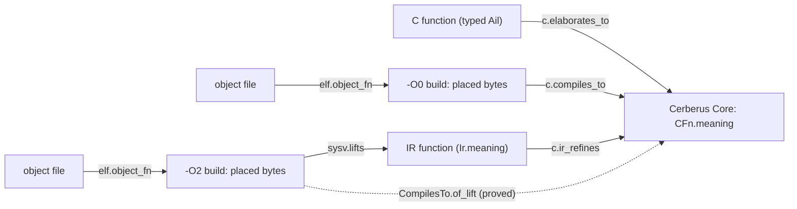

# Function-by-function System V translation validation

Standard silmaril problem shapes for checking compiled x86-64 code **one function at a time**
against its source, at the System V AMD64 boundary. Three kinds of correspondence connect at a
common interface: x86 to C, x86 to an IR (a lift), and IR to C. The composition is proved once:
x86 to IR and IR to C give x86 to C. One C function can have several builds (compilers,
optimization levels). Each build has its own rows, and all of them share the C side.



## The common interface: function meanings

A **meaning** of a function with C signature `sig` describes its behaviour at the System V
boundary (`Silmaril.Project.Shapes.SysV.Meaning`). The signature uses INTEGER-class scalars
from `Silmaril.X86.SystemV.CApi`. For an argument tuple `a`, the meaning says whether a call is
**safe** (no undefined behaviour, and it terminates) and which results the call may return.

```lean
structure Meaning (sig : Signature) where
  Safe : Arguments sig.arguments → Prop
  Returns : Arguments sig.arguments → ReturnValue sig.result → Prop

structure Meaning.Refines (lo hi : Meaning sig) : Prop where   -- lo refines hi
  safe : ∀ a, hi.Safe a → lo.Safe a
  returns : ∀ a, hi.Safe a → ∃ r, lo.Returns a r
  sound : ∀ a r, hi.Safe a → lo.Returns a r → hi.Returns a r
```

Meanings come from three places:

- **C** (`C.CFn.meaning`): the Cerberus meaning. It runs the Core procedure that the Lean port of
  Cerberus's elaborator gives for the function's typed Ail ([Cerberus guide](cerberus.md)).
- **An IR** (`SysV.Ir`): functions, each with a signature and a meaning. `SysV.SmallStep`
  builds an IR from a small-step semantics and its System V reading of arguments (`init`) and
  results (`final`).
- **A specification**: a meaning written by hand.

## The shapes

| id | Lean | statement |
| --- | --- | --- |
| `silmaril.shapes.sysv.implements` (`.open`, `.open9`, `.str9`) | `SysV.Implements M p sig frame spec` | (i) the function placed by `p` implements `spec` on the x86-64 model `M` |
| `silmaril.shapes.sysv.lifts` (`.open`, `.open9`, `.str9`) | `SysV.Lifts M p frame I f` | (ii) the IR function `f` is a lift of the placed function |
| `silmaril.shapes.c.ir_refines` | `C.IrRefines I f F` | (iii) the IR function `f` corresponds to the C function `F` |
| `silmaril.shapes.c.compiles_to` (`.open`, `.open9`, `.str9`) | `C.CompilesTo M p frame F` | (i) for a C source: the placed function implements `F`'s Cerberus meaning |
| `silmaril.shapes.c.compiles_to.builds` | `C.CompilesToBuilds M F builds` | every build of the list implements `F` |
| `silmaril.shapes.c.elaborates_to` | `C.ElaboratesTo ail name F` | the elaborator takes typed Ail `ail` to a file whose procedure `name` is `F` |
| `silmaril.shapes.elf.object_fn` | `SysV.ObjectFn obj fn code` | the ELF object `obj` defines the function `fn` with exactly the bytes `code`, with no relocation inside them |

The three main statements, in Lean:

```lean
def Implements (M : Model) (p : Placement) (sig : Signature) (frame : Nat)
    (spec : Meaning sig) : Prop :=
  Enterable M p sig frame ∧ spec.Inhabited ∧ ContractStrict M (sysvSpec p sig frame spec)

def Lifts (M : Model) (p : Placement) (frame : Nat) (I : Ir) (f : I.Fn) : Prop :=
  Implements M p (I.sig f) frame (I.meaning f) ∧ Faithful M p (I.sig f) frame (I.meaning f)

def IrRefines (I : Ir) (f : I.Fn) (F : CFn (I.sig f)) : Prop :=
  (I.meaning f).Refines F.meaning ∧ F.meaning.Inhabited

theorem CompilesTo.of_lift (hlift : Lifts M p frame I f) (hc : IrRefines I f F) :
    CompilesTo M p frame F                                    -- (iv), proved
```

The definitions behind these statements:

- `sysvSpec p sig frame spec` is the System V function contract (`Silmaril.X86.FnContract.Spec`):
  - **entry:** a `CallEntry`, with arguments on which `spec` is safe;
  - **footprint:** the `frame` bytes below the entry `rsp`;
  - **post:** the value in `rax` is a result `spec` may return for those arguments.
- `CallEntry` gives the function what a caller gives a System V callee: the code loaded, `rip`
  at the entry, the arguments in their registers and stack slots, room for the frame, and the
  frame and the return address readable and writable and apart from the code.
  `FnContract.AbiEntry` adds `rsp ≡ 8 (mod 16)` and the return address.
- `ContractStrict` (`Spec.Strict`) reads the result at the function's **first** return, not at
  some later state of the caller.

## Why the rows mean what they say

- **Undefined behaviour is explicit.** A call is constrained only on arguments where the
  source is safe. Source undefined behaviour therefore permits any machine behaviour. A source
  that may diverge is not covered, because safety includes termination.
- **Non-vacuity.**
  - `Implements` asks for `Enterable`: for every argument tuple, some live System V entry state
    exists. This is a property of the placement alone.
  - It also asks for `spec.Inhabited`: the source is safe on some tuple.
  - A spec with an unsatisfiable entry fills the plain contract shape `x86.contract`, but it
    does not fill `Implements` (`Implements.not_of_never_safe`).
  - `IrRefines` asks that the C function is safe somewhere.
  - `Lifts` asks that the IR be **faithful**: safe wherever the machine returns. An IR that is
    undefined on all but one input therefore does not count as a lift.
- **True for a correct compilation.** The hypotheses are what a real caller provides, the
  footprint is the stack frame, and the result is read at the first return.
  `Implements.abiFn` shows that an `Implements` row is a row of the existing
  `x86.abi_function` shape for its contract.
- **The bytes are the artifact's.** A placement's code is a literal. `elf.object_fn` ties it
  to a registered object file through the public ELF object reader. `ObjectFn.of_blob` proves
  that with one kernel run of the fast reader (`decide +kernel`), not by a tool's word.

## Same source, several builds

A row group is one source function and its builds:

- **The source side** is a `C.CFn sig`: the Core file, the parameters and the body.
- **Each build** is a `C.Build`: a configuration string such as `gcc 14.2.0 -O2`, the
  placement and the frame.
- **Rows per source function:** `c.elaborates_to` once, and `c.ir_refines` once per IR function.
- **Rows per build:** `elf.object_fn`, then either `c.compiles_to` directly or `sysv.lifts` to
  that build's IR.
- **The whole group:** `c.compiles_to.builds` is the statement for all builds.
  `CompilesToBuilds.of_lifts` proves it from per-build lifts and correspondences.

## IRs available now

- `SysV.bir9`: Bir9 blocks (`Silmaril.X86.Bir9.Block`, the public symbolic block IR of lifted
  x86 code) as leaf functions of one block. `Silmaril.X86.Bir9.liftBlock` lifts a listing, and
  `liftBlock_sound` proves the lift.
- `SysV.SmallStep.toIr`: any IR with a small-step semantics.
- `SysV.rtl R` and `SysV.rtlSSA R` (`Silmaril.Project.Shapes.SysV.Rtl`): functions of the machine RTL
  (`Silmaril.Machine.RTL.Prog`) and of its SSA form (`Silmaril.Machine.RTL.SSA.Prog`, with block
  arguments and decided well-formedness), each run by its own small-step semantics. The System V
  reading: arguments as zero-extended 64-bit words (`argWords`), the result as the one returned
  word (`ResultIs`). Safe means the run returns from every initial memory; a result is what
  some run returns.
- **Not yet:** the flat λRTL CFG (`Silmaril.SSA.LambdaRTL.CFG`) is stated over abstract operator
  models, and its lowering to `Lir` functions with a simulation against `Lir` execution is still
  open, so it has no System V reading yet. λSSA is reached from SSA-form RTL through
  `toLambdaSSA` once a word model of λSSA is fixed.

## Worked example

`examples/sysv-tv/` registers one C function, `int max2(int a, int b)`, at two optimization levels:

- **Sources and builds:** `max2/max2.c` and `max2/{O0,O2}/max2.o`. They were compiled with
  gcc 14.2.0 in a container pinned by digest (`max2/build.sh`). The objects reproduce bit for
  bit (`max2/RECEIPTS.sha256`), and the three files are artifacts in
  `silmaril/artifacts.toml`.
- **The module:** `SysVTvExample.lean` (library `SysVTvExample`) quotes the typed Ail that the
  Lean frontend gives. It checks that output by compiled evaluation (`#guard`), extracts the
  Core (`cfn`), lifts the `-O2` code to a Bir9 block, and registers these rows:

| row | shape | verdict |
| --- | --- | --- |
| `silmaril.sysv_tv.max2.{o0,o2}_obj_value.parses` | the objects read as bytes | proved |
| `silmaril.sysv_tv.max2.o0.code`, `….o2.code` | `elf.object_fn` | proved (kernel) |
| `silmaril.sysv_tv.max2.elaborates` | `c.elaborates_to` | open (`Task.elaborates`). The elaborator's output is proved (`elab_ok`, by `cbv`); the procedure's shape is checked by `#guard` |
| `silmaril.sysv_tv.max2.o0.compiles_to` | `c.compiles_to.open9` | open (`Task.o0_compiles_to`) |
| `silmaril.sysv_tv.max2.o2.lifts` | `sysv.lifts.open9`, IR `bir9` | open (`Task.o2_lifts`) |
| `silmaril.sysv_tv.max2.o2.ir_refines` | `c.ir_refines` | open (`Task.o2_ir_refines`) |
| `silmaril.sysv_tv.max2.o2.compiles_to` | `c.compiles_to.open9` | proved from the two rows above (`o2_compiles_to_of`), so open while they are |
| `silmaril.sysv_tv.max2.builds` | `c.compiles_to.builds` | proved from the per-build rows (`builds_of`, `builds_of_tasks`), so open while they are |

`SysVTvRtl.lean` adds the RTL and SSA-form RTL lifts of `max2` (written by hand and run on sample
arguments by `#guard`): the rows `….{o0,o2}.lifts_rtl` and `….o2.lifts_ssa` (`sysv.lifts.open9`)
and `….rtl.ir_refines`, `….ssa.ir_refines` (`c.ir_refines`) are open (`Task`); one RTL
correspondence serves both builds (`builds_of_rtl`), and the `-O2` row also follows from the SSA
route (`o2_compiles_to_of_ssa`).

The group `silmaril.sysv_tv.max2` of `silmaril/selftest.toml` collects these rows, and
`sil project lint`, `dump` and `check` accept them. The project self-test
(`make project-check`) runs all three.

## Status

| | |
| --- | --- |
| **Proved** | `Meaning.Refines.{refl,trans}`, `sysvSpec_sub`, `strict_mono`, `Implements.of_refines`, `Lifts.implements_of_refines`, `C.CompilesTo.of_lift` (the composition), `C.CompilesToBuilds.of_lifts`, `Implements.abiFn`, `Implements.not_of_never_safe`, `ObjectFn.of_blob`, `Enterable.of_fits` (every placement that fits is enterable for signatures with up to six INTEGER arguments, by an explicit witness state); the generic cut-point simulation `Silmaril.Compiler.CompilesTo.Sim` with `Corr.whole_of_segments` |
| **Trusted definitions** | The x86 model (`Open9.isa` and the others; see [x86](../x86.md)). The System V reading of arguments and results (`Silmaril.X86.SystemV`). The Cerberus port and its Core dynamics. The meaning of a construct the port does not support is "unsafe" (it permits anything). |
| **Checked by compiled evaluation only** | C text to typed Ail (the frontend's typing pass is `partial`) |
| **Open** | The example's `compiles_to`, `lifts` and `ir_refines` rows (their `Enterable` conjuncts are proved: `o0_enterable`, `o2_enterable`). `Enterable` for signatures with stack arguments (more than six). The relation of `C.CompilesTo` to segment-level simulations built on `Sim`. |

**Profile:** INTEGER-class scalar arguments and results. The Core meaning additionally takes
`int` parameters (the objects of the verified Core library). The function writes only its stack
frame and makes no calls. Functions that write caller memory, read globals or call other
functions need a meaning with a memory footprint, and this release does not cover them.

## Build

```sh
lake build --wfail Silmaril.Project.Shapes.SysV.Thms Silmaril.Project.Shapes.C.Thms SysVTvExample
make project-tool && make project-check     # sil project lint, dump, check, sqlite, explore
```

## Provenance

The generic cut-point simulation (`Silmaril.Compiler.CompilesTo.Sim`) and the C function data
(`CFn`, `ElabAil`, `ElaboratesTo`) follow an earlier design for statements of the form "this C
compiles to this x86 code". The shapes are new. The C side uses the Lean port of
Cerberus ([Cerberus guide](cerberus.md), `NOTICES/Cerberus`). The example's objects are gcc
output for the example's own source, built from the `gcc:14.2.0` image pinned in `build.sh`.
They contain no library code (`-ffreestanding`, no linking).
