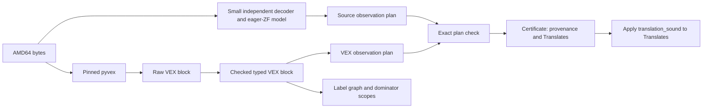

# AMD64Scalar: a checked x86-64 to VEX slice

`AMD64Scalar` validates one direct-control-flow block at a time, observing
`RAX`, `RDI`, `RSI`, `ZF`, and the selected successor `RIP`. Four real LibVEX
lifts from locally assembled x86-64 machine bytes pass. This is not an angr
CFG recovery implementation, a full x86 semantics, or a verified lifter.

## Artifact relation and checker

[`Translation.Relation`](../../Silmaril/Machine/Translation/Defs.lean) is
`Src → Tgt → Prop`; it mentions neither a checker nor a semantics.
It inherits Mathlib's pointwise complete lattice: `R ≤ S` means every pair
in `R` is in `S`, joins are unions, and meets are intersections. This orders
sets of **artifact pairs**, not possible behaviours of a fixed program.
[`Translates pc`](../../Silmaril/Machine/Vex/Validate/Defs.lean) relates a
decoded x86 block and a checked VEX block when the target has that entry
address, the instruction markers agree, and their residual plan syntax
matches exactly. The plans are a syntactic witness, not assumptions about the
results of either evaluator. This relation may miss equivalent lifts written
with different residual plans.

`validate` decodes the bytes and checks the raw VEX, then tests those three
conditions. `validate_certifies` derives a `Certificate` from success: the
certificate records the decode and type-check provenance and a proof of
`Translates`. It is not a semantic soundness theorem.



## What is interpreted

| Layer | Scope |
| --- | --- |
| [`Scalar.Defs`](../../Silmaril/Machine/Vex/Scalar/Defs.lean) | An extensible untyped tree with raw guest offsets and operator names, plus tagged opaque nodes for unsupported extensions. `check` recognizes `IMark`, `WrTmp`, `Get`, `Put`, `I1`/`I64` literals and temporaries, `Add64`, `CmpEQ64`, `1Uto64`, `64to1`, one optional **final** `Exit` and a constant `NEXT`; both edges must be `Ijk_Boring` and commit to the AMD64 RIP slot. |
| [`Execution.Defs`](../../Silmaril/Machine/Vex/Execution/Defs.lean) | Ordered guest-register writes and lexical temp snapshots; `IMark` is metadata. The shared functional `RegisterFile` stores VEX guest slots. `Block.lower` produces a separate first-order `Plan` over entry values, without VEX offsets, temp IDs, or lazy flags. Running the program instantiates and evaluates that plan; inter-block fetch is not part of the model. |
| [`X86.Defs`](../../Silmaril/Machine/Vex/X86/Defs.lean) | Exact encodings `48 89 f8` (MOV), `48 01 f0` (ADD), `48 39 f7` (CMP), and `eb`, `74`, `75` followed by a signed byte (JMP, JE, JNE). The decoder rejects trailing bytes after the terminator. The evaluator does concrete modular arithmetic and updates ZF eagerly; it does not use VEX operations, statements, or flag recipes. This decoder does not replace the [general x86 models](x86.md). |

Checking requires declared temp types, single assignment, and bind-before-use.
Typed expressions carry a width index and a scoped reference; erasure preserves
names and types in the untyped form. `check_word_erase` proves the literal
round-trip for all words and scopes; the replay tests compare re-erased blocks
against the four original untyped trees. There is no general VEX AST round-trip
claim. The exporter maps the pinned API fields without optimizing or rewriting
the lift. It fails on unknown object forms; the raw AST's opaque nodes are an
explicit extension point, not a semantics for arbitrary VEX.

VEX starts with a `COPY` thunk (`CC_OP = 0`, input ZF in bit 6 of `CC_DEP1`, other thunk
words zero). On exit the observer recognizes `COPY`, `ADDQ` (`4`: sum equals
zero), and `SUBQ` (`8`: operands equal) for ZF only. An unrecognized or
nonliteral recipe is a static observation rejection. `Term.selectBit_sound`
justifies the small bit-projection normalizations; `X86.Block.lower_sound`
connects the source residualizer to the concrete eager source model.

## Soundness under chosen semantics

[`Translation.Sound`](../../Silmaril/Machine/Translation/Soundness/Defs.lean)
takes an artifact relation, refinement direction and mode, source and target
semantics, an entry-state relation, and an observation relation on outcomes.
The returned-payload part can express both a final-state relation and
agreement on observable values. The theorem [`translation_sound`](../../Silmaril/Machine/Vex/Validate/Thms.lean)
instantiates it for **any** pair satisfying `Translates pc`, without a checker
or certificate premise. The entry states must agree at `pc`; returned states
must agree on successor RIP (the final-state relation) and on RAX, RDI, RSI,
and ZF (the observation).

The chosen direction is **target refines source** in strict mode: on related
entries with a safe source, every target behaviour must match a source
behaviour under the observation relation. With identity observation this is
target-set inclusion in the source set. The existing `Behaviour.Refines`
`Safe` guard means a source state with a possible `.undefined` behaviour
imposes no obligation; target UB cannot match a safe source. Strict mode does
not conflate faults, traps, exhaustion, or divergence with one another or with
returns. Decode, type-check and validation errors are not behaviours. An
unsupported observation also produces no admitted behaviour, not UB. This
could make inclusion vacuous in general; here `translation_runs` and
`translation_beh` prove that at **every** related entry the actual VEX
evaluator returns the same projected state as the source, and the source
always returns (`boundary_beh`).

This is a model of admitted scalar instruction effects, not an execution
claim for a loaded executable. No memory, fetch/permission or canonical-address
checks, other flags, partial registers, helper calls, indirect jumps, or
instruction-level traps are modeled. Infinite execution would require
composing blocks and defining traces; a branch to the same address is still
one boundary result here. There is no general LibVEX correctness result;
the MOV/JMP result below is the only checked bridge to Silmaril's x86 model.

## Largest sound relation

Fix the semantics, direction, mode, and state and observation relations.
`Translation.largestSound` contains exactly the artifact pairs that satisfy
the resulting pairwise refinement obligation.
[`sound_iff_le_largestSound`](../../Silmaril/Machine/Translation/Soundness/Thms.lean)
characterizes sound relations as the lower interval below that bound. The
bound itself is sound, and arbitrary joins of sound relations are sound.
These joins combine artifact pairs; they do not change behaviour sets, the
direction of refinement, or the UB policy.

For AMD64Scalar, `translates_le_largestSoundAt` puts the syntactic relation
below the semantic bound at the common entry PC. `validate_in_largestSoundAt`
composes this inclusion with the checker certificate. The bound is a
specification, not a decision procedure or a guarantee of progress. It need
not check markers or exact plans; it can also admit a stuck target because the
refinement obligation only constrains existing target behaviours. Checked
pairs get the stronger return guarantee from `translation_beh`.

## Flat CFG and lexical scoping

[`CFG.Defs`](../../Silmaril/Machine/Vex/CFG/Defs.lean) indexes labeled checked
blocks in a shared `Machine.Graph.Digraph`. Its reachability analysis follows
both edges without deciding guards. `CFG.scope` accepts a nonempty reachable
array in forward topological order with unique labels, resolved internal
edges and separately declared external labels. It uses the existing immediate
dominator tree, keeps each original block intact, binds child labels in the
parent region and its descendants, and checks every target against the visible
labels. The converter also checks that flattening covers each input index
exactly once. Flattening is tree preorder, not necessarily input order.

The synthetic diamond regression puts a join that neither arm dominates in
their common dominator's scope; the registers carry values across edges while
VEX temporaries stay local. This implements lexical control scoping in the
style of [λRTL](ssa.md), not a lowering to its `Region` syntax or an SSA φ-node
construction. A backward edge (including a self-loop) is rejected before
scoping. This treats reducible loops, irreducible graphs, and even unsorted
DAGs uniformly as outside this converter; it is not a reducibility test. No
whole-CFG semantic preservation theorem is claimed.

### Abstract call edges and Region/BB overlap

The scalar `CFG.scope` above still handles only `Ijk_Boring` blocks. The
independent [call-edge CFG](../../Silmaril/Machine/Vex/CFG/CallEdges/Defs.lean)
extends the existing [`FlatCFG`](region-trees.md#cfg-adjacency-and-precise-converse-bounds)
with a direct call site and optional caller-local continuation per block.
It distinguishes ordinary intraprocedural/boundary flow, caller-to-callee
edges, and caller-to-continuation *fake returns*. A fake return records a
candidate continuation, not a dynamic return, as in the distinction made by
[angr CFG recovery](https://docs.angr.io/en/latest/analyses/cfg.html).

The partition assigns each block at most one owner. A call is internal if
its target is owned anywhere in the program (including recursion), and
well-formed internal calls target the owner's declared entry. External calls
must target an explicitly declared, unowned label. Well-formedness also
checks ownership of the caller and continuation, closure of ordinary flow
to function blocks or declared unowned exits, and that a call terminator has
no competing ordinary edges.

[`flatFilling` and `callFilling`](../../Silmaril/Machine/Vex/CFG/Rows/Defs.lean)
instantiate the same `Semantics.Region.Abstract.SegmentRegionModel` shape.
Segments are block labels, supports are sets of labels, and boundaries are
tagged edge destinations. `BB` uses singleton support; `Reg` accepts a
declared support. Both record structural boundaries, not dynamically
reachable exits. A call is always a region departure (even for recursion);
ordinary and fake-return edges appear at the boundary only if they leave
the support. Call sites and edge origins remain in the CFG image.

[`commonReg_iff` and `commonBB_iff`](../../Silmaril/Machine/Vex/CFG/Rows/Thms.lean)
prove exact overlap for well-formed graphs without external calls: a call
row has an ordinary witness whose embedding reconstructs the **entire** graph
if and only if the call row holds and the function has no internal calls.
The ordinary projection alone is lossy and cannot establish this result.
The [synthetic examples](../../Silmaril/Machine/Vex/CFG/Examples/Thms.lean)
check a common row, an internal call and its fake return with no ordinary
preimage, and a declared external call showing why the restriction matters.
External-call summaries, actual return edges, indirect and tail calls,
angr graph import, and concrete x86 call semantics are not included.

## Bridge to the existing x86 machine

[`MovJump.Thms`](../../Silmaril/Machine/Vex/X86/MovJump/Thms.lean) covers
`MOV rax,rdi; JMP rel8` at a parameterized base and signed displacement.
It checks the same bytes with both decoders. The real side is the existing
`Machine.Region.X86.system`, running `X86.Ext.step` over `MState` with actual
`Process.Memory`. `Region.decode?_fetch` uses execute permission and backing
bytes; `system_retire` connects a decoded non-RET instruction and its actual
`Ext.exec` result to retirement. The scalar side has separate executable
steps. Its entry is the MOV address; the cut ends at the first jump out of
the two instruction starts. Assumptions are a nonwrapping five-byte code
interval, loaded executable bytes and a target outside the cut. A jump back
into the cut fails the guard; unmapped bytes can produce a real fetch fault
and do not satisfy the loading relation. Neither case is treated as UB.

`Fragment.full_exit` guarantees a unique normal full-machine exit for every
related initial state. It rules out stuck states, non-retirement outcomes
(including fetch/data faults and traps), and divergence **inside the cut**.
This adapter has no events, so the exiting trace is empty. It does not check
the target's next fetch, denote an ABI return, or prove process termination.
`Fragment.lift_postcondition` transfers a scalar postcondition to every full
first exit after projection: RAX, RDI, RSI, RIP and ZF (either Boolean
completion if undefined; neither instruction reads it). Code loading also
holds at the exit; the observation statement is not a frame for memory or
other registers and flags. `Fragment.region_sound` proves the exit label
in the existing Region judgment. `Fragment.validated_exit` composes the
already-checked artifact certificate and scalar translation theorem with
the real-model bridge. The [fixture theorem](../../Silmaril/Machine/Vex/X86/MovJump/Examples.lean)
constructs executable backing via `Region.load`, and checks the real lift
for `$RDI = 42` and undefined ZF. This is one of the four pyvex fixtures;
the other three still have only scalar-to-VEX validation.

[`Realizes`](../../Silmaril/Semantics/Region/Simulation/Defs.lean) separates a
state relation from step realization, using literal label and event
agreement. Relation composition (`Realizes.comp`) composes state/projection
and step obligations; the existing `X86.Model.Sem.Hom.comp` instead composes
functional maps. The stackable interface has three separate premises and
conclusions:

1. Prove `NoUB` for **all** admitted simple executions: no classified UB event
   on any reachable edge (including the first exit edge), and no classified UB
   halt at any reachable in-cut state. This covers prefixes of infinite runs.
   Region's partial `wp` can discharge the halt obligation; the event obligation
   is separate. Non-UB alone does not exclude stuckness, a non-UB fault, or divergence.
2. Prove a simple `TotalHoare` contract: normal exits meet the postcondition,
   only UB halts are allowed, and `Finishes` establishes progress and internal
   termination. Together with non-UB and admission inside support, this forces
   a normal exit. It does not assume a successful test run.
3. `Realizes.transferContract` gives the full system its own non-UB proof and
   total contract for the next layer. Under a determinate full system and related
   entries, every full first exit refines a simple first exit with the same trace
   and labels and related endpoints (`RefinesExits`, which composes). No full halt
   or stuck state is reached and no infinite in-cut execution is possible.

For MOV/JMP, `entryWP_iff` reduces the guarded entry WP to the scalar block
postcondition, `wp_noUB` and `wp_contract` supply the distinct premises, and
`transfer_wp` proves the projected contract on the existing `Ext` model.
The full admission predicate is arbitrary: it supplies the projection's WP
and proves `LoadedIn` through the memory API; the theorem does not require
memory constructed by `Region.load` or any particular image representation.
The real pyvex fixture uses this transfer for its output assertion. An unmodeled
step contributes no witness; the theorem does not use UB to hide that gap.
This model-morphism structure is distinct from both artifact relation inclusion
and the behavior/refinement lattice with its UB policy. No joins or meets of
models are claimed.

The proofs name their roots. `translation_sound` relates scalar `sourceSem`
to VEX `targetSem` for one artifact pair. The ISA-independent WP/contract
transfer is instantiated from `Fragment.simple` to `Machine.Region.X86.system
ret`, the existing `Ext.step` adapter. For accepted MOV/JMP bytes,
`validated_beh` combines the two bridges at a fixed admitted initial state:
the x86 root has a unique normal first exit and the VEX root has exactly the
corresponding projected return. Both guarantees quantify over the executions
of the named root, not an intersection of possible behaviors from different
reference models. A property of such an intersection would not, by itself,
prove that property for every execution of either root.

To link regions, use `Wiring`/`FamilyWiring` in the existing Region API:
prove destination entry and admitted state (including loading and any
invariants) for each actual cross-edge, route remaining departures to the
outward allowance, and establish support compatibility and common execution,
environment and call interfaces. This theorem does not discharge those
obligations. The structural call-edge model still uses `FlatCFG` and
`Machine.Graph.Digraph`; no `GraphLike` API was found in this checkout.
Linked calls/returns, syscall or OS contracts, and multithreading are deferred.

The existing Compiler Explorer kernel evidence exporter can audit the fixture,
Region theorem and named-root agreement without changing the tool or UI.
This manifest is for the exporter only; no dashboard obligation template or Godbolt
decompiler path was added (the existing block path does not accept jumps).

```sh
lake build --wfail Silmaril.Machine.Vex.X86.MovJump.Examples cexplorer-export
lake env .lake/build/bin/cexplorer-export scripts/vex/cexplorer-mov.json /tmp/vex-mov-evidence.json
```

## Observation boundary and containers

[`FirstExit.toTraceRuns`](../../Silmaril/Machine/Region/Trace/Thms.lean) embeds a
Region first exit in the existing `Machine.Trace.Runs`, keeping both endpoints
and the whole event list formed by concatenating step batches in order.
`Realizes.RefinesExits.matchTraceRuns` gives both executions in this interface:
each admitted full first exit has a simple first exit with the same trace and
related endpoints. This is not `Machine.Trace.Refines`, whose premise matches
every implementation transition. A synthetic regression exercises nonempty
event batches. The real MOV/JMP regression exercises `Runs` at the `Ext.step`
root alongside VEX's projected return; the adapter has event type `Empty`.
Neither the state projection nor the empty trace proves OS event agreement.

For process observations, reuse the existing
[`Containers.Lps.lps` adapter](../../Silmaril/Containers/Lps/Defs.lean), which
steps `Process.LPS`, **not** `Ext.step`. `mapEvs` projects supported standard
stream batches, `Step` buffers and emits them, and `Final` accounts for process
stops separately. A fragment's first exit is not a process `.exited` stop
or [`Obs.stop`](../../Silmaril/Containers/Check/Defs.lean). The
[container behaviour API](containers.md) distinguishes `TraceRefines`
(inclusion of event prefixes) from `Model.Refines` (inclusion of whole
behaviours, including stops, blocking and silent or reactive infinite runs).

An eventful extension needs a cut simulation against LPS with explicit
loading, environment and admissibility assumptions, then preservation of
its event batches through the existing mapper and buffer, including a proof
that the emitted events are supported. Linking needs the Region wiring
obligations above. Whole-container refinement would also need to account for
stops/faults/UB, blocking, silent and reactive divergence, and any admitted
clone steps. The current theorem discharges none of these process-level
obligations and is not a container or monitor contract.

## Replay

The [fixture report](../../examples/vex/lifts.md) has bytes, independent GNU
disassembly, original IRSB output and SHA-256 digests. Each fixture is a raw
`.text` section, lifted at `0x1000` with optimization level 1; successors are
boundary addresses, not a linked executable to run. The tested replay is
Linux x86-64, Python 3.13.5, GNU binutils 2.44. The lock file pins the wheels by
SHA-256. No Python dependency is needed for the checked-in Lean regression.

```sh
python3.13 -m venv /tmp/silmaril-vex
/tmp/silmaril-vex/bin/pip install --only-binary=:all: --require-hashes -r scripts/vex/requirements.txt
/tmp/silmaril-vex/bin/python scripts/vex/export.py --check
lake build --wfail Silmaril.Machine.Vex.Examples.Thms Silmaril.Machine.Vex.CFG.Examples.Thms Silmaril.Machine.Vex.X86.MovJump.Examples Silmaril.Semantics.Region.Simulation.Examples Silmaril.Machine.Region.Trace.Examples
make check CHECK_TARGETS='Silmaril.Machine.Vex.Examples.Thms Silmaril.Machine.Vex.CFG.Examples.Thms Silmaril.Machine.Vex.X86.MovJump.Examples Silmaril.Semantics.Region.Simulation.Examples Silmaril.Machine.Region.Trace.Examples'
```

MOV/JMP tests check preservation of both incoming ZF values; ADD checks
wraparound and resulting ZF; CMP/JE and CMP/JNE test both edges. Swapped lifts,
altered successors/markers, trailing bytes and unsupported flag recipes are
rejected. The malformed VEX and multi-block graph tests are synthetic. For all
four real lifts, the [regressions](../../Silmaril/Machine/Vex/Examples/Thms.lean)
also check membership in `largestSoundAt` via certification and soundness,
as well as the returned-behaviour guarantee. They build under the existing
`Silmaril` target and print the main theorem axiom sets (only the standard
allowed axioms).

Next: give a versioned structured interchange for larger pyvex/angr exports,
extend real-model agreement to ADD/CMP and conditional exits, and validate
recovered edges against executable image layouts. Add data memory and fault
observations, more flag recipes, and a loop-aware scoping validator with a
preservation theorem.

## Upstream references

- [angr's IR guide](https://docs.angr.io/en/latest/advanced-topics/ir.html)
- [pyvex 9.2.179](https://github.com/angr/pyvex/tree/db7fd67c135c9b4394e0605bc0f8f517bde06578)
  and [archinfo 9.2.179](https://github.com/angr/archinfo/tree/54495fe429ee595550d5ddc6619d348e45bfbe64)
- Pinned LibVEX: [IR header](https://github.com/angr/vex/blob/421bf0d9ec800df09fe4f8d90a8c13a0c63325e3/pub/libvex_ir.h),
  [AMD64 guest layout](https://github.com/angr/vex/blob/421bf0d9ec800df09fe4f8d90a8c13a0c63325e3/pub/libvex_guest_amd64.h),
  [AMD64 flag encodings](https://github.com/angr/vex/blob/421bf0d9ec800df09fe4f8d90a8c13a0c63325e3/priv/guest_amd64_defs.h),
  and [flag helper semantics](https://github.com/angr/vex/blob/421bf0d9ec800df09fe4f8d90a8c13a0c63325e3/priv/guest_amd64_helpers.c)
