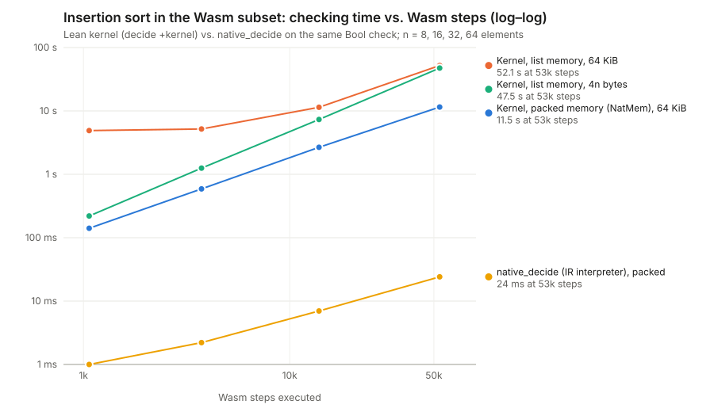

# Evaluating Wasm in Lean's kernel

This note covers how cheaply Lean's kernel can run WebAssembly code. It describes what this
repository already does, introduces a small prototype with measurements, and records what
the measurements suggest. It reports measured costs and their limits. It does **not**
claim kernel support for full Wasm.

- **Prototype:** `Silmaril.Wasm.KernelEval` (`Defs`, `Thms`, `Examples`, `Tests`), with
  proofs in `Silmaril.Proofs.Wasm.KernelEval.Basic`. It uses only Lean core and needs no
  Mathlib.
- **Benchmarks:** [`benchmarks/wasm-kernel-eval`](../../benchmarks/wasm-kernel-eval).
- **Results:** [`docs/benchmarks/wasm-kernel-eval-2026-11-12.json`](../benchmarks/wasm-kernel-eval-2026-11-12.json),
  with the [chart](../benchmarks/wasm-kernel-eval-2026-11-12.svg).

```sh
lake build --wfail Silmaril.Wasm.KernelEval.Tests        # proofs and kernel tests, a few seconds
python3 -I benchmarks/wasm-kernel-eval/bench.py           # kernel matrix (about 6 min)
python3 -I benchmarks/wasm-kernel-eval/bench.py --native --tactic native   # native_decide cases, scratch files only
python3 -I benchmarks/wasm-kernel-eval/opcode_census.py tools/wasm-tools/tests/corpus/{cat,echo,hello}.wasm
```

## Summary

- **Per-step cost.** The kernel performs about **5,000 Wasm steps per second**
  (170–215 µs per step) on this machine. Compiled evaluation of the same `Bool` check with
  `native_decide` runs in the IR interpreter, which is about **500× faster** (about 0.4 µs
  per step). Kernel time is linear in the number of steps, provided memory is represented
  well.
- **Memory representation matters most.** With a list of bytes, a 64 KiB page costs seconds
  before any work is done. The prototype's `NatMem` stores all of memory in one natural
  number and reads and writes it with GMP-accelerated `>>>`, `%`, `-` and `+`. Its cost does
  not depend on memory size: 141 ms for 1,066 steps with a 64 KiB page, against 4.9 s for a
  list. At 53k steps on a 256-byte memory it is still 4× faster than a list. A proof
  (`memSim_toNatMem`) shows that it computes the same results as the list reference.
- **Other rewrites matter far less.**

  | Rewrite | Effect |
  | --- | --- |
  | Driver as `Nat.rec` instead of the equation compiler | 8–13 % |
  | Dispatch on the instruction first, stack second | about 10 % |
  | `Nat` values instead of `BitVec 32` | no change |
  | Locals packed into a number | 40 % slower |

  The kernel's cost per step is overhead in reducing the interpreter's terms, not
  arithmetic.
- **`decide +kernel`, not `decide`.** Plain `decide` evaluates the goal in the elaborator
  first. That doubles the time up to 15k steps, and at 150k steps the elaborator stops
  before the kernel is reached.
- **A function for the kernel can break compiled code.** Compiled code recurses
  non-tail-recursively on the fuel of `Nat.rec`, so `native_decide` on the kernel-oriented
  `runRec` overflowed the stack. The fix is a proved `@[csimp]` lemma
  (`runRec_eq_run_csimp`): compiled code then runs `run` and the kernel runs `runRec`, and
  the proposition is the same.
- **Piecewise checking works.** Checkpoint configurations are found by compiled
  evaluation, which is untrusted. Each chunk `run k cᵢ = .running cᵢ₊₁` is then checked by
  the kernel and the chunks are composed with `run_add_of_running`.
  - The total kernel time equals the monolithic time: 11.5 s for 53k steps.
  - Each piece takes a bounded 0.6–0.9 s.
  - Pieces run as separate processes give a 1.6× speedup on this 2-core machine.
- **Subset coverage.** The subset covers **91 %** of static instruction occurrences in three
  Rust release WASI programs (`cat`, `echo`, `hello`; 32,903 instructions). Adding the next
  tier gives 98.8 %: calls, globals, signed and other comparisons, 16- and 64-bit memory
  accesses, `if` and `br_table`.



## What the repository already does

These measurements come from the source comments cited.

| Where | Technique | Recorded cost |
| --- | --- | --- |
| `Wasm/Verify/Kernel` | `kernel_rfl`. Byte lists with `List.rec` (`fload`, `fstore`) replace `ByteArray.extract`/`copySlice`. A structural driver `stepK` with depth fuel replaces the well-founded `step?`. | A store through `ByteArray` into one page takes "billions of kernel steps". `stepK` is "about 2× faster" on a 100-iteration loop. That benchmark directory is not in the repository. |
| `Wasm/Auto2/Kernel` | Lazy memory `writeL (List.replicate n 0) off seg`. `instK?` skips validation after one `validate?` proof. `bytesEqL`. | A 24-byte data segment into one page did not finish in 44 GB. Comparing one-page memories exceeded 20 GiB. Validation ran 18 times per certificate. |
| `Wasm/Auto/Bridge` | One kernel evaluation per chunk of exports. | Checking all 60 exports at once did not fit in 53 GB. |
| `Data/IncludeBytes`, ELF `Chunk.read`, `pages` | Files as 4 KiB `Nat` literals, read with `(n >>> 8k) % 2^(8w)`. | Decoding 64 KiB as one literal did not finish in 12 min. In chunks it takes under 20 s. |
| `wasm-check` (`wat3b!`) | Modules as terms, not binaries. | Decoding a 2 KB binary in the kernel exceeded 16–20 GB. |

`NatMem` applies the `IncludeBytes`/ELF technique to *mutable* Wasm memory.

## The prototype and its soundness boundary

`Silmaril.Wasm.KernelEval` is a **self-contained reference machine** for an i32 subset. It
is not Core 3.0.

- **Instructions:** `i32.const`, `local.get/set/tee`, `drop`, `select`,
  `add sub mul and or xor shl shr_u eq ne lt_u eqz`, `i32.load/store/load8_u/store8`,
  `block`, `loop`, `br`, `br_if`, `unreachable`.
- **Machine:** a small-step machine over code, operand stack, labels, locals and memory.
- **Results:** `.trap` is a Wasm trap. `.stuck` means ill-formed code, kept separate from
  traps. `.running` means the fuel ran out.

| Proved (no `sorry`, standard axioms) | Not proved / not claimed |
| --- | --- |
| `runRec_eq_run`, `runRec_eq_run_csimp`: the kernel and compiled drivers are the reference `run`. | That `run` agrees with `Execution.Core.Step`. The machine follows the Core rules for these instructions, but no simulation is proved. |
| `run_add`, `run_add_of_running`: runs compose, which makes piecewise checks sound. | Typing and validation: ill-formed code is `.stuck`, not excluded. |
| `step_mapMem`, `run_mapMem`: any memory simulation (`MemSim`) lifts to whole runs. | Calls, globals, i64, floats, `memory.grow`, tables, multi-value block parameters. |
| `memSim_toNatMem`, `returns_toNatMem`, `zeros_eq`: packed memory is the list memory. | The `native_decide` mode: it adds `Lean.ofReduceBool` and trusts the compiler, so it stays out of `Silmaril/`. |
| `run_of_returns`: what a `true` check means for the reference run. | |

`Tests.fillSort8_returns` shows the full path. It runs one `decide +kernel` on the packed
memory, transports the result with `returns_toNatMem` and `zeros_eq`, and concludes a
statement about the reference run over a 64 KiB list memory.

### Toward Core

The cheapest connection to Core reuses what exists. `Verify/Kernel` already proves
`runInvokeK = runInvoke?` and `runInvoke?_sound`, which connect to Core `Steps`. The next
step is a `MemSim`-style equality for its `Memory.Bytes`, mapping `fload` and `fstore` to
`NatMem.read` and `NatMem.write`. The lemmas `read_toNatMem` and `write_toNatMem` are
stated over `take`/`drop` splices and little-endian decoding, the form Core's
`Memory.load`/`Memory.store` take. With that lemma, the asymptotic memory win applies to
the verified Core interpreter without adding a second semantics.

## Measurements

**Setup:** 2-vCPU gVisor sandbox; Lean 4.37.0-nightly-2026-11-05. Times are the profiler's
kernel "type checking" time, from one run each.

**Programs:**

- `sumTo n`: a counting loop with 15n + 9 steps.
- `fillSort n`: fills memory with `n … 1`, insertion-sorts it, and returns
  `mem[0] + mem[n-1]`. It takes 1,066 / 3,734 / 13,870 / 53,342 steps for
  n = 8 / 16 / 32 / 64.

| Case | Steps | `decide +kernel` | Notes |
| --- | ---: | ---: | --- |
| `sumTo 100`, `runRec` | 1,509 | 0.21 s | `run`: 0.25 s. Plain `decide`: 0.21 s + 0.20 s in the elaborator. |
| `sumTo 1000`, `runRec` | 15,009 | 2.81 s | `run`: 3.06 s. Plain `decide`: 2.81 s + 2.22 s. |
| `sumTo 10000`, `runRec` | 150,009 | 29.6 s | `run`: 33.6 s. Plain `decide` **fails** in the elaborator after 7.4 s. |
| `fillSort 8`, NatMem 64 KiB | 1,066 | 0.14 s | List memory: 4 n bytes 0.22 s; 64 KiB 4.9 s. |
| `fillSort 16`, NatMem 64 KiB | 3,734 | 0.59 s | List memory: 1.25 s; 64 KiB 5.2 s. |
| `fillSort 32`, NatMem 64 KiB | 13,870 | 2.67 s | List memory: 7.3 s; 64 KiB 11.4 s. |
| `fillSort 64`, NatMem 64 KiB | 53,342 | 11.5 s | List memory: 47.5 s; 64 KiB 52.1 s. |
| `native_decide`, `fillSort 64` | 53,342 | 24 ms (IR interpreter) | `sumTo 10000`: 56 ms. `sumTo 10⁶` (15 M steps): 5.9 s. |

**One-off variants of `sumTo 1000`.** These were run in scratch copies of `Defs` that are
not kept.

| Variant | Kernel time |
| --- | ---: |
| Baseline | 2.77 s |
| `Nat` values | 2.82 s |
| Locals in a `NatMem` | 3.82 s |
| Instruction-first dispatch | 2.48 s |

**Chunked `fillSort 64`.** 11 pieces of 5,000 steps.

| How the pieces ran | Time |
| --- | ---: |
| One file | 11.5 s, as monolithic |
| 11 separate processes, serial | 36.0 s |
| 11 separate processes, 2 at a time | 22.9 s |

Process start-up dominates at this size. Each piece's kernel time is constant, so wider
machines scale.

## Two modes, one statement

The design: one executable `check : Input → Bool`, one soundness theorem
`check x = true → Spec x`, and two ways to establish `check x = true`.

| | Fast edge | Paranoid |
| --- | --- | --- |
| Tactic | `native_decide`, or compiled `#eval`/tool output | `decide +kernel`, `kernel_rfl` |
| Trust | Lean compiler and runtime, `Lean.ofReduceBool` | the kernel and the standard axioms |
| Where | Outside `Silmaril/`: a separate edge library, CI pre-screening, tools, or a `policy.toml` exception with a reason | `Silmaril/` on main |
| Speed here | about 0.4 µs per step (interpreter); faster when precompiled | about 200 µs per step |
| Implementation | `run` (tail recursive); `@[csimp]` routes kernel definitions to it | `runRec` and `NatMem` (kernel-shaped), proved equal |

The fast edge serves search: finding counterexamples, checkpoints, loop counts and
certificates. The paranoid mode replays what the edge found. Because both modes decide the
**same** proposition with **proved-equal** implementations, a fast result can be
re-established in the kernel without changing any statement. The kernel replay can be done
piecewise (`run_add_of_running`), in parallel modules, with bounded memory per piece.

## Bottlenecks and rewrites, ranked

1. **Memory as one GMP number** (`NatMem`). This is the asymptotic win; port it to
   `Verify/Kernel` as described above. For memories larger than about a megabyte, use pages
   of `NatMem`, as ELF does with `pages`. Each access then touches one 4 KiB or 64 KiB
   number.
2. **Never run the elaborator on the evaluation.** Use `decide +kernel` or `kernel_rfl`.
3. **Decide once, replay in pieces.** Proved `run_add` plus checkpoints keeps each kernel
   job small and parallel. This replaces one evaluation that does not fit in memory, the
   failure behind the 44–53 GB entries in the table above.
4. **Hoist invariant checks out of the evaluation.** `instK?` already does this for
   validation. The same applies to arity checks and decoding, done once per module rather
   than once per evaluation.
5. **Keep kernel and compiled implementations separate but equal.** Use `@[csimp]`
   (`runRec_eq_run_csimp`), never `implemented_by`.
6. **Smaller constant factors.** Recursor drivers and instruction-first dispatch each save
   about 10 %. A flat code representation is the next candidate: a program-counter-indexed
   instruction array with a precomputed branch side table, as wasm3 and Wizard use. It makes
   configurations tiny, which makes checkpoints cheap to print and compare. It needs a
   compilation-correctness proof against the structured machine. It has not been measured.

## Piecewise validation of parse and disassembly formats

Kernel decoding of binaries is the most expensive step measured in the repository: a 2 KB
binary exceeded 16–20 GB. The Wasm binary format is already a concatenation of
length-prefixed pieces: sections, then function bodies within the code section. A future
disassembly or parse format should expose that structure as a certificate rather than hide
it:

1. **The index is an untrusted certificate.** For each section, and each code entry, it
   lists the byte offset, the length, and the AST fragment the piece decodes to. A tool
   writes it; the kernel never searches.
2. **One splitting lemma, proved once.** Decoding the whole file equals the composition of
   decoding each slice, provided the length prefixes and offsets in the certificate are
   consistent. The lemma would be named `decode_of_pieces`, after `Check.parses_of_pages`
   for ELF. Checking the boundaries is a linear scan of LEB prefixes.
3. **Bytes in pages.** File bytes are `IncludeBytes`-style 4 KiB `Nat` literals, so the
   kernel reads a slice by shifts on one page.
4. **One kernel job per piece.** Each piece is checked as `decodeFunc slice = fragment`,
   with function-local validation (`validateFunc ctx fragment = true`) in the same job. Each
   job is small, independent, cacheable by the piece's hash and parallel across modules.
   Statements about one function import only that function's piece.
5. **Text formats.** WAT or a disassembly listing relates to the same per-function AST
   fragments through the same index, so the round trip `wasm-dis` → `wasm-as` can also be
   checked per function.

This is a proposal. No code for it is in this change.

## Scope of this change

- **New files only**, plus two glob entries in `lakefile.toml`. Nothing touches the core
  bytes/mode, ELF or LRAT work, or the existing `Verify/Kernel` and `Auto2/Kernel` modules.
- **`benchmarks/wasm-kernel-eval/KernelRfl.lean`** copies `kernel_rfl` from
  `Verify/Kernel`, so that benchmarks avoid a Mathlib closure. It is not part of the
  library.
