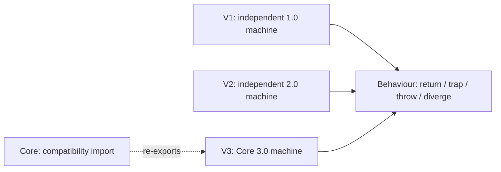

# Wasm execution semantics

Each version has a behaviour-set API: a configuration denotes the outcomes of
its finite and infinite reduction traces. The value types and instruction sets
are version-specific.

| Import under `Silmaril.Wasm.Behaviour.Semantics` | Declarations | Values | Outcomes |
|---|---|---|---|
| `V1` | `Silmaril.Wasm.V1.Execution` | Numeric values | Return, trap, divergence |
| `V2` | `Silmaril.Wasm.V2.Execution` | Numeric, vector and reference values | Return, trap, divergence |
| `V3` | `Silmaril.Wasm.Execution.Core` | Numeric, vector and reference values | Return, trap, escaping exception, divergence |

`Core` is a compatibility import for `V3`; existing qualified names continue to
work. In this execution namespace, **Core means WebAssembly Core 3.0**.

For each version:

- `behavioursOf` takes a configuration and a host relation. V2 and V3 also
  take a numerical profile.
- `behaviours` specializes it to function invocation.
- `mem_behavioursOf` introduces an outcome from a finite run;
  `diverges_mem_behavioursOf_iff` characterizes infinite traces.
- `exists_result_of_mem` recovers a finite run for an observed terminating
  outcome. `behavioursOf_mono_steps` transports outcomes backwards along a run.
- V1 and V2 prove that escaping exceptions cannot occur.

A **profile** specifies allowed numerical results and growth decisions. It can
retain multiple allowed outcomes. Neither fixing a profile nor selecting a
growth oracle asserts determinism of the whole reduction relation. A **host
relation** describes host-function outcomes, including divergence. The behaviour
API observes returned values, traps, escaping exceptions and divergence. The
optimizer has separate contracts for state-retaining call sessions; final stores
and host interaction traces need their own observations.

## What the V2 addition establishes

V2 has its own runtime, reduction and instantiation relations, using the shared
integer, floating-point, SIMD and memory libraries. Source citations refer to the pinned
[SpecTec 2.0 manifest](../../specs/wasm/core-2.0.json), which records the upstream
revision and individual source SHA256 hashes. The source-file comments describe
modelling choices in detail.

The release includes these choices relative to a literal reading of that pin:

| Area | Model choice |
|---|---|
| Evaluation contexts | Add instruction-sequence closure; allow the inner frame to change under a frame context. The corresponding 1.0/3.0 rules provide these forms. |
| Host calls | Add host-function instances and a host relation. Taking the host type to be `Empty` removes these calls. |
| Numerical results and growth | Parameterize allowed choices by a profile; `Profile.spec` retains specification growth nondeterminism. |
| Bulk memory/table loops | Use 32-bit wrapping index arithmetic. At the 4 GiB memory boundary this can finish a loop where the literal natural-number rule has no representable next index. |
| Data initialization | Accept any active memory index in `runData`; `DataOk.active_zero` proves valid 2.0 data segments use index zero. |
| Instantiation and invocation | State import matching/validity and argument typing explicitly, rather than relying on embedder preconditions. |

V2 supplies behaviour introduction, elimination, range and backwards-monotonicity
laws. Toolkit executables use the Core 3.0 models. V2 type soundness, cross-version
execution simulations and a V2 executable remain follow-up work. Existing
syntax/validation embeddings have their own statements and hypotheses.

## Reading the code

V2 and V3 expose definitions in `Semantics/V2/Defs.lean` and
`Semantics/V3/Defs.lean`, with theorem statements in their `Thms.lean` headers.
Longer proof bodies live under `Silmaril/Proofs/Wasm/Behaviour/Semantics`;
ordinary clients use the versioned imports in the table above.

- [V1 behaviours](../../Silmaril/Wasm/Behaviour/Semantics/V1.lean)
- [V2 behaviours](../../Silmaril/Wasm/Behaviour/Semantics/V2.lean),
  [runtime](../../Silmaril/Wasm/V2/Execution/Basic.lean),
  [reduction](../../Silmaril/Wasm/V2/Execution/Step.lean),
  [instantiation](../../Silmaril/Wasm/V2/Execution/Instantiation.lean)
- [V3 behaviours](../../Silmaril/Wasm/Behaviour/Semantics/V3.lean)
- [Shared observations](../../Silmaril/Wasm/Behaviour/Basic.lean)

The [compiler API guide](compilers.md) describes how additional semantic models
can connect to these observations.
