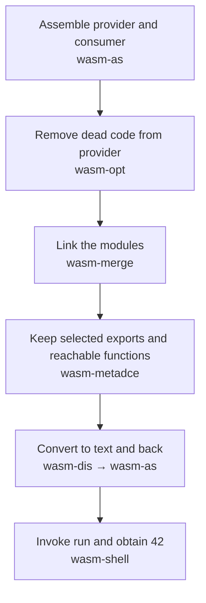
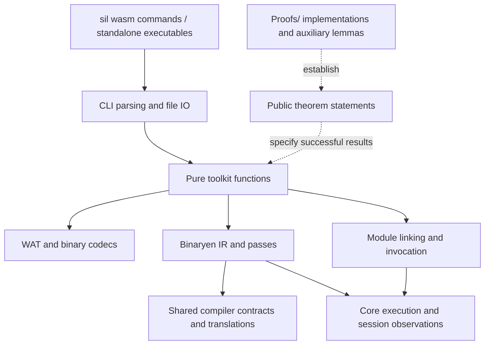

# WebAssembly (Wasm) toolkit

Seven tools written in Lean 4, a proof assistant, follow Binaryen version_133
command conventions. Each ships with executable code, formal contracts and
correctness theorems for supported operations.

## Build and check

Requirements:

- [elan](https://github.com/leanprover/elan), which installs the pinned Lean version;
- Git, GNU Make and a native C toolchain;
- Python 3.11+ and Node.js 24+.

From the repository root:

```sh
make cache
make check
```

This compiles the complete included library, tools and theorem modules, then
runs native checks, including independent execution in Node. It also builds
`wasm-shell-lean`, a positional test helper. Public dependencies are pinned;
no vendored source or paper downloads are needed.

`make tools` builds and stages the seven commands and the `sil` dispatcher under
`build/bin/`. Add that directory to `PATH`, or use `build/bin/sil wasm opt --help`.

## Try the example

```sh
python3 tools/binaryen-lean/test-release-demo.py
```

The test checks this pipeline and a second example that serializes a constructor's
global assignment and returns `9`:



<details>
<summary>Run each step and inspect the files</summary>

```sh
wasm_bin=build/bin
wasm_examples=tools/binaryen-lean/examples/release
wasm_demo=/tmp/wasm-demo
mkdir -p "$wasm_demo"

"$wasm_bin/wasm-as" "$wasm_examples/provider.wat" -o "$wasm_demo/provider.wasm"
"$wasm_bin/wasm-as" "$wasm_examples/consumer.wat" -o "$wasm_demo/consumer.wasm"
"$wasm_bin/wasm-opt" "$wasm_demo/provider.wasm" --dce -o "$wasm_demo/optimized.wasm"
"$wasm_bin/wasm-merge" "$wasm_demo/optimized.wasm" Provider "$wasm_demo/consumer.wasm" Consumer -o "$wasm_demo/linked.wasm"
"$wasm_bin/wasm-metadce" "$wasm_demo/linked.wasm" --graph-file "$wasm_examples/roots.json" -o "$wasm_demo/public.wasm"
"$wasm_bin/wasm-dis" "$wasm_demo/public.wasm" -o "$wasm_demo/public.wat"
"$wasm_bin/wasm-as" "$wasm_demo/public.wat" -o "$wasm_demo/rebuilt.wasm"
"$wasm_bin/wasm-shell" "$wasm_demo/rebuilt.wasm" --fuel 100 --invoke run
cat "$wasm_demo/public.wat"
```

The invocation prints `return [i32:42]`. The final module exports only `run`.
Merge arguments use Binaryen's `FILE NAME` order. The [graph file](../../tools/binaryen-lean/examples/release/roots.json)
marks `run` as an entry point, retaining it and the functions it needs.

</details>

To explore optimizer options:

```sh
build/bin/wasm-opt --print-passes
build/bin/wasm-opt --print-presets
build/bin/wasm-opt -O2 --print-pipeline
```

A **preset**, such as `-O2`, selects a list of passes (program transformations).
These commands list implemented transformations and missing upstream schedule entries.
Unsupported inputs and options produce errors.

## Tools and current scope

Each tool links to its main theorem module. The
[contract inventory](../../tools/binaryen-lean/release-manifest.json) lists the exact
functions, theorems, assumptions and restrictions.

| Tool | Supported operation | Main boundary |
| --- | --- | --- |
| [wasm-as](../../Silmaril/Wasm/Binaryen/Toolkit/AsBinaryenSound.lean) | Convert supported original WAT and documented Binaryen macros into a valid module with the same meaning. | Source and proposal coverage is incomplete. |
| [wasm-dis](../../Silmaril/Wasm/Binaryen/Toolkit/DisassembleLegacySound.lean) | Convert supported binaries into text denoting the same decoded module. | Does not validate input. Extension syntax proofs do not prove extension execution. Complete disassemble–assemble acceptance is unfinished. |
| [wasm-opt](../../Silmaril/Wasm/Binaryen/Exe/SelectedCleanupSound.lean) | Select and compose proven transformations, including restricted inlining and dead-code elimination. | Full upstream algorithms, presets and input coverage remain incomplete. |
| [wasm-merge](../../Silmaril/Wasm/Binaryen/Toolkit/PolicyMergeSound.lean) | Checked in-order function linking, export-name policies and supported silent starts; output behavior is included in source behavior. | General linking of stateful modules, cycles and metadata flags remains incomplete. |
| [wasm-shell](../../Silmaril/Wasm/Binaryen/Toolkit/ShellSpecSound.lean) | Initialize a binary module and invoke an export with a step budget. Successful results correspond to Core execution. | No imported hosts or upstream text test-script interface. Exhausting the budget is inconclusive. |
| [wasm-ctor-eval](../../Silmaril/Wasm/Binaryen/Toolkit/CtorEvalFallbackSound.lean) | Serialize one i32/i64 constant assignment in the recognized module shape. | Other decoded valid shapes retain the original bytes. |
| [wasm-metadce](../../Silmaril/Wasm/Binaryen/Toolkit/MetaDCEFallbackSound.lean) | Keep graph-selected exports and remove unreachable functions. | Closed numeric function-only optimization fragment; other decoded valid shapes retain the original bytes. |

This release targets Core-module files. The table above describes input and
optimization coverage for each tool.

## What the proofs mean

- Theorems cover successful **pure functions**: functions from inputs to results,
  without file input/output. Command-line parsing, file input/output and Lean's native compiler/runtime are
  outside those semantic theorems.
- Optimizer observations include initialization and **sessions**: sequences of
  exported-function calls that retain state between calls. Arbitrary external
  reads or writes of exported state need a separate contract.
- The execution contracts use a **closed host**, an environment with no host-function
  execution. Each API separately specifies its import-matching requirements.
- A **profile** describes implementation choices: floating-point NaN ("not a number")
  results, relaxed SIMD (vector operations with several permitted results), and
  whether memory or table growth can fail. It can allow several outcomes.

The optimizer defaults to **equivalence**: the same modeled initialization
circumstances and observable outcomes for the same call sequences, at the same
profile. Its explicit **refinement** mode restricts output outcomes to those allowed
by the input and preserves the existence of an outcome. **Trap insertion** permits
documented extra execution traps after matching earlier returned values; later calls
after that trap need not match. These policies have separate, restricted rewrites.
The merger proves behavior inclusion; outcome existence requires a separate
argument.

Terms used above:

- **WAT:** WebAssembly's readable module text.
- **Core module:** a unit of WebAssembly code. Imports request external definitions; exports make definitions available by name.
- **DCE:** dead-code elimination, which removes code that cannot affect the selected observations.
- **Silent start:** an initialization function checked to finish normally without changing persistent state.
- **Constructor:** initialization code; the evaluator supports its documented scalar assignment.
- **Trap:** a WebAssembly execution error, such as an out-of-bounds memory access.
- **Macro:** source shorthand expanded into supported Core syntax before validation.
- **Proof root:** a Lean module selected to build a tool's correctness theorems and their dependencies.

## Confidence in the Wasm semantics

This is a snapshot of evidence on `main` and on separate branches as of
2026-11-21. A theorem about one model or fragment is not a conformance claim
for the entire toolchain. The linked ledgers give the precise domains and open goals.

| Evidence on `main` | What is proved | What it does not establish |
| --- | --- | --- |
| [REF and IR byte reading](../../Silmaril/Wasi/Component/Accept/Ref/Bridge/Thms.lean), #709 (`532414bea`) | `bytesOf?_toRefVal`: the reference machine (REF) and the component IR read the same bytes from a converted value. | Agreement of acceptance languages or machine runs. |
| [Direct kernel memory run](../../Silmaril/Wasi/Component/Accept/Ref/Examples.lean), #707 (`bc74e4a5f`) | `hi_mem_direct`: the kernel evaluates a direct `ByteArray` run for the concrete `"hi!"` fixture. With the fixed `accept: func(list<u8>)` logging host, `core3 neverFail`, and the deterministic component choice profile `first.prof`, invoking `run` proves membership in `bytesSystemUntyped`. | This does not transfer a `KMem` evaluation, prove general acceptance, or establish equivalence of memory engines. |
| [Policy-parametric REF acceptance](../../Silmaril/Wasi/Component/Accept/Ref/Thms.lean), #802 (`feb9e3ce8`) | A successful finite `acceptRunWith` that records the bytes is sound for its `EnvPolicy` and the oracle's profile. For bytes that `decodeValid` accepts, the default system uses the typed policy and is contained in the untyped system. The linked host supplies `accept: func(list<u8>)`; no host waitable is ready. | Completeness of finite search, equality with the untyped language, or equivalence with the IR or arbitrary typed hosts. |
| [Named decoder and start bridge](component-tests.md), #1020 (`568ec9b0c`) | `MultiX.startAdequacyFrag` discharges `Task.startAdequacyFrag` on `MultiImpFrag`: for the stated valid named reading, an IR ready instantiation and first-export play imply the REF outcome and ordered host log. The IR uses `profile neverFail`; REF uses `first.prof` with the logging host for the fixed `f: func(x: u32)` import. `starts_ref_of_ir'` gives the concrete `get` result `42` and log. | `Task.startAdequacyChecked` for every binary that passes the root checks. The parameter-name counterexample rules out the unguarded claim. |
| [Quiet later-node failure](component-tests.md), #989 (`e39131465`) | For a valid P2 import-wired binary in `MultiImpFailFrag` with the fixed host import, quiet ready nodes followed by a quiet preparation or start failure at node `k ≥ 1` imply a REF instantiation trap under the bridge's `first.prof` and logging host. The guard does not require the successful-start fragment's `splitNodes` or `liftsCall` checks. | `Task.failRefWiredRest''` remains a hypothesis for the other cases. This proves neither general failure adequacy nor a broader successful-start theorem. |
| [Typed-host acceptance sessions](../../Silmaril/Wasi/Component/Accept/Ref/HostSession/Thms.lean), #805 (`363a097a2`) | `HLinked2.sessAccepted_iff`: under `HLinked2.Adequate` and `HostTyped g`, REF sessions and IR plays answered by the same host agree on the existence of a logged `accept` carrying the bytes, for every stated Core profile and component choice profile. | Arbitrary hosts, unfinished calls, or a general equivalence from component bytes to a game denotation. |
| [Well-typed jco adaptors](component-caveats.md#streams-async-and-jco), #1025 (`2441a12ba`) | Core 3.0 matching runs for the covered `memory.copy`, control and integer-store code with `CallsTyped`, `MemOk` and `CallsKeepMem`; the trap result also needs `CallsTrapCore`. The moving `cabi_realloc` shim agrees with allocation followed by a bounded copy when `alloc` returns one `i32`. | General adaptor correctness, including float loads/stores, or agreement with the full canonical ABI. |
| [Core ↔ SpecTec bridge](wasm-spec-bridge.md#bridge-matrix), #1027 (`f39e5bd24`, includes #1015 and #1024) | Two-way whole-step results on typed/plain Wasm 1.0 with aligned memories and `GoodV1`, at the top-level Wasm 2.0 `growB` domain, and on selected bounded Wasm 3.0 domains (up to configuration equality and Core's choices). Round 9 lifts 140 backward cases (74 `Step_read`, 66 `Step_pure`); the matrix gives the exact profile and host hypotheses. | Whole-step equivalence on all valid configurations. Backward rule lift and provenance, broader memory/SIMD and export/host coverage, and official validation and instantiation correspondence remain separate. |

### Evidence not yet on `main`

- **KMem evaluator (#796, `746b31b1`):** the canonical memory-representation and
  evaluator stack. The public `hi_mem` theorem uses a kernel run on `KMem` and
  transfers it to the `ByteArray` REF engine (`core3 neverFail`) without a run
  hypothesis. It is acceptance of the particular `"hi!"` fixture, not a claim
  of general acceptance or equivalence to the specification.
- **Selected WAST corpus (#931, `6f8c669d`, depends on #796):** at the pinned
  `WebAssembly/spec` revision `608711107b7f1edb13efd57b7d79b49477462d36`, the
  branch's `examples/wasm-wast/report.json` records **8,674 commands: 8,620
  kernel-proved, 25 context, 29 unsupported, and 0 undetermined**. The
  independent oracle (`examples/wasm-wast/oracle.json`) records Wasmtime
  50.0.0 replay passing **8,626/8,626**: all 8,620 proved commands and six
  native-only context actions. Script digests were rechecked; 16 wrong
  expectations were rejected and five controls passed. This is test-wise
  agreement, not a proof about Wasmtime or the whole spec suite.
The WAST counts combine different kinds of evidence:

- **Deterministic execution:** return and trap rows use Core reduction at
  `profile neverFail` (canonical NaNs, nondeterministic mode off, growth fails
  only when impossible). Unlinked rows start from valid, import-free modules
  and use `noHost`. Linked rows resolve registered exports and names provided
  by the concrete typed `Spectest.host`, check import types and observe the
  host-call log. Earlier commands thread the store; a segment trap leaves a
  residual store for the next command. Wasmtime uses its own `spectest` host.
- **Specification-profile floating point:** the straight-line numeric rows at
  `Profile.spec nd r` range over the specification's NaN choices, for every
  `nd` and relaxed choice `r`. They are host-free and have no data or element
  segments or start function. Existence of an allowed outcome, every normal
  form satisfying the allowed set, and termination are separate claims. Native
  replay checks one execution; it cannot prove the allowed-set or termination
  theorem.
- **Tool-level rejection:** decoding or validation rejects the recorded bytes
  produced by pinned wasm-tools. This is not official-spec invalidity: the
  project's `ModuleOk` and `Instantiate` are transcriptions whose correspondence
  to the official rules is a separate obligation, as is the remaining
  whole-step bridge. The upstream text-to-binary tool is outside these theorems.

The next coverage step is to land the evaluator and WAST stack without losing
the typed-host, residual-store or negative cases. General component linking and
behavioral correspondence still need proofs for shared memories and tables,
canonical ABI options and resources, and the outstanding adaptor, stream and
async cases in the [component ledger](component-caveats.md).

### Reuse the intrinsic Core representation

[Context-indexed functions and modules](wasm-intrinsic.md) (#1170, `acc297f7a`)
already relate checked syntax to existing Core syntax by erasure and validity,
with existence of a lift for well-typed raw syntax, not a general executable
elaborator.
The [invocation theorems](../../Silmaril/Wasm/Execution/Core/Intrinsic/Invoke/Thms.lean)
(#1242, `b2e801d63`) give a singleton behavior set and exclude divergence for a
finite typed answer on a resolved, host-free integer direct call at `profile oracle`.
Fuel exhaustion gives neither result. Extend these representations and their
erasure, elaboration and execution bridges by fragment instead of adding a
parallel typed Core. A denotational comparison must agree on observations of
state, traps, divergence, host effects and permissible NaN and resource choices.
[Checked component declaration wiring](wasm-components.md#checked-declaration-wiring)
is a starting point for linking, not a component execution equivalence.

## Library entry points

[WAT quotations](wasm-wat.md) let Lean programs embed module text with `wat1!`,
`watLime!` and `wat3!`, plus instruction-list forms.

See the [versioned semantics guide](wasm-semantics.md) and the shared
[compiler API guide](compilers.md) for definitions and proof organization.



The solid arrows show calls or model dependencies. The dashed arrows show proof
relationships. File IO and argument parsing are outside the pure semantic contracts.

- [Contract inventory](../../tools/binaryen-lean/release-manifest.json): runtime and proof roots, theorem names and assumptions.
- [Compiler API](../../Silmaril/Compile/Category/Compiler.lean) and [pass API](../../Silmaril/Wasm/Binaryen/PassAPI/ModeCategory.lean): proven translations compose. An **IR** is an internal program representation; a **pass** transforms programs. A pass back into the same language model is an **endomorphism**, which need not be reversible.
- [Dependency pins](../../lake-manifest.json).
- [Optional source inventory](../../scripts/source-manifest.py): run
  `python3 scripts/source-manifest.py` to write an ignored local
  `SOURCE-MANIFEST.json` with SHA-256 hashes and sizes of tracked working-tree files.

## Compare with Binaryen

The [benchmark guide](wasm-benchmarks.md) describes paired measurements and their limits.

With Binaryen version_133 installed separately:

```sh
python3 tools/binaryen-lean/check-release.py --reference-bin-dir /path/to/binaryen/bin --report /tmp/wasm-reference-checks.json
```

These optional checks run the bundled codec and linking regressions with
upstream syntax validation. The benchmark guide covers upstream fixture sampling.

## License and references

- Original contributions use [MIT](../../LICENSE).
- Binaryen-derived material retains applicable Apache-2.0 terms; specification-derived
  material retains applicable W3C terms. Exact notices are under [NOTICES](../../NOTICES).
- [references.bib](../../references.bib) records citations, DOIs and artifact hashes in the custom `sha256` field.
