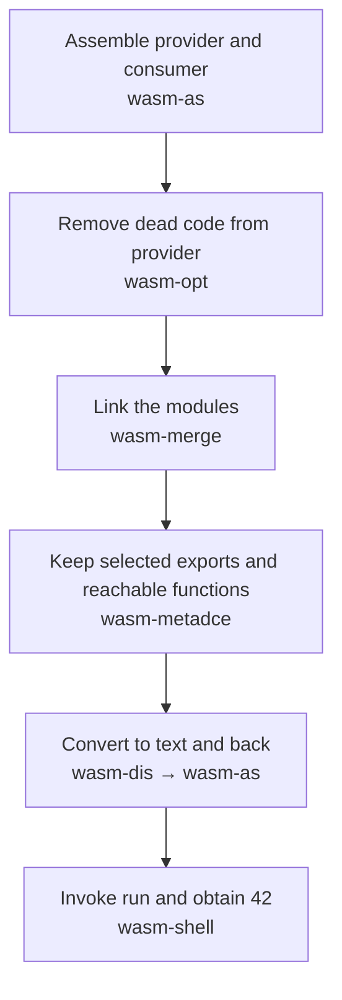
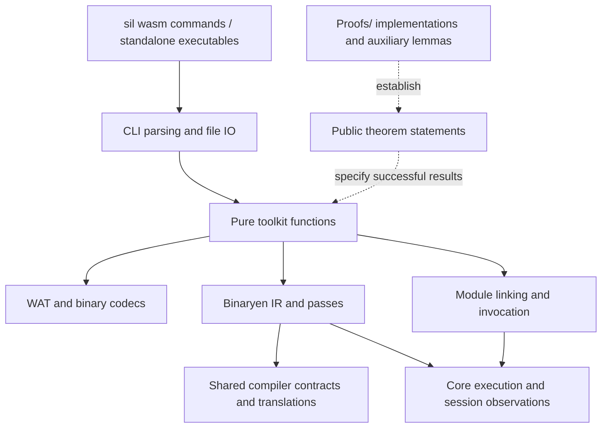

# WebAssembly (Wasm) toolkit

Seven tools written in Lean 4, a proof assistant, follow Binaryen version_133
command conventions. Each ships with executable code, formal contracts and
correctness theorems for supported operations.

## Build and check

Requirements:

- [elan](https://github.com/leanprover/elan), which installs the pinned Lean version;
- Git, GNU Make and a native C toolchain;
- Python 3.11+ and Node.js 24+.

From the repository root:

```sh
make cache
make check
```

This compiles the complete included library, tools and theorem modules, then
runs native checks, including independent execution in Node. It also builds
`wasm-shell-lean`, a positional test helper. Public dependencies are pinned;
no vendored source or paper downloads are needed.

`make tools` builds and stages the seven commands and the `sil` dispatcher under
`build/bin/`. Add that directory to `PATH`, or use `build/bin/sil wasm opt --help`.

## Try the example

```sh
python3 tools/binaryen-lean/test-release-demo.py
```

The test checks this pipeline and a second example that serializes a constructor's
global assignment and returns `9`:



<details>
<summary>Run each step and inspect the files</summary>

```sh
wasm_bin=build/bin
wasm_examples=tools/binaryen-lean/examples/release
wasm_demo=/tmp/wasm-demo
mkdir -p "$wasm_demo"

"$wasm_bin/wasm-as" "$wasm_examples/provider.wat" -o "$wasm_demo/provider.wasm"
"$wasm_bin/wasm-as" "$wasm_examples/consumer.wat" -o "$wasm_demo/consumer.wasm"
"$wasm_bin/wasm-opt" "$wasm_demo/provider.wasm" --dce -o "$wasm_demo/optimized.wasm"
"$wasm_bin/wasm-merge" "$wasm_demo/optimized.wasm" Provider "$wasm_demo/consumer.wasm" Consumer -o "$wasm_demo/linked.wasm"
"$wasm_bin/wasm-metadce" "$wasm_demo/linked.wasm" --graph-file "$wasm_examples/roots.json" -o "$wasm_demo/public.wasm"
"$wasm_bin/wasm-dis" "$wasm_demo/public.wasm" -o "$wasm_demo/public.wat"
"$wasm_bin/wasm-as" "$wasm_demo/public.wat" -o "$wasm_demo/rebuilt.wasm"
"$wasm_bin/wasm-shell" "$wasm_demo/rebuilt.wasm" --fuel 100 --invoke run
cat "$wasm_demo/public.wat"
```

The invocation prints `return [i32:42]`. The final module exports only `run`.
Merge arguments use Binaryen's `FILE NAME` order. The [graph file](../../tools/binaryen-lean/examples/release/roots.json)
marks `run` as an entry point, retaining it and the functions it needs.

</details>

To explore optimizer options:

```sh
build/bin/wasm-opt --print-passes
build/bin/wasm-opt --print-presets
build/bin/wasm-opt -O2 --print-pipeline
```

A **preset**, such as `-O2`, selects a list of passes (program transformations).
These commands list implemented transformations and missing upstream schedule entries.
Unsupported inputs and options produce errors.

## Tools and current scope

Each tool links to its main theorem module. The
[contract inventory](../../tools/binaryen-lean/release-manifest.json) lists the exact
functions, theorems, assumptions and restrictions.

| Tool | Supported operation | Main boundary |
| --- | --- | --- |
| [wasm-as](../../Silmaril/Wasm/Binaryen/Toolkit/AsBinaryenSound.lean) | Convert supported original WAT and documented Binaryen macros into a valid module with the same meaning. | Source and proposal coverage is incomplete. |
| [wasm-dis](../../Silmaril/Wasm/Binaryen/Toolkit/DisassembleLegacySound.lean) | Convert supported binaries into text denoting the same decoded module. | Does not validate input. Extension syntax proofs do not prove extension execution. Complete disassemble–assemble acceptance is unfinished. |
| [wasm-opt](../../Silmaril/Wasm/Binaryen/Exe/SelectedCleanupSound.lean) | Select and compose proven transformations, including restricted inlining and dead-code elimination. | Full upstream algorithms, presets and input coverage remain incomplete. |
| [wasm-merge](../../Silmaril/Wasm/Binaryen/Toolkit/PolicyMergeSound.lean) | Checked in-order function linking, export-name policies and supported silent starts; output behavior is included in source behavior. | General linking of stateful modules, cycles and metadata flags remains incomplete. |
| [wasm-shell](../../Silmaril/Wasm/Binaryen/Toolkit/ShellSpecSound.lean) | Initialize a binary module and invoke an export with a step budget. Successful results correspond to Core execution. | No imported hosts or upstream text test-script interface. Exhausting the budget is inconclusive. |
| [wasm-ctor-eval](../../Silmaril/Wasm/Binaryen/Toolkit/CtorEvalFallbackSound.lean) | Serialize one i32/i64 constant assignment in the recognized module shape. | Other decoded valid shapes retain the original bytes. |
| [wasm-metadce](../../Silmaril/Wasm/Binaryen/Toolkit/MetaDCEFallbackSound.lean) | Keep graph-selected exports and remove unreachable functions. | Closed numeric function-only optimization fragment; other decoded valid shapes retain the original bytes. |

This release targets Core-module files. The table above describes input and
optimization coverage for each tool.

## What the proofs mean

- Theorems cover successful **pure functions**: functions from inputs to results,
  without file input/output. Command-line parsing, file input/output and Lean's native compiler/runtime are
  outside those semantic theorems.
- Optimizer observations include initialization and **sessions**: sequences of
  exported-function calls that retain state between calls. Arbitrary external
  reads or writes of exported state need a separate contract.
- The execution contracts use a **closed host**, an environment with no host-function
  execution. Each API separately specifies its import-matching requirements.
- A **profile** describes implementation choices: floating-point NaN ("not a number")
  results, relaxed SIMD (vector operations with several permitted results), and
  whether memory or table growth can fail. It can allow several outcomes.

The optimizer defaults to **equivalence**: the same modeled initialization
circumstances and observable outcomes for the same call sequences, at the same
profile. Its explicit **refinement** mode restricts output outcomes to those allowed
by the input and preserves the existence of an outcome. **Trap insertion** permits
documented extra execution traps after matching earlier returned values; later calls
after that trap need not match. These policies have separate, restricted rewrites.
The merger proves behavior inclusion; outcome existence requires a separate
argument.

Terms used above:

- **WAT:** WebAssembly's readable module text.
- **Core module:** a unit of WebAssembly code. Imports request external definitions; exports make definitions available by name.
- **DCE:** dead-code elimination, which removes code that cannot affect the selected observations.
- **Silent start:** an initialization function checked to finish normally without changing persistent state.
- **Constructor:** initialization code; the evaluator supports its documented scalar assignment.
- **Trap:** a WebAssembly execution error, such as an out-of-bounds memory access.
- **Macro:** source shorthand expanded into supported Core syntax before validation.
- **Proof root:** a Lean module selected to build a tool's correctness theorems and their dependencies.

## Library entry points

[WAT quotations](wasm-wat.md) let Lean programs embed module text with `wat1!`,
`watLime!` and `wat3!`, plus instruction-list forms.

See the [versioned semantics guide](wasm-semantics.md) and the shared
[compiler API guide](compilers.md) for definitions and proof organization.



The solid arrows show calls or model dependencies. The dashed arrows show proof
relationships. File IO and argument parsing are outside the pure semantic contracts.

- [Contract inventory](../../tools/binaryen-lean/release-manifest.json): runtime and proof roots, theorem names and assumptions.
- [Compiler API](../../Silmaril/Compile/Category/Compiler.lean) and [pass API](../../Silmaril/Wasm/Binaryen/PassAPI/ModeCategory.lean): proven translations compose. An **IR** is an internal program representation; a **pass** transforms programs. A pass back into the same language model is an **endomorphism**, which need not be reversible.
- [Dependency pins](../../lake-manifest.json).
- [Optional source inventory](../../scripts/source-manifest.py): run
  `python3 scripts/source-manifest.py` to write an ignored local
  `SOURCE-MANIFEST.json` with SHA-256 hashes and sizes of tracked working-tree files.

## Compare with Binaryen

The [benchmark guide](wasm-benchmarks.md) describes paired measurements and their limits.

With Binaryen version_133 installed separately:

```sh
python3 tools/binaryen-lean/check-release.py --reference-bin-dir /path/to/binaryen/bin --report /tmp/wasm-reference-checks.json
```

These optional checks run the bundled codec and linking regressions with
upstream syntax validation. The benchmark guide covers upstream fixture sampling.

## License and references

- Original contributions use [MIT](../../LICENSE).
- Binaryen-derived material retains applicable Apache-2.0 terms; specification-derived
  material retains applicable W3C terms. Exact notices are under [NOTICES](../../NOTICES).
- [references.bib](../../references.bib) records citations, DOIs and artifact hashes in the custom `sha256` field.
