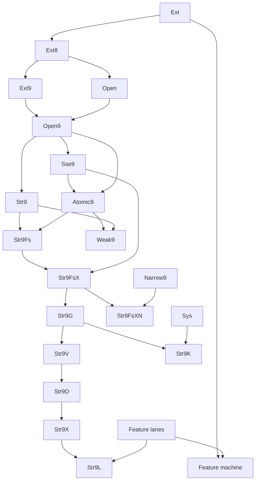
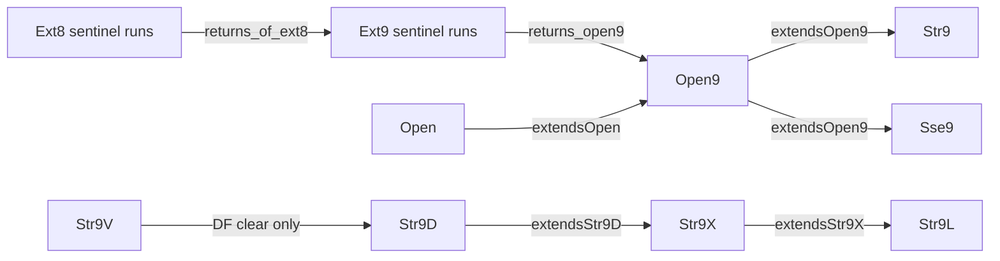

# Choosing an x86 model

Silmaril has several **partial x86-64 user-mode models**, not one model at
different optimization levels. Start with the property you want to state.
For a plain integer function contract use [`Open9.isa`](../../Silmaril/X86/Open9/Defs.lean);
for a process contract use the CLI or LPS profile that actually runs the binary;
for allowed architectural effects independently of a specific executor use
[`Loose`/`Exact`](../../Silmaril/X86/Exact/Thms.lean). None of the handwritten
semantics is proved equivalent to hardware. The
[proof engineering guide](../x86.md) has the function proof recipes.

## Names and what they select

The names identify local model families, not Intel generations, ISA versions,
privilege levels, or psABI feature levels. **Undocumented provenance** means
the linked code says what the layer adds but does not explain the suffix.
The table gives operational meanings, not guesses about the authors’ naming.

| Name and code | Meaning and applicability |
| --- | --- |
| [`X86.State`](../../Silmaril/X86/Basic.lean), [`X86.step`](../../Silmaril/X86/Semantics.lean), [`MState.step`](../../Silmaril/X86/Machine.lean) | Core registers, RIP, status flags and FS base; a small decoded register language, then a byte/memory runner. Useful as a narrow reference, not the full `Ext` integer profile. |
| [`Ext`](../../Silmaril/X86/Ext/Semantics.lean), [`Ext.step`](../../Silmaril/X86/Ext/Machine.lean) | “Extended” integer model: `mov`, ALU, branches, stack, calls, division and more. Decode/fetch and execution are separate. The byte-runner takes a sentinel return address; `Ext.exec` is already decoded and takes a length. Checked projections: [`Ext/Lemmas`](../../Silmaril/X86/Ext/Lemmas.lean). |
| [`Ext.Wire`](../../Silmaril/X86/Ext/Wire/Machine.lean) | Byte-faithful integer path: checks the consumed execute span, can retain encodings the canonical path does not expose, and keeps data/divide/flag/trap outcomes separate. An alternative input for [LPS](../../Silmaril/Process/LPS/Machines/X86Wire.lean), not a synonym for `Ext8`. |
| [`Ext8`](../../Silmaril/X86/Ext8/Basic.lean) | Documented as the **8-bit** variant: more byte-width ALU, move, shifts and extension forms, including the legacy high-byte registers where encodable. Same core/state and sentinel conventions. [`Lemmas`](../../Silmaril/X86/Ext8/Lemmas.lean). |
| [`Ext9`](../../Silmaril/X86/Ext9/Defs.lean) | Integer forms compiled code needs past `Ext8`: selected 16-bit operations, `adc`/`sbb`, additional `imul`, bit scan, indirect transfers, `push imm`, etc. `9` has undocumented provenance; it is **not** an operand width or hardware generation. [`Thms`](../../Silmaril/X86/Ext9/Thms.lean) covers the existing `Ext8` behavior. |
| [`Open`](../../Silmaril/X86/Open/Defs.lean), [`Open9`](../../Silmaril/X86/Open9/Defs.lean) | Open versions over the `Ext8` and `Ext9` families respectively. `ret` pops and jumps, rather than treating a sentinel as a stop. Both expose `SegVC.Isa`; [`Open9.Thms`](../../Silmaril/X86/Open9/Thms.lean) has the open-machine lift. |
| [`Str9`](../../Silmaril/X86/Str9/Defs.lean) | String forms on `Open9`: `movsb`, `rep movsq`, `rep stosq`, one element per step, DF assumed clear. [`Str9.Thms`](../../Silmaril/X86/Str9/Thms.lean) has extension and run lemmas; [`Flow/Str9`](../../Silmaril/X86/Flow/Str9/Defs.lean) exposes control-flow facts. |
| [`Sse9`](../../Silmaril/X86/Sse9/Defs.lean) | Sibling of `Str9`: selected legacy SSE moves, logical and unpack forms plus 16 XMM registers, not MXCSR or YMM/ZMM upper lanes. [`Sse9.Thms`](../../Silmaril/X86/Sse9/Thms.lean) frames XMM for `Open9` steps. [`x86-difftest`](../../tools/x86-difftest/README.md) exercises some of this lane via `Str9G`; this is not full SSE validation. |
| [`Atomic9`](../../Silmaril/X86/Atomic9/Defs.lean), [`Weak9`](../../Silmaril/X86/Weak9/Defs.lean) | Selected locked RMW, exchange, fences and `pause`, then non-temporal and string stores. Sequential execution with ordering metadata; the actual memory-order model is separate. An import of `Sse9` helpers does not make `Atomic9` execute SSE. [`Litmus/Test`](../../Silmaril/X86/Litmus/Test/Defs.lean) and [`MemoryModel/Xl`](../../Silmaril/X86/MemoryModel/Xl/Thms.lean) distinguish instruction evidence from ordering evidence. |
| [`Str9Fs`](../../Silmaril/X86/Str9Fs/Defs.lean) | `Fs` selects certain FS-relative addressing used by TLS; also calls into the `Atomic9` semantics. Not a generic segmentation or thread scheduler model. [`Thms`](../../Silmaril/X86/Str9Fs/Thms.lean). |
| [`Str9FsX`](../../Silmaril/X86/Str9FsX/Defs.lean), [`Str9FsXN`](../../Silmaril/X86/Str9FsXN/Defs.lean) | The first combines `Str9Fs`, XMM/Sse9 behavior and `rep stosd`; the second adds [`Narrow9`](../../Silmaril/X86/Narrow9/Defs.lean) byte/word shift, rotate and carry forms, e.g. zlib instructions. `X` and `XN` have undocumented name provenance. This narrow branch is **not** automatically folded into `Str9G`. [`Vectors`](../../Silmaril/X86/Str9FsXN/Vectors.lean). |
| [`Str9G`](../../Silmaril/X86/Str9G/Defs.lean) | Builds on `Str9FsX` with more SSE2 integer forms, some addressing forms, a time-stamp oracle and explicit CET/shadow-stack assumptions. `G`: undocumented provenance. Model used by the [host and glibc `strlen` differential tests](../../tools/x86-difftest/README.md). |
| [`Str9V`](../../Silmaril/X86/Str9V/Defs.lean) | `Str9G` with YMM upper halves, selected VEX AVX/AVX2/BMI forms and copy/store hints, still DF clear. `V`: undocumented name provenance; the added VEX forms are documented. Not the feature-parametric `Avx` lane. [`Thms`](../../Silmaril/X86/Str9V/Thms.lean). |
| [`Str9D`](../../Silmaril/X86/Str9D/Defs.lean) | `Str9V` with explicit DF, `std`/`cld` and backward string operations. `D`: documented behavior, name provenance undocumented. Lifts from `Str9V` only starting with DF clear; see [`run_of_str9v`](../../Silmaril/X86/Str9D/Thms.lean) and [`Vectors`](../../Silmaril/X86/Str9D/Vectors.lean). |
| [`Str9X`](../../Silmaril/X86/Str9X/Defs.lean) | `Str9D` with an x87 lane and x87 state; the adapter does not check the lane’s x87/SSE3 `requires`. `X`: undocumented provenance, different state from `Str9FsX`. [`Vectors`](../../Silmaril/X86/Str9X/Vectors.lean). |
| [`Str9L`](../../Silmaril/X86/Str9L/Defs.lean) | `Str9X` plus MXCSR and ordered feature **lanes**, tried after lower decoders decline. `L`: undocumented name provenance. `step F exts` uses effective features for lane instructions; `stepOf p` adds profile-based CPUID/XGETBV. Does not globally re-guard earlier forms; its `view`/`back` does not carry all AVX-512 state. [`Checks`](../../Silmaril/X86/Str9L/Checks.lean), [`Vectors`](../../Silmaril/X86/Str9L/Vectors.lean). |
| [`Sys`](../../Silmaril/X86/Sys/Defs.lean), [`Str9K`](../../Silmaril/X86/Str9K/Defs.lean) | `Sys.isa I` adds selected Linux syscall semantics and an answer stream to an open machine. `Str9K` fills `I` with `Str9G.isa`; `K` has undocumented name provenance. Neither is the LPS syscall table nor a full OS. [`Str9K.Thms`](../../Silmaril/X86/Str9K/Thms.lean). |

## Code dependencies versus checked transfers

These are **selected code dependencies**: arrows point from a provider to a
consumer of definitions, and imply no agreement or refinement.



**Text fallback.** `Ext` feeds `Ext8`; `Ext8` feeds `Ext9` and `Open`,
both used by `Open9`. `Open9` feeds three branches: `Str9`, `Sse9` and
`Atomic9` (which also uses `Sse9` helpers). `Str9` and `Atomic9` feed `Str9Fs`
and `Weak9`. `Str9FsX` combines `Str9Fs` and `Sse9`; from it, `Str9FsXN`
uses `Narrow9`, while `Str9G` leads to `Str9V`, `Str9D`, `Str9X` and `Str9L`.
`Str9K` uses `Sys` and `Str9G`. Feature lanes are inputs to both the feature
machine and `Str9L`, but their lower decoders differ.

**Proof relationships** have their own direction and conditions:



**Text fallback and additional checks.** Each line states the direction and
condition; the arrows are not general equivalences.

| Checked arrow | What actually transfers |
| --- | --- |
| `Ext8` → `Ext9`; sentinel → open | [`Ext9.returns_of_ext8`](../../Silmaril/X86/Ext9/Thms.lean) preserves selected sentinel runs; [`Open9.returns_open9`](../../Silmaril/X86/Open9/Thms.lean) changes the treatment of the final `ret` with a stated theorem. |
| `Open` → `Open9` → `Str9` or `Sse9` | [`Isa.Extends`](../x86.md#moving-proofs-up-isaextends) is a checked lens plus older-step preservation, with run/contract lifts. It is not the claim that every observation of the larger model is allowed by the smaller one. |
| `Str9FsX` → `Str9G` → `Str9V`; `Str9V` → `Str9D` → `Str9X` → `Str9L` | The first edges carry the documented extension lenses. The `Str9V` to `Str9D` edge is only a DF-clear step/run theorem, not unconditional `Isa.Extends`. [`Str9L.run_of_str9v`](../../Silmaril/X86/Str9L/Thms.lean) composes the conditional chain. |
| `Model.ext` → feature configuration | [`Model.Hom`](../../Silmaril/X86/Model/Basic.lean) transports **settled** steps through a state map under the modeled effective-feature assumptions; its observation model collapses unsettled outcomes. Not a fault-classification comparison with the sentinel/open tower. |
| Loose integer/string law → exact instances | [`sv1_le_exact` and the instance facts](../../Silmaril/X86/Exact/Thms.lean) give a checked abstract/concrete bridge on a named projection. The [`listing checker`](../../Silmaril/X86/Loose/Listing/Thms.lean) also accepts some SIMD forms; listing recognition is not a proof of vector-state effects in `Sv1`. |

### What a comparison buys

| Claim | What it does and does not establish |
| --- | --- |
| API compatibility | The existing entry point and types still work for their callers. A shim alone proves no equality of outcomes. |
| Outcome equality | On the stated input domain, both paths have the same outcomes under a named projection. Say which successors, stops, faults, and events are compared; equality after dropping an event cannot recover that event. The [typed process pilot](typed-syscall.md) gives equality of step judgments for a constructed kernel pullback, not for arbitrary kernels. |
| Agreement on a fragment | The models agree only after discharging stated preconditions, e.g. DF clear or successful reads of owned spans. A successful-execution theorem can exclude faults as well as UB; it says nothing about outcomes off that fragment. |
| Directed soundness | To transfer a universal contract from a small model to a named reference, each in-scope reference observation must be allowed by the small contract. Preserving an older step in a richer ISA is useful but does not alone give this direction of coverage. |

Equality composes when the intermediate projections agree. For scoped
agreement, also show that the intermediate inputs and successors satisfy the
next edge's preconditions. [`Str9L.run_of_str9v`](../../Silmaril/X86/Str9L/Thms.lean)
is a checked example: the run lifts through the extension chain using the
DF-clear condition, not an equality of the entire tower. Directed coverage
composes by transitivity of observation inclusion with compatible projections
and related successors. Prove progress separately: neither an empty behavior
set nor a no-UB claim alone guarantees a successful step.

## State and outcome choices that affect proofs

- **Use the result type that retains the distinction you need.** [`Ext.Outcome`](../../Silmaril/X86/Ext/Machine.lean)
  distinguishes successful retirement, sentinel return, trap/division/data/fetch
  faults, undefined conditional flags, and undecodable bytes. `stepOpt`, open
  models and much of the `Str9` tower return `none` when no successor is provided;
  do not infer a particular fault from it. `undefinedCondition` is not a
  prediction of the actual register/PC result, and unsupported bytes are not a
  proof of hardware `#UD`.
- **Separate feature profile from decoder coverage.** [`Features.Machine`](../../Silmaril/X86/Features/Machine.lean)
  is `Ext`-first, then ordered lanes over full [`Features.State`](../../Silmaril/X86/Features/State.lean).
  It distinguishes a disabled instruction (`featureUD`), feature-dependent aliases
  (`featureAlias`, for LZCNT/TZCNT), and unmodeled/undecodable outcomes. Choose it
  for explicit feature experiments; use [`Features.Cpuid.Checks`](../../Silmaril/X86/Features/Cpuid/Checks.lean)
  for observed-vs-effective feature examples. CPUID advertisement, OSXSAVE/XCR0,
  and the lane/state actually being modeled are separate. `v1`–`v4` in
  [`Model/Profile`](../../Silmaril/X86/Model/Profile.lean) are psABI levels, not the
  `8`/`9` suffixes. [`Float`](../../Silmaril/X86/Float/Machine.lean) is its own
  scalar subset; `Features.Ext` includes separate SSE2/SSE4, packed, integer,
  AVX and x87 lanes. Neither a profile nor a listed lane implies all matching
  opcode forms are covered.
- **Choose the process and image separately.** [`CLI.X86Linux`](../../Silmaril/Process/CLI/X86Linux.lean)
  (and [`X86Linux8`](../../Silmaril/Process/CLI/X86Linux8.lean)) wraps user-mode
  stepping with a small read/write/exit ABI and pluggable environment. Use it
  for small CLI observations with [`Image.Loaded`](../../Silmaril/Process/CLI/Loaded/Thms.lean).
  [`Process.X86.Thms`](../../Silmaril/Process/X86/Thms.lean) is the LPS release
  entry point for Linux syscalls, ELF launch, musl, and
  [the pinned probes](x86.md). Its [`UserIsa`](../../Silmaril/Process/LPS/Isa.lean)
  has a native/legacy adapter choice, and the
  [feature](../../Silmaril/Process/LPS/Machines/X86Features.lean) and
  [flag-oracle](../../Silmaril/Process/LPS/Machines/X86FlagChoices.lean) paths
  are separate fillings. Lazy mappings need correctly reported access spans;
  an executor without them is not a substitute. For relocated images and
  imports use [`Elf.Link.Dyn.Loader`](../../Silmaril/Elf/Link/Dyn/Loader/Defs.lean)
  and [`ProcX`](../../Silmaril/Elf/Link/Dyn/ProcX/Defs.lean), not a static loader
  predicate. Threads/SC/TSO are explicit choices in
  [`Process.Mt`](../../Silmaril/Process/Mt/Defs.lean); sequential atomics are
  not a concurrency correctness proof.
- **Choose the right artifact boundary.** [`Bir9`](../../Silmaril/X86/Bir9/Defs.lean)
  is a lifted block summary; [`BlockCert9`](../../Silmaril/X86/BlockCert9/Thms.lean)
  checks certificates relative to concrete semantics. The
  [`Machine.X86.Lir`](../../Silmaril/Machine/X86/Lir/Defs.lean) compiler image
  is not a replacement for a byte decoder. Some `Silmaril.Machine.X86.*`
  modules, e.g. [`Open9`](../../Silmaril/Machine/X86/Open9/Defs.lean), coexist
  with **distinct namespaces** under `Silmaril.X86.*`; check the expected core,
  theorem and import before switching. For example, the
  [`Machine.Process.Lps9` agreement](../../Silmaril/Machine/Process/Lps9/Thms.lean)
  is for the parallel `Open9` path under its process assumptions, not an
  all-tower footprint proof. Do not assume variants with similar names are
  aliases. [`Sim.X86Real`](../../Silmaril/Sim/X86Real/Thms.lean) is a
  Wasm-facing simulation consumer, not another Linux runner.

## What to factor next

Keep decode, one-instruction effects, image access, process transitions, and
whole-region proof boundaries separate. For an opcode change, check a concrete
form, its feature/flag guards, read/write span and state frame before routing
another executor through it. Keep working concrete executors, entry points,
and fixtures runnable as named references and regressions. Add a factored
path alongside them: prove projected equality when it holds, or state a
directed theorem with the precise domain and observation relation. Reusing
an implementation helper need not remove the concrete path or its tests.

For process/image work, first opt in one CLI loaded-image/ABI client and run
the same fixture through both paths. Check related successors and retained
observations, including stops. Then opt in one LPS profile only after checking
exact ordered access spans, lazy-map fault/retry behavior, and syscall/exit
events. Keep the old runners and fixtures callable for these comparisons;
a future default change is a separate review with downstream evidence. Keep
additional SSE, AVX or SHA forms independent of that default change. The
[typed process pilot](typed-syscall.md) exercises the request/response boundary
without assuming an x86 decoder or replacing CLI or LPS. Its
[container/stream bridge](typed-syscall.md#container-execution-and-event-streams)
uses the existing runtime and monitor for a typed read and exit. An x86
[`MemEvent`](../../Silmaril/X86/MemEvent/Defs.lean) footprint is a different
observation from a syscall or container event. A later scheduler adapter needs
a footprint and memory-order argument; a later decoder adapter needs its own
coverage and transport proof.

**Glossary.** *Sentinel return*: a chosen address whose pop ends the modeled
run. *Open step*: an ordinary instruction step, including a `ret` jump.
*DF*: direction flag for string accesses; *FS base*: address component used
e.g. for TLS. *XMM/YMM/ZMM*: overlapping vector views, not interchangeable state
records. *MXCSR*: SSE control/status; *x87*: separate floating-point state.
*Effective feature*: a modeled executable capability, not just a CPUID bit.
*Undecodable/unmodeled*: coverage boundary; *fault*: a modeled failure with
semantics; *UB*: a violated domain promise of a loose/ownership view. *Lens*:
a state projection and update used by a checked extension, not automatically
a correspondence between arbitrary backends.

## Reproduce focused checks

```sh
lake build --wfail Silmaril.X86.Open9.Thms Silmaril.X86.Exact.Thms \
  Silmaril.X86.Str9L.Checks Silmaril.X86.Features.Cpuid.Checks \
  Silmaril.Process.X86.Thms Silmaril.Process.CLI.Loaded.Thms
python3 -B tools/verification-projects/lps_probes.py check --offline
```

The longer [proof and regression command](../x86.md#build) covers more paths.
Native vectors and probes are evidence for those inputs, not semantic
correspondence or a certificate for other instructions.
