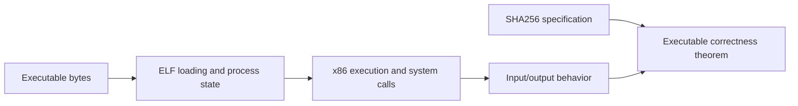

# x86 process verification roadmap

The x86 models and assembly proofs are planned public ports. The sequence starts
with machine foundations and small instruction examples, then SHA256 compression
and whole-utility verification.

The intended demonstration starts with executable bytes and proves an input/output
contract for a SHA256 utility. Its model must account for instruction execution,
ELF loading, process state, system calls and failures. Compression-function
correctness supplies one layer of that executable-level contract.

Each port should ship a small runnable example, a statement of permitted failures,
and a map from its public theorem to the instruction, loader and operating-system
assumptions. Shared codecs and compiler contracts belong in the root library;
future commands can appear under `sil x86` when implementations are included.
