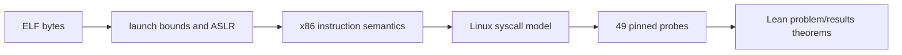

# x86-64 process verification

The release publishes the x86-64 process slice through
`Silmaril.Process.X86.Defs` and `Silmaril.Process.X86.Thms`. It combines the
instruction semantics, Linux syscall table, feature lattice, ELF launch
randomization, musl startup image, and the recorded probe corpus.

The executable-facing checks are the 49 pinned Linux probes in
`examples/verification-projects/theorem-dev/lps-probes`. Their assembly,
declarations, SHA-256 pins, generated Lean observations, and problem catalogue
are checked together:

```sh
python3 -B tools/verification-projects/lps_probes.py check --offline
python3 -B tools/verification-projects/x86_probe_problems.py check
```

The live replay workflow additionally runs the probes under the native guarded
backend. Container, bubblewrap, and qemu-user observations are retained in
the fixtures when available; the checker rejects disagreements between the
backends. The generated x86 problem roots are
`Silmaril.Process.LPS.Problems.X86Probes.Corpus` and `Results`.



The public `Thms` header is the stable import. The detailed LPS modules stay
in their pinned namespaces so generated observations and upstream citations
remain reproducible.
